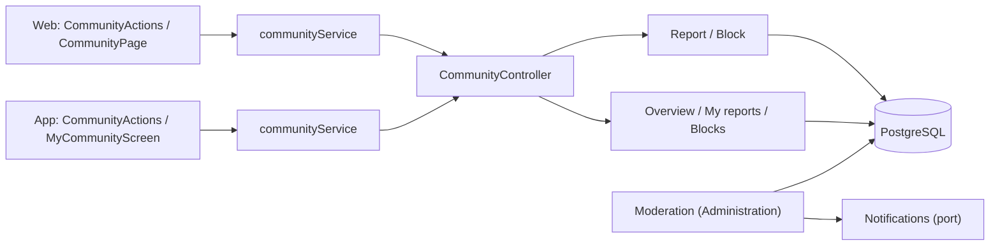
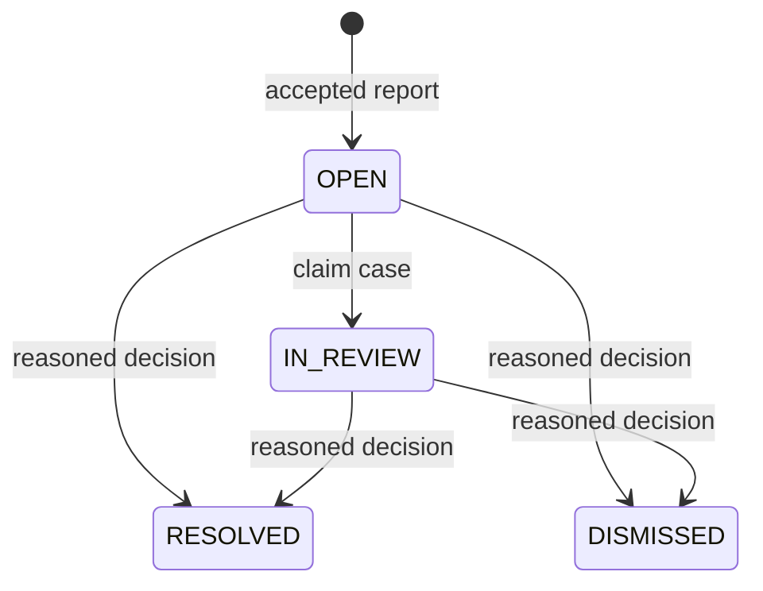
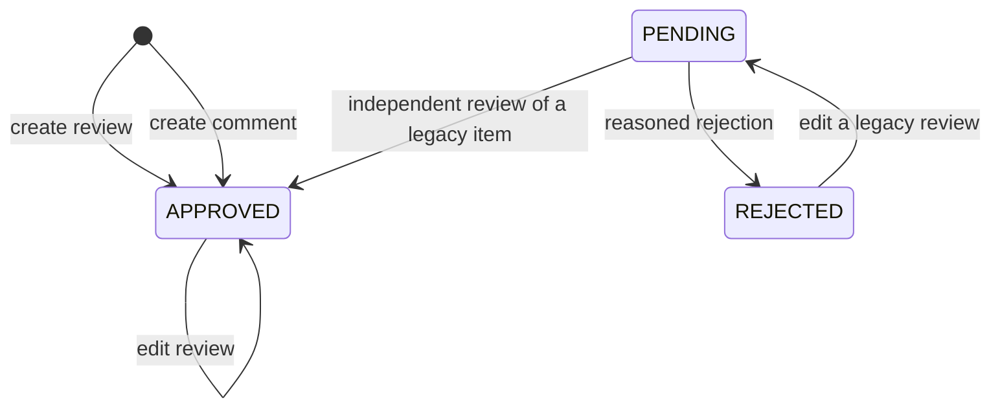

# Architecture

How the module is built in each layer. The backend follows the hexagonal flow
`controller → input port → handler → domain → output port → adapter`;
the web and the app follow `screen → hook → service → API client → HTTP transport`.
The backend section also describes the staff review of reports, operated from
[Administration](../admin/README.md).



[View the full “Architecture” diagram](https://images.vinnot.com/docs/diagrams/v1/en/modules-community-architecture-0ece53af5a9f.svg)

## Backend

### Contract and boundaries

`community` handles reports about `REVIEW`, `COMMENT`, `USER`, `EVENT` and
`WINE_ROUTE`. The server resolves the author and a bounded content snapshot;
clients submit only the target type, ID, reason and description. Reportable targets
are active users, approved reviews/comments on active wines, events that have been published,
and published routes. Drafts cannot be reported through this public flow.

Descriptions allow up to 2000 characters and are required for `OTHER`. Self-reports
are rejected. An existing open report by the same person for the same target returns
its original receipt, even after the content becomes unavailable. A per-reporter
lock serializes creation and enforces ten new cases per rolling 24 hours. The HTTP
filter adds its own `report` request limit (10 per hour), separate from support. Reports do not each send email.

### Ports, layers and transactions

| Layer | Responsibility |
|---|---|
| Domain | `CommunityReport`, reasons, transitions, conflicts of interest and required decisions |
| Application | Create/review/remove content, change blocks and query receipts/queues |
| Output ports | Report/block persistence, public target resolution and content removal |
| Adapters | JDBC, JPA visibility queries, bridge to review use cases and authenticated HTTP |
| Presentation | Contextual forms, block/removal confirmations and recoverable error state |

`ReportedContentRemovalAdapter` calls existing review/comment deletion use cases.
Deletion, review rating recalculation and case resolution share one transaction.
A failure rolls back resolution. Domain and application handlers do not import
HTTP clients or another module's persistence.

### API

Paths are relative to `/api`. Identities come from the JWT, never the request
body. Pagination returns `content`, `totalItems` and `totalPages`, capped at 50
items per page.

| Method and path | Access and result |
|---|---|
| `POST /community/reports` | Authenticated; private receipt without evidence or notes |
| `GET /community/reports/mine` | Only the caller's cases; ID, target, status and date |
| `GET /community/blocks` | Only blocks created by the caller |
| `PUT /community/blocks/{userId}` | Idempotent block; self-blocking prohibited |
| `DELETE /community/blocks/{userId}` | Idempotent unblock; unblocking yourself answers 422 |
| `GET /admin/community/reports?status=OPEN` | ADMIN/MODERATOR; queue with private evidence plus `authorUsername`, `reviewerUsername` and `targetLabel` |
| `PATCH /admin/community/reports/{id}` | ADMIN/MODERATOR; assignment or documented decision |
| `POST /admin/community/reports/{id}/remove-content` | ADMIN/MODERATOR plus `REVIEW_DELETE`; review/comment only; reason required |

Removal is explicit and cannot be undone through the UI. Resolving a case with
PATCH records a decision; it does not itself delete content or change an account.
Events, routes and accounts keep their existing administration flows and permissions.
The queue excludes cases whose reviewer is the reporter or author before pagination;
the command also checks this conflict. Moderators gain no account administration powers.

Each queue item keeps every report field and adds three nullable names so
moderators never read raw ids: `authorUsername`, `reviewerUsername` and
`targetLabel`, which is the wine name for a review or comment, the event title for
`EVENT`, the route name for `WINE_ROUTE` and the username for `USER`.
`GetCommunityQueryHandler` resolves them per page with one
`CommunityTargetPort.describe` call; `JdbcCommunityTargetAdapter` answers it with a
single SQL statement, and a deleted or missing user or content leaves its name
`null` instead of failing. `PATCH` and `remove-content` keep returning the plain
report.



[View the full “API” diagram](https://images.vinnot.com/docs/diagrams/v1/en/modules-community-architecture-03533c70e120.svg)

An assigned reviewer keeps ownership; another reviewer cannot change the case.
Final statuses cannot be reopened. `community_report_actions` records each
transition with reviewer, time and decision. Reporter receipts do not expose notes.

### Blocking effects

For authenticated accounts, a block in either direction hides reviews, comments
and profiles and prevents new likes/comments on the other person's reviews.
Read filters run before counts and pagination. Comment visibility also checks
the parent review's author. Removing an existing like or one's own content remains
allowed. Aggregate wine ratings and counts are not changed by a block. Community
notices skip blocked pairs too: no comment notice, and their likes are left
out of the likes summaries.

Events, routes and registrations retain their rules. Product reads require a
session; account blocking filters content within that authenticated access.
Moderation tools retain privileged access.

### Persistence and account deletion

V24 creates `community_reports`, `community_report_actions` and `user_blocks`,
with partial uniqueness for open reports, unique block pairs and queue/foreign-key
indexes. Targets use type+UUID without a content FK so the case survives target
deletion. Deleting an account removes its block pairs and nulls report/action
identity references. Case evidence is retained separately from public content;
profiles and user listings do not expose it.

### Review and comment publication

`Review.create` publishes the review as `APPROVED`:
new reviews are immediately visible to other accounts and update
public ratings/counts. New comments are stored as `APPROVED` too and
are visible at once; moderation is reactive, through reports, blocks and
removal. There is no automatic text detector. Previously pending/rejected rows
retain their status; no bulk approval runs. Editing an approved review keeps it
public; editing a pending or rejected one sends it back to `PENDING`. Authors may
read their pending/rejected content. Comment reads
require an approved or owned parent and an approved or owned comment. Blocking
and reported-content removal keep their rules. Catalogue submissions have a
separate workflow.



[View the full “Review and comment publication” diagram](https://images.vinnot.com/docs/diagrams/v1/en/modules-community-architecture-386e3cde04e0.svg)

`GET /admin/review-publications` returns a paginated queue of the reviews and
comments still pending from before instant publishing, excluding the
reviewer's own content before pagination. It requires ADMIN/MODERATOR and
`REVIEW_DELETE`, as does `POST /admin/review-publications/{type}/{id}`. Decisions
accept `status`, `reasonCode`, `reason` and `expectedRevision`: the queue's exact
`updatedAt`, kept as a string by both clients to preserve microseconds. A rejection
carries a preset `reasonCode` (`OFFENSIVE`, `SPAM`, `OFF_TOPIC`, `PERSONAL_DATA`,
`OTHER`; stored in `review_publication_decisions.reason_code`, V53) that the author is
told by email; `reason` is the moderator's note, emailed only when the moderator
explicitly chose `OTHER`. An approval carries no `reasonCode`. A client that sends
only a note (older version) still rejects, recorded as `OTHER`, but that note stays
internal and is never emailed (as with legacy ban notes); one with neither is refused; self-review, repeated decisions and changed content revisions are rejected
without publication. A comment can only be approved when its parent review is
approved. The role gains no account management permissions.

Each queue item keeps every publication field and adds `authorUsername` and
`wineName`. `GetReviewPublicationQueueQueryHandler` resolves them per page with one
`ReviewPublicationRepositoryPort.findNames` call, a single SQL statement in
`JdbcReviewPublicationAdapter`; a deleted or missing user or wine gives `null`.

`DecideReviewPublicationCommandHandler` locks the wine before locking the content,
following the same order as review editing and deletion. It validates
`ReviewPublication`, changes status, appends an audit decision and recalculates
approved ratings in one transaction. JDBC/JPA adapters implement the ports;
no external provider or AI moderation is added. Public reporting accepts only
approved reviews/comments. New likes and comments on pending/rejected reviews
are rejected.

V26 adds `publication_status`: existing records remain `APPROVED`; new records
default to `PENDING` in SQL, but the domain explicitly saves new
reviews and new comments as `APPROVED`. `review_publication_decisions` records target, reviewer,
decision, reason, content revision and time without duplicating full content.
Account deletion nulls the reviewer reference; this does not make textual reasons
anonymous. Restore/rollback must retain status filtering: rolling back to code
before V26 can expose pending content even though the migration is additive.

### Review and appeal operation

Reviewers inspect pending publications and open reports separately. They assess
objectionable content, spam, harassment, privacy, third-party rights and relevance
using the content policy; a negative rating alone does not justify removal.
They approve or reject publication and record the required reasons. A report can
be claimed, dismissed or resolved; explicit removal supports only reviews/comments.
There are no automatic penalties based on report counts and no AI decisions.

Repeated violations are assessed manually using retained cases. Account actions
use the existing ADMIN flow `POST /admin/users/{id}/ban`, with its reason and own
validation; MODERATOR gains no such permission. Appeals enter through Contact
with the case or content reference. Closed cases are not reopened by this API;
reviewing a decision does not restore deleted content or automatically publish a
rejected review. Editing a rejected review returns it to `PENDING`. Conflicts of interest require
another authorized reviewer.

### Retention and purge

`PurgeClosedReportsCommandHandler` fixes retention at 90 days from closure
(`updated_at` of the immutable final status). An in-process backend scheduler
invokes the use case hourly; V25 indexes closed cases by date. The adapter deletes
up to 500 expired cases per run, with their actions through FK cascade, and up to
500 publication decisions older than 90 days from the decision. `OPEN` and
`IN_REVIEW` are never purged based on age. `SKIP LOCKED` avoids duplicate work
across instances; a failed transaction rolls back.

The deadline makes a record eligible for the next run; backlog or downtime can
delay deletion. No additional cloud resources are created. Purging affects the
active database, not immediate removal from backups or conversations already
received by support. Purged case receipts also disappear from the user's query.

### Clients and verification

Web uses page/component → TanStack Query hook → service → HTTP client. Mobile
uses screen → hook → Redux Toolkit Query operations → service → HTTP client;
Expo Router files only compose screens. Services map dates; DTOs stay at the
infrastructure boundary.

Successful blocking discards cached social projections before refreshing them.
A failed block preserves the previous view. Invalidation does not trigger AI
comparisons or regeneration. A failed report retains its draft for retry.

HTTP tests with PostgreSQL cover permissions, conflicts of interest, privacy,
concurrent deduplication, quotas, filters before pagination, transactional removal
and account deletion. Client tests cover mapping, confirmation/cancellation,
failures and caches. Native component execution does not replace acceptance on
a device with a signed build.

### Activity overview and review actions

`GET /community/overview` returns the authenticated viewer's report counts by
status and blocked-user count. `GET /admin/community/reports/overview` requires
ADMIN/MODERATOR and applies the same conflict-of-interest exclusions as the
moderation queue: cases submitted by or about the reviewer are excluded. Neither
endpoint returns evidence, identities or case references. Aggregates cover all
pages; a pending total combines OPEN and IN_REVIEW, and a closed total combines
RESOLVED and DISMISSED. Counts reflect retained records, not an all-time history.

Web and mobile show the moderation summary and publication queue count on the
admin dashboard, and personal activity from the profile. Reports and blocks have
independent pagination. Loading and failures are explicit; failures do not appear
as zero pending cases. Mutations invalidate activity counts with the existing
community cache. There is no polling or additional cloud service.

Review editing is available to the author or ADMIN. MODERATOR can delete another
user's review under the existing server permissions, but cannot edit it. Clients
render edit and delete independently; server authorization remains authoritative.

## Web

```text
CommunityPage / CommunityActions → useCommunity → communityService → communityClient → http
```

Report and block actions appear next to the content; the person's own activity
is on the protected `/community` page, linked from the profile. The staff
screens are in [Administration](../admin/README.md).

| Piece | What it does |
|---|---|
| [`CommunityActions.tsx`](../../../../frontend-react/src/presentation/components/features/community/CommunityActions.tsx) | “Report”, “Report user” and “Block” with confirmation; preset reasons and a required description for “Other”; hidden from the author and the organizer. An error shows its cause through `communityErrorMessage`: daily limit (`REPORT_LIMIT`), too many submissions (429), own content or account (`SELF_REPORT`, `SELF_BLOCK`) or content that no longer exists (404) |
| Where it is used | Review cards, comments and event and route pages (blocking is not offered on events and routes) |
| [`CommunityActionsMenu.tsx`](../../../../frontend-react/src/presentation/components/features/community/CommunityActionsMenu.tsx) and [`CommunityReportForm.tsx`](../../../../frontend-react/src/presentation/components/features/community/CommunityReportForm.tsx) | On reviews and comments the actions sit in a three-dots menu at the top right (`variant="menu"`); the report form opens in a dialog and a toast confirms it. Events and routes keep the inline links |
| [`CommunityPage.tsx`](../../../../frontend-react/src/presentation/pages/community/CommunityPage.tsx) | Summary, own reports, blocked accounts with unblock and a link to Contact |
| [`CommunityOverview.tsx`](../../../../frontend-react/src/presentation/components/features/community/CommunityOverview.tsx) | Summary panels and the link to the activity from the profile |
| [`ModerationNames.tsx`](../../../../frontend-react/src/presentation/components/features/community/ModerationNames.tsx) | Moderation item names (author, subject, reviewer, wine) for both admin queues; hides a field whose name is null and never shows ids |
| [`useCommunity.ts`](../../../../frontend-react/src/presentation/hooks/queries/community/useCommunity.ts) | Queries and mutations; blocking reloads reviews and profiles |
| [`community.service.ts`](../../../../frontend-react/src/application/services/community.service.ts) and [`community.client.ts`](../../../../frontend-react/src/infrastructure/api/clients/community.client.ts) | Map the DTOs and call `/community` |

## App

The person's own activity is the `frontend-mobile/app/(app)/community.tsx`
screen, opened from the profile.

| Piece | What it does |
|---|---|
| [`CommunityActions.tsx`](../../../../frontend-mobile/src/presentation/features/community/CommunityActions.tsx) | Report and block with reasons as options and a system confirmation; used on reviews, comments, events and routes. `communityErrorKey` turns the error into the same set of causes as the web |
| [`CommunityActionsMenu.tsx`](../../../../frontend-mobile/src/presentation/features/community/CommunityActionsMenu.tsx) and [`CommunityReportForm.tsx`](../../../../frontend-mobile/src/presentation/features/community/CommunityReportForm.tsx) | On reviews and comments a three-dots button at the top right opens a bottom sheet with the actions and the report form; a toast confirms. Events and routes keep the inline links |
| [`CommunityScreens.tsx`](../../../../frontend-mobile/src/presentation/features/community/CommunityScreens.tsx) | Summary, own reports and blocked accounts with unblock |
| [`useCommunity.ts`](../../../../frontend-mobile/src/presentation/hooks/queries/community/useCommunity.ts) | Community queries and mutations |
| [`api.ts`](../../../../frontend-mobile/src/presentation/store/api.ts) | Blocking clears the stored reviews and comments from the cache |
| [`community.service.ts`](../../../../frontend-mobile/src/application/services/community.service.ts) and [`community.client.ts`](../../../../frontend-mobile/src/infrastructure/api/clients/community.client.ts) | Map the DTOs and call `/community` |
