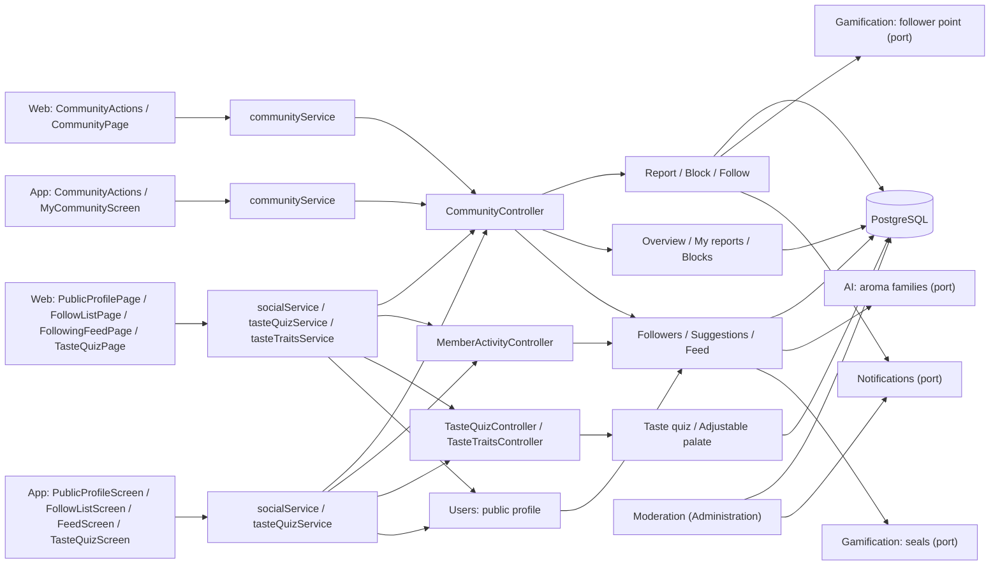
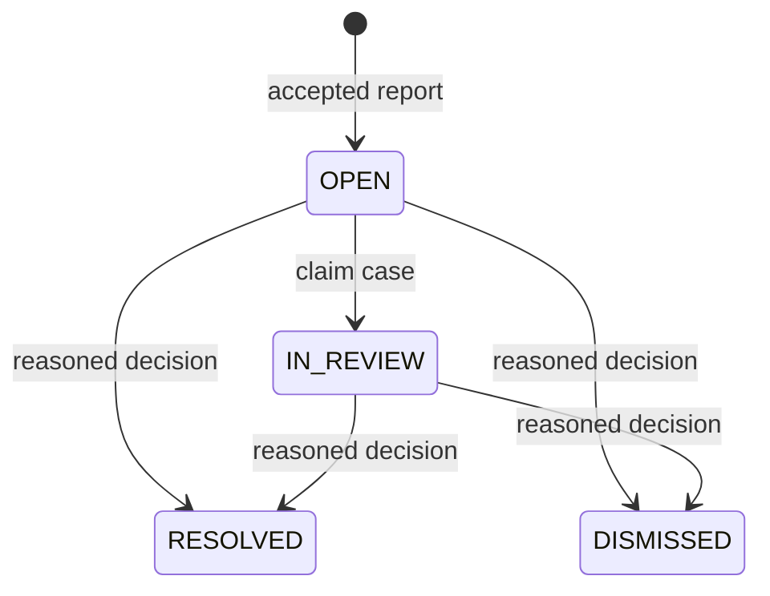
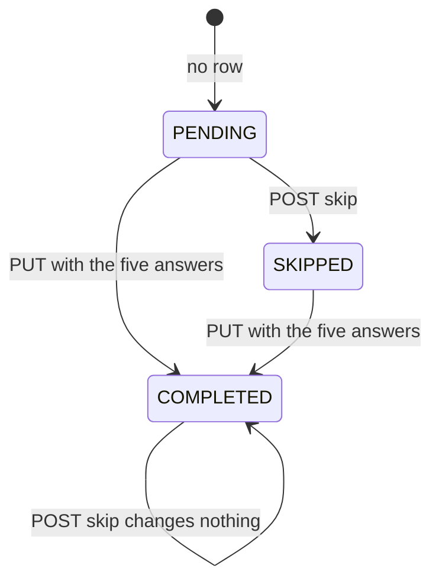
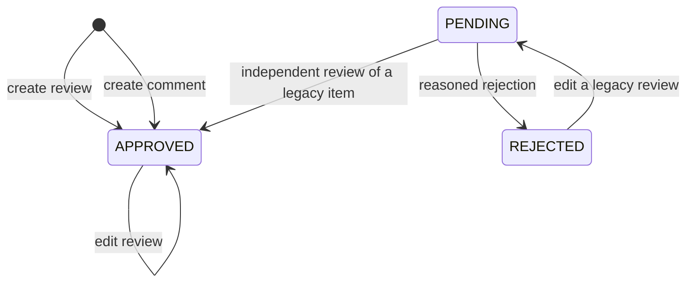

# Architecture

How the module is built in each layer. The backend follows the hexagonal flow
`controller → input port → handler → domain → output port → adapter`;
the web and the app follow `screen → hook → service → API client → HTTP transport`.
The backend section also describes the staff review of reports, operated from
[Administration](../admin/README.md).



[View the full “Architecture” diagram](https://images.vinnot.com/docs/diagrams/v1/en/modules-community-architecture-b45d923da0ae.svg)

## Backend

### Contract and boundaries

`community` handles reports about `REVIEW`, `COMMENT`, `USER`, `EVENT` and
`WINE_ROUTE`. The server resolves the author and a bounded content snapshot;
clients submit only the target type, ID, reason and description. Reportable targets
are active users, approved reviews/comments on active wines, events that have been published,
and published routes. Drafts cannot be reported through this public flow.

Descriptions allow up to 2000 characters and are required for `OTHER`. Self-reports
are rejected. An existing open report by the same person for the same target returns
its original receipt, even after the content becomes unavailable. A per-reporter
lock serializes creation and enforces ten new cases per rolling 24 hours. The HTTP
filter adds its own `report` request limit (10 per hour), separate from support. Reports do not each send email.

### Ports, layers and transactions

| Layer | Responsibility |
|---|---|
| Domain | `CommunityReport`, reasons, transitions, conflicts of interest and required decisions; `CellarVisibility`, `TasteProfile` and `PublicName` for the social profile |
| Application | Create/review/remove content, change blocks and follows, and query receipts/queues, follow lists, suggestions, the feed and public profiles |
| Output ports | Report/block/follow persistence, social reads, public target resolution, content removal, follower points, seals and the new-follower push |
| Adapters | JDBC, JPA visibility queries, bridge to review use cases and authenticated HTTP |
| Presentation | Contextual forms, block/removal confirmations and recoverable error state |

`ReportedContentRemovalAdapter` calls existing review/comment deletion use cases.
Deletion, review rating recalculation and case resolution share one transaction.
A failure rolls back resolution. Domain and application handlers do not import
HTTP clients or another module's persistence.

### API

Paths are relative to `/api`. Identities come from the JWT, never the request
body. Pagination returns `content`, `totalItems` and `totalPages`, capped at 50
items per page.

| Method and path | Access and result |
|---|---|
| `POST /community/reports` | Authenticated; private receipt without evidence or notes |
| `GET /community/reports/mine` | Only the caller's cases; ID, target, status and date |
| `GET /community/blocks` | Only blocks created by the caller |
| `PUT /community/blocks/{userId}` | Idempotent block; self-blocking prohibited |
| `DELETE /community/blocks/{userId}` | Idempotent unblock; unblocking yourself answers 422 |
| `PUT /community/follows/{userId}` | 204, idempotent; following yourself answers 400 `SELF_FOLLOW`; a missing, inactive or blocked member answers 404 |
| `DELETE /community/follows/{userId}` | 204, idempotent; 400 `SELF_FOLLOW` for yourself |
| `GET /community/users/{userId}/followers` and `/following` | `page`, `size` (at most 50); `FollowUserResponse` `{id, username, displayName, avatarUrl, tier, following}`, newest follow first, without members blocked either way with the viewer |
| `GET /community/suggestions?size` | `size` 1 to 20, default 10; list of `SuggestedUserResponse` `{id, username, displayName, avatarUrl, tier, affinityPercent, reviewsCount}` |
| `GET /community/feed` | `page`, `size` (at most 50); `UserReviewResponse` of the approved reviews of followed members, newest first |
| `GET /users/{userId}/reviews` | `page`, `size` (at most 50); the member's approved `UserReviewResponse`, newest first |
| `GET /users/{userId}/cellar` | `page`, `size` (at most 50); `PublicCellarWineResponse` `{id, wine, vintage, rating, addedAt}`, newest first; 403 `CELLAR_NOT_VISIBLE` when the owner's setting hides it |
| `GET /users/me/taste-quiz` | The caller's own taste quiz, wrapped as `{data, timestamp}`: `{status, answers, shouldPrompt}` (see [Taste quiz](#taste-quiz)) |
| `PUT /users/me/taste-quiz` | Body `{answers}` with an option for each of the five questions; 204, a retake overwrites; 400 `INVALID_TASTE_QUIZ` for a missing or unknown question or an unknown option |
| `POST /users/me/taste-quiz/skip` | 204; records `SKIPPED` only when the caller has no quiz yet, so a completed quiz is never erased |
| `PUT /users/me/taste-traits` | Body `{structure}`: a trait key to a whole score from 0 to 100, or to `null` to clear that trait; traits left out stay as they are; 204. 400 `INVALID_TASTE_ADJUSTMENT` for a missing or empty `structure`, an unknown trait or a score that is not a whole number from 0 to 100, and nothing is stored (see [Adjustable palate](#adjustable-palate)) |
| `DELETE /users/me/taste-traits` | 204, idempotent; clears every manual value of the caller |
| `GET /admin/community/reports?status=OPEN` | ADMIN/MODERATOR; queue with private evidence plus `authorUsername`, `reviewerUsername` and `targetLabel` |
| `PATCH /admin/community/reports/{id}` | ADMIN/MODERATOR; assignment or documented decision |
| `POST /admin/community/reports/{id}/remove-content` | ADMIN/MODERATOR plus `REVIEW_DELETE`; review/comment only; reason required |

Removal is explicit and cannot be undone through the UI. Resolving a case with
PATCH records a decision; it does not itself delete content or change an account.
Events, routes and accounts keep their existing administration flows and permissions.
The queue excludes cases whose reviewer is the reporter or author before pagination;
the command also checks this conflict. Moderators gain no account administration powers.

Each queue item keeps every report field and adds three nullable names so
moderators never read raw ids: `authorUsername`, `reviewerUsername` and
`targetLabel`, which is the wine name for a review or comment, the event title for
`EVENT`, the route name for `WINE_ROUTE` and the username for `USER`.
`GetCommunityQueryHandler` resolves them per page with one
`CommunityTargetPort.describe` call; `JdbcCommunityTargetAdapter` answers it with a
single SQL statement, and a deleted or missing user or content leaves its name
`null` instead of failing. `PATCH` and `remove-content` keep returning the plain
report.



[View the full “API” diagram](https://images.vinnot.com/docs/diagrams/v1/en/modules-community-architecture-03533c70e120.svg)

An assigned reviewer keeps ownership; another reviewer cannot change the case.
Final statuses cannot be reopened. `community_report_actions` records each
transition with reviewer, time and decision. Reporter receipts do not expose notes.

### Blocking effects

For authenticated accounts, a block in either direction hides reviews, comments
and profiles and prevents new likes/comments on the other person's reviews.
Read filters run before counts and pagination. Comment visibility also checks
the parent review's author. Removing an existing like or one's own content remains
allowed. Aggregate wine ratings and counts are not changed by a block. Community
notices skip blocked pairs too: no comment notice, and their likes are left
out of the likes summaries.

Events, routes and registrations retain their rules. Product reads require a
session; account blocking filters content within that authenticated access.
Moderation tools retain privileged access.

### Follows and the social profile

Follows (#541) are asymmetric and need no approval. `ChangeFollowCommandHandler`
refuses following oneself (`SELF_FOLLOW`, 400) and answers 404 for a missing or
inactive member or while either member blocks the other, exactly like the
profile. Both a follow and a block first take a transaction-scoped advisory lock
on the pair (`JdbcFollowAdapter.lockPair`), so a follow cannot survive a block
committed at the same time. A block deletes the follows in both directions in its
own transaction and takes back their follower points.

A new follow stores the row, awards the followed member one `FOLLOWER_GAINED`
point when the follower has a verified email and at least one approved review
(key: the follower id, limit 10 per day inside the global 40) and queues the
`NEW_FOLLOWER` push (key: follower, followed member and UTC day). Unfollowing
revokes the point. All of it joins the follow's transaction.

Every social read about a member answers 404 when the member is missing,
inactive or blocked either way with the viewer. `JdbcSocialQueryAdapter` reads
active members, approved reviews on active wines and cellar entries on active
wines; counts follow the same rules. `GetSocialQueryHandler` reads the seals of
a whole page in one call through `MemberBadgePort` (gamification standings).
`UserReviewResponse` is `{reviewId, rating, title, comment, vintage, createdAt,
reviewer {id, username, displayName, avatarUrl, tier}, wine {id, name, imageUrl,
type, wineryName}}`; `displayName` is the first and last name, or the username.

| Rule | Behaviour |
|---|---|
| Cellar | `PUBLIC` for every member, `FOLLOWERS` for followers, `PRIVATE` for nobody; the owner always sees it. The public listing never carries notes or purchase prices |
| Taste wheel | Up to eight `GRAPE`, eight `TYPE` and eight `REGION` slices (`{kind, value, label, score, tone, ratedWines}`), each kind best score first (ties: more rated wines, then label), computed on request from the member's own ratings by `TasteWheel`; `null` below five rated wines. Clients show one kind at a time |
| Rated wines | Sum of the member's `TYPE` rows in `user_taste_affinities`: each rated wine has exactly one type |
| Affinity | Cosine similarity of both score vectors over `(kind, value)`, rounded to 0–100; `null` for oneself or when either member rated fewer than five wines |
| Suggestions | Active members with at least five rated wines, not oneself, not followed and not blocked either way; ranked by affinity (when the viewer rated five wines) and then by approved reviews |
| Taste traits | The structure and aroma families of the wines the member liked (see below), filled by a completed taste quiz where that data is missing and overridden per trait by the member's manual values; `null` below five rated wines without a completed quiz or a manual value |

The taste wheel (#541 S15) has no table of its own. The five-wine gate
still reads `user_taste_affinities`, like the affinity. Once it passes,
`JdbcSocialQueryAdapter.ratedWines` reads every rated wine of the member with
the nightly job's sources and grape filter: non-rejected reviews and the cellar
ratings of wines without one, grapes non-blank and at most 120 characters. Each
row carries the wine's type, grapes and region. `grapeCatalog` reads
`grape_types`. The domain class `TasteWheel` aggregates them:

- `score` is the average rating (two decimals) and `ratedWines` the number of
  rated wines behind the slice; a grape listed twice on one wine counts once.
- `GRAPE` slices join spellings in any script, case or accent: `GrapeName`
  lower-cases, strips accents, romanises Greek after ELOT 743 and, to match,
  ignores doubled letters ("Agiorgitiko", "ΑΓΙΩΡΓΙΤΙΚΟ" and "Αγιωργίτικο" are one
  slice, and so are "Assyrtiko" and "ασύρτικο"). `label` is the most frequent
  Latin-script spelling, else the title-cased romanisation; `value` is the
  label's key. `tone` is the most frequent type among the grape's wines; a tie
  goes to the type matching the grape's `grape_types.category` (`RED` or
  `WHITE`), else to the first type code.
- `TYPE` slices use the trimmed upper-case type code as `value`, `label` and
  `tone`.
- `REGION` slices use the region id as `value` and its name as `label`, with
  `tone` `null`; the country is not shown.

Only these aggregates leave the handler, so a member with a `PRIVATE` cellar
still shows a wheel but never a wine. `user_taste_affinities` keeps its
`TYPE` and `GRAPE` rows as written, so suggestions, the affinity and the
recommendation sources that read it are unchanged.

Taste traits (`tasteTraits`) are computed on every request, with no table of their
own. `JdbcSocialQueryAdapter.likedWines` reads the same ratings as
`user_taste_affinities` (non-rejected reviews and the cellar ratings of wines
without the member's own review) rated at least 3.5, the 200 most recent. Each
wine brings the catalog's `acidity_score`, `body_score`, `tannin_score` and
`sweetness_score` and one of its AI profiles (any language): the numeric
`palateAnalysis` scores and the primary and secondary aromas and flavors. The
`TasteTraits` domain model weighs each wine by its rating:

| Trait | Rule |
|---|---|
| Structure | For `ACIDITY`, `BODY`, `TANNIN` and `SWEETNESS`, the weighted average (0–100) of the wines with data: the catalog score when present and between 0 and 100, otherwise the AI profile's `palateAnalysis` score. A trait with fewer than three wines with data is omitted; `wines` says how many wines it comes from |
| Families | For `FRUIT`, `FLORAL`, `HERBAL`, `SPICE`, `OAK` and `MINERAL`, the weighted share (0–100) of AI-profiled wines with at least one note of that family. Only AI-profiled wines count; below three of them the list is empty. A family at 0% is omitted and the rest go from most to least shared (ties: by key) |

`GetSocialQueryHandler` classifies the descriptors of each profiled wine through
`SensoryFamilyPort`, implemented by `AiSensoryFamilyAdapter` over the AI module's
`ClassifySensoryFamiliesUseCase` (see [AI](../ai/architecture.md)); the community
module receives family keys and uses no AI domain types.

### Taste quiz

The taste quiz (#541) is five illustrated questions a member answers at sign-up
or later from their profile, so their taste profile has a starting point before
they rate wines. Members see the options; how each option maps to taste traits is
internal and never sent to clients. `TasteQuizQuestion` and `TasteQuizAnswer` are
domain enums with the keys below; `TasteQuiz` validates a full set of answers and
computes the seed.

| Question | Options |
|---|---|
| `RAINY_DAY` | `DARK_CHOCOLATE_COFFEE`, `SPICED_TEA_APPLE_TART` |
| `FRUIT` | `CITRUS`, `RED_BERRIES`, `DARK_BERRIES`, `STONE_TROPICAL` |
| `DESSERT` | `LEMON_TART`, `CARAMEL_FLAN`, `BROWNIE`, `FRESH_FRUIT` |
| `DINNER` | `GRILLED_RED_MEAT`, `LEMON_FISH`, `MUSHROOM_PASTA`, `SPICY_CURRY` |
| `AROMA` | `VANILLA_TOAST`, `PEPPER_CINNAMON`, `ROSES_VIOLETS`, `CUT_GRASS` |

`GET /users/me/taste-quiz` returns `status` `PENDING` (no row), `COMPLETED` or
`SKIPPED`; `answers`, a question-to-option object in quiz order, only when
completed and only to its owner; and `shouldPrompt`, true while the quiz is
pending and the member rated fewer than five wines, counted like the profile
wheel (sum of the `TYPE` rows of `user_taste_affinities`). `PUT` validates the
answers in `TasteQuiz.of` before storing them as `COMPLETED`; `POST .../skip`
inserts `SKIPPED` with `ON CONFLICT DO NOTHING`. `GetTasteQuizQueryHandler`,
`CompleteTasteQuizCommandHandler` and `SkipTasteQuizCommandHandler` use
`TasteQuizRepositoryPort`, implemented by `JdbcTasteQuizAdapter` over
`user_taste_quiz`. `TasteQuizController` serves the paths under `/users/me`,
like the rest of the own account, and `CommunityExceptionHandler` answers
`INVALID_TASTE_QUIZ` with 400.



[View the full “Taste quiz” diagram](https://images.vinnot.com/docs/diagrams/v1/en/modules-community-architecture-6df6d7d7e3a9.svg)

The seed starts every structure trait at 50, adds the shifts of the answers and
clamps the result to 0–100; seeded traits report `wines: 0`. Families are
weighted mentions: each family an answer names adds 1, or 2 for the `AROMA`
answer; a family's percent is its weight over the total, rounded, a percent of
0 is omitted, and the rest go from most to least shared (ties: by key).

| Option | Structure shifts | Families |
|---|---|---|
| `DARK_CHOCOLATE_COFFEE` | tannin +20, body +15 | `OAK` |
| `SPICED_TEA_APPLE_TART` | acidity +15 | `SPICE`, `FRUIT` |
| `CITRUS` | acidity +20, body −10 | `FRUIT` |
| `RED_BERRIES` | body −5, tannin −5 | `FRUIT` |
| `DARK_BERRIES` | body +15, tannin +10 | `FRUIT` |
| `STONE_TROPICAL` | sweetness +10, acidity −5 | `FRUIT`, `FLORAL` |
| `LEMON_TART` | acidity +15 | — |
| `CARAMEL_FLAN` | sweetness +25 | `OAK` |
| `BROWNIE` | tannin +10, body +10 | `OAK` |
| `FRESH_FRUIT` | sweetness −15, acidity +5 | `FRUIT` |
| `GRILLED_RED_MEAT` | body +20, tannin +15 | `SPICE` |
| `LEMON_FISH` | acidity +10, body −15, tannin −15 | `MINERAL` |
| `MUSHROOM_PASTA` | body +5 | `MINERAL`, `HERBAL` |
| `SPICY_CURRY` | sweetness +10, tannin −10 | `SPICE` |
| `VANILLA_TOAST` | body +5 | `OAK` (weight 2) |
| `PEPPER_CINNAMON` | — | `SPICE` (weight 2) |
| `ROSES_VIOLETS` | — | `FLORAL` (weight 2) |
| `CUT_GRASS` | acidity +10 | `HERBAL` (weight 2) |

The profile blends the seed into `tasteTraits` with `TasteTraits.blend`; the
wheel and the affinity keep reading real ratings only.

| Case | `tasteTraits` |
|---|---|
| No completed quiz | The real traits, or `null` below five rated wines; `fromQuiz: false` |
| Completed quiz, below five rated wines | The seed; `fromQuiz: true` |
| Completed quiz, five or more rated wines | Each structure trait keeps its real score and takes the seed's when it has none; families keep the real list unless it is empty. `fromQuiz` is true when any value came from the seed |

The public profile carries the blended traits and never the answers.

The users module composes the public profile: `GetPublicUserProfileQueryHandler`
reads the account and asks `SocialProfilePort`, implemented by
`CommunitySocialProfileAdapter` over `GetSocialUseCase.profile`. See
[Users](../users/architecture.md).

### Adjustable palate

Members refine the structure bars of their own taste profile (#541): each manual
score replaces the computed or quiz value of its trait. `TasteAdjustment` is the
domain model of one change: it validates the whole `structure` object before
anything is stored, so a body with one invalid trait changes nothing.

| Value in `structure` | Effect |
|---|---|
| Whole number from 0 to 100 | Upserts the manual score of that trait |
| `null` | Deletes the manual score of that trait |
| Trait left out | No change |
| Missing or empty `structure`, unknown trait (keys are case sensitive), decimal, text, boolean or a number outside 0–100 | 400 `INVALID_TASTE_ADJUSTMENT` |

`AdjustTasteTraitsCommandHandler` and `ResetTasteTraitsCommandHandler` use
`TasteAdjustmentRepositoryPort`, implemented by `JdbcTasteAdjustmentAdapter` over
`user_taste_adjustments`. `TasteTraitsController` serves `PUT` and `DELETE
/users/me/taste-traits` next to the taste quiz, and `CommunityExceptionHandler`
answers `INVALID_TASTE_ADJUSTMENT` with 400.

`GetSocialQueryHandler` passes the manual scores to `TasteTraits.blend`, which
resolves each structure trait in this order:

| Source | Structure item |
|---|---|
| Manual value | The manual `score`, `adjusted: true`; `wines` keeps the real count, or 0 without real data |
| Real data | The computed `score` and `wines`, `adjusted: false` |
| Completed quiz | The seed `score`, `wines: 0`, `adjusted: false`; `fromQuiz` becomes true |

Items keep the order `ACIDITY`, `BODY`, `TANNIN`, `SWEETNESS`, and an adjusted
trait appears even when neither real data nor the quiz has it. `fromQuiz` is true
only when a shown value comes from the quiz, so a trait overridden manually no
longer counts. With manual values and neither real traits nor a completed quiz,
`tasteTraits` is `{structure, families: [], fromQuiz: false}` instead of `null`.
Families, the wheel and the affinity ignore manual values. Manual values are
public like the rest of `tasteTraits`: anyone who can see the profile sees them.

### Persistence and account deletion

V24 creates `community_reports`, `community_report_actions` and `user_blocks`,
with partial uniqueness for open reports, unique block pairs and queue/foreign-key
indexes. Targets use type+UUID without a content FK so the case survives target
deletion. Deleting an account removes its block pairs and nulls report/action
identity references. Case evidence is retained separately from public content;
profiles and user listings do not expose it.

V87 creates `user_follows`: a `(follower_id, followee_id)` pair as primary key,
both foreign keys to `users` with `ON DELETE CASCADE`, a CHECK that prevents
following oneself, `created_at` and an index on `(followee_id, created_at DESC)`
for the follower lists. It adds to `users` the `bio` (`varchar(160)`, optional)
and `cellar_visibility` (`PUBLIC`, `FOLLOWERS` or `PRIVATE` by CHECK, `PUBLIC` by
default). Deleting an account deletes its follows in both directions.

V88 creates `user_taste_quiz`: one row per member keyed by `user_id` (foreign key
to `users` with `ON DELETE CASCADE`), `status` `COMPLETED` or `SKIPPED`, `answers`
as a jsonb object present only when completed (enforced by a CHECK) and
`updated_at`. Deleting an account removes its quiz. The users module has no
personal-data export, so there is nothing else to extend.

V89 creates `user_taste_adjustments`: one row per member and trait, with primary
key `(user_id, trait)`, `user_id` a foreign key to `users` with `ON DELETE
CASCADE`, `trait` limited by a CHECK to `ACIDITY`, `BODY`, `TANNIN` and
`SWEETNESS`, `score` a smallint between 0 and 100 and `updated_at`. Deleting an
account removes its manual values.

### Review and comment publication

`Review.create` publishes the review as `APPROVED`:
new reviews are immediately visible to other accounts and update
public ratings/counts. New comments are stored as `APPROVED` too and
are visible at once; moderation is reactive, through reports, blocks and
removal. There is no automatic text detector. Previously pending/rejected rows
retain their status; no bulk approval runs. Editing an approved review keeps it
public; editing a pending or rejected one sends it back to `PENDING`. Authors may
read their pending/rejected content. Comment reads
require an approved or owned parent and an approved or owned comment. Blocking
and reported-content removal keep their rules. Catalogue submissions have a
separate workflow.



[View the full “Review and comment publication” diagram](https://images.vinnot.com/docs/diagrams/v1/en/modules-community-architecture-386e3cde04e0.svg)

`GET /admin/review-publications` returns a paginated queue of the reviews and
comments still pending from before instant publishing, excluding the
reviewer's own content before pagination. It requires ADMIN/MODERATOR and
`REVIEW_DELETE`, as does `POST /admin/review-publications/{type}/{id}`. Decisions
accept `status`, `reasonCode`, `reason` and `expectedRevision`: the queue's exact
`updatedAt`, kept as a string by both clients to preserve microseconds. A rejection
carries a preset `reasonCode` (`OFFENSIVE`, `SPAM`, `OFF_TOPIC`, `PERSONAL_DATA`,
`OTHER`; stored in `review_publication_decisions.reason_code`, V53) that the author is
told by email; `reason` is the moderator's note, emailed only when the moderator
explicitly chose `OTHER`. An approval carries no `reasonCode`. A client that sends
only a note (older version) still rejects, recorded as `OTHER`, but that note stays
internal and is never emailed (as with legacy ban notes); one with neither is refused; self-review, repeated decisions and changed content revisions are rejected
without publication. A comment can only be approved when its parent review is
approved. The role gains no account management permissions.

Each queue item keeps every publication field and adds `authorUsername` and
`wineName`. `GetReviewPublicationQueueQueryHandler` resolves them per page with one
`ReviewPublicationRepositoryPort.findNames` call, a single SQL statement in
`JdbcReviewPublicationAdapter`; a deleted or missing user or wine gives `null`.

`DecideReviewPublicationCommandHandler` locks the wine before locking the content,
following the same order as review editing and deletion. It validates
`ReviewPublication`, changes status, appends an audit decision and recalculates
approved ratings in one transaction. JDBC/JPA adapters implement the ports;
no external provider or AI moderation is added. Public reporting accepts only
approved reviews/comments. New likes and comments on pending/rejected reviews
are rejected.

V26 adds `publication_status`: existing records remain `APPROVED`; new records
default to `PENDING` in SQL, but the domain explicitly saves new
reviews and new comments as `APPROVED`. `review_publication_decisions` records target, reviewer,
decision, reason, content revision and time without duplicating full content.
Account deletion nulls the reviewer reference; this does not make textual reasons
anonymous. Restore/rollback must retain status filtering: rolling back to code
before V26 can expose pending content even though the migration is additive.

### Review and appeal operation

Reviewers inspect pending publications and open reports separately. They assess
objectionable content, spam, harassment, privacy, third-party rights and relevance
using the content policy; a negative rating alone does not justify removal.
They approve or reject publication and record the required reasons. A report can
be claimed, dismissed or resolved; explicit removal supports only reviews/comments.
There are no automatic penalties based on report counts and no AI decisions.

Repeated violations are assessed manually using retained cases. Account actions
use the existing ADMIN flow `POST /admin/users/{id}/ban`, with its reason and own
validation; MODERATOR gains no such permission. Appeals enter through Contact
with the case or content reference. Closed cases are not reopened by this API;
reviewing a decision does not restore deleted content or automatically publish a
rejected review. Editing a rejected review returns it to `PENDING`. Conflicts of interest require
another authorized reviewer.

### Retention and purge

`PurgeClosedReportsCommandHandler` fixes retention at 90 days from closure
(`updated_at` of the immutable final status). An in-process backend scheduler
invokes the use case hourly; V25 indexes closed cases by date. The adapter deletes
up to 500 expired cases per run, with their actions through FK cascade, and up to
500 publication decisions older than 90 days from the decision. `OPEN` and
`IN_REVIEW` are never purged based on age. `SKIP LOCKED` avoids duplicate work
across instances; a failed transaction rolls back.

The deadline makes a record eligible for the next run; backlog or downtime can
delay deletion. No additional cloud resources are created. Purging affects the
active database, not immediate removal from backups or conversations already
received by support. Purged case receipts also disappear from the user's query.

### Clients and verification

Web uses page/component → TanStack Query hook → service → HTTP client. Mobile
uses screen → hook → Redux Toolkit Query operations → service → HTTP client;
Expo Router files only compose screens. Services map dates; DTOs stay at the
infrastructure boundary.

Successful blocking discards cached social projections before refreshing them.
A failed block preserves the previous view. Invalidation does not trigger AI
comparisons or regeneration. A failed report retains its draft for retry.

HTTP tests with PostgreSQL cover permissions, conflicts of interest, privacy,
concurrent deduplication, quotas, filters before pagination, transactional removal
and account deletion. Client tests cover mapping, confirmation/cancellation,
failures and caches. Native component execution does not replace acceptance on
a device with a signed build.

### Activity overview and review actions

`GET /community/overview` returns the authenticated viewer's report counts by
status and blocked-user count. `GET /admin/community/reports/overview` requires
ADMIN/MODERATOR and applies the same conflict-of-interest exclusions as the
moderation queue: cases submitted by or about the reviewer are excluded. Neither
endpoint returns evidence, identities or case references. Aggregates cover all
pages; a pending total combines OPEN and IN_REVIEW, and a closed total combines
RESOLVED and DISMISSED. Counts reflect retained records, not an all-time history.

Web and mobile show the moderation summary and publication queue count on the
admin dashboard, and personal activity from the profile. Reports and blocks have
independent pagination. Loading and failures are explicit; failures do not appear
as zero pending cases. Mutations invalidate activity counts with the existing
community cache. There is no polling or additional cloud service.

Review editing is available to the author or ADMIN. MODERATOR can delete another
user's review under the existing server permissions, but cannot edit it. Clients
render edit and delete independently; server authorization remains authoritative.

## Web

```text
CommunityPage / CommunityActions → useCommunity → communityService → communityClient → http
```

Report and block actions appear next to the content; the person's own activity
is on the protected `/community` page, linked from the profile. The staff
screens are in [Administration](../admin/README.md).

| Piece | What it does |
|---|---|
| [`CommunityActions.tsx`](../../../../frontend-react/src/presentation/components/features/community/CommunityActions.tsx) | “Report”, “Report user” and “Block” with confirmation; preset reasons and a required description for “Other”; hidden from the author and the organizer. An error shows its cause through `communityErrorMessage`: daily limit (`REPORT_LIMIT`), too many submissions (429), own content or account (`SELF_REPORT`, `SELF_BLOCK`) or content that no longer exists (404) |
| Where it is used | Review cards, comments and event and route pages (blocking is not offered on events and routes) |
| [`CommunityActionsMenu.tsx`](../../../../frontend-react/src/presentation/components/features/community/CommunityActionsMenu.tsx) and [`CommunityReportForm.tsx`](../../../../frontend-react/src/presentation/components/features/community/CommunityReportForm.tsx) | On reviews and comments the actions sit in a three-dots menu at the top right (`variant="menu"`); the report form opens in a dialog and a toast confirms it. Events and routes keep the inline links |
| [`CommunityPage.tsx`](../../../../frontend-react/src/presentation/pages/community/CommunityPage.tsx) | Summary, own reports, blocked accounts with unblock and a link to Contact |
| [`CommunityOverview.tsx`](../../../../frontend-react/src/presentation/components/features/community/CommunityOverview.tsx) | Summary panels and the link to the activity from the profile |
| [`ModerationNames.tsx`](../../../../frontend-react/src/presentation/components/features/community/ModerationNames.tsx) | Moderation item names (author, subject, reviewer, wine) for both admin queues; hides a field whose name is null and never shows ids |
| [`useCommunity.ts`](../../../../frontend-react/src/presentation/hooks/queries/community/useCommunity.ts) | Queries and mutations; blocking reloads reviews and profiles |
| [`community.service.ts`](../../../../frontend-react/src/application/services/community.service.ts) and [`community.client.ts`](../../../../frontend-react/src/infrastructure/api/clients/community.client.ts) | Map the DTOs and call `/community` |

## App

The person's own activity is the `frontend-mobile/app/(app)/community.tsx`
screen, opened from the profile.

| Piece | What it does |
|---|---|
| [`CommunityActions.tsx`](../../../../frontend-mobile/src/presentation/features/community/CommunityActions.tsx) | Report and block with reasons as options and a system confirmation; used on reviews, comments, events and routes. `communityErrorKey` turns the error into the same set of causes as the web |
| [`CommunityActionsMenu.tsx`](../../../../frontend-mobile/src/presentation/features/community/CommunityActionsMenu.tsx) and [`CommunityReportForm.tsx`](../../../../frontend-mobile/src/presentation/features/community/CommunityReportForm.tsx) | On reviews and comments a three-dots button at the top right opens a bottom sheet with the actions and the report form; a toast confirms. Events and routes keep the inline links |
| [`CommunityScreens.tsx`](../../../../frontend-mobile/src/presentation/features/community/CommunityScreens.tsx) | Summary, own reports and blocked accounts with unblock |
| [`useCommunity.ts`](../../../../frontend-mobile/src/presentation/hooks/queries/community/useCommunity.ts) | Community queries and mutations |
| [`api.ts`](../../../../frontend-mobile/src/presentation/store/api.ts) | Blocking clears the stored reviews and comments from the cache |
| [`community.service.ts`](../../../../frontend-mobile/src/application/services/community.service.ts) and [`community.client.ts`](../../../../frontend-mobile/src/infrastructure/api/clients/community.client.ts) | Map the DTOs and call `/community` |
