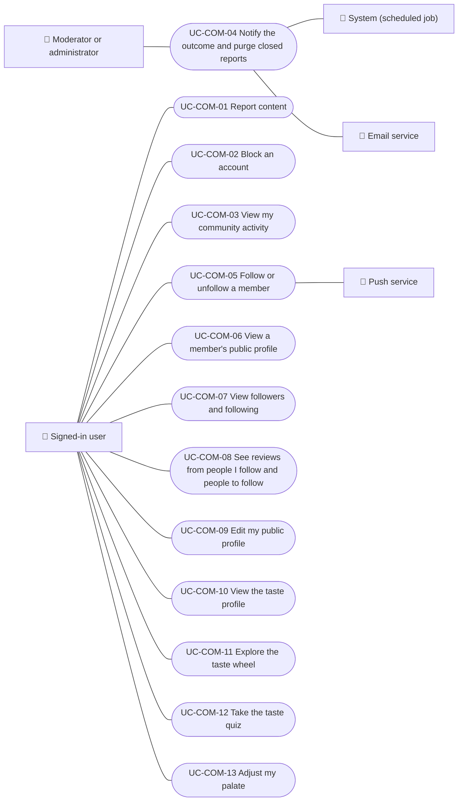

# Use cases

Community use cases: reporting content, blocking and unblocking accounts, viewing one's own activity, telling the outcome of a report and the social layer: following other members, public profiles, the feed of people one follows, the taste profile and wheel, the taste quiz and adjusting the palate. Staff review of reports is in Administration. Each case applies to the platforms listed.

| ID | Use case | Platforms | Actors |
|---|---|---|---|
| `UC-COM-01` | [Report content](uc-com-01-report-content.md) | Web, APK | Signed-in user |
| `UC-COM-02` | [Block an account](uc-com-02-block-user.md) | Web, APK | Signed-in user |
| `UC-COM-03` | [View my community activity](uc-com-03-my-community.md) | Web, APK | Signed-in user |
| `UC-COM-04` | [Notify the outcome and purge closed reports](uc-com-04-report-outcome-and-retention.md) | Backend only | Moderator or administrator, System (scheduled job), Email service |
| `UC-COM-05` | [Follow or unfollow a member](uc-com-05-follow-member.md) | Web, App | Signed-in user, Push service |
| `UC-COM-06` | [View a member's public profile](uc-com-06-view-public-profile.md) | Web, App | Signed-in user |
| `UC-COM-07` | [View followers and following](uc-com-07-view-follow-lists.md) | Web, App | Signed-in user |
| `UC-COM-08` | [See reviews from people I follow and people to follow](uc-com-08-following-feed-and-suggestions.md) | Web, App | Signed-in user |
| `UC-COM-09` | [Edit my public profile](uc-com-09-edit-public-profile.md) | Web, App | Signed-in user |
| `UC-COM-10` | [View the taste profile](uc-com-10-view-taste-profile.md) | Web, App | Signed-in user |
| `UC-COM-11` | [Explore the taste wheel](uc-com-11-explore-taste-wheel.md) | Web, App | Signed-in user |
| `UC-COM-12` | [Take the taste quiz](uc-com-12-take-taste-quiz.md) | Web, App | Signed-in user |
| `UC-COM-13` | [Adjust my palate](uc-com-13-adjust-palate.md) | Web, App | Signed-in user |

## Use case diagram

[View the full “Use cases · Use case diagram” diagram](https://images.vinnot.com/docs/diagrams/v1/en/modules-community-use-cases-readme-e78d3b721dcc.svg)

## Lucidchart mapping

| ID | Lucidchart IDs |
|---|---|
| `UC-COM-01` | [WEB UC-COM-01](https://lucid.app/lucidchart/9f11a16b-bb5a-42fc-a9e8-0852b17bd241/edit), [APK UC-COM-01](https://lucid.app/lucidchart/e095dd25-e8ac-41ba-bf5b-396e1055f217/edit) |
| `UC-COM-02` | [WEB UC-COM-02](https://lucid.app/lucidchart/9f11a16b-bb5a-42fc-a9e8-0852b17bd241/edit), [APK UC-COM-02](https://lucid.app/lucidchart/e095dd25-e8ac-41ba-bf5b-396e1055f217/edit) |
| `UC-COM-03` | [WEB UC-COM-03](https://lucid.app/lucidchart/9f11a16b-bb5a-42fc-a9e8-0852b17bd241/edit), [APK UC-COM-03](https://lucid.app/lucidchart/e095dd25-e8ac-41ba-bf5b-396e1055f217/edit) |
| `UC-COM-04` | None |
| `UC-COM-05` | None |
| `UC-COM-06` | None |
| `UC-COM-07` | None |
| `UC-COM-08` | None |
| `UC-COM-09` | None |
| `UC-COM-10` | None |
| `UC-COM-11` | None |
| `UC-COM-12` | None |
| `UC-COM-13` | None |
