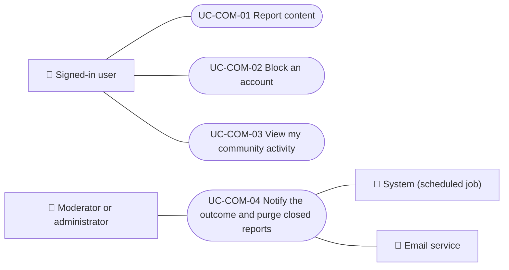

# Use cases

Community use cases: reporting content, blocking and unblocking accounts, viewing one's own activity and telling the outcome of a report. Staff review of reports is in Administration. Each case applies to the platforms listed.

| ID | Use case | Platforms | Actors |
|---|---|---|---|
| `UC-COM-01` | [Report content](uc-com-01-report-content.md) | Web, APK | Signed-in user |
| `UC-COM-02` | [Block an account](uc-com-02-block-user.md) | Web, APK | Signed-in user |
| `UC-COM-03` | [View my community activity](uc-com-03-my-community.md) | Web, APK | Signed-in user |
| `UC-COM-04` | [Notify the outcome and purge closed reports](uc-com-04-report-outcome-and-retention.md) | Backend only | Moderator or administrator, System (scheduled job), Email service |

## Use case diagram

[View the full “Use cases · Use case diagram” diagram](https://images.vinnot.com/docs/diagrams/v1/en/modules-community-use-cases-readme-5bb847395d36.svg)

## Lucidchart mapping

| ID | Lucidchart IDs |
|---|---|
| `UC-COM-01` | [WEB UC-COM-01](https://lucid.app/lucidchart/9f11a16b-bb5a-42fc-a9e8-0852b17bd241/edit), [APK UC-COM-01](https://lucid.app/lucidchart/e095dd25-e8ac-41ba-bf5b-396e1055f217/edit) |
| `UC-COM-02` | [WEB UC-COM-02](https://lucid.app/lucidchart/9f11a16b-bb5a-42fc-a9e8-0852b17bd241/edit), [APK UC-COM-02](https://lucid.app/lucidchart/e095dd25-e8ac-41ba-bf5b-396e1055f217/edit) |
| `UC-COM-03` | [WEB UC-COM-03](https://lucid.app/lucidchart/9f11a16b-bb5a-42fc-a9e8-0852b17bd241/edit), [APK UC-COM-03](https://lucid.app/lucidchart/e095dd25-e8ac-41ba-bf5b-396e1055f217/edit) |
| `UC-COM-04` | None |
