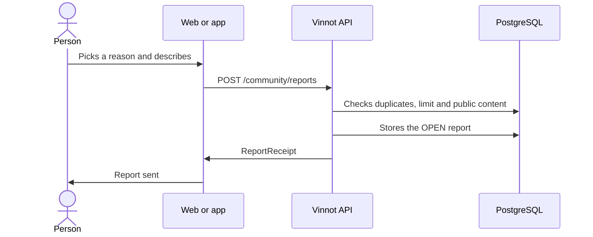

# UC-COM-01 · Report content

| Field | Value |
|---|---|
| ID | `UC-COM-01` |
| Module | [Community](../README.md) |
| Platforms | Web, APK |
| Actors | Signed-in user |
| Lucidchart IDs | [WEB UC-COM-01](https://lucid.app/lucidchart/9f11a16b-bb5a-42fc-a9e8-0852b17bd241/edit), [APK UC-COM-01](https://lucid.app/lucidchart/e095dd25-e8ac-41ba-bf5b-396e1055f217/edit) |
| Requirements | [`RF-WEB-COM-01`](../requirements.md), [`RF-WEB-COM-02`](../requirements.md), [`RF-APK-COM-01`](../requirements.md), [`RF-APK-COM-02`](../requirements.md) |
| Test cases | [`CP-COM-01`](../testing.md), [`CP-COM-02`](../testing.md), [`CP-COM-03`](../testing.md), [`CP-COM-04`](../testing.md), [`CP-COM-05`](../testing.md), [`CP-COM-06`](../testing.md), [`CP-COM-07`](../testing.md), [`CP-COM-08`](../testing.md), [`CP-COM-75`](../testing.md) |

## Preconditions

- The person is signed in and sees a review, a comment, an event or a wine route of someone else.

## Postconditions

- The report is open for the moderation team and the person gets a receipt.

## Main flow

1. The person chooses “Report” on the content or, on a review or a comment, “Report user” for its author. On reviews and comments these actions sit in the three-dots menu at the top right.
2. They pick a reason: spam, harassment, hate, sexual content, violence, privacy, misinformation or other.
3. They can add a description of up to 2000 characters.
4. The client sends `POST /community/reports` with the content type and ID, the reason and the description.
5. The API checks that the content is public and not the reporter's, and stores the author and an excerpt of the content.
6. The API stores the report as `OPEN` and returns the receipt; the client confirms the submission.

## Alternative flows

- 3a. The reason is “Other” and the description is missing: it cannot be sent and the API answers 422 `INVALID_REPORT_DESCRIPTION`.
- 5a. The person already has an open report on that content: the API returns that same receipt without creating another.
- 5b. The person exceeded 10 reports in 24 hours: the API answers 422 `REPORT_LIMIT` and the client explains that the daily limit was reached and that they can report again later.
- 5c. The content is their own: the API answers 422 `SELF_REPORT` and the client says that one's own content cannot be reported.
- 5d. The content is no longer public: the API answers 404 and the client says that the content is no longer available.
- 4a. The limit of 10 submissions per hour was exceeded: the API answers 429 and the client asks to wait a while before retrying.
- 4b. Sending fails: the client keeps the draft to retry.
- 4c. The request names a catalog wine (`WINE`) as the target or uses the `CATALOG_QUALITY` reason: the API answers 422 `REPORT_NOT_ALLOWED` and stores nothing.

## Business rules

- Active users, approved reviews and comments on active wines, events already published and published routes can be reported.
- Catalog wines and the catalog quality reason are reserved for the reports Vinnot files itself from label scans ([Administration](../../admin/use-cases/uc-adm-07-moderate-reports.md)).
- The action is not shown to the content's author or to the event's organizer.
- The receipt does not show evidence, internal notes or other reports.
- There are no automatic sanctions or hiding by number of reports; the team decides ([Administration](../../admin/README.md)).
- Reports have their own limit of 10 submissions per hour (`report` policy), independent from support requests. Repeating a report that is still open also counts as a submission.

## Diagram

[View the full “UC-COM-01 · Report content” diagram](https://images.vinnot.com/docs/diagrams/v1/en/modules-community-use-cases-uc-com-01-report-content-1d197fee943d.svg)

Component diagram in Lucidchart: [WEB UC-COM-01](https://lucid.app/lucidchart/9f11a16b-bb5a-42fc-a9e8-0852b17bd241/edit), [APK UC-COM-01](https://lucid.app/lucidchart/e095dd25-e8ac-41ba-bf5b-396e1055f217/edit).

## Code

| Layer | Location |
|---|---|
| Endpoints | `POST /community/reports` |
| Backend | [`CommunityController.java`](../../../../../backend/src/main/java/com/vinnot/community/infrastructure/web/CommunityController.java), [`CreateReportCommandHandler.java`](../../../../../backend/src/main/java/com/vinnot/community/application/command/handler/CreateReportCommandHandler.java), [`JdbcCommunityTargetAdapter.java`](../../../../../backend/src/main/java/com/vinnot/community/infrastructure/persistence/JdbcCommunityTargetAdapter.java), [`CommunityReport.java`](../../../../../backend/src/main/java/com/vinnot/community/domain/model/CommunityReport.java) |
| Web | [`CommunityActions.tsx`](../../../../../frontend-react/src/presentation/components/features/community/CommunityActions.tsx), [`useCommunity.ts`](../../../../../frontend-react/src/presentation/hooks/queries/community/useCommunity.ts), [`community.service.ts`](../../../../../frontend-react/src/application/services/community.service.ts), [`community.client.ts`](../../../../../frontend-react/src/infrastructure/api/clients/community.client.ts) |
| App | [`CommunityActions.tsx`](../../../../../frontend-mobile/src/presentation/features/community/CommunityActions.tsx), [`useCommunity.ts`](../../../../../frontend-mobile/src/presentation/hooks/queries/community/useCommunity.ts), [`community.service.ts`](../../../../../frontend-mobile/src/application/services/community.service.ts), [`community.client.ts`](../../../../../frontend-mobile/src/infrastructure/api/clients/community.client.ts) |

## Automated tests

- Backend: [`CommunityCommandHandlersTest.java`](../../../../../backend/src/test/java/com/vinnot/community/application/command/handler/CommunityCommandHandlersTest.java), [`RateLimitPolicyResolverTest.java`](../../../../../backend/src/test/java/com/vinnot/shared/infrastructure/security/RateLimitPolicyResolverTest.java), [`CommunityReportTest.java`](../../../../../backend/src/test/java/com/vinnot/community/domain/model/CommunityReportTest.java), [`CommunityHttpPostgresIntegrationTest.java`](../../../../../backend/src/test/java/com/vinnot/community/infrastructure/CommunityHttpPostgresIntegrationTest.java), [`CatalogQualityReportTest.java`](../../../../../backend/src/test/java/com/vinnot/community/domain/model/CatalogQualityReportTest.java)
- Web: [`CommunityActions.test.tsx`](../../../../../frontend-react/src/presentation/components/features/community/CommunityActions.test.tsx), [`community.service.test.ts`](../../../../../frontend-react/src/application/services/community.service.test.ts), [`community.client.test.ts`](../../../../../frontend-react/src/infrastructure/api/clients/community.client.test.ts), [`communityErrorMessage.test.ts`](../../../../../frontend-react/src/presentation/feedback/communityErrorMessage.test.ts)
- App: [`CommunityActions.test.tsx`](../../../../../frontend-mobile/src/presentation/features/community/CommunityActions.test.tsx), [`community.service.test.ts`](../../../../../frontend-mobile/src/application/services/community.service.test.ts)
