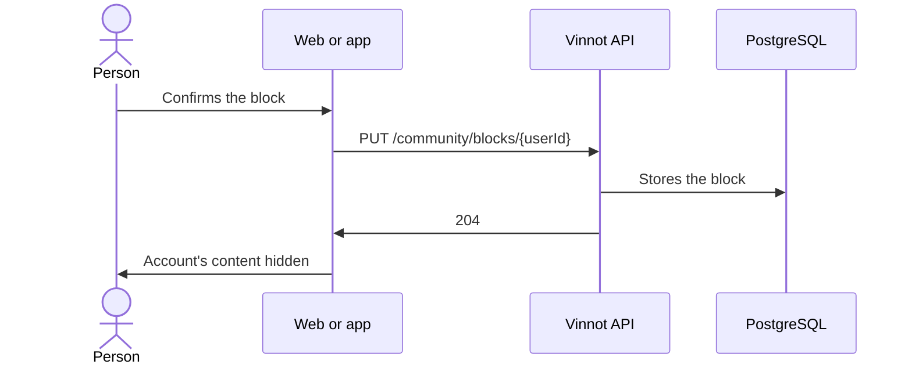

# UC-COM-02 · Block an account

| Field | Value |
|---|---|
| ID | `UC-COM-02` |
| Module | [Community](../README.md) |
| Platforms | Web, APK |
| Actors | Signed-in user |
| Lucidchart IDs | [WEB UC-COM-02](https://lucid.app/lucidchart/9f11a16b-bb5a-42fc-a9e8-0852b17bd241/edit), [APK UC-COM-02](https://lucid.app/lucidchart/e095dd25-e8ac-41ba-bf5b-396e1055f217/edit) |
| Requirements | [`RF-WEB-COM-03`](../requirements.md), [`RF-APK-COM-03`](../requirements.md) |
| Test cases | [`CP-COM-09`](../testing.md), [`CP-COM-10`](../testing.md), [`CP-COM-11`](../testing.md), [`CP-COM-12`](../testing.md), [`CP-COM-13`](../testing.md), [`CP-COM-14`](../testing.md) |

## Preconditions

- The person is signed in and sees a review or a comment of someone else.

## Postconditions

- The other account is blocked for the person.

## Main flow

1. The person chooses “Block” on the review or the comment.
2. The client explains the effect and asks for confirmation.
3. The client sends `PUT /community/blocks/{userId}`.
4. The API stores the block and answers 204.
5. The client discards the stored reviews, comments and profiles and reloads them without that account's content.

## Alternative flows

- 2a. The person cancels: nothing is blocked.
- 4a. The account was already blocked: the API answers 204 anyway.
- 4b. It is the person's own account: the API answers 422 `SELF_BLOCK` and the client says that one's own account cannot be blocked.
- 4c. The account does not exist: the API answers 404 and the client says that the content is no longer available.
- 4d. Blocking fails: the previous view is kept.

## Business rules

- The block works both ways: it hides reviews, comments and profile, and stops new likes and comments between the two accounts.
- Blocked accounts get no comment notices and do not count in like summaries or new-event notices.
- Events and routes stay visible, and wine averages do not change.
- It is a personal block; it is not an account suspension by the team.
- Unblocking is done from the community activity ([UC-COM-03](uc-com-03-my-community.md)).

## Diagram

[View the full “UC-COM-02 · Block an account” diagram](https://images.vinnot.com/docs/diagrams/v1/en/modules-community-use-cases-uc-com-02-block-user-a1c72b3a91f6.svg)

Component diagram in Lucidchart: [WEB UC-COM-02](https://lucid.app/lucidchart/9f11a16b-bb5a-42fc-a9e8-0852b17bd241/edit), [APK UC-COM-02](https://lucid.app/lucidchart/e095dd25-e8ac-41ba-bf5b-396e1055f217/edit).

## Code

| Layer | Location |
|---|---|
| Endpoints | `PUT /community/blocks/{userId}`, `DELETE /community/blocks/{userId}` |
| Backend | [`CommunityController.java`](../../../../../backend/src/main/java/com/vinnot/community/infrastructure/web/CommunityController.java), [`ChangeUserBlockCommandHandler.java`](../../../../../backend/src/main/java/com/vinnot/community/application/command/handler/ChangeUserBlockCommandHandler.java) |
| Web | [`CommunityActions.tsx`](../../../../../frontend-react/src/presentation/components/features/community/CommunityActions.tsx), [`useCommunity.ts`](../../../../../frontend-react/src/presentation/hooks/queries/community/useCommunity.ts), [`community.service.ts`](../../../../../frontend-react/src/application/services/community.service.ts), [`community.client.ts`](../../../../../frontend-react/src/infrastructure/api/clients/community.client.ts) |
| App | [`CommunityActions.tsx`](../../../../../frontend-mobile/src/presentation/features/community/CommunityActions.tsx), [`useCommunity.ts`](../../../../../frontend-mobile/src/presentation/hooks/queries/community/useCommunity.ts), [`api.ts`](../../../../../frontend-mobile/src/presentation/store/api.ts), [`community.service.ts`](../../../../../frontend-mobile/src/application/services/community.service.ts), [`community.client.ts`](../../../../../frontend-mobile/src/infrastructure/api/clients/community.client.ts) |

## Automated tests

- Backend: [`CommunityCommandHandlersTest.java`](../../../../../backend/src/test/java/com/vinnot/community/application/command/handler/CommunityCommandHandlersTest.java), [`CommunityHttpPostgresIntegrationTest.java`](../../../../../backend/src/test/java/com/vinnot/community/infrastructure/CommunityHttpPostgresIntegrationTest.java)
- Web: [`useCommunity.test.tsx`](../../../../../frontend-react/src/presentation/hooks/queries/community/useCommunity.test.tsx), [`CommunityActions.test.tsx`](../../../../../frontend-react/src/presentation/components/features/community/CommunityActions.test.tsx)
- App: [`CommunityActions.test.tsx`](../../../../../frontend-mobile/src/presentation/features/community/CommunityActions.test.tsx)
