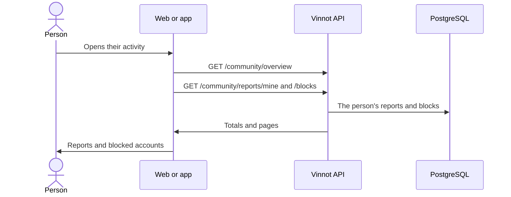

# UC-COM-03 · View my community activity

| Field | Value |
|---|---|
| ID | `UC-COM-03` |
| Module | [Community](../README.md) |
| Platforms | Web, APK |
| Actors | Signed-in user |
| Lucidchart IDs | [WEB UC-COM-03](https://lucid.app/lucidchart/9f11a16b-bb5a-42fc-a9e8-0852b17bd241/edit), [APK UC-COM-03](https://lucid.app/lucidchart/e095dd25-e8ac-41ba-bf5b-396e1055f217/edit) |
| Requirements | [`RF-WEB-COM-04`](../requirements.md), [`RF-APK-COM-04`](../requirements.md) |
| Test cases | [`CP-COM-15`](../testing.md), [`CP-COM-16`](../testing.md), [`CP-COM-17`](../testing.md), [`CP-COM-18`](../testing.md) |

## Preconditions

- The person is signed in.

## Postconditions

- The person sees their reports and blocks, and can unblock accounts.

## Main flow

1. The person opens their community activity: on the web the `/community` page, from the profile; on the app from the profile.
2. The client calls `GET /community/overview` with the report totals per status and the number of blocked accounts.
3. It calls `GET /community/reports/mine` and `GET /community/blocks`, each paged separately.
4. It shows each report with its target, status and date, and each blocked account with its name and date.

## Alternative flows

- 4a. The person unblocks an account: the client sends `DELETE /community/blocks/{userId}`, the API answers 204 and the list is updated.
- 4b. There are no reports or blocks: the empty state is shown with a link to Contact.
- 2a. The request fails: the error is shown, not a zero.

## Business rules

- Each person only sees their own reports and blocks.
- Pages of 20 by default and up to 50.
- Closed reports disappear 90 days after closing ([UC-COM-04](uc-com-04-report-outcome-and-retention.md)).
- An appeal is sent through Contact with the case reference ([Support](../../support/README.md)).

## Diagram

[View the full “UC-COM-03 · View my community activity” diagram](https://images.vinnot.com/docs/diagrams/v1/en/modules-community-use-cases-uc-com-03-my-community-65450cddfef3.svg)

Component diagram in Lucidchart: [WEB UC-COM-03](https://lucid.app/lucidchart/9f11a16b-bb5a-42fc-a9e8-0852b17bd241/edit), [APK UC-COM-03](https://lucid.app/lucidchart/e095dd25-e8ac-41ba-bf5b-396e1055f217/edit).

## Code

| Layer | Location |
|---|---|
| Endpoints | `GET /community/overview`, `GET /community/reports/mine`, `GET /community/blocks`, `DELETE /community/blocks/{userId}` |
| Backend | [`CommunityController.java`](../../../../../backend/src/main/java/com/vinnot/community/infrastructure/web/CommunityController.java), [`GetCommunityQueryHandler.java`](../../../../../backend/src/main/java/com/vinnot/community/application/query/handler/GetCommunityQueryHandler.java) |
| Web | [`CommunityPage.tsx`](../../../../../frontend-react/src/presentation/pages/community/CommunityPage.tsx), [`CommunityOverview.tsx`](../../../../../frontend-react/src/presentation/components/features/community/CommunityOverview.tsx), [`useCommunity.ts`](../../../../../frontend-react/src/presentation/hooks/queries/community/useCommunity.ts), [`community.service.ts`](../../../../../frontend-react/src/application/services/community.service.ts), [`community.client.ts`](../../../../../frontend-react/src/infrastructure/api/clients/community.client.ts) |
| App | [`CommunityScreens.tsx`](../../../../../frontend-mobile/src/presentation/features/community/CommunityScreens.tsx), [`useCommunity.ts`](../../../../../frontend-mobile/src/presentation/hooks/queries/community/useCommunity.ts), [`community.service.ts`](../../../../../frontend-mobile/src/application/services/community.service.ts), [`community.client.ts`](../../../../../frontend-mobile/src/infrastructure/api/clients/community.client.ts) |

## Automated tests

- Backend: [`CommunityQueryHandlersTest.java`](../../../../../backend/src/test/java/com/vinnot/community/application/query/handler/CommunityQueryHandlersTest.java), [`CommunityHttpPostgresIntegrationTest.java`](../../../../../backend/src/test/java/com/vinnot/community/infrastructure/CommunityHttpPostgresIntegrationTest.java)
- Web: [`CommunityPage.test.tsx`](../../../../../frontend-react/src/presentation/pages/community/CommunityPage.test.tsx), [`CommunityOverview.test.tsx`](../../../../../frontend-react/src/presentation/components/features/community/CommunityOverview.test.tsx)
- App: [`CommunityOverview.test.tsx`](../../../../../frontend-mobile/src/presentation/features/community/CommunityOverview.test.tsx)
