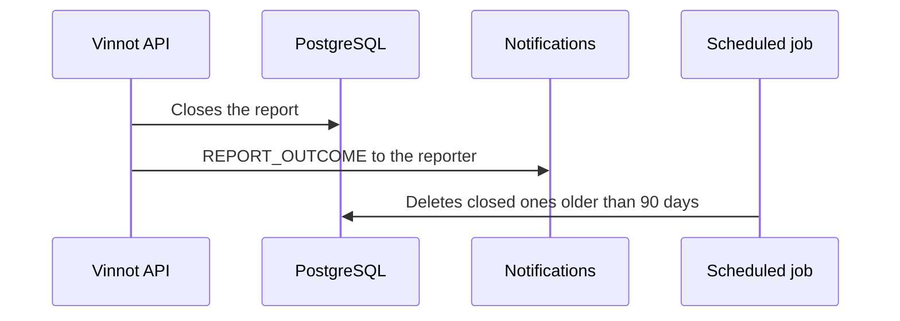

# UC-COM-04 · Notify the outcome and purge closed reports

| Field | Value |
|---|---|
| ID | `UC-COM-04` |
| Module | [Community](../README.md) |
| Platforms | Backend only |
| Actors | Moderator or administrator, System (scheduled job), Email service |
| Lucidchart IDs | None |
| Requirements | None |
| Test cases | [`CP-COM-19`](../testing.md), [`CP-COM-20`](../testing.md), [`CP-COM-21`](../testing.md) |

## Preconditions

- There are reports the team closed or content it removed.

## Postconditions

- The reporter knows the outcome and old closed reports are deleted.

## Main flow

1. A moderator resolves or dismisses a report, or removes the reported content ([Administration](../../admin/README.md)).
2. The API queues a `REPORT_OUTCOME` email for the reporter, with the outcome.
3. If the content was removed, its author gets a `CONTENT_REMOVED` email.
4. Every hour the scheduled job deletes up to 500 reports closed more than 90 days ago, with their action history.

## Alternative flows

- 2a. The same outcome was already notified: the notice key prevents a second email.
- 4a. More than 500 are due: the rest are deleted in the following runs.

## Business rules

- Creating a report sends no emails.
- `OPEN` and `IN_REVIEW` reports are never deleted for age.
- Purging affects the live database, not backups.
- The outcome email does not reveal internal notes or the reviewer's identity.

## Diagram

[View the full “UC-COM-04 · Notify the outcome and purge closed reports” diagram](https://images.vinnot.com/docs/diagrams/v1/en/modules-community-use-cases-uc-com-04-report-outcome-and-retention-4baa0c078a8e.svg)

## Code

| Layer | Location |
|---|---|
| Backend | [`EmailReportOutcomeNotifier.java`](../../../../../backend/src/main/java/com/vinnot/community/infrastructure/notification/EmailReportOutcomeNotifier.java), [`PurgeClosedReportsCommandHandler.java`](../../../../../backend/src/main/java/com/vinnot/community/application/command/handler/PurgeClosedReportsCommandHandler.java), [`CommunityRetentionScheduler.java`](../../../../../backend/src/main/java/com/vinnot/community/infrastructure/CommunityRetentionScheduler.java) |

## Automated tests

- Backend: [`EmailReportOutcomeNotifierTest.java`](../../../../../backend/src/test/java/com/vinnot/community/infrastructure/notification/EmailReportOutcomeNotifierTest.java), [`PurgeClosedReportsCommandHandlerTest.java`](../../../../../backend/src/test/java/com/vinnot/community/application/command/handler/PurgeClosedReportsCommandHandlerTest.java), [`CommunityEmailTemplatesTest.java`](../../../../../backend/src/test/java/com/vinnot/notification/infrastructure/template/CommunityEmailTemplatesTest.java), [`ModerationOutcomeTemplatesTest.java`](../../../../../backend/src/test/java/com/vinnot/notification/infrastructure/template/ModerationOutcomeTemplatesTest.java)
- Web: None
- App: None
