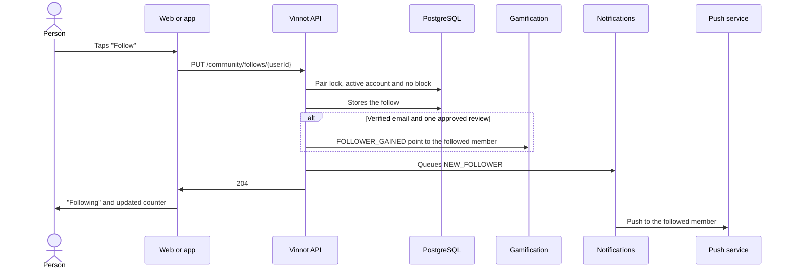

# UC-COM-05 · Follow or unfollow a member

| Field | Value |
|---|---|
| ID | `UC-COM-05` |
| Module | [Community](../README.md) |
| Platforms | Web, App |
| Actors | Signed-in user, Push service |
| Lucidchart IDs | None |
| Requirements | [`RF-WEB-COM-05`](../requirements.md), [`RF-WEB-COM-06`](../requirements.md), [`RF-APK-COM-05`](../requirements.md), [`RF-APK-COM-06`](../requirements.md), [`RF-APK-COM-22`](../requirements.md) |
| Test cases | [`CP-COM-22`](../testing.md), [`CP-COM-23`](../testing.md), [`CP-COM-24`](../testing.md), [`CP-COM-25`](../testing.md), [`CP-COM-26`](../testing.md), [`CP-COM-27`](../testing.md), [`CP-COM-28`](../testing.md) |

## Preconditions

- The person is signed in.
- They see another member on a public profile, in a followers or following list, or under "People to follow".

## Postconditions

- The person follows the other member, or stops following them, without the other member having to approve it.
- The follower and following counters reflect the change.

## Main flow

1. The person taps "Follow".
2. The client sends `PUT /community/follows/{userId}`.
3. The API takes a lock on the pair, checks that the account exists, is active and has no block in either direction with the follower, and stores the follow.
4. If the follower has a verified email and at least one approved review, the API awards the followed member one `FOLLOWER_GAINED` point.
5. The API queues the `NEW_FOLLOWER` push for the followed member and answers 204.
6. The button turns into "Following" and the follower counter is updated.

## Alternative flows

- 1a. The person taps "Following": the client sends `DELETE /community/follows/{userId}`, the API deletes the follow, takes back the point it had awarded and answers 204; the button returns to "Follow".
- 3a. The person already followed that account: the API answers 204 without a second follow, a second point or a second push.
- 3b. It is their own account: the API answers 400 `SELF_FOLLOW`. The clients show no button on the own profile or on the own row of a list.
- 3c. The account does not exist, is inactive or there is a block in either direction: the API answers 404.
- 6a. The request fails: the button returns to its previous state and the client says it could not update the follow.
- 5a. In the app, the followed member taps the push: the app opens the public profile of the new follower (`/users/{followerId}`).

## Business rules

- Following is asymmetric and needs no approval; both operations are idempotent.
- The follower point is keyed by the follower's ID, has its own limit of 10 per day and counts toward the global cap of 40 points a day ([Gamification](../../gamification/README.md)).
- The push is sent once per follower, followed member and UTC day; the notice is a push only.
- A block deletes the follows in both directions and takes back their points in the same transaction ([UC-COM-02](uc-com-02-block-user.md)).
- Deleting an account deletes its follows in both directions.

## Diagram

[View the full “UC-COM-05 · Follow or unfollow a member” diagram](https://images.vinnot.com/docs/diagrams/v1/en/modules-community-use-cases-uc-com-05-follow-member-ba017e885165.svg)

## Code

| Layer | Location |
|---|---|
| Endpoints | `PUT /community/follows/{userId}`, `DELETE /community/follows/{userId}` |
| Backend | [`CommunityController.java`](../../../../../backend/src/main/java/com/vinnot/community/infrastructure/web/CommunityController.java), [`ChangeFollowCommandHandler.java`](../../../../../backend/src/main/java/com/vinnot/community/application/command/handler/ChangeFollowCommandHandler.java) |
| Web | [`FollowButton.tsx`](../../../../../frontend-react/src/presentation/components/features/social/FollowButton.tsx), [`useFollowUser.ts`](../../../../../frontend-react/src/presentation/hooks/queries/social/useFollowUser.ts), [`social.service.ts`](../../../../../frontend-react/src/application/services/social.service.ts), [`social.client.ts`](../../../../../frontend-react/src/infrastructure/api/clients/social.client.ts) |
| App | [`FollowButton.tsx`](../../../../../frontend-mobile/src/presentation/features/social/FollowButton.tsx), [`useFollowToggle.ts`](../../../../../frontend-mobile/src/presentation/features/social/useFollowToggle.ts), [`social.service.ts`](../../../../../frontend-mobile/src/application/services/social.service.ts), [`social.client.ts`](../../../../../frontend-mobile/src/infrastructure/api/clients/social.client.ts), [`pushRoute.ts`](../../../../../frontend-mobile/src/domain/notification/pushRoute.ts) |

## Automated tests

- Backend: [`ChangeFollowCommandHandlerTest.java`](../../../../../backend/src/test/java/com/vinnot/community/application/command/handler/ChangeFollowCommandHandlerTest.java), [`SocialAdaptersTest.java`](../../../../../backend/src/test/java/com/vinnot/community/infrastructure/notification/SocialAdaptersTest.java), [`SocialHttpPostgresIntegrationTest.java`](../../../../../backend/src/test/java/com/vinnot/community/infrastructure/SocialHttpPostgresIntegrationTest.java)
- Web: [`useFollowUser.test.tsx`](../../../../../frontend-react/src/presentation/hooks/queries/social/useFollowUser.test.tsx), [`social.service.test.ts`](../../../../../frontend-react/src/application/services/social.service.test.ts), [`social.client.test.ts`](../../../../../frontend-react/src/infrastructure/api/clients/social.client.test.ts)
- App: [`useFollowToggle.test.tsx`](../../../../../frontend-mobile/src/presentation/features/social/useFollowToggle.test.tsx), [`socialOperations.test.ts`](../../../../../frontend-mobile/src/application/operations/socialOperations.test.ts), [`social.client.test.ts`](../../../../../frontend-mobile/src/infrastructure/api/clients/social.client.test.ts), [`pushRoute.test.ts`](../../../../../frontend-mobile/src/domain/notification/pushRoute.test.ts)
