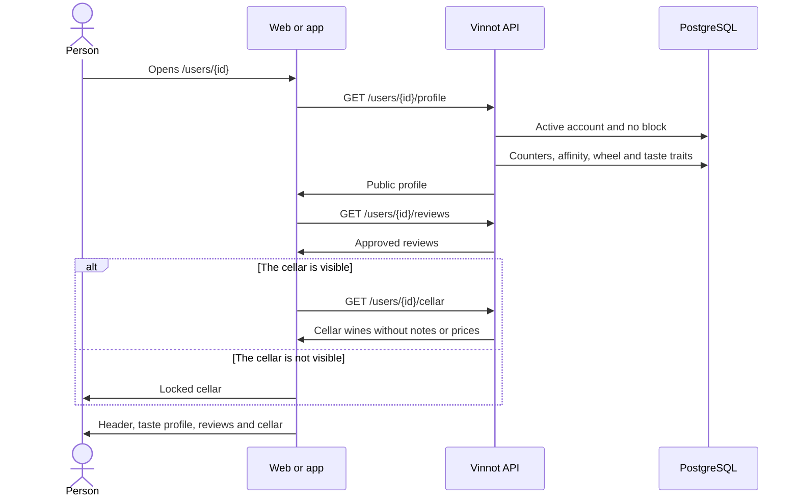

# UC-COM-06 · View a member's public profile

| Field | Value |
|---|---|
| ID | `UC-COM-06` |
| Module | [Community](../README.md) |
| Platforms | Web, App |
| Actors | Signed-in user |
| Lucidchart IDs | None |
| Requirements | [`RF-WEB-COM-07`](../requirements.md), [`RF-WEB-COM-08`](../requirements.md), [`RF-WEB-COM-09`](../requirements.md), [`RF-APK-COM-07`](../requirements.md), [`RF-APK-COM-08`](../requirements.md), [`RF-APK-COM-09`](../requirements.md) |
| Test cases | [`CP-COM-29`](../testing.md), [`CP-COM-30`](../testing.md), [`CP-COM-31`](../testing.md), [`CP-COM-32`](../testing.md), [`CP-COM-33`](../testing.md), [`CP-COM-34`](../testing.md) |

## Preconditions

- The person is signed in.

## Postconditions

- The person sees the member's public profile, with their reviews and, when it is visible to them, their cellar.

## Main flow

1. The person opens `/users/{id}`: from the name or photo of a review's author, a followers or following row, a suggestion or a review in the feed.
2. The client calls `GET /users/{id}/profile`.
3. The API checks that the account exists, is active and has no block in either direction with the viewer, and returns the public data: photo, name, @username, bio, seal, counters, whether the viewer follows them, whether they follow the viewer, the affinity, the wheel and the taste traits.
4. The client calls `GET /users/{id}/reviews`, paged.
5. The client shows the header with photo, name, @username, seal, bio, the "Followers", "Following", "Reviews" and "Wines in cellar" counters, "Follows you" and the affinity in %; the "Follow" or "Following" button ([UC-COM-05](uc-com-05-follow-member.md)); the taste profile ([UC-COM-10](uc-com-10-view-taste-profile.md)) and the reviews section.
6. When the cellar is visible, the client calls `GET /users/{id}/cellar` and shows each wine with its winery, vintage, rating and the date it was added. In the app it is requested when the cellar tab is chosen.

## Alternative flows

- 3a. The account does not exist, is inactive or there is a block: the API answers 404. The web shows "This profile isn't available"; the app shows the error with a retry option.
- 5a. It is the own profile: "Edit profile" takes the place of "Follow" ([UC-COM-09](uc-com-09-edit-public-profile.md)), with no "Follows you" or affinity; the taste profile offers the quiz ([UC-COM-12](uc-com-12-take-taste-quiz.md)) and "Adjust" ([UC-COM-13](uc-com-13-adjust-palate.md)).
- 6a. The cellar is not visible to the viewer: the profile reports `cellarVisible: false` and `cellarCount: null`, the cellar counter shows "—" and the section shows a locked state without requesting the list. If the API answers the list with 403 `CELLAR_NOT_VISIBLE`, the client shows the same state.
- 4a. The member has no reviews or the cellar is empty: each section shows its empty state.
- 4b. On the web, loading the reviews or the cellar fails: the section shows "We couldn't load this section" without hiding the rest of the profile.

## Business rules

- The affinity is the cosine similarity of both taste vectors, from 0 to 100; it is not shown on the own profile or when either member rated fewer than five wines.
- The reviews are the approved ones on active wines, newest first.
- A `PUBLIC` cellar is visible to every member, `FOLLOWERS` only to the owner's followers and `PRIVATE` to nobody; the owner always sees it. The list never includes private notes or purchase prices.
- In the app, the profile's three-dot menu lets the person report or block the account ([UC-COM-01](uc-com-01-report-content.md), [UC-COM-02](uc-com-02-block-user.md)), and the own profile opens from "Quick access" › "My public profile".
- Pages hold up to 50 items; a larger size answers 422 `INVALID_PAGINATION`.

## Diagram

[View the full “UC-COM-06 · View a member's public profile” diagram](https://images.vinnot.com/docs/diagrams/v1/en/modules-community-use-cases-uc-com-06-view-public-profile-f1d49dd299ac.svg)

## Code

| Layer | Location |
|---|---|
| Endpoints | `GET /users/{id}/profile`, `GET /users/{id}/reviews`, `GET /users/{id}/cellar` |
| Backend | [`GetPublicUserProfileQueryHandler.java`](../../../../../backend/src/main/java/com/vinnot/user/application/query/handler/GetPublicUserProfileQueryHandler.java), [`MemberActivityController.java`](../../../../../backend/src/main/java/com/vinnot/community/infrastructure/web/MemberActivityController.java), [`GetSocialQueryHandler.java`](../../../../../backend/src/main/java/com/vinnot/community/application/query/handler/GetSocialQueryHandler.java), [`CellarVisibility.java`](../../../../../backend/src/main/java/com/vinnot/community/domain/model/CellarVisibility.java) |
| Web | [`PublicProfilePage.tsx`](../../../../../frontend-react/src/presentation/pages/social/PublicProfilePage.tsx), [`usePublicProfileViewModel.ts`](../../../../../frontend-react/src/presentation/pages/social/usePublicProfileViewModel.ts), [`useSocialQueries.ts`](../../../../../frontend-react/src/presentation/hooks/queries/social/useSocialQueries.ts), [`ReviewCard.tsx`](../../../../../frontend-react/src/presentation/components/features/wine/ReviewCard.tsx) |
| App | [`PublicProfileScreen.tsx`](../../../../../frontend-mobile/src/presentation/features/social/PublicProfileScreen.tsx), [`PublicProfileHeader.tsx`](../../../../../frontend-mobile/src/presentation/features/social/PublicProfileHeader.tsx), [`usePublicProfileViewModel.ts`](../../../../../frontend-mobile/src/presentation/features/social/usePublicProfileViewModel.ts), [`ProfileCellarList.tsx`](../../../../../frontend-mobile/src/presentation/features/social/ProfileCellarList.tsx), [`ReviewItem.tsx`](../../../../../frontend-mobile/src/presentation/features/wine/ReviewItem.tsx) |

## Automated tests

- Backend: [`GetPublicUserProfileQueryHandlerTest.java`](../../../../../backend/src/test/java/com/vinnot/user/application/query/handler/GetPublicUserProfileQueryHandlerTest.java), [`SocialRulesTest.java`](../../../../../backend/src/test/java/com/vinnot/community/domain/model/SocialRulesTest.java), [`SocialHttpPostgresIntegrationTest.java`](../../../../../backend/src/test/java/com/vinnot/community/infrastructure/SocialHttpPostgresIntegrationTest.java)
- Web: [`PublicProfilePage.test.tsx`](../../../../../frontend-react/src/presentation/pages/social/PublicProfilePage.test.tsx), [`social.mappers.test.ts`](../../../../../frontend-react/src/domain/social/social.mappers.test.ts)
- App: [`PublicProfileScreen.test.tsx`](../../../../../frontend-mobile/src/presentation/features/social/PublicProfileScreen.test.tsx), [`social.mappers.test.ts`](../../../../../frontend-mobile/src/domain/social/social.mappers.test.ts), [`socialRules.test.ts`](../../../../../frontend-mobile/src/domain/social/socialRules.test.ts)
