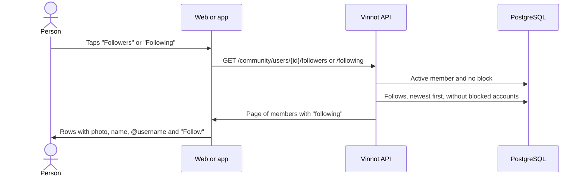

# UC-COM-07 · View followers and following

| Field | Value |
|---|---|
| ID | `UC-COM-07` |
| Module | [Community](../README.md) |
| Platforms | Web, App |
| Actors | Signed-in user |
| Lucidchart IDs | None |
| Requirements | [`RF-WEB-COM-10`](../requirements.md), [`RF-APK-COM-10`](../requirements.md) |
| Test cases | [`CP-COM-35`](../testing.md), [`CP-COM-36`](../testing.md), [`CP-COM-37`](../testing.md), [`CP-COM-38`](../testing.md) |

## Preconditions

- The person is signed in and on a public profile ([UC-COM-06](uc-com-06-view-public-profile.md)).

## Postconditions

- The person sees who follows the member or whom the member follows, and can follow them or open their profiles.

## Main flow

1. The person taps the profile's "Followers" or "Following" counter.
2. The client opens `/users/{id}/followers` or `/users/{id}/following` and calls `GET /community/users/{id}/followers` or `/following`, paged.
3. The API returns the active members from the newest follow to the oldest, without accounts that have a block in either direction with the viewer, each with a flag saying whether the viewer already follows them.
4. The client shows each row with photo, name, seal, @username and the "Follow" or "Following" button ([UC-COM-05](uc-com-05-follow-member.md)); tapping the row opens their public profile.

## Alternative flows

- 4a. The row is the person themselves: the row shows no button.
- 4b. The list is empty: the client shows "No followers yet" or "Not following anyone yet".
- 3a. The profile does not exist, is inactive or there is a block: the API answers 404 and the client shows the error.

## Business rules

- Pages of 20 by default and up to 50; a larger size answers 422 `INVALID_PAGINATION`.
- The web pages the list; the app loads the next page on reaching the end.
- The profile counters count every follow among active members; the list also leaves out blocked accounts.

## Diagram

[View the full “UC-COM-07 · View followers and following” diagram](https://images.vinnot.com/docs/diagrams/v1/en/modules-community-use-cases-uc-com-07-view-follow-lists-27f173b13d50.svg)

## Code

| Layer | Location |
|---|---|
| Endpoints | `GET /community/users/{userId}/followers`, `GET /community/users/{userId}/following` |
| Backend | [`CommunityController.java`](../../../../../backend/src/main/java/com/vinnot/community/infrastructure/web/CommunityController.java), [`GetSocialQueryHandler.java`](../../../../../backend/src/main/java/com/vinnot/community/application/query/handler/GetSocialQueryHandler.java) |
| Web | [`FollowListPage.tsx`](../../../../../frontend-react/src/presentation/pages/social/FollowListPage.tsx), [`useFollowListViewModel.ts`](../../../../../frontend-react/src/presentation/pages/social/useFollowListViewModel.ts), [`SocialUserRow.tsx`](../../../../../frontend-react/src/presentation/components/features/social/SocialUserRow.tsx) |
| App | [`FollowListScreen.tsx`](../../../../../frontend-mobile/src/presentation/features/social/FollowListScreen.tsx), [`social.service.ts`](../../../../../frontend-mobile/src/application/services/social.service.ts) |

## Automated tests

- Backend: [`SocialHttpPostgresIntegrationTest.java`](../../../../../backend/src/test/java/com/vinnot/community/infrastructure/SocialHttpPostgresIntegrationTest.java)
- Web: [`FollowListPage.test.tsx`](../../../../../frontend-react/src/presentation/pages/social/FollowListPage.test.tsx)
- App: [`FollowListScreen.test.tsx`](../../../../../frontend-mobile/src/presentation/features/social/FollowListScreen.test.tsx)
