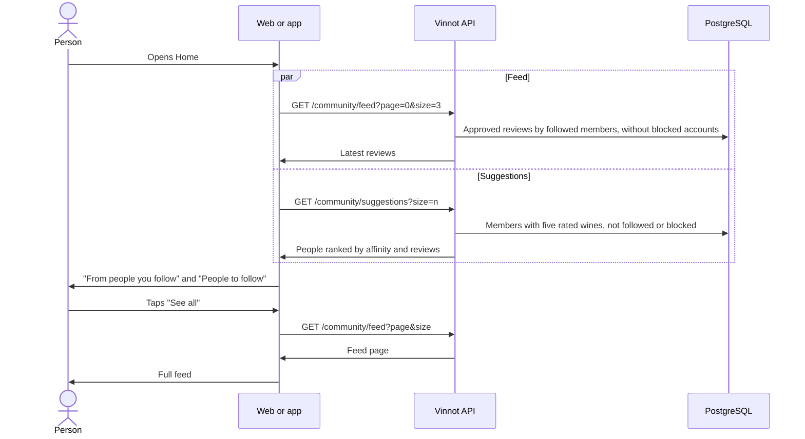

# UC-COM-08 · See reviews from people I follow and people to follow

| Field | Value |
|---|---|
| ID | `UC-COM-08` |
| Module | [Community](../README.md) |
| Platforms | Web, App |
| Actors | Signed-in user |
| Lucidchart IDs | None |
| Requirements | [`RF-WEB-COM-11`](../requirements.md), [`RF-WEB-COM-12`](../requirements.md), [`RF-APK-COM-11`](../requirements.md), [`RF-APK-COM-12`](../requirements.md) |
| Test cases | [`CP-COM-39`](../testing.md), [`CP-COM-40`](../testing.md), [`CP-COM-41`](../testing.md), [`CP-COM-42`](../testing.md), [`CP-COM-43`](../testing.md) |

## Preconditions

- The person is signed in.

## Postconditions

- The person sees the latest reviews of the members they follow and people they could follow.

## Main flow

1. The person opens Home. At the end are the "From people you follow" and "People to follow" sections.
2. The client calls `GET /community/feed` for the three newest reviews and `GET /community/suggestions`: six on the web, ten in the app.
3. The API returns the approved reviews on active wines written by the members the person follows, newest first and without blocked accounts; and, as suggestions, active members with at least five rated wines whom the person does not follow, with no block in either direction and other than the person, ranked by affinity and then by approved reviews.
4. The client shows each review with its author, the wine, the rating and the date, and each suggestion with photo, name, affinity, number of reviews and the "Follow" button ([UC-COM-05](uc-com-05-follow-member.md)).
5. The person taps "See all" and the client opens the full feed (`/feed`), with every review from the people they follow.

## Alternative flows

- 3a. The person follows nobody or the people they follow have not published reviews: the section shows an empty state that invites them to follow other people.
- 3b. There are no suggestions: the web shows a notice in the section; the app does not show the section.
- 2a. One of the requests fails: the rest of Home stays available. The web shows "We couldn't load this section" in the section that failed; the app shows the feed error with a retry option and hides the suggestions.
- 5a. The person taps the author of a review, a suggestion or a wine: the public profile of that person ([UC-COM-06](uc-com-06-view-public-profile.md)) or the wine's page opens.

## Business rules

- The sections appear only when signed in and close Home ([UC-USR-22](../../users/use-cases/uc-usr-22-home.md)).
- The full feed pages 10 reviews at a time on the web; the app loads the next page on reaching the end.
- Affinity ranks the suggestions only when the viewer rated at least five wines; otherwise they are ranked by approved reviews.
- Suggestions accept from 1 to 20 results, 10 by default; outside that range the API answers 422 `INVALID_PAGINATION`.

## Diagram

[View the full “UC-COM-08 · See reviews from people I follow and people to follow” diagram](https://images.vinnot.com/docs/diagrams/v1/en/modules-community-use-cases-uc-com-08-following-feed-and-suggestions-ef412a436abf.svg)

## Code

| Layer | Location |
|---|---|
| Endpoints | `GET /community/feed`, `GET /community/suggestions` |
| Backend | [`CommunityController.java`](../../../../../backend/src/main/java/com/vinnot/community/infrastructure/web/CommunityController.java), [`GetSocialQueryHandler.java`](../../../../../backend/src/main/java/com/vinnot/community/application/query/handler/GetSocialQueryHandler.java) |
| Web | [`HomeSocialSections.tsx`](../../../../../frontend-react/src/presentation/pages/public/HomeSocialSections.tsx), [`useHomeSocialViewModel.ts`](../../../../../frontend-react/src/presentation/pages/public/useHomeSocialViewModel.ts), [`FollowingFeedPage.tsx`](../../../../../frontend-react/src/presentation/pages/social/FollowingFeedPage.tsx), [`useFollowingFeedViewModel.ts`](../../../../../frontend-react/src/presentation/pages/social/useFollowingFeedViewModel.ts), [`SocialReviewCard.tsx`](../../../../../frontend-react/src/presentation/components/features/social/SocialReviewCard.tsx), [`SocialPersonCard.tsx`](../../../../../frontend-react/src/presentation/components/features/social/SocialPersonCard.tsx) |
| App | [`HomeSocialSections.tsx`](../../../../../frontend-mobile/src/presentation/features/social/HomeSocialSections.tsx), [`useHomeSocial.ts`](../../../../../frontend-mobile/src/presentation/features/social/useHomeSocial.ts), [`FeedScreen.tsx`](../../../../../frontend-mobile/src/presentation/features/social/FeedScreen.tsx), [`SocialReviewCard.tsx`](../../../../../frontend-mobile/src/presentation/features/social/SocialReviewCard.tsx) |

## Automated tests

- Backend: [`SocialHttpPostgresIntegrationTest.java`](../../../../../backend/src/test/java/com/vinnot/community/infrastructure/SocialHttpPostgresIntegrationTest.java)
- Web: [`HomeSocialSections.test.tsx`](../../../../../frontend-react/src/presentation/pages/public/HomeSocialSections.test.tsx), [`FollowingFeedPage.test.tsx`](../../../../../frontend-react/src/presentation/pages/social/FollowingFeedPage.test.tsx), [`SocialReviewCard.test.tsx`](../../../../../frontend-react/src/presentation/components/features/social/SocialReviewCard.test.tsx)
- App: [`HomeSocialSections.test.tsx`](../../../../../frontend-mobile/src/presentation/features/social/HomeSocialSections.test.tsx), [`FeedScreen.test.tsx`](../../../../../frontend-mobile/src/presentation/features/social/FeedScreen.test.tsx)
