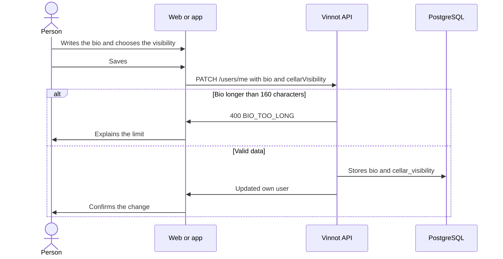

# UC-COM-09 · Edit my public profile

| Field | Value |
|---|---|
| ID | `UC-COM-09` |
| Module | [Community](../README.md) |
| Platforms | Web, App |
| Actors | Signed-in user |
| Lucidchart IDs | None |
| Requirements | [`RF-WEB-COM-13`](../requirements.md), [`RF-APK-COM-13`](../requirements.md) |
| Test cases | [`CP-COM-44`](../testing.md), [`CP-COM-45`](../testing.md), [`CP-COM-46`](../testing.md), [`CP-COM-47`](../testing.md) |

## Preconditions

- The person is signed in.

## Postconditions

- The bio and the cellar visibility are saved and the public profile reflects them.

## Main flow

1. The person opens the editing of their public profile: on the web, the "Public profile" card of the profile tab at `/profile` (also reached from "Edit profile" on their public profile); in the app, "Edit profile" on their profile or on their public profile.
2. They write a bio, with a character counter out of 160.
3. They choose who sees their cellar: "Public", "Followers only" or "Private".
4. They save. The client sends `PATCH /users/me` with `bio` and `cellarVisibility`; in the app the same request carries the rest of the form.
5. The API trims the bio, stores `null` when it ends up empty, stores the visibility and returns the own user with both fields.
6. The client confirms the change and the public profile shows the new bio and applies the chosen visibility.

## Alternative flows

- 2a. The bio exceeds 160 characters: the field accepts no more; if the API receives it anyway, it answers 400 `BIO_TOO_LONG` and the client explains the limit.
- 3a. The visibility is not `PUBLIC`, `FOLLOWERS` or `PRIVATE`: the API answers 400 without saving.
- 5a. Saving fails: the client says it could not save and keeps what was written.

## Business rules

- The default visibility is `PUBLIC`.
- The cellar's private notes and purchase prices are never shown, whatever the visibility.
- `GET /auth/me` and the `PATCH /users/me` response return `bio` and `cellarVisibility`.

## Diagram

[View the full “UC-COM-09 · Edit my public profile” diagram](https://images.vinnot.com/docs/diagrams/v1/en/modules-community-use-cases-uc-com-09-edit-public-profile-b54d058b35ae.svg)

## Code

| Layer | Location |
|---|---|
| Endpoints | `PATCH /users/me`, `GET /auth/me` |
| Backend | [`UserController.java`](../../../../../backend/src/main/java/com/vinnot/user/infrastructure/web/controller/UserController.java), [`UpdateUserProfileCommandHandler.java`](../../../../../backend/src/main/java/com/vinnot/user/application/command/handler/UpdateUserProfileCommandHandler.java) |
| Web | [`UserProfileSocialCard.tsx`](../../../../../frontend-react/src/presentation/pages/user/UserProfileSocialCard.tsx), [`useSocialProfileEditor.ts`](../../../../../frontend-react/src/presentation/pages/user/useSocialProfileEditor.ts), [`useUpdateSocialProfile.ts`](../../../../../frontend-react/src/presentation/hooks/queries/social/useUpdateSocialProfile.ts), [`social.validators.ts`](../../../../../frontend-react/src/domain/social/social.validators.ts), [`users.service.ts`](../../../../../frontend-react/src/application/services/users.service.ts) |
| App | [`EditProfileSheet.tsx`](../../../../../frontend-mobile/src/presentation/features/user/EditProfileSheet.tsx), [`users.service.ts`](../../../../../frontend-mobile/src/application/services/users.service.ts) |

## Automated tests

- Backend: [`UserSocialProfileTest.java`](../../../../../backend/src/test/java/com/vinnot/user/domain/model/UserSocialProfileTest.java), [`UpdateUserProfileCommandHandlerTest.java`](../../../../../backend/src/test/java/com/vinnot/user/application/command/handler/UpdateUserProfileCommandHandlerTest.java), [`SocialHttpPostgresIntegrationTest.java`](../../../../../backend/src/test/java/com/vinnot/community/infrastructure/SocialHttpPostgresIntegrationTest.java)
- Web: [`UserProfileSocialCard.test.tsx`](../../../../../frontend-react/src/presentation/pages/user/UserProfileSocialCard.test.tsx), [`social.validators.test.ts`](../../../../../frontend-react/src/domain/social/social.validators.test.ts), [`users.service.social.test.ts`](../../../../../frontend-react/src/application/services/users.service.social.test.ts)
- App: [`EditProfileSheet.test.tsx`](../../../../../frontend-mobile/src/presentation/features/user/EditProfileSheet.test.tsx)
