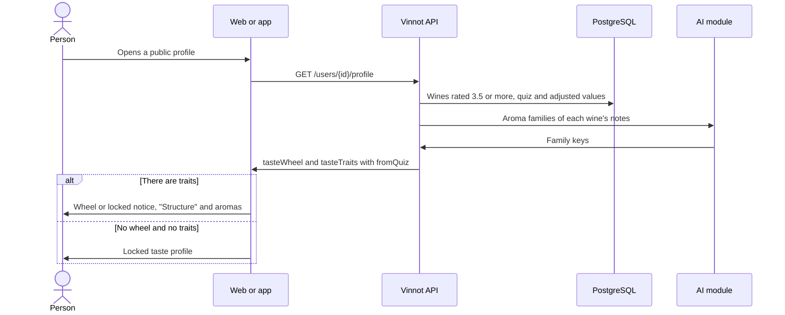

# UC-COM-10 · View the taste profile

| Field | Value |
|---|---|
| ID | `UC-COM-10` |
| Module | [Community](../README.md) |
| Platforms | Web, App |
| Actors | Signed-in user |
| Lucidchart IDs | None |
| Requirements | [`RF-WEB-COM-14`](../requirements.md), [`RF-WEB-COM-17`](../requirements.md), [`RF-APK-COM-14`](../requirements.md), [`RF-APK-COM-17`](../requirements.md) |
| Test cases | [`CP-COM-48`](../testing.md), [`CP-COM-49`](../testing.md), [`CP-COM-50`](../testing.md), [`CP-COM-51`](../testing.md), [`CP-COM-52`](../testing.md), [`CP-COM-53`](../testing.md), [`CP-COM-54`](../testing.md) |

## Preconditions

- The person is on a public profile ([UC-COM-06](uc-com-06-view-public-profile.md)).

## Postconditions

- The person sees which structure and which aromas the member prefers, in Vinnot's illustrated style.

## Main flow

1. The public profile carries `tasteWheel` and `tasteTraits`, computed on each request.
2. The client shows the taste profile card: the wheel ([UC-COM-11](uc-com-11-explore-taste-wheel.md)) on its cream stage with the grape-cluster emblem.
3. Below it shows "Structure": acidity, body, tannin and sweetness, each with its watercolor illustration, a 0-100 bar and the word for its level (low, medium or high; for sweetness, dry, off-dry or sweet).
4. Then it shows "Preferred aromas" (addressed to the member on their own profile): the fruity, floral, herbal, spicy, oak and mineral families as illustrated chips with their percentage, highest first.

## Alternative flows

- 1a. Some value comes from the taste quiz: the card says so with "Based on your taste quiz" on the own profile or "Based on the taste quiz" on someone else's ([UC-COM-12](uc-com-12-take-taste-quiz.md)).
- 2a. The member rated fewer than five wines but has quiz traits or adjusted values: a compact notice with the emblem and a lock takes the wheel's place, and the traits are shown anyway.
- 2b. There is no wheel and there are no traits: on someone else's profile the card shows only the locked state, explaining that the profile appears after five rated wines; on the own profile the lock sits next to "Structure" so the member can set it (3a).
- 3a. A trait lacks enough data: the trait is left out; with no trait at all, the "Structure" section does not appear except on the own profile, which offers to adjust it ([UC-COM-13](uc-com-13-adjust-palate.md)).
- 4a. Fewer than three wines have an AI profile and the quiz gives no families: the aromas section does not appear.
- 3b. A trait has a hand-set value: the trait shows the "Adjusted" tag.

## Business rules

- The wines the member likes are their non-rejected reviews and their cellar ratings without a review rated at least 3.5, the 200 most recent, weighted by the rating.
- A structure trait uses the catalog score or, when it is missing, the AI profile score; with fewer than three wines with data it is left out.
- A family is the weighted share of wines with an AI profile that have at least one note of that family; a family at 0% is left out.
- Each trait takes, in order, the hand-set value, the computed value and the completed quiz value; computed families replace the quiz families when they exist.
- The level is low below 34, medium below 67 and high from 67.
- The illustrations are decorative: the text carries the meaning.
- The quiz answers never appear on the public profile.

## Diagram

[View the full “UC-COM-10 · View the taste profile” diagram](https://images.vinnot.com/docs/diagrams/v1/en/modules-community-use-cases-uc-com-10-view-taste-profile-feb9e5814122.svg)

## Code

| Layer | Location |
|---|---|
| Endpoints | `GET /users/{id}/profile` (`tasteWheel` and `tasteTraits` fields) |
| Backend | [`GetSocialQueryHandler.java`](../../../../../backend/src/main/java/com/vinnot/community/application/query/handler/GetSocialQueryHandler.java), [`TasteTraits.java`](../../../../../backend/src/main/java/com/vinnot/community/domain/model/TasteTraits.java), [`TasteProfile.java`](../../../../../backend/src/main/java/com/vinnot/community/domain/model/TasteProfile.java) |
| Web | [`TasteProfileCard.tsx`](../../../../../frontend-react/src/presentation/components/features/social/TasteProfileCard.tsx), [`tasteProfileArt.ts`](../../../../../frontend-react/src/presentation/components/features/social/tasteProfileArt.ts), [`tasteTraits.ts`](../../../../../frontend-react/src/domain/social/tasteTraits.ts) |
| App | [`TasteProfileCard.tsx`](../../../../../frontend-mobile/src/presentation/features/social/TasteProfileCard.tsx), [`profileArt.ts`](../../../../../frontend-mobile/src/shared/profileArt.ts) |

## Automated tests

- Backend: [`TasteTraitsTest.java`](../../../../../backend/src/test/java/com/vinnot/community/domain/model/TasteTraitsTest.java), [`TasteTraitsBlendTest.java`](../../../../../backend/src/test/java/com/vinnot/community/domain/model/TasteTraitsBlendTest.java), [`GetSocialQueryHandlerTasteTraitsTest.java`](../../../../../backend/src/test/java/com/vinnot/community/application/query/handler/GetSocialQueryHandlerTasteTraitsTest.java), [`SocialHttpPostgresIntegrationTest.java`](../../../../../backend/src/test/java/com/vinnot/community/infrastructure/SocialHttpPostgresIntegrationTest.java)
- Web: [`PublicProfilePage.test.tsx`](../../../../../frontend-react/src/presentation/pages/social/PublicProfilePage.test.tsx), [`tasteTraits.test.ts`](../../../../../frontend-react/src/domain/social/tasteTraits.test.ts), [`tasteProfileArt.test.ts`](../../../../../frontend-react/src/presentation/components/features/social/tasteProfileArt.test.ts)
- App: [`TasteProfileCard.test.tsx`](../../../../../frontend-mobile/src/presentation/features/social/TasteProfileCard.test.tsx)
