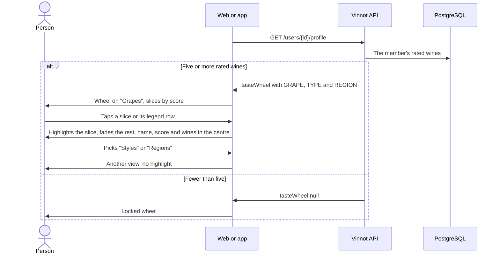

# UC-COM-11 · Explore the taste wheel

| Field | Value |
|---|---|
| ID | `UC-COM-11` |
| Module | [Community](../README.md) |
| Platforms | Web, App |
| Actors | Signed-in user |
| Lucidchart IDs | None |
| Requirements | [`RF-WEB-COM-15`](../requirements.md), [`RF-WEB-COM-16`](../requirements.md), [`RF-WEB-COM-17`](../requirements.md), [`RF-APK-COM-15`](../requirements.md), [`RF-APK-COM-16`](../requirements.md), [`RF-APK-COM-17`](../requirements.md) |
| Test cases | [`CP-COM-55`](../testing.md), [`CP-COM-56`](../testing.md), [`CP-COM-57`](../testing.md), [`CP-COM-58`](../testing.md), [`CP-COM-59`](../testing.md), [`CP-COM-60`](../testing.md) |

## Preconditions

- The person is on the public profile ([UC-COM-06](uc-com-06-view-public-profile.md)) of a member with at least five rated wines.

## Postconditions

- The person sees which grapes, styles or regions the member prefers and with what score.

## Main flow

1. The profile carries `tasteWheel`: up to eight grape slices (`GRAPE`), eight style slices (`TYPE`) and eight region slices (`REGION`), each with a label, a 0-5 score, a tone and its rated wines.
2. The client opens the wheel on "Grapes" and shows the "Grapes", "Styles" and "Regions" selector with the views that have slices.
3. It draws one equal-width slice per entry, painted as watercolor with an organic outline, and the legend with each slice's colour. Within the view, the best-scored slice reaches the rim and the lowest-scored one fills 65% of the ring. The wheel appears with a short animation when it opens.
4. The person taps a slice or its legend row: that slice is highlighted, the others fade and the centre shows the name, the score out of 5 and the number of rated wines.
5. The person taps the same slice again and the highlight is cleared.

## Alternative flows

- 2a. The person picks another view: the wheel shows only that kind of slice and clears the highlight.
- 2b. There are no grapes: the wheel opens on the first view with slices; with a single view no selector is shown.
- 3a. Every slice of the view has the same score: they all reach the rim.
- 3b. The person has reduced motion turned on: the wheel is drawn at once, without animation.
- 1a. The member rated fewer than five wines: `tasteWheel` is `null` and the locked state shows in its place ([UC-COM-10](uc-com-10-view-taste-profile.md)).

## Business rules

- A slice's score is the average rating of its wines, with two decimals; a grape repeated in one wine counts once.
- Grapes merge spellings in any script, case or accent (for example, the Greek and Latin spellings of one grape are one slice).
- Grapes take the colours of their tone: garnet, ruby and violet for reds, pinks for rosés, gold and green for whites; styles use each wine type's colour and regions clearly different hues. The region's country is not shown.
- Style labels are translated to the interface language.
- The rated-wine count is the sum of the member's `TYPE` rows in `user_taste_affinities`; the wheel is computed on each request and shows no wines, so a private cellar is not exposed.

## Diagram

[View the full “UC-COM-11 · Explore the taste wheel” diagram](https://images.vinnot.com/docs/diagrams/v1/en/modules-community-use-cases-uc-com-11-explore-taste-wheel-d138e986192a.svg)

## Code

| Layer | Location |
|---|---|
| Endpoints | `GET /users/{id}/profile` (`tasteWheel` field) |
| Backend | [`TasteWheel.java`](../../../../../backend/src/main/java/com/vinnot/community/domain/model/TasteWheel.java), [`GrapeName.java`](../../../../../backend/src/main/java/com/vinnot/community/domain/model/GrapeName.java), [`GetSocialQueryHandler.java`](../../../../../backend/src/main/java/com/vinnot/community/application/query/handler/GetSocialQueryHandler.java) |
| Web | [`TasteWheel.tsx`](../../../../../frontend-react/src/presentation/components/features/social/TasteWheel.tsx), [`useTasteWheelView.ts`](../../../../../frontend-react/src/presentation/components/features/social/useTasteWheelView.ts), [`tasteWheel.ts`](../../../../../frontend-react/src/domain/social/tasteWheel.ts) |
| App | [`TasteWheel.tsx`](../../../../../frontend-mobile/src/presentation/features/social/TasteWheel.tsx), [`TasteWheelCanvas.tsx`](../../../../../frontend-mobile/src/presentation/features/social/TasteWheelCanvas.tsx), [`useTasteWheel.ts`](../../../../../frontend-mobile/src/presentation/features/social/useTasteWheel.ts), [`tasteWheelGeometry.ts`](../../../../../frontend-mobile/src/presentation/features/social/tasteWheelGeometry.ts), [`tasteWheelPalette.ts`](../../../../../frontend-mobile/src/presentation/features/social/tasteWheelPalette.ts) |

## Automated tests

- Backend: [`TasteWheelTest.java`](../../../../../backend/src/test/java/com/vinnot/community/domain/model/TasteWheelTest.java), [`GrapeNameTest.java`](../../../../../backend/src/test/java/com/vinnot/community/domain/model/GrapeNameTest.java), [`GetSocialQueryHandlerTasteWheelTest.java`](../../../../../backend/src/test/java/com/vinnot/community/application/query/handler/GetSocialQueryHandlerTasteWheelTest.java), [`SocialHttpPostgresIntegrationTest.java`](../../../../../backend/src/test/java/com/vinnot/community/infrastructure/SocialHttpPostgresIntegrationTest.java)
- Web: [`TasteWheel.test.tsx`](../../../../../frontend-react/src/presentation/components/features/social/TasteWheel.test.tsx), [`tasteWheel.test.ts`](../../../../../frontend-react/src/domain/social/tasteWheel.test.ts)
- App: [`TasteWheel.test.tsx`](../../../../../frontend-mobile/src/presentation/features/social/TasteWheel.test.tsx), [`TasteWheelCanvas.test.tsx`](../../../../../frontend-mobile/src/presentation/features/social/TasteWheelCanvas.test.tsx), [`tasteWheelGeometry.test.ts`](../../../../../frontend-mobile/src/presentation/features/social/tasteWheelGeometry.test.ts), [`tasteWheelPalette.test.ts`](../../../../../frontend-mobile/src/presentation/features/social/tasteWheelPalette.test.ts)
