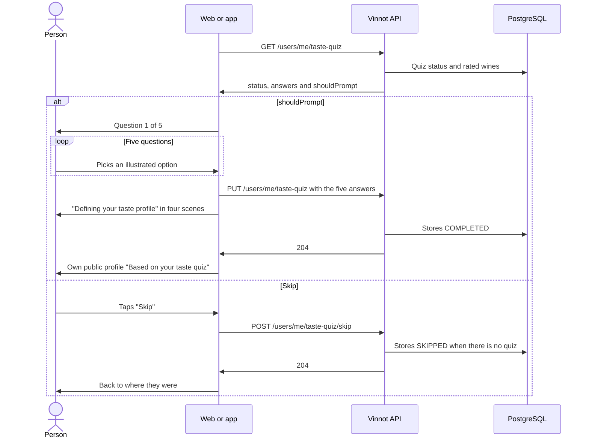

# UC-COM-12 · Take the taste quiz

| Field | Value |
|---|---|
| ID | `UC-COM-12` |
| Module | [Community](../README.md) |
| Platforms | Web, App |
| Actors | Signed-in user |
| Lucidchart IDs | None |
| Requirements | [`RF-WEB-COM-18`](../requirements.md), [`RF-WEB-COM-19`](../requirements.md), [`RF-WEB-COM-20`](../requirements.md), [`RF-APK-COM-18`](../requirements.md), [`RF-APK-COM-19`](../requirements.md), [`RF-APK-COM-20`](../requirements.md) |
| Test cases | [`CP-COM-61`](../testing.md), [`CP-COM-62`](../testing.md), [`CP-COM-63`](../testing.md), [`CP-COM-64`](../testing.md), [`CP-COM-65`](../testing.md), [`CP-COM-66`](../testing.md), [`CP-COM-67`](../testing.md), [`CP-COM-68`](../testing.md) |

## Preconditions

- The person is signed in, with the terms accepted and the profile completed.

## Postconditions

- The quiz is `COMPLETED` with its five answers, or `SKIPPED` if the person skipped it.
- A completed quiz gives the taste profile a starting point ([UC-COM-10](uc-com-10-view-taste-profile.md)).

## Main flow

1. After sign-in, the client calls `GET /users/me/taste-quiz`. When `shouldPrompt` is true (quiz pending and fewer than five rated wines), it opens the quiz: on the web, `/taste-quiz`; in the app, its screen.
2. The client shows five questions one at a time, with "Question n of 5" and a watercolor illustration per option: a rainy day, the favorite fruit, the dessert, a special dinner and the scent they like most.
3. The person taps an option; it is marked and, after a short beat, the next question appears.
4. After the fifth answer, the client sends `PUT /users/me/taste-quiz` with the five answers and shows the "Defining your taste profile" animation, with four scenes: "Gathering your picks", "Filling your glass", "Blending your flavors" and "Shaping your taste profile".
5. The API validates the answers, stores them as `COMPLETED` and answers 204.
6. Once the animation ends, the client opens the own public profile with the taste profile "Based on your taste quiz".

## Alternative flows

- 1a. The person taps "Take the taste quiz" on their public profile, or "Retake the quiz" when they already completed it: the quiz opens and, on a retake, the new answers replace the previous ones.
- 1b. The quiz is already completed or skipped, or the person rated five wines or more: the client does not offer it on its own.
- 3a. The person taps "Back" ("Previous question" in the app): the previous question comes back and the answers are kept.
- 3b. The person taps "Skip" on any step: the client sends `POST /users/me/taste-quiz/skip`, the API records `SKIPPED` and the person returns to where they were; the quiz is not offered on its own again.
- 3c. "Skip" during a retake: the person leaves without recording anything and the completed quiz stays as it was.
- 5a. Saving fails: the client shows the error, keeps the answers and offers "Try again". On the web, "Not now" leaves and records the skip except on a retake; in the app, "Later" leaves without recording anything, so the quiz is offered again later.
- 5b. A question is missing, or a question or option is unknown: the API answers 400 `INVALID_TASTE_QUIZ` without saving anything.

## Business rules

- The quiz is offered only once per browser or app session; across sessions the status stored on the server decides.
- Skipping never erases a completed quiz.
- The person sees the options, never how they translate into taste traits; the translation lives in the backend domain.
- Each scene lasts about 3 seconds with eased motion, and the animation lasts at least 13.4 seconds on the web and 12.8 seconds in the app even when the answer arrives sooner. With reduced motion turned on, the scenes are not animated.
- The answers never appear on the public profile; `GET /users/me/taste-quiz` returns them to their owner only.

## Diagram

[View the full “UC-COM-12 · Take the taste quiz” diagram](https://images.vinnot.com/docs/diagrams/v1/en/modules-community-use-cases-uc-com-12-take-taste-quiz-0fb21befa37d.svg)

## Code

| Layer | Location |
|---|---|
| Endpoints | `GET /users/me/taste-quiz`, `PUT /users/me/taste-quiz`, `POST /users/me/taste-quiz/skip` |
| Backend | [`TasteQuizController.java`](../../../../../backend/src/main/java/com/vinnot/community/infrastructure/web/TasteQuizController.java), [`GetTasteQuizQueryHandler.java`](../../../../../backend/src/main/java/com/vinnot/community/application/query/handler/GetTasteQuizQueryHandler.java), [`CompleteTasteQuizCommandHandler.java`](../../../../../backend/src/main/java/com/vinnot/community/application/command/handler/CompleteTasteQuizCommandHandler.java), [`SkipTasteQuizCommandHandler.java`](../../../../../backend/src/main/java/com/vinnot/community/application/command/handler/SkipTasteQuizCommandHandler.java), [`TasteQuiz.java`](../../../../../backend/src/main/java/com/vinnot/community/domain/model/TasteQuiz.java) |
| Web | [`TasteQuizPage.tsx`](../../../../../frontend-react/src/presentation/pages/user/TasteQuizPage.tsx), [`useTasteQuizViewModel.ts`](../../../../../frontend-react/src/presentation/pages/user/useTasteQuizViewModel.ts), [`TasteQuizLoadingSteps.tsx`](../../../../../frontend-react/src/presentation/components/features/tasteQuiz/TasteQuizLoadingSteps.tsx), [`TasteQuizPrompt.tsx`](../../../../../frontend-react/src/presentation/components/features/tasteQuiz/TasteQuizPrompt.tsx), [`useTasteQuizPrompt.ts`](../../../../../frontend-react/src/presentation/hooks/useTasteQuizPrompt.ts), [`tasteQuiz.service.ts`](../../../../../frontend-react/src/application/services/tasteQuiz.service.ts), [`tasteQuiz.client.ts`](../../../../../frontend-react/src/infrastructure/api/clients/tasteQuiz.client.ts) |
| App | [`TasteQuizScreen.tsx`](../../../../../frontend-mobile/src/presentation/features/tasteQuiz/TasteQuizScreen.tsx), [`useTasteQuizFlow.ts`](../../../../../frontend-mobile/src/presentation/features/tasteQuiz/useTasteQuizFlow.ts), [`TasteQuizLoadingSteps.tsx`](../../../../../frontend-mobile/src/presentation/features/tasteQuiz/TasteQuizLoadingSteps.tsx), [`TasteQuizPromptHost.tsx`](../../../../../frontend-mobile/src/presentation/features/tasteQuiz/TasteQuizPromptHost.tsx), [`useTasteQuizPrompt.ts`](../../../../../frontend-mobile/src/presentation/features/tasteQuiz/useTasteQuizPrompt.ts), [`tasteQuiz.service.ts`](../../../../../frontend-mobile/src/application/services/tasteQuiz.service.ts), [`tasteQuiz.client.ts`](../../../../../frontend-mobile/src/infrastructure/api/clients/tasteQuiz.client.ts) |

## Automated tests

- Backend: [`TasteQuizTest.java`](../../../../../backend/src/test/java/com/vinnot/community/domain/model/TasteQuizTest.java), [`TasteQuizCommandHandlersTest.java`](../../../../../backend/src/test/java/com/vinnot/community/application/command/handler/TasteQuizCommandHandlersTest.java), [`GetTasteQuizQueryHandlerTest.java`](../../../../../backend/src/test/java/com/vinnot/community/application/query/handler/GetTasteQuizQueryHandlerTest.java), [`SocialHttpPostgresIntegrationTest.java`](../../../../../backend/src/test/java/com/vinnot/community/infrastructure/SocialHttpPostgresIntegrationTest.java)
- Web: [`TasteQuizPage.test.tsx`](../../../../../frontend-react/src/presentation/pages/user/TasteQuizPage.test.tsx), [`TasteQuizPrompt.test.tsx`](../../../../../frontend-react/src/presentation/components/features/tasteQuiz/TasteQuizPrompt.test.tsx), [`TasteQuizLoadingSteps.test.tsx`](../../../../../frontend-react/src/presentation/components/features/tasteQuiz/TasteQuizLoadingSteps.test.tsx), [`tasteQuiz.mappers.test.ts`](../../../../../frontend-react/src/domain/tasteQuiz/tasteQuiz.mappers.test.ts), [`tasteQuiz.service.test.ts`](../../../../../frontend-react/src/application/services/tasteQuiz.service.test.ts), [`tasteQuiz.client.test.ts`](../../../../../frontend-react/src/infrastructure/api/clients/tasteQuiz.client.test.ts)
- App: [`TasteQuizScreen.test.tsx`](../../../../../frontend-mobile/src/presentation/features/tasteQuiz/TasteQuizScreen.test.tsx), [`TasteQuizPromptHost.test.tsx`](../../../../../frontend-mobile/src/presentation/features/tasteQuiz/TasteQuizPromptHost.test.tsx), [`TasteQuizLoadingSteps.test.tsx`](../../../../../frontend-mobile/src/presentation/features/tasteQuiz/TasteQuizLoadingSteps.test.tsx), [`tasteQuiz.rules.test.ts`](../../../../../frontend-mobile/src/domain/tasteQuiz/tasteQuiz.rules.test.ts), [`tasteQuiz.mappers.test.ts`](../../../../../frontend-mobile/src/domain/tasteQuiz/tasteQuiz.mappers.test.ts), [`tasteQuizOperations.test.ts`](../../../../../frontend-mobile/src/application/operations/tasteQuizOperations.test.ts), [`tasteQuiz.service.test.ts`](../../../../../frontend-mobile/src/application/services/tasteQuiz.service.test.ts), [`tasteQuiz.client.test.ts`](../../../../../frontend-mobile/src/infrastructure/api/clients/tasteQuiz.client.test.ts)
