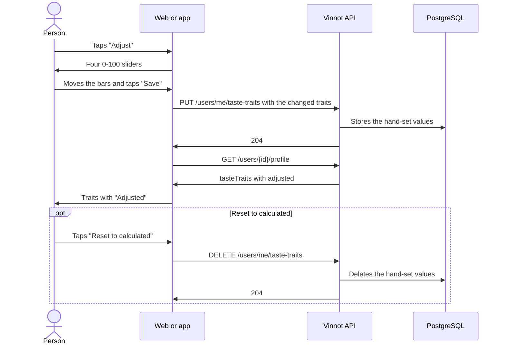

# UC-COM-13 · Adjust my palate

| Field | Value |
|---|---|
| ID | `UC-COM-13` |
| Module | [Community](../README.md) |
| Platforms | Web, App |
| Actors | Signed-in user |
| Lucidchart IDs | None |
| Requirements | [`RF-WEB-COM-21`](../requirements.md), [`RF-APK-COM-21`](../requirements.md) |
| Test cases | [`CP-COM-69`](../testing.md), [`CP-COM-70`](../testing.md), [`CP-COM-71`](../testing.md), [`CP-COM-72`](../testing.md), [`CP-COM-73`](../testing.md), [`CP-COM-74`](../testing.md) |

## Preconditions

- The person is on their own public profile ([UC-COM-06](uc-com-06-view-public-profile.md)).

## Postconditions

- The structure traits the person adjusted show their hand-set value, with the "Adjusted" tag, to anyone who sees the profile.

## Main flow

1. The person taps "Adjust" in the "Structure" section of their taste profile.
2. The acidity, body, tannin and sweetness bars turn into 0-100 sliders; a trait without data starts in the middle.
3. The person moves the bars to fill or empty them and taps "Save".
4. The client sends `PUT /users/me/taste-traits` with `structure`, holding only the traits they changed.
5. The API validates the whole object, stores the hand-set values and answers 204.
6. The profile reloads: each adjusted trait shows its value with the "Adjusted" tag.

## Alternative flows

- 3a. The person taps "Cancel": the bars return to the values shown and nothing is saved.
- 3b. The person taps "Save" without changing anything: the editor closes without sending a request.
- 3c. The person taps "Reset to calculated", shown when some trait is adjusted: the client sends `DELETE /users/me/taste-traits`, the API deletes every hand-set value and answers 204, and the traits return to their computed or quiz value.
- 5a. A trait is unknown or a score is not an integer from 0 to 100: the API answers 400 `INVALID_TASTE_ADJUSTMENT` and saves nothing.
- 5b. Saving fails: the editor stays open with an error message.

## Business rules

- Only the owner sees "Adjust"; visitors never get the editor.
- A hand-set value replaces the computed value and the quiz value of its trait; sending `null` for a trait clears only that hand-set value.
- The aroma families, the wheel and the affinity do not change with hand-set values.
- The sliders work with the keyboard on the web (arrows in steps of 5, Home and End) and with the screen reader in the app (steps of 5), and announce the level word.

## Diagram

[View the full “UC-COM-13 · Adjust my palate” diagram](https://images.vinnot.com/docs/diagrams/v1/en/modules-community-use-cases-uc-com-13-adjust-palate-0c3010741484.svg)

## Code

| Layer | Location |
|---|---|
| Endpoints | `PUT /users/me/taste-traits`, `DELETE /users/me/taste-traits` |
| Backend | [`TasteTraitsController.java`](../../../../../backend/src/main/java/com/vinnot/community/infrastructure/web/TasteTraitsController.java), [`AdjustTasteTraitsCommandHandler.java`](../../../../../backend/src/main/java/com/vinnot/community/application/command/handler/AdjustTasteTraitsCommandHandler.java), [`ResetTasteTraitsCommandHandler.java`](../../../../../backend/src/main/java/com/vinnot/community/application/command/handler/ResetTasteTraitsCommandHandler.java), [`TasteAdjustment.java`](../../../../../backend/src/main/java/com/vinnot/community/domain/model/TasteAdjustment.java) |
| Web | [`TasteProfileCard.tsx`](../../../../../frontend-react/src/presentation/components/features/social/TasteProfileCard.tsx), [`TasteTraitSlider.tsx`](../../../../../frontend-react/src/presentation/components/features/social/TasteTraitSlider.tsx), [`useTasteStructureEditor.ts`](../../../../../frontend-react/src/presentation/pages/social/useTasteStructureEditor.ts), [`useTasteTraits.ts`](../../../../../frontend-react/src/presentation/hooks/queries/user/useTasteTraits.ts), [`tasteTraits.service.ts`](../../../../../frontend-react/src/application/services/tasteTraits.service.ts), [`tasteTraits.client.ts`](../../../../../frontend-react/src/infrastructure/api/clients/tasteTraits.client.ts) |
| App | [`TasteProfileCard.tsx`](../../../../../frontend-mobile/src/presentation/features/social/TasteProfileCard.tsx), [`TasteTraitSlider.tsx`](../../../../../frontend-mobile/src/presentation/features/social/TasteTraitSlider.tsx), [`useTasteStructureEditor.ts`](../../../../../frontend-mobile/src/presentation/features/social/useTasteStructureEditor.ts), [`social.client.ts`](../../../../../frontend-mobile/src/infrastructure/api/clients/social.client.ts) |

## Automated tests

- Backend: [`TasteAdjustmentTest.java`](../../../../../backend/src/test/java/com/vinnot/community/domain/model/TasteAdjustmentTest.java), [`TasteAdjustmentCommandHandlersTest.java`](../../../../../backend/src/test/java/com/vinnot/community/application/command/handler/TasteAdjustmentCommandHandlersTest.java), [`SocialHttpPostgresIntegrationTest.java`](../../../../../backend/src/test/java/com/vinnot/community/infrastructure/SocialHttpPostgresIntegrationTest.java)
- Web: [`PublicProfilePage.test.tsx`](../../../../../frontend-react/src/presentation/pages/social/PublicProfilePage.test.tsx), [`tasteTraits.test.ts`](../../../../../frontend-react/src/domain/social/tasteTraits.test.ts), [`tasteTraits.client.test.ts`](../../../../../frontend-react/src/infrastructure/api/clients/tasteTraits.client.test.ts)
- App: [`TasteTraitSlider.test.tsx`](../../../../../frontend-mobile/src/presentation/features/social/TasteTraitSlider.test.tsx), [`TasteProfileCard.test.tsx`](../../../../../frontend-mobile/src/presentation/features/social/TasteProfileCard.test.tsx)
