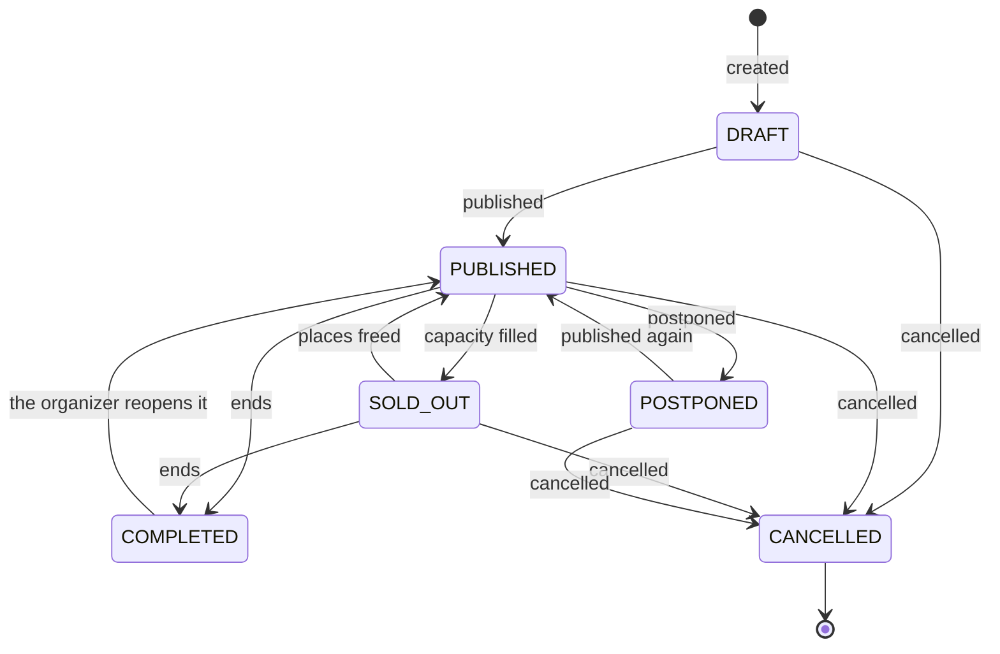
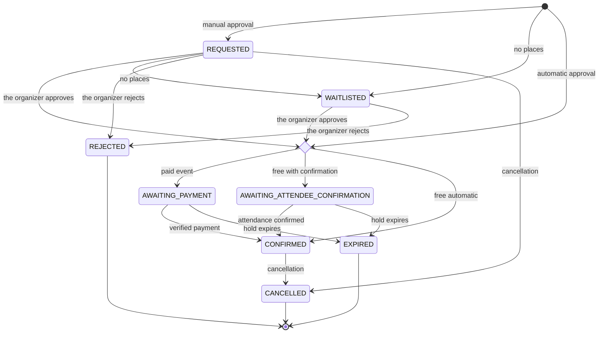
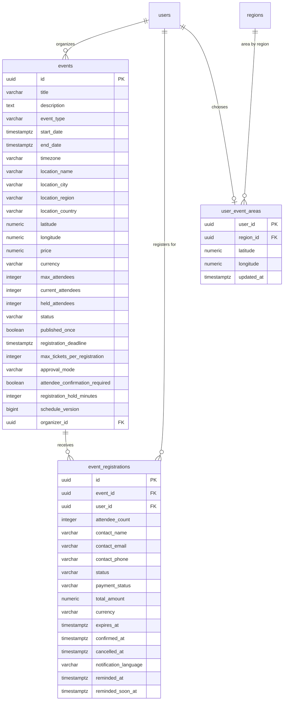

# Events and tickets

Wine events published by organizers: discovering them by distance or with filters,
registering, confirming attendance, cancelling the registration and viewing
tickets. It also covers the nearby events notice area and the jobs that complete
ended events, expire holds and notify attendees. Registration payments are in
[Payments](../payments/README.md) and event management by the organizer is in
[Partners](../partner/README.md).

- Module code: `EVT`.
- Backend: package [`event`](../../../../backend/src/main/java/com/vinnot/event/).
- [Use cases](use-cases/README.md) · [Requirements](requirements.md) ·
  [Architecture](architecture.md) · [Testing](testing.md)

## Actors

| Actor | What they do in this module |
|---|---|
| Signed-in user | Discovers events, registers, confirms or cancels their registration, views their tickets and chooses their notice area |
| Organizer | Receives and reviews registrations (from [Partners](../partner/README.md)) and gets notices |
| System (scheduled jobs) | Completes ended events, expires holds and sends reminders |
| Email and push service | Delivers registration, change, cancellation, reminder and nearby event notices |

## Business rules

| Rule | Detail | Where |
|---|---|---|
| Access | Every event read requires a session | [`EventController.java`](../../../../backend/src/main/java/com/vinnot/event/infrastructure/web/controller/EventController.java) |
| Lists | Only `PUBLISHED` or `SOLD_OUT` events whose end is after the request | [`EventPersistenceAdapter.java`](../../../../backend/src/main/java/com/vinnot/event/infrastructure/persistence/adapter/EventPersistenceAdapter.java) |
| Distance | Radius from 0 to 500 km (0 means 100); nearby events are kept apart from other events | [`DiscoverEventsQueryHandler.java`](../../../../backend/src/main/java/com/vinnot/event/application/query/handler/DiscoverEventsQueryHandler.java) |
| Details | An event is visible if it was published at least once and is not a draft; the organizer and staff also see private ones | [`GetEventByIdQueryHandler.java`](../../../../backend/src/main/java/com/vinnot/event/application/query/handler/GetEventByIdQueryHandler.java) |
| One active registration | Per person and event; 1 to 20 tickets within the event's maximum (6 by default) | [`RegisterForEventCommandHandler.java`](../../../../backend/src/main/java/com/vinnot/event/application/command/handler/RegisterForEventCommandHandler.java) |
| Closing | Registration closes at the deadline and never after the start | [`EventRegistrationSettings.java`](../../../../backend/src/main/java/com/vinnot/event/domain/valueobject/EventRegistrationSettings.java) |
| Capacity | Confirmed registrations and holds never exceed the capacity; when full the event becomes `SOLD_OUT` and goes back to `PUBLISHED` if places are freed | [`Event.java`](../../../../backend/src/main/java/com/vinnot/event/domain/model/Event.java) |
| Holds | Last what the event defines (1440 minutes by default); expired holds release the place | [`MaintainEventLifecycleCommandHandler.java`](../../../../backend/src/main/java/com/vinnot/event/application/command/handler/MaintainEventLifecycleCommandHandler.java) |
| Waitlist | Does not move up on its own when a place is freed | [`EventRegistration.java`](../../../../backend/src/main/java/com/vinnot/event/domain/model/EventRegistration.java) |
| Own cancellation | A confirmed registration paid online is cancelled by the organizer | [`CancelEventRegistrationCommandHandler.java`](../../../../backend/src/main/java/com/vinnot/event/application/command/handler/CancelEventRegistrationCommandHandler.java) |
| Reminders | Email and push between 24 and 1 hour before, and another push between 2 hours and 15 minutes before | [`SendEventRemindersService.java`](../../../../backend/src/main/java/com/vinnot/event/application/service/SendEventRemindersService.java) |
| Nearby events | Push on first publication, at most once a day, to people whose area matches | [`AnnounceNewEventNearbyService.java`](../../../../backend/src/main/java/com/vinnot/event/application/service/AnnounceNewEventNearbyService.java) |
| Notice area | A region or a point rounded to 0.1° with a 50 km radius | [`EventArea.java`](../../../../backend/src/main/java/com/vinnot/event/domain/valueobject/EventArea.java) |

## Event states

[View the full “Event states” diagram](https://images.vinnot.com/docs/diagrams/v1/en/modules-events-readme-fe74ec71c9eb.svg)

The system sets `SOLD_OUT` from the capacity; it cannot be requested by hand.

## Registration states

[View the full “Registration states” diagram](https://images.vinnot.com/docs/diagrams/v1/en/modules-events-readme-c91ab12f0e7e.svg)

## Where it lives

| Part | Location |
|---|---|
| API | [`EventController`](../../../../backend/src/main/java/com/vinnot/event/infrastructure/web/controller/EventController.java) under `/events`, [`MyTicketsController`](../../../../backend/src/main/java/com/vinnot/event/infrastructure/web/controller/MyTicketsController.java) under `/me/tickets` and [`EventAreaController`](../../../../backend/src/main/java/com/vinnot/event/infrastructure/web/controller/EventAreaController.java) under `/users/me/event-area` |
| Web | Pages `/events`, `/events/:id` and `/my-tickets` in [`pages/events`](../../../../frontend-react/src/presentation/pages/events/) |
| App | Events tab in `frontend-mobile/app/(app)/(tabs)/events/`, tickets in `frontend-mobile/app/(app)/my-tickets/` and logic in [`features/event`](../../../../frontend-mobile/src/presentation/features/event/) |

## Data

`V1` creates `events` and `event_registrations`; `V8` adds the registration
workflow and capacity, `V22` the publication history, `V35` the notice language,
`V40` the time zone, `V44` the schedule version, `V45` and `V48` the reminders
and `V50` the notice areas.

[View the full “Events and tickets · Data” diagram](https://images.vinnot.com/docs/diagrams/v1/en/modules-events-readme-bd2be805cec5.svg)

Deleting an account removes its events, its registrations and its notice area.
