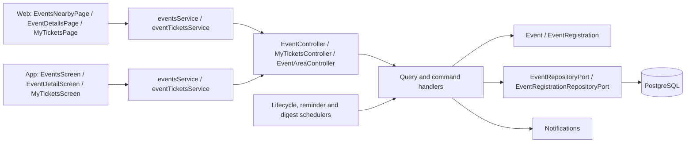
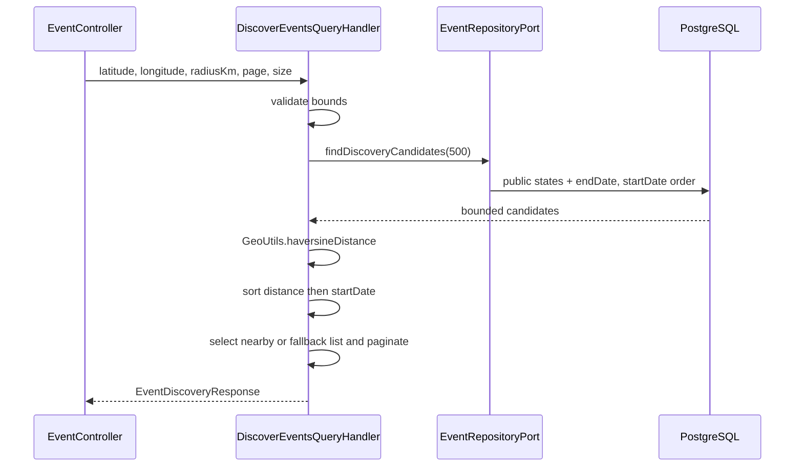
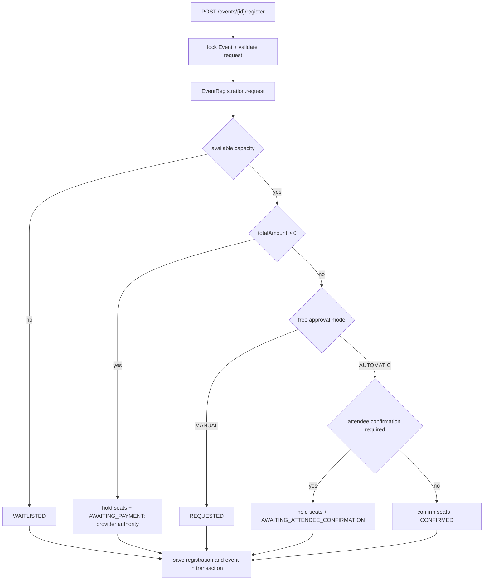

# Architecture

How the module is built in each layer. The backend follows the hexagonal flow
`controller → input port → handler → domain → output port → adapter`;
the web and the app follow `screen → hook → service → API client → HTTP transport`.
Registration payments are in [Payments](../payments/README.md) and event
management by the organizer is in [Partners](../partner/README.md).

[View the full “Architecture” diagram](https://images.vinnot.com/docs/diagrams/v1/en/modules-events-architecture-eccde02c4dad.svg)

## Backend

### Purpose, actors and boundaries

The event module owns discovery, content, registration settings, requests, reservations and capacity. Every read requires a session. Authenticated users browse events, request or cancel their own registration, initiate checkout and confirm free attendance; organizers or administrators review requests. Partner is an HTTP adapter reusing event use cases.

Paid admission is confirmed only after a charge verified by the payment module. Legacy report/manual-credit endpoints reject with PAYMENT_PROVIDER_VERIFICATION_REQUIRED without changing capacity.

### Read contracts

| GET | Behavior |
|---|---|
| `/events` | text, type, city, region and country; public states and endDate later than query time |
| `/events/upcoming` | dedicated upcoming-events query |
| `/events/nearby` | geographic repository query; not the discovery algorithm |
| `/events/discovery` | bounded candidates + local Haversine + radius partition |
| `/events/{id}` | projection of the entity retrieved by UUID |
| `/events/my-events` | authenticated organizer's events |
| `/events/{eventId}/registrations/me` | principal's registration; authenticated query |

Public lists use PUBLISHED and SOLD_OUT with endDate > now. Detail uses findById and requires publishedOnce with a status other than DRAFT; the organizer and ADMIN/MODERATOR retain private reads. Historical published links remain accessible without exposing drafts. `EventDetailsResponse.publiclyVisible` (`Event.isPubliclyVisible()`: published at least once and a status other than `DRAFT`) says whether the event has a public page; an event cancelled without ever being published has none. Paths are relative to /api.

### Discovery algorithm

[View the full “Discovery algorithm” diagram](https://images.vinnot.com/docs/diagrams/v1/en/modules-events-architecture-b9e10bb03efd.svg)

Latitude accepts [-90,90], longitude [-180,180], radius 0..500 km, page >= 0 and size 1..50. Radius 0 selects the 100 km default. Distance is rounded to one decimal; events without coordinates retain null distance and sort last. Google Maps is not called.

If candidates are inside the radius, that list is paginated and the alternative list is empty. Otherwise the ordered alternative list and a message are returned. Total refers to the selected candidate set, not a geospatial query over the entire catalog.

### Registration preconditions and settings

RegisterForEventCommandHandler obtains the event through findByIdForUpdate. ensureRegistrationRequestAllowed accepts PUBLISHED/SOLD_OUT, requires now before the earlier of registrationDeadline and startDate, and checks maxTicketsPerRegistration. Quantity and contact data are validated when creating EventRegistration. An active registration for the same event/user produces EVENT_ALREADY_REGISTERED.

EventRegistrationSettings defines currency, deadline, per-request maximum (1..20), MANUAL/AUTOMATIC, attendee confirmation and hold duration (5..10080 minutes). Total is event price × attendees; a null price is zero. Empty contact name/email uses user data; the response can include an organizer WhatsApp or mailto URL.

[View the full “Registration preconditions and settings” diagram](https://images.vinnot.com/docs/diagrams/v1/en/modules-events-architecture-bf31c57c8b74.svg)

### Actions and counters

| Action / actor | Input state | Result and capacity |
|---|---|---|
| APPROVE / organizer-admin | REQUESTED, WAITLISTED | applies free/paid branches; no capacity moves to WAITLISTED |
| WAITLIST / organizer-admin | REQUESTED, WAITLISTED | WAITLISTED; no seat reservation |
| REJECT / organizer-admin | nonterminal, not CONFIRMED | REJECTED; releases any hold |
| APPROVE_PAYMENT / organizer-admin | Any state | Rejected: provider verification required |
| CONFIRM_PAY_AT_VENUE / organizer-admin | Any state | Rejected: door payments are not enabled |
| confirm-attendance / owner | AWAITING_ATTENDEE_CONFIRMATION + active hold | CONFIRMED; held -= n, current += n |
| report-payment / owner | Any state | Rejected: reported payment is not proof |
| cancel registration / owner | nonterminal, except CONFIRMED with provider-verified (online) payment | CANCELLED; releases held or confirmed seats. A confirmed online payment returns 422 `PAID_REGISTRATION_REQUIRES_ORGANIZER`: refunds are authorized by the organizer, so the attendee contacts them |
| expire / scheduler | held state and expiresAt <= now | EXPIRED; held -= n |

Review checks admin role or organizerId=requestingUserId and verifies registration.eventId matches the route event. Personal endpoints derive the user from the principal and validate ownership in the handler. Cancelling an event changes Event; cancelling a registration is a separate operation.

### Activity diagram: registration and cancellation

Shows in UML activity notation how `RegisterForEventCommandHandler` resolves a request and when the holder can cancel it.

```mermaid
flowchart TD
    start((" ")) --> a1("Request registration with quantity and contact")
    a1 --> a2("Lock the event and validate status, deadline and limit")
    a2 --> d1{" "}
    d1 -->|"[closed, over the limit or already registered]"| a3("Return the domain error")
    d1 -->|"[valid]"| d2{" "}
    d2 -->|"[no capacity]"| a4("WAITLISTED")
    d2 -->|"[capacity and total > 0]"| a5("Hold seats: AWAITING_PAYMENT")
    d2 -->|"[free and MANUAL]"| a6("REQUESTED: awaits organizer review")
    d2 -->|"[free and AUTOMATIC]"| d3{" "}
    d3 -->|"[confirmation required]"| a7("Hold seats: AWAITING_ATTENDEE_CONFIRMATION")
    d3 -->|"[no confirmation]"| a8("Confirm seats: CONFIRMED")
    a4 & a5 & a6 & a7 & a8 --> m1{" "}
    m1 --> a9("Save event and registration in one transaction")
    a9 --> d4{" "}
    d4 -->|"[holder cancels]"| d5{" "}
    d5 -->|"[CONFIRMED with online payment]"| a10("Reject: PAID_REGISTRATION_REQUIRES_ORGANIZER")
    d5 -->|"[not terminal]"| a11("CANCELLED: release the hold or seats")
    d4 -->|"[still active]"| stop
    a3 & a10 & a11 --> stop(((" ")))
    classDef bar fill:#30262c,stroke:#30262c,color:#30262c
    style start fill:#30262c,stroke:#30262c
    style stop fill:#30262c,stroke:#30262c
```

[View the full “Activity diagram: registration and cancellation” diagram](https://images.vinnot.com/docs/diagrams/v1/en/modules-events-architecture-04cdd3eac5d9.svg)

### HTTP and domain errors

Creating an event requires EVENT_CREATE; editing/publishing/cancelling requires EVENT_UPDATE or EVENT_UPDATE_OWN. Reviewing/listing registrations uses those authorities plus ownership. Requesting, confirming, reporting payment and cancelling registration require a session. Administrative contracts are detailed in [Administration](../admin/architecture.md#backend) and [Partners](../partner/architecture.md#backend).

Updates (`PATCH /events/{id}`, `PUT /partner/events/{id}` and `PATCH /admin/events/{id}`) do not cancel: asking for a status change to `CANCELLED` answers 400 `USE_CANCEL_ENDPOINT`, because cancelling has its own endpoint with a reason and notices. Sending the current status back, `SOLD_OUT` or `CANCELLED` included, is not a status change and the other fields are saved.

Cancelling accepts an optional JSON body `{"reason": "...", "note": "..."}` on
`PATCH /events/{id}/cancel`, `DELETE /partner/events/{id}`,
`PATCH /admin/events/{id}/cancel` and `DELETE /admin/events/{id}`. `reason` is
one of `UNFORESEEN_CIRCUMSTANCES` (the preselected default, also used when the
body or reason is missing),
`SCHEDULING_CONFLICT`, `VENUE_UNAVAILABLE`, `INSUFFICIENT_ATTENDANCE`,
`WEATHER`, `HEALTH_AND_SAFETY` or `OTHER`; `note` (up to 280 characters) is
kept only with `OTHER`. The reason is not stored: `EventCancellationService`
reads the active registrations before the cascade and queues one
`EVENT_CANCELLED_ATTENDEE` email each with the reason and what happens to the
money (`CancellationRefund`: `ONLINE` for an approved online payment, refunded automatically to the same payment method ([Payments](../payments/README.md)),
`ORGANIZER` for an approved or reported direct payment, `NONE` otherwise). V44
makes the registration trigger skip its generic attendee copy for that cascade.
The organizer still gets a summary only when someone else cancelled.

A change of start, end or venue on a `PUBLISHED` or `SOLD_OUT` event (through
`PATCH /events/{id}` or the partner/admin update) raises
`events.schedule_version`. The venue counts as people read it (name, address,
city, region, country); map coordinates or embed URL alone do not. After saving,
`UpdateEventCommandHandler` hands the previous schedule to
`EventScheduleChangeService`, which queues one `EVENT_CHANGED_ATTENDEE` email per
confirmed registration with the new values and, for what changed, the previous
ones. The key includes the schedule version, so saving the same values again
sends nothing. Drafts and cancelled events send no change notice.

Relevant codes include NOT_AVAILABLE, REGISTRATION_CLOSED, REGISTRATION_LIMIT_EXCEEDED, EVENT_SOLD_OUT, REGISTRATION_HOLD_EXPIRED, INVALID_PAYMENT_METHOD, EVENT_ALREADY_REGISTERED, EVENT_OWNERSHIP and REGISTRATION_EVENT_MISMATCH. Exception class determines HTTP: DomainException normally 400; BusinessRuleViolationException normally 422; missing entity 404. Not every business conflict is 409.

### Transaction and lifecycle maintenance

Registration commands save event and registration within @Transactional. findByIdForUpdate uses PESSIMISTIC_WRITE; constraints enforce nonnegative counts and total capacity. A manual REQUESTED request does not consume a hold. The workflow does not automatically promote WAITLISTED when seats are released.

EventLifecycleScheduler uses configurable 60000 ms initial delay and 300000 ms fixed delay. MaintainEventLifecycleCommandHandler completes elapsed PUBLISHED/SOLD_OUT events and processes up to 200 expired holds: reloads each registration with a lock, rechecks expiry, locks the event, releases the hold and saves both. Dates are compared as Instant.

EventReminderScheduler (`app.events.reminders.enabled`, default true; initial
delay `app.events.reminders.initial-delay-ms` 60000 ms, fixed delay
`app.events.reminders.delay-ms` 300000 ms) runs `SendEventRemindersUseCase`.
`SendEventRemindersService` claims up to 200 `CONFIRMED` registrations of
`PUBLISHED`/`SOLD_OUT` events starting between one and 24 hours from now that
were not reminded yet, and queues one `EVENT_REMINDER` email each (local date,
venue, ticket link; key `reminder:<registrationId>:24h:<startEpoch>`, so a
rescheduled event's corrected email is not deduplicated against the stale one), plus a push when the
event is more than two hours away (it may wait out quiet hours and expires two
hours before the start), in one transaction. In
the same run it claims registrations of events starting in 15 minutes to two hours
for a push-only reminder (`reminded_soon_at`). Push keys end with the event start,
so a rescheduled event is pushed again.
`PostgresEventReminderStore` claims with `FOR UPDATE SKIP LOCKED` and sets
`event_registrations.reminded_at`, so each attendee is reminded once across
instances and restarts. Cancelled registrations and events are never claimed. A
new date or time clears `reminded_at` and `reminded_soon_at` for the event, so attendees are reminded of
the new date. On dev the EC2 host follows its start/stop schedule: reminders due
while it is stopped are sent on the next run only while their window is still open.

### Testing and traceability

The strategy covers domain methods, manual/automatic-free/paid combinations, group size, expiry, ownership, registration/event linkage and geographic bounds. Concurrency tests require independent PostgreSQL transactions; mocks do not establish serialization. HTTP correlation comes from the shared filter; no module-specific transition metric is implied.

Sources under `backend/src/main/java/com/vinnot/event/`:

- `infrastructure/web/controller/EventController.java`.
- `application/query/handler/DiscoverEventsQueryHandler.java`.
- `application/command/handler/RegisterForEventCommandHandler.java`, `ReviewEventRegistrationCommandHandler.java`, `MaintainEventLifecycleCommandHandler.java`.
- `domain/model/Event.java`, `EventRegistration.java`, `domain/valueobject/EventRegistrationSettings.java`.
- `infrastructure/persistence/jpa/EventJpaRepository.java`, `EventRegistrationJpaRepository.java`.
- `infrastructure/scheduling/EventLifecycleScheduler.java`.

[States](../../backend/diagrams/domain-state-machines.md) · [Consistency](../../backend/diagrams/data-consistency.md) · [API](../../backend/architecture/api.md).

### Consistency and access contract

Confirmation, review and expiry acquire event before registration. Expiry processes each hold in its own transaction. Cancellation marks active registrations CANCELLED and releases counters without changing payment state; the payments module refunds online payments. Releasing capacity does not reopen completed/cancelled events.

[Coordination details](../../backend/architecture/session-and-data-integrity.md).

### Reusable contact and free registration

Registration accepts optional `saveContactPhone` (default false). Nonempty `contactPhone` is normalized through the shared `PhoneNumberNormalizer` port; forms translate `INVALID_PHONE_NUMBER` into localized feedback. For compatibility, omitting the phone uses the profile phone when available; explicit empty text leaves this reservation without a phone. Remembering a missing/invalid number is rejected. Current forms require international phone contact while the legacy API still permits omission.

The `EventRegistration` contact snapshot remains independent of the profile. Explicitly saving the profile phone, creating the reservation and changing capacity share one transaction. Saving the phone also checks the profile for its one-time `PROFILE_COMPLETE` points (photo, first and last name and phone number), through the users module `ProfilePointsPort`.

`FreeEventRegistrationPostgresIntegrationTest` runs real PostgreSQL migrations and transactions: two users compete for one place (CONFIRMED/WAITLISTED), manual request → approval → confirmation → cancellation, idempotent expiration, invalid contact rejection, rollback on profile persistence failure and snapshot preservation. `SessionAccessHttpPostgresIntegrationTest` verifies owner edits and exclusion from public profiles with real HTTP/security. These tests do not replace keyboard or map acceptance on physical devices.

### Registration emails

- V35 transactionally enqueues a durable job per state version/recipient (attendee/organizer). The use case skips superseded versions. SES sends branded es/en escaped HTML/plain text and the actual reservation deadline; sanitized failures are retried by the outbox. Delivery is at least once: interruption after sending but before acknowledgement can duplicate mail. Historical registrations are not backfilled.
- The attendee copy uses the language chosen when registering; the organizer copy uses the organizer's `preferred_language`. Email dates use the event's time zone (`events.timezone`, an IANA id shown next to each date), the same for every recipient. V40 fills it from the organizer's `users.timezone` when the event is created and backfilled existing events the same way; it is not part of any HTTP contract. Messages queued before V40 still render in UTC and say so.
- The organizer is not emailed about changes they made themselves: approve, reject or waitlist by the organizer records `event_registrations.last_actor_id`, and the V40 trigger then skips the organizer copy. Changes made by the attendee (registration, confirmation, self-cancel), by an administrator or by payments still reach the organizer.
- Cancelling an event (cancel or delete) sends each attendee their own notice and no organizer copy per registration. When someone other than the organizer cancelled it, `EventCancellationService` enqueues one `EVENT_CANCELLED_ORGANIZER_SUMMARY` to the organizer with the event name and how many registrations were cancelled (key `event-cancelled-summary:<eventId>`); the organizer cancelling their own event, or a cancellation that cancelled no registration, sends none.

## Web

### Discovery and boundaries

Browsing events, geographic details and registration require a session.
Organizers manage registrations through a separate view. Device location is
optional discovery input, not proof of residence or authorization.

`eventsService` separates listing, nearby search and discovery. Discovery returns
`nearbyEventsFound`, `nearbyEvents`, `otherEvents`, message and pagination.
The service selects metadata from nearby results when present, otherwise from
the alternative collection. It does not invent a combined page.
The server message is never shown: when nothing is nearby, the screen shows
its own translated notice, and only while other events are listed.

`useEventsNearbyViewModel` queries discovery with a 100 km radius and pages
of 50 when coordinates exist. Without active filters it shows nearby results or
`otherEvents` when none are nearby. With text, type, country or region selected,
or without coordinates, the view uses the filtered global list. Listing and
discovery queries are enabled by active mode, waiting for default location first.
The view labels locating, nearby, alternatives, global browsing or filters across
all locations. Discovery cannot combine text/type with radius; that switch to
global is explicit and does not change SQL. Country/region selectors are not
prefilled from device location.

### Detail and registration

Detail loads the event and own registration separately. The personal query is
enabled with a session. The form collects attendee count,
prefilled account name/email, and a phone with country-code selection and bounded ticket quantity. It does not request companions, notes or a payment declaration. Persistent capacity/deadline rules belong to backend.

1. Open detail by ID and read registration settings.
2. Without a session, authenticate before submitting.
3. Validate the form and call `registerForEvent`.
4. Render the returned state rather than assuming immediate confirmation. Feedback depends on the status (`registrationSuccessFeedback` in `@domain/event/eventRegistrationFeedback`): CONFIRMED, REQUESTED and WAITLISTED have their own copy; a payment-pending or other status shows no success toast. The submit button reads "Send request" only for manual approval, "Confirm registration" for automatic approval and keeps the payment label for paid events.
5. If paid and AWAITING_PAYMENT is returned, open Mercado Pago immediately. Free events may open `contactActionUrl`.
6. Refresh after attendance confirmation or checkout return. CANCELLED/REJECTED/EXPIRED registrations offer registration again while the event remains available. A cancelled event says the organizer cancelled it and offers no registration.
7. While the registration is not cancelled, rejected or expired, “Your registration” offers “Cancel registration”: it asks for confirmation and calls `DELETE /events/{eventId}/register` through `useCancelRegistration`.

“Share” only appears when the event has a public page (`isPublicEvent` in `@domain/sharing/publicContent`, which uses `publiclyVisible` and, when it is missing, a status other than `DRAFT`).

The CTA tells "Registration closed" (unpublished event, deadline passed or event started) apart from "Sold out" (full capacity) through `eventRegistrationAvailability`.

`useEventDetailsViewModel` coordinates detail. Confirmation/cancellation/checkout mutations
update own-registration cache and then invalidate event detail. Management uses
`EventRegistrationsManagerModal`.

### Errors and consistency

Denied permission, no nearby events and API errors are different outcomes.
Registration actions may fail because of capacity, deadline, ownership or
invalid transition even if an action was visible when the screen opened.
Final state comes from rereading registration/event, not manually incrementing
attendee counts.

### Registration contact and profile phone

The profile editor can save or clear an optional private international phone. `useEventRegistrationForm` prefills name, email and phone, validates contact, coordinates attendee count and explains whether free registration awaits approval, confirms immediately or requires confirmation before its deadline. Group size is not restricted to currently available capacity: it respects the organizer's limit and lets the backend decide waitlisting.

Remembering the phone for future bookings requires explicit selection. Reservations keep their own snapshot even if the profile changes later. The service sends `saveContactPhone` and preserves the distinction between omitted and empty contact. The mutation synchronizes profile state only on explicit saving; failed profile refresh does not turn a committed registration into a booking failure. Invalid-phone feedback is localized in ES/EN; the backend is authoritative.

Tests cover formatting, private/public projections, service serialization and registration-hook behavior. Collecting contact does not activate Mercado Pago or transactional messaging.

### My tickets

`/my-tickets` and `/my-tickets/:id` live inside `ProtectedLayout` and are reached from the `AppHeader` user menu. `MyTicketsPage` → `useMyTickets`/`useMyTicket` → `eventTicketsService` → `eventTicketsClient`, which calls `GET /me/tickets` (pages of 20) and `GET /me/tickets/{id}`. The service validates page and UUID ID before calling and maps dates. Tickets use attendee status labels (`events.registration.statuses`). Detail shows "not found" only for 403/404 or an invalid ID; any other error offers "Retry" (`useMyTicketDetailsViewModel`).

## App

### Discovery and boundaries

Browsing events, geographic details and registration require a session.
Organizers manage registrations through a separate view. Device location is
optional discovery input, not proof of residence or authorization.

`eventsService` separates listing, nearby search and discovery. Discovery returns
`nearbyEventsFound`, `nearbyEvents`, `otherEvents`, message and pagination.
The service selects metadata from nearby results when present, otherwise from
the alternative collection. It does not invent a combined page.
The server message is never shown: when nothing is nearby, the screen shows
its own translated notice, and only while other events are listed.

### Detail and registration

Detail loads the event and own registration separately. The personal query is
enabled with a session. Forms collect a bounded ticket quantity (at most 20) and a
contact phone with country-code selection. Account name/email are prefilled; companion names, notes and manual payment reports are not requested; existing `companionNames` are only shown in the manager sheet. Persistent capacity/deadline rules belong to backend.

1. Open detail by ID and read registration settings.
2. Without a session, authenticate before submitting.
3. Validate the form and call `registerForEvent`.
4. Render the returned state rather than assuming immediate confirmation.
5. Open contact action when `contactActionUrl` exists.
6. Refresh after attendance confirmation or checkout return. CANCELLED/REJECTED/EXPIRED registrations offer registration again while the event remains available. A cancelled event says the organizer cancelled it and offers no registration.

Detail uses `EventRegistrationSheet`; organizers/admins use
`EventRegistrationsManagerSheet`. Event mutations invalidate `Events`.
“Share” only appears when the event has a public page (`canShareEvent` in `src/domain/sharing/shareability.ts`, which uses `publiclyVisible` and, when it is missing, a status other than `DRAFT`).

Presentation rules live in `src/domain/event/eventRegistrationActions.ts`:
`registrationAvailability` separates full capacity ("Sold out") from
registration closed by deadline, start or status ("Registration closed");
`registrationSubmitKey` uses "Send request" only for manual approval and
"Confirm registration" for automatic approval; `registrationSuccessKey` picks
the notice from the returned status (CONFIRMED, REQUESTED, WAITLISTED) and
shows no success for AWAITING_PAYMENT; `registrationStatusTone` sets the own
registration status icon. When the account is incomplete, the sheet offers
"Go to my profile". In My tickets, a load error offers "Retry"; "not found"
only appears for a 404 or an empty response.

### Errors and consistency

Denied permission, no nearby events and API errors are different outcomes.
Registration actions may fail because of capacity, deadline, ownership or
invalid transition even if an action was visible when the screen opened.
Final state comes from rereading registration/event, not manually incrementing
attendee counts.

### Registration contact and profile phone

The profile editor can save or clear an optional private international phone. `useEventRegistrationForm` prefills name, email and phone, validates contact, caps ticket quantity at the event maximum (up to 20) and explains whether free registration awaits approval, confirms immediately or requires confirmation before its deadline. Group size is not restricted to currently available capacity: it respects the organizer's limit and lets the backend decide waitlisting.

Remembering the phone for future bookings requires explicit selection. Reservations keep their own snapshot even if the profile changes later. The service sends `saveContactPhone` and preserves the distinction between omitted and empty contact. The mutation synchronizes profile state only on explicit saving; failed profile refresh does not turn a committed registration into a booking failure. Invalid-phone feedback is localized in ES/EN; the backend is authoritative.

Tests cover formatting, private/public projections, service serialization and registration-hook behavior. Collecting contact does not activate Mercado Pago or transactional messaging.

### Location unavailable

When the location is missing, the Events list shows a neutral grey notice and all events: “Location access is off” when permission was denied, “We could not get your location” otherwise.

### Map and area filter

`EventsScreen` calls discovery with a 100 km radius and up to 50 events (`eventDiscoveryConfig.ts`) and shows events with coordinates on a map (`react-native-maps`). Searching an area geocodes it and calls `GET /events/nearby` with a 100 km radius (`useEventAreaFilter.ts`); country, type and text refine the first page on the device.

The map centers on the searched area, the person's location (with no catalog filters) or the first event with coordinates, with a 0.3° delta (`NEARBY_DELTA`, about 30 km). Apple Maps keeps its first camera and ignores later `region` changes, so the screen uses `initialRegion` and moves the camera with `animateToRegion` once the map is ready and whenever the target changes. The header is the `BrowseScreenHeader` shared with Wines and Routes; its subtitle is the descriptive text "Find tastings, fairs, tours and wine experiences near you." and the event count appears below, in the "Events nearby" or "All events" section.

### Cancel the registration

`ReserveCTA` offers “Cancel registration” while the registration is not cancelled, rejected or expired. `useEventDetailViewModel` asks for confirmation and calls `DELETE /events/{eventId}/register`. If the registration is confirmed and paid online, the API answers `PAID_REGISTRATION_REQUIRES_ORGANIZER` and the app says to contact the organizer.

### My tickets

`app/(app)/my-tickets/index.tsx` and `[id].tsx` open from the profile. `MyTicketsScreen` → `useMyTickets` → `eventTicketsService` → `eventTicketsClient` (`GET /me/tickets` and `GET /me/tickets/{id}`). The detail shows the 12-character reference and says when the organizer cancelled the event.

### Tab navigation

Tabs select their main screen. Wines, Events and Routes reset only the selected tab's nested stack, retaining the existing list route and its parameters. This avoids restoring details visited from tickets or links and accumulating duplicate lists. Event detail returns explicitly to the list; ticket detail returns to My tickets.
