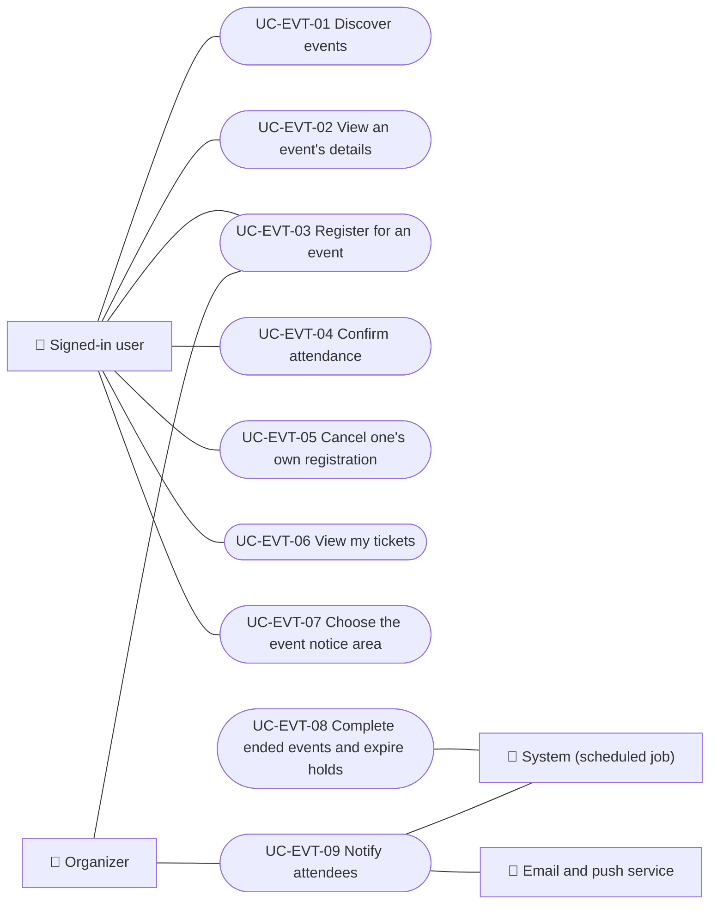

# Use cases

Event use cases from the attendee's side: discovering and opening events, registering, confirming or cancelling the registration, viewing tickets, choosing the notice area, and the automatic lifecycle and notice jobs. Paying is in Payments and event management by the organizer is in Partners. Each case applies to the platforms listed.

| ID | Use case | Platforms | Actors |
|---|---|---|---|
| `UC-EVT-01` | [Discover events](uc-evt-01-discover-events.md) | Web, APK | Signed-in user |
| `UC-EVT-02` | [View an event's details](uc-evt-02-view-event.md) | Web, APK | Signed-in user |
| `UC-EVT-03` | [Register for an event](uc-evt-03-register-for-event.md) | Web, APK | Signed-in user, Organizer |
| `UC-EVT-04` | [Confirm attendance](uc-evt-04-confirm-attendance.md) | Web, APK | Signed-in user |
| `UC-EVT-05` | [Cancel one's own registration](uc-evt-05-cancel-registration.md) | Web, APK | Signed-in user |
| `UC-EVT-06` | [View my tickets](uc-evt-06-my-tickets.md) | Web, APK | Signed-in user |
| `UC-EVT-07` | [Choose the event notice area](uc-evt-07-event-area.md) | Web, APK | Signed-in user |
| `UC-EVT-08` | [Complete ended events and expire holds](uc-evt-08-event-lifecycle.md) | Backend only | System (scheduled job) |
| `UC-EVT-09` | [Notify attendees](uc-evt-09-attendee-notices.md) | Backend only | System (scheduled job), Organizer, Email and push service |

## Use case diagram

[View the full “Use cases · Use case diagram” diagram](https://images.vinnot.com/docs/diagrams/v1/en/modules-events-use-cases-readme-ffbed08a0c86.svg)

## Lucidchart mapping

| ID | Lucidchart IDs |
|---|---|
| `UC-EVT-01` | [WEB UC-EVT-01](https://lucid.app/lucidchart/9f11a16b-bb5a-42fc-a9e8-0852b17bd241/edit), [APK UC-EVT-01](https://lucid.app/lucidchart/e095dd25-e8ac-41ba-bf5b-396e1055f217/edit) |
| `UC-EVT-02` | [WEB UC-EVT-02](https://lucid.app/lucidchart/9f11a16b-bb5a-42fc-a9e8-0852b17bd241/edit), [APK UC-EVT-02](https://lucid.app/lucidchart/e095dd25-e8ac-41ba-bf5b-396e1055f217/edit) |
| `UC-EVT-03` | [WEB UC-EVT-03](https://lucid.app/lucidchart/9f11a16b-bb5a-42fc-a9e8-0852b17bd241/edit), [APK UC-EVT-03](https://lucid.app/lucidchart/e095dd25-e8ac-41ba-bf5b-396e1055f217/edit) |
| `UC-EVT-04` | [WEB UC-EVT-04](https://lucid.app/lucidchart/9f11a16b-bb5a-42fc-a9e8-0852b17bd241/edit), [APK UC-EVT-04](https://lucid.app/lucidchart/e095dd25-e8ac-41ba-bf5b-396e1055f217/edit) |
| `UC-EVT-05` | [APK UC-EVT-05](https://lucid.app/lucidchart/e095dd25-e8ac-41ba-bf5b-396e1055f217/edit), [WEB UC-EVT-08](https://lucid.app/lucidchart/9f11a16b-bb5a-42fc-a9e8-0852b17bd241/edit) |
| `UC-EVT-06` | [WEB UC-EVT-07](https://lucid.app/lucidchart/9f11a16b-bb5a-42fc-a9e8-0852b17bd241/edit), [APK UC-EVT-07](https://lucid.app/lucidchart/e095dd25-e8ac-41ba-bf5b-396e1055f217/edit) |
| `UC-EVT-07` | [WEB UC-NOTIF-02](https://lucid.app/lucidchart/9f11a16b-bb5a-42fc-a9e8-0852b17bd241/edit), [APK UC-NOTIF-06](https://lucid.app/lucidchart/e095dd25-e8ac-41ba-bf5b-396e1055f217/edit) |
| `UC-EVT-08` | None |
| `UC-EVT-09` | None |
