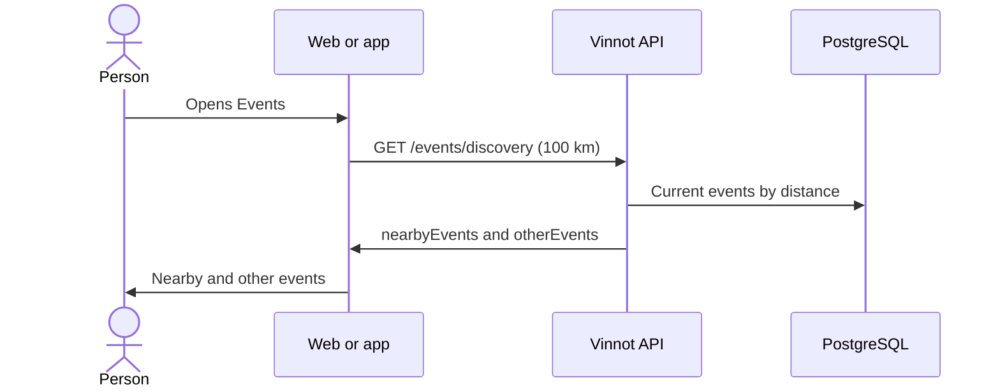

# UC-EVT-01 · Discover events

| Field | Value |
|---|---|
| ID | `UC-EVT-01` |
| Module | [Events and tickets](../README.md) |
| Platforms | Web, APK |
| Actors | Signed-in user |
| Lucidchart IDs | [WEB UC-EVT-01](https://lucid.app/lucidchart/9f11a16b-bb5a-42fc-a9e8-0852b17bd241/edit), [APK UC-EVT-01](https://lucid.app/lucidchart/e095dd25-e8ac-41ba-bf5b-396e1055f217/edit) |
| Requirements | [`RF-WEB-EVT-01`](../requirements.md), [`RF-WEB-EVT-02`](../requirements.md), [`RF-WEB-EVT-03`](../requirements.md), [`RF-WEB-EVT-04`](../requirements.md), [`RF-APK-EVT-01`](../requirements.md), [`RF-APK-EVT-02`](../requirements.md), [`RF-APK-EVT-03`](../requirements.md), [`RF-APK-EVT-04`](../requirements.md) |
| Test cases | [`CP-EVT-01`](../testing.md), [`CP-EVT-02`](../testing.md), [`CP-EVT-03`](../testing.md), [`CP-EVT-04`](../testing.md), [`CP-EVT-05`](../testing.md), [`CP-EVT-06`](../testing.md) |

## Preconditions

- The person is signed in.

## Postconditions

- The person sees the current events, nearby ones first if they shared their location.

## Main flow

1. The person opens Events.
2. If they shared their location and applied no filters, the client calls `GET /events/discovery` with a 100 km radius and up to 50 events.
3. The API returns the nearby events and, separately, other current events outside the radius.
4. The client shows the nearby ones and then the others, with date, place, type and price.

## Alternative flows

- 2a. Without a location or with text, type, country or region filters: the client calls the paged `GET /events` with those filters.
- 2b. On the app, the person searches for an area: the app geocodes it and calls `GET /events/nearby` with a 100 km radius.
- 3a. There are no nearby events: only the other events are shown, without presenting them as nearby.
- 3b. Invalid coordinates, radius or paging: the API answers 422.
- 4a. On the app, events with coordinates are also shown on a map, centered at a nearby zoom (about 30 km) on the searched area, the person's location or the first event.

## Business rules

- Only `PUBLISHED` or `SOLD_OUT` events whose end is after the request are listed.
- Drafts, cancelled, postponed and completed events do not appear in the lists.
- The radius goes from 0 to 500 km; 0 means 100 km.
- Pages hold 20 events by default and up to 100 in the catalog.

## Diagram

[View the full “UC-EVT-01 · Discover events” diagram](https://images.vinnot.com/docs/diagrams/v1/en/modules-events-use-cases-uc-evt-01-discover-events-28ed9cc8a974.svg)

Component diagram in Lucidchart: [WEB UC-EVT-01](https://lucid.app/lucidchart/9f11a16b-bb5a-42fc-a9e8-0852b17bd241/edit), [APK UC-EVT-01](https://lucid.app/lucidchart/e095dd25-e8ac-41ba-bf5b-396e1055f217/edit).

## Code

| Layer | Location |
|---|---|
| Endpoints | `GET /events/discovery`, `GET /events`, `GET /events/nearby`, `GET /events/upcoming` |
| Backend | [`EventController.java`](../../../../../backend/src/main/java/com/vinnot/event/infrastructure/web/controller/EventController.java), [`DiscoverEventsQueryHandler.java`](../../../../../backend/src/main/java/com/vinnot/event/application/query/handler/DiscoverEventsQueryHandler.java), [`SearchEventsQueryHandler.java`](../../../../../backend/src/main/java/com/vinnot/event/application/query/handler/SearchEventsQueryHandler.java), [`GetNearbyEventsQueryHandler.java`](../../../../../backend/src/main/java/com/vinnot/event/application/query/handler/GetNearbyEventsQueryHandler.java), [`EventPersistenceAdapter.java`](../../../../../backend/src/main/java/com/vinnot/event/infrastructure/persistence/adapter/EventPersistenceAdapter.java) |
| Web | [`EventsNearbyPage.tsx`](../../../../../frontend-react/src/presentation/pages/events/EventsNearbyPage.tsx), [`useEventsNearbyViewModel.ts`](../../../../../frontend-react/src/presentation/pages/events/useEventsNearbyViewModel.ts), [`useDiscoverEvents.ts`](../../../../../frontend-react/src/presentation/hooks/queries/event/useDiscoverEvents.ts), [`events.service.ts`](../../../../../frontend-react/src/application/services/events.service.ts), [`events.client.ts`](../../../../../frontend-react/src/infrastructure/api/clients/events.client.ts) |
| App | [`EventsScreen.tsx`](../../../../../frontend-mobile/src/presentation/screens/events/EventsScreen.tsx), [`useEventAreaFilter.ts`](../../../../../frontend-mobile/src/presentation/features/event/useEventAreaFilter.ts), [`eventDiscoveryConfig.ts`](../../../../../frontend-mobile/src/presentation/features/event/eventDiscoveryConfig.ts), [`events.service.ts`](../../../../../frontend-mobile/src/application/services/events.service.ts), [`events.client.ts`](../../../../../frontend-mobile/src/infrastructure/api/clients/events.client.ts) |

## Automated tests

- Backend: [`DiscoverEventsQueryHandlerTest.java`](../../../../../backend/src/test/java/com/vinnot/event/application/query/handler/DiscoverEventsQueryHandlerTest.java), [`SearchEventsQueryHandlerTest.java`](../../../../../backend/src/test/java/com/vinnot/event/application/query/handler/SearchEventsQueryHandlerTest.java), [`GetNearbyEventsQueryHandlerTest.java`](../../../../../backend/src/test/java/com/vinnot/event/application/query/handler/GetNearbyEventsQueryHandlerTest.java), [`EventCatalogQueryHandlersTest.java`](../../../../../backend/src/test/java/com/vinnot/event/application/query/handler/EventCatalogQueryHandlersTest.java)
- Web: [`useEventsNearbyViewModel.test.tsx`](../../../../../frontend-react/src/presentation/pages/events/useEventsNearbyViewModel.test.tsx), [`events.service.test.ts`](../../../../../frontend-react/src/application/services/events.service.test.ts), [`eventPagination.test.ts`](../../../../../frontend-react/src/application/services/eventPagination.test.ts)
- App: [`eventsRoute.test.tsx`](../../../../../frontend-mobile/src/presentation/features/event/__tests__/eventsRoute.test.tsx), [`eventCatalogFilter.test.ts`](../../../../../frontend-mobile/src/presentation/features/event/__tests__/eventCatalogFilter.test.ts)
