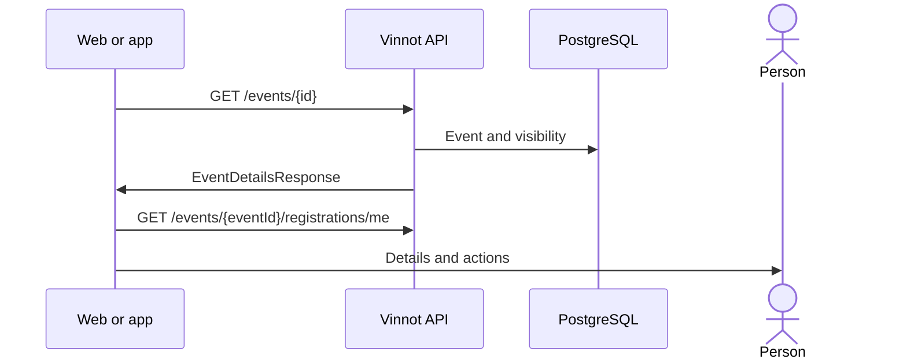

# UC-EVT-02 · View an event's details

| Field | Value |
|---|---|
| ID | `UC-EVT-02` |
| Module | [Events and tickets](../README.md) |
| Platforms | Web, APK |
| Actors | Signed-in user |
| Lucidchart IDs | [WEB UC-EVT-02](https://lucid.app/lucidchart/9f11a16b-bb5a-42fc-a9e8-0852b17bd241/edit), [APK UC-EVT-02](https://lucid.app/lucidchart/e095dd25-e8ac-41ba-bf5b-396e1055f217/edit) |
| Requirements | [`RF-WEB-EVT-05`](../requirements.md), [`RF-WEB-EVT-06`](../requirements.md), [`RF-WEB-EVT-07`](../requirements.md), [`RF-APK-EVT-05`](../requirements.md), [`RF-APK-EVT-06`](../requirements.md), [`RF-APK-EVT-07`](../requirements.md) |
| Test cases | [`CP-EVT-07`](../testing.md), [`CP-EVT-08`](../testing.md), [`CP-EVT-09`](../testing.md), [`CP-EVT-10`](../testing.md), [`CP-EVT-46`](../testing.md) |

## Preconditions

- The person is signed in and opens an event from a list, a link or a notice.

## Postconditions

- The person sees the event and the available actions.

## Main flow

1. The client calls `GET /events/{id}`.
2. The API returns the event if it was published at least once and is not a draft.
3. The client shows image, description, date, place, price, places and the organizer with their name, email and phone if provided.
4. It offers opening the location in maps, sharing the event when it has a public page, and reporting it.
5. If the person already has a registration, the client fetches it with `GET /events/{eventId}/registrations/me` and shows its status in “Your registration”. After registering for an event with a contact phone or email, “Your registration” offers “Contact organizer” by WhatsApp or email.

## Alternative flows

- 2a. The event is a draft or was never published and the reader is not the organizer, a moderator or an administrator: the API answers 404.
- 2b. The event was cancelled or completed: it is still shown with its status, without registration.
- 4a. Organizer or location data is missing: it is not shown or that action is not offered.
- 4b. The event has no public page, because it is a draft or was cancelled without ever being published: sharing is not offered.

## Business rules

- Links to events already published keep working after they are cancelled or completed.
- Reporting follows the [Community](../../community/README.md) rules; organizers do not see the action on their own event.
- Sharing produces the event's public link ([Sharing](../../sharing/README.md)); it is only offered once the event was published and is not a draft.

## Diagram

[View the full “UC-EVT-02 · View an event's details” diagram](https://images.vinnot.com/docs/diagrams/v1/en/modules-events-use-cases-uc-evt-02-view-event-d1c8712a73da.svg)

Component diagram in Lucidchart: [WEB UC-EVT-02](https://lucid.app/lucidchart/9f11a16b-bb5a-42fc-a9e8-0852b17bd241/edit), [APK UC-EVT-02](https://lucid.app/lucidchart/e095dd25-e8ac-41ba-bf5b-396e1055f217/edit).

## Code

| Layer | Location |
|---|---|
| Endpoints | `GET /events/{id}` |
| Backend | [`EventController.java`](../../../../../backend/src/main/java/com/vinnot/event/infrastructure/web/controller/EventController.java), [`GetEventByIdQueryHandler.java`](../../../../../backend/src/main/java/com/vinnot/event/application/query/handler/GetEventByIdQueryHandler.java) |
| Web | [`EventDetailsPage.tsx`](../../../../../frontend-react/src/presentation/pages/events/EventDetailsPage.tsx), [`EventDetailsSidebar.tsx`](../../../../../frontend-react/src/presentation/pages/events/EventDetailsSidebar.tsx), [`useEventDetailsViewModel.ts`](../../../../../frontend-react/src/presentation/pages/events/useEventDetailsViewModel.ts), [`EventDetailsHero.tsx`](../../../../../frontend-react/src/presentation/pages/events/EventDetailsHero.tsx), [`useEvent.ts`](../../../../../frontend-react/src/presentation/hooks/queries/event/useEvent.ts), [`events.service.ts`](../../../../../frontend-react/src/application/services/events.service.ts), [`events.client.ts`](../../../../../frontend-react/src/infrastructure/api/clients/events.client.ts) |
| App | [`EventDetailScreen.tsx`](../../../../../frontend-mobile/src/presentation/features/event/EventDetailScreen.tsx), [`ReserveCTA.tsx`](../../../../../frontend-mobile/src/presentation/features/event/ReserveCTA.tsx), [`useEventDetailViewModel.ts`](../../../../../frontend-mobile/src/presentation/features/event/useEventDetailViewModel.ts), [`EventDetailHero.tsx`](../../../../../frontend-mobile/src/presentation/features/event/EventDetailHero.tsx), [`events.service.ts`](../../../../../frontend-mobile/src/application/services/events.service.ts), [`events.client.ts`](../../../../../frontend-mobile/src/infrastructure/api/clients/events.client.ts) |

## Automated tests

- Backend: [`GetEventByIdQueryHandlerTest.java`](../../../../../backend/src/test/java/com/vinnot/event/application/query/handler/GetEventByIdQueryHandlerTest.java)
- Web: [`EventDetailsPage.test.tsx`](../../../../../frontend-react/src/presentation/pages/events/EventDetailsPage.test.tsx), [`EventDetailsHero.test.tsx`](../../../../../frontend-react/src/presentation/pages/events/EventDetailsHero.test.tsx), [`EventDetailsSidebar.test.tsx`](../../../../../frontend-react/src/presentation/pages/events/EventDetailsSidebar.test.tsx), [`useEventDetailsViewModel.test.tsx`](../../../../../frontend-react/src/presentation/pages/events/useEventDetailsViewModel.test.tsx), [`publicContent.test.ts`](../../../../../frontend-react/src/domain/sharing/publicContent.test.ts), [`event.mappers.test.ts`](../../../../../frontend-react/src/domain/event/event.mappers.test.ts)
- App: [`eventDetailRoute.test.tsx`](../../../../../frontend-mobile/src/presentation/features/event/__tests__/eventDetailRoute.test.tsx), [`shareability.test.ts`](../../../../../frontend-mobile/src/domain/sharing/shareability.test.ts), [`event.mappers.test.ts`](../../../../../frontend-mobile/src/domain/event/event.mappers.test.ts)
