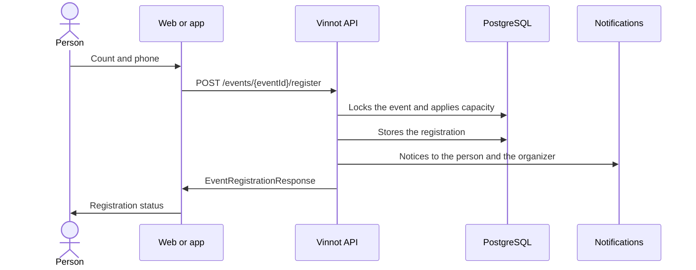

# UC-EVT-03 · Register for an event

| Field | Value |
|---|---|
| ID | `UC-EVT-03` |
| Module | [Events and tickets](../README.md) |
| Platforms | Web, APK |
| Actors | Signed-in user, Organizer |
| Lucidchart IDs | [WEB UC-EVT-03](https://lucid.app/lucidchart/9f11a16b-bb5a-42fc-a9e8-0852b17bd241/edit), [APK UC-EVT-03](https://lucid.app/lucidchart/e095dd25-e8ac-41ba-bf5b-396e1055f217/edit) |
| Requirements | [`RF-WEB-EVT-08`](../requirements.md), [`RF-WEB-EVT-09`](../requirements.md), [`RF-WEB-EVT-10`](../requirements.md), [`RF-WEB-EVT-11`](../requirements.md), [`RF-WEB-EVT-12`](../requirements.md), [`RF-APK-EVT-08`](../requirements.md), [`RF-APK-EVT-09`](../requirements.md), [`RF-APK-EVT-10`](../requirements.md), [`RF-APK-EVT-11`](../requirements.md), [`RF-APK-EVT-12`](../requirements.md) |
| Test cases | [`CP-EVT-11`](../testing.md), [`CP-EVT-12`](../testing.md), [`CP-EVT-13`](../testing.md), [`CP-EVT-14`](../testing.md), [`CP-EVT-15`](../testing.md), [`CP-EVT-16`](../testing.md), [`CP-EVT-17`](../testing.md), [`CP-EVT-18`](../testing.md), [`CP-EVT-19`](../testing.md), [`CP-EVT-20`](../testing.md) |

## Preconditions

- The person is signed in and the event is `PUBLISHED` or `SOLD_OUT`.

## Postconditions

- The person has a registration with its actual status.

## Main flow

1. The person chooses “Register” on the event details.
2. The client asks for the number of tickets, up to the event's maximum per request, and a contact phone; name and email come from the account.
3. The person can save the phone to their profile and sees the total to pay if the event is paid.
4. The person confirms with “Continue to payment” if the event is paid, “Send request” if approval is manual or “Confirm registration” otherwise, and the client sends `POST /events/{eventId}/register` with the count, the contact and the notice language.
5. The API locks the event, checks that registration is open and that the person has no other active one, and applies the capacity.
6. The API stores the registration with the matching status and notifies the person and the organizer ([UC-EVT-09](uc-evt-09-attendee-notices.md)).
7. The client shows the status: requested, waitlisted, awaiting payment, awaiting confirmation or confirmed.

## Alternative flows

- 5a. Registration closed or the event is not available: the API answers 400 `REGISTRATION_CLOSED` or `EVENT_NOT_AVAILABLE`.
- 5b. The person already has an active registration: the API answers 422 `EVENT_ALREADY_REGISTERED`.
- 5c. The count exceeds the maximum per request: the API answers `REGISTRATION_LIMIT_EXCEEDED`.
- 5d. There are no places: the registration is `WAITLISTED`.
- 6a. The event is paid: the registration is `AWAITING_PAYMENT` with a held place and the person pays ([Payments](../../payments/README.md)).
- 6b. Free event with attendance confirmation: it is `AWAITING_ATTENDEE_CONFIRMATION` with a hold ([UC-EVT-04](uc-evt-04-confirm-attendance.md)).
- 6c. Free event with automatic approval and no confirmation: it is `CONFIRMED`.
- 6d. Event with manual approval: it is `REQUESTED` until the organizer reviews it ([Partners](../../partner/README.md)).
- 1a. The person is not signed in: the app takes them to sign in and back to the event.

## Business rules

- One active registration per person and event; the registrant comes from the session, not from an editable field.
- Each request allows 1 to 20 tickets, within the event's maximum (6 by default).
- Registration closes at the event's deadline, and never after its start.
- Confirmed registrations and holds never exceed the capacity; at the limit the event becomes `SOLD_OUT`.
- A waitlisted registration does not move up on its own when a place is freed.
- The registration status and the payment status are independent.

## Diagram

[View the full “UC-EVT-03 · Register for an event” diagram](https://images.vinnot.com/docs/diagrams/v1/en/modules-events-use-cases-uc-evt-03-register-for-event-0c497ea22a9a.svg)

Component diagram in Lucidchart: [WEB UC-EVT-03](https://lucid.app/lucidchart/9f11a16b-bb5a-42fc-a9e8-0852b17bd241/edit), [APK UC-EVT-03](https://lucid.app/lucidchart/e095dd25-e8ac-41ba-bf5b-396e1055f217/edit).

## Code

| Layer | Location |
|---|---|
| Endpoints | `POST /events/{eventId}/register`, `GET /events/{eventId}/registrations/me` |
| Backend | [`EventController.java`](../../../../../backend/src/main/java/com/vinnot/event/infrastructure/web/controller/EventController.java), [`RegisterForEventCommandHandler.java`](../../../../../backend/src/main/java/com/vinnot/event/application/command/handler/RegisterForEventCommandHandler.java), [`EventRegistration.java`](../../../../../backend/src/main/java/com/vinnot/event/domain/model/EventRegistration.java), [`EventCapacity.java`](../../../../../backend/src/main/java/com/vinnot/event/domain/valueobject/EventCapacity.java), [`EventRegistrationSettings.java`](../../../../../backend/src/main/java/com/vinnot/event/domain/valueobject/EventRegistrationSettings.java) |
| Web | [`EventDetailsPage.tsx`](../../../../../frontend-react/src/presentation/pages/events/EventDetailsPage.tsx), [`EventDetailsSidebar.tsx`](../../../../../frontend-react/src/presentation/pages/events/EventDetailsSidebar.tsx), [`useEventDetailsViewModel.ts`](../../../../../frontend-react/src/presentation/pages/events/useEventDetailsViewModel.ts), [`EventRegistrationModal.tsx`](../../../../../frontend-react/src/presentation/pages/events/EventRegistrationModal.tsx), [`useEventRegistrationForm.ts`](../../../../../frontend-react/src/presentation/pages/events/useEventRegistrationForm.ts), [`useRegisterForEvent.ts`](../../../../../frontend-react/src/presentation/hooks/queries/event/useRegisterForEvent.ts), [`events.service.ts`](../../../../../frontend-react/src/application/services/events.service.ts), [`events.client.ts`](../../../../../frontend-react/src/infrastructure/api/clients/events.client.ts) |
| App | [`EventDetailScreen.tsx`](../../../../../frontend-mobile/src/presentation/features/event/EventDetailScreen.tsx), [`ReserveCTA.tsx`](../../../../../frontend-mobile/src/presentation/features/event/ReserveCTA.tsx), [`useEventDetailViewModel.ts`](../../../../../frontend-mobile/src/presentation/features/event/useEventDetailViewModel.ts), [`EventRegistrationSheet.tsx`](../../../../../frontend-mobile/src/presentation/features/event/EventRegistrationSheet.tsx), [`useEventRegistrationForm.ts`](../../../../../frontend-mobile/src/presentation/features/event/useEventRegistrationForm.ts), [`events.service.ts`](../../../../../frontend-mobile/src/application/services/events.service.ts), [`events.client.ts`](../../../../../frontend-mobile/src/infrastructure/api/clients/events.client.ts) |

## Automated tests

- Backend: [`RegisterForEventCommandHandlerTest.java`](../../../../../backend/src/test/java/com/vinnot/event/application/command/handler/RegisterForEventCommandHandlerTest.java), [`EventRegistrationTest.java`](../../../../../backend/src/test/java/com/vinnot/event/domain/model/EventRegistrationTest.java), [`EventCapacityTest.java`](../../../../../backend/src/test/java/com/vinnot/event/domain/valueobject/EventCapacityTest.java), [`EventRegistrationSettingsTest.java`](../../../../../backend/src/test/java/com/vinnot/event/domain/valueobject/EventRegistrationSettingsTest.java), [`FreeEventRegistrationPostgresIntegrationTest.java`](../../../../../backend/src/test/java/com/vinnot/event/infrastructure/FreeEventRegistrationPostgresIntegrationTest.java)
- Web: [`EventRegistrationModal.test.tsx`](../../../../../frontend-react/src/presentation/pages/events/EventRegistrationModal.test.tsx), [`useEventRegistrationForm.test.ts`](../../../../../frontend-react/src/presentation/pages/events/useEventRegistrationForm.test.ts), [`useEventRegistration.test.tsx`](../../../../../frontend-react/src/presentation/hooks/queries/event/useEventRegistration.test.tsx)
- App: [`EventRegistrationSheet.test.tsx`](../../../../../frontend-mobile/src/presentation/features/event/EventRegistrationSheet.test.tsx), [`useEventRegistrationForm.test.ts`](../../../../../frontend-mobile/src/presentation/features/event/useEventRegistrationForm.test.ts), [`ReserveCTA.test.tsx`](../../../../../frontend-mobile/src/presentation/features/event/ReserveCTA.test.tsx)
