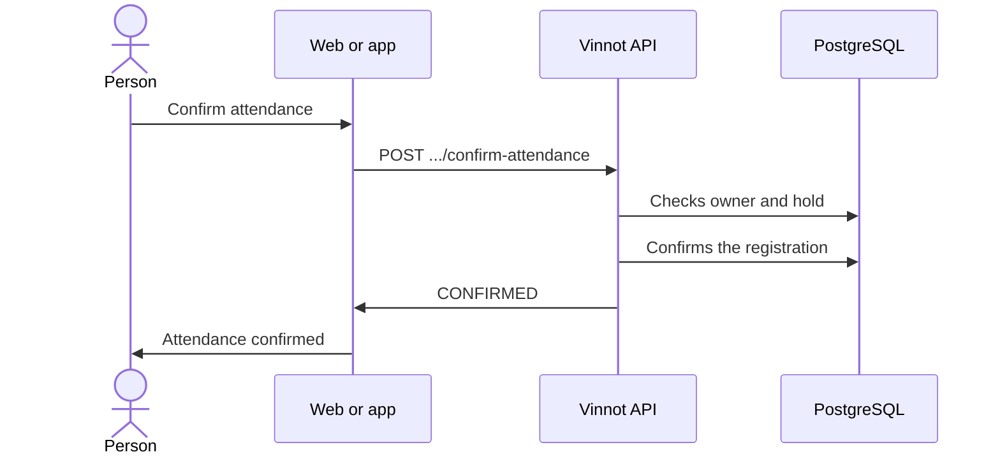

# UC-EVT-04 · Confirm attendance

| Field | Value |
|---|---|
| ID | `UC-EVT-04` |
| Module | [Events and tickets](../README.md) |
| Platforms | Web, APK |
| Actors | Signed-in user |
| Lucidchart IDs | [WEB UC-EVT-04](https://lucid.app/lucidchart/9f11a16b-bb5a-42fc-a9e8-0852b17bd241/edit), [APK UC-EVT-04](https://lucid.app/lucidchart/e095dd25-e8ac-41ba-bf5b-396e1055f217/edit) |
| Requirements | [`RF-WEB-EVT-13`](../requirements.md), [`RF-APK-EVT-13`](../requirements.md) |
| Test cases | [`CP-EVT-21`](../testing.md), [`CP-EVT-22`](../testing.md), [`CP-EVT-23`](../testing.md), [`CP-EVT-24`](../testing.md) |

## Preconditions

- The person has an `AWAITING_ATTENDEE_CONFIRMATION` registration with a current hold.

## Postconditions

- The registration is `CONFIRMED` and the hold becomes a confirmed place.

## Main flow

1. The person opens the event and sees they must confirm attendance before the date shown.
2. They choose “Confirm attendance”.
3. The client sends `POST /events/registrations/{registrationId}/confirm-attendance`.
4. The API checks that the registration is the person's, that it is awaiting confirmation and that the hold has not expired.
5. The API confirms the registration and returns the new status.

## Alternative flows

- 4a. The hold expired: the API answers 400 `REGISTRATION_HOLD_EXPIRED`.
- 4b. The registration is in another status: the API answers 400 `INVALID_REGISTRATION_TRANSITION`.
- 4c. The registration belongs to someone else: the API rejects it.

## Business rules

- The hold lasts what the event defines (1440 minutes by default, between 5 and 10080).
- An unconfirmed hold expires on its own ([UC-EVT-08](uc-evt-08-event-lifecycle.md)).

## Diagram

[View the full “UC-EVT-04 · Confirm attendance” diagram](https://images.vinnot.com/docs/diagrams/v1/en/modules-events-use-cases-uc-evt-04-confirm-attendance-c6ebfedb8e7b.svg)

Component diagram in Lucidchart: [WEB UC-EVT-04](https://lucid.app/lucidchart/9f11a16b-bb5a-42fc-a9e8-0852b17bd241/edit), [APK UC-EVT-04](https://lucid.app/lucidchart/e095dd25-e8ac-41ba-bf5b-396e1055f217/edit).

## Code

| Layer | Location |
|---|---|
| Endpoints | `POST /events/registrations/{registrationId}/confirm-attendance` |
| Backend | [`EventController.java`](../../../../../backend/src/main/java/com/vinnot/event/infrastructure/web/controller/EventController.java), [`ConfirmEventAttendanceCommandHandler.java`](../../../../../backend/src/main/java/com/vinnot/event/application/command/handler/ConfirmEventAttendanceCommandHandler.java), [`EventRegistration.java`](../../../../../backend/src/main/java/com/vinnot/event/domain/model/EventRegistration.java) |
| Web | [`EventDetailsPage.tsx`](../../../../../frontend-react/src/presentation/pages/events/EventDetailsPage.tsx), [`EventDetailsSidebar.tsx`](../../../../../frontend-react/src/presentation/pages/events/EventDetailsSidebar.tsx), [`useEventDetailsViewModel.ts`](../../../../../frontend-react/src/presentation/pages/events/useEventDetailsViewModel.ts), [`events.service.ts`](../../../../../frontend-react/src/application/services/events.service.ts), [`events.client.ts`](../../../../../frontend-react/src/infrastructure/api/clients/events.client.ts) |
| App | [`EventDetailScreen.tsx`](../../../../../frontend-mobile/src/presentation/features/event/EventDetailScreen.tsx), [`ReserveCTA.tsx`](../../../../../frontend-mobile/src/presentation/features/event/ReserveCTA.tsx), [`useEventDetailViewModel.ts`](../../../../../frontend-mobile/src/presentation/features/event/useEventDetailViewModel.ts), [`events.service.ts`](../../../../../frontend-mobile/src/application/services/events.service.ts), [`events.client.ts`](../../../../../frontend-mobile/src/infrastructure/api/clients/events.client.ts) |

## Automated tests

- Backend: [`EventRegistrationLifecycleHandlersTest.java`](../../../../../backend/src/test/java/com/vinnot/event/application/command/handler/EventRegistrationLifecycleHandlersTest.java), [`EventRegistrationTest.java`](../../../../../backend/src/test/java/com/vinnot/event/domain/model/EventRegistrationTest.java)
- Web: [`EventDetailsSidebar.test.tsx`](../../../../../frontend-react/src/presentation/pages/events/EventDetailsSidebar.test.tsx)
- App: [`ReserveCTA.test.tsx`](../../../../../frontend-mobile/src/presentation/features/event/ReserveCTA.test.tsx)
