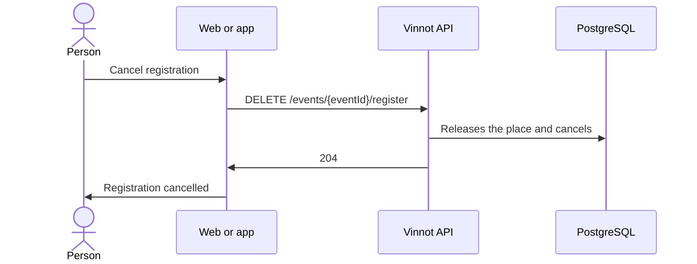

# UC-EVT-05 · Cancel one's own registration

| Field | Value |
|---|---|
| ID | `UC-EVT-05` |
| Module | [Events and tickets](../README.md) |
| Platforms | Web, APK |
| Actors | Signed-in user |
| Lucidchart IDs | [APK UC-EVT-05](https://lucid.app/lucidchart/e095dd25-e8ac-41ba-bf5b-396e1055f217/edit), [WEB UC-EVT-08](https://lucid.app/lucidchart/9f11a16b-bb5a-42fc-a9e8-0852b17bd241/edit) |
| Requirements | [`RF-WEB-EVT-14`](../requirements.md), [`RF-APK-EVT-14`](../requirements.md) |
| Test cases | [`CP-EVT-25`](../testing.md), [`CP-EVT-26`](../testing.md), [`CP-EVT-27`](../testing.md), [`CP-EVT-28`](../testing.md) |

## Preconditions

- The person has a registration that is not cancelled, rejected or expired.

## Postconditions

- The registration is `CANCELLED` and its place or hold is released.

## Main flow

1. The person opens the event and, in “Your registration”, chooses “Cancel registration”.
2. The client asks for confirmation.
3. The client sends `DELETE /events/{eventId}/register`.
4. The API releases the hold or the confirmed place and marks the registration as `CANCELLED`.
5. The client shows the new status; the web says “Registration cancelled”.

## Alternative flows

- 2a. The person goes back: nothing is cancelled.
- 4a. The registration is confirmed and was paid online: the API answers 422 `PAID_REGISTRATION_REQUIRES_ORGANIZER`; the organizer handles the cancellation and the refund. The app explains that the organizer must be contacted; the web shows “We couldn't cancel the registration”.
- 4b. The registration already ended: the API answers 400 `INVALID_REGISTRATION_TRANSITION`.

## Business rules

- Cancelling a registration does not delete the event.
- Cancelling on one's own does not start a refund.
- The action only appears while the registration is not cancelled, rejected or expired.

## Diagram

[View the full “UC-EVT-05 · Cancel one's own registration” diagram](https://images.vinnot.com/docs/diagrams/v1/en/modules-events-use-cases-uc-evt-05-cancel-registration-0aeedbf5136f.svg)

Component diagram in Lucidchart: [APK UC-EVT-05](https://lucid.app/lucidchart/e095dd25-e8ac-41ba-bf5b-396e1055f217/edit), [WEB UC-EVT-08](https://lucid.app/lucidchart/9f11a16b-bb5a-42fc-a9e8-0852b17bd241/edit).

## Code

| Layer | Location |
|---|---|
| Endpoints | `DELETE /events/{eventId}/register` |
| Backend | [`EventController.java`](../../../../../backend/src/main/java/com/vinnot/event/infrastructure/web/controller/EventController.java), [`CancelEventRegistrationCommandHandler.java`](../../../../../backend/src/main/java/com/vinnot/event/application/command/handler/CancelEventRegistrationCommandHandler.java), [`EventRegistration.java`](../../../../../backend/src/main/java/com/vinnot/event/domain/model/EventRegistration.java) |
| Web | [`EventDetailsPage.tsx`](../../../../../frontend-react/src/presentation/pages/events/EventDetailsPage.tsx), [`EventDetailsSidebar.tsx`](../../../../../frontend-react/src/presentation/pages/events/EventDetailsSidebar.tsx), [`useEventDetailsViewModel.ts`](../../../../../frontend-react/src/presentation/pages/events/useEventDetailsViewModel.ts), [`useCancelRegistration.ts`](../../../../../frontend-react/src/presentation/hooks/queries/event/useCancelRegistration.ts), [`eventRegistrationActions.ts`](../../../../../frontend-react/src/domain/event/eventRegistrationActions.ts) |
| App | [`EventDetailScreen.tsx`](../../../../../frontend-mobile/src/presentation/features/event/EventDetailScreen.tsx), [`ReserveCTA.tsx`](../../../../../frontend-mobile/src/presentation/features/event/ReserveCTA.tsx), [`useEventDetailViewModel.ts`](../../../../../frontend-mobile/src/presentation/features/event/useEventDetailViewModel.ts), [`events.service.ts`](../../../../../frontend-mobile/src/application/services/events.service.ts), [`events.client.ts`](../../../../../frontend-mobile/src/infrastructure/api/clients/events.client.ts) |

## Automated tests

- Backend: [`EventRegistrationLifecycleHandlersTest.java`](../../../../../backend/src/test/java/com/vinnot/event/application/command/handler/EventRegistrationLifecycleHandlersTest.java), [`EventRegistrationTest.java`](../../../../../backend/src/test/java/com/vinnot/event/domain/model/EventRegistrationTest.java)
- Web: [`useEventDetailsViewModel.test.tsx`](../../../../../frontend-react/src/presentation/pages/events/useEventDetailsViewModel.test.tsx), [`EventDetailsSidebar.test.tsx`](../../../../../frontend-react/src/presentation/pages/events/EventDetailsSidebar.test.tsx)
- App: [`ReserveCTA.test.tsx`](../../../../../frontend-mobile/src/presentation/features/event/ReserveCTA.test.tsx)
