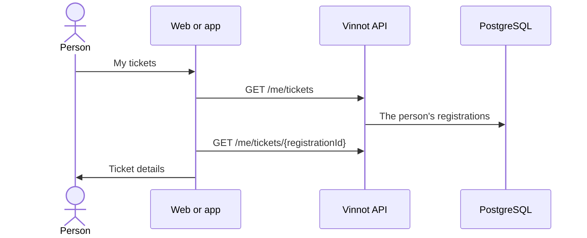

# UC-EVT-06 · View my tickets

| Field | Value |
|---|---|
| ID | `UC-EVT-06` |
| Module | [Events and tickets](../README.md) |
| Platforms | Web, APK |
| Actors | Signed-in user |
| Lucidchart IDs | [WEB UC-EVT-07](https://lucid.app/lucidchart/9f11a16b-bb5a-42fc-a9e8-0852b17bd241/edit), [APK UC-EVT-07](https://lucid.app/lucidchart/e095dd25-e8ac-41ba-bf5b-396e1055f217/edit) |
| Requirements | [`RF-WEB-EVT-15`](../requirements.md) |
| Test cases | [`CP-EVT-29`](../testing.md), [`CP-EVT-30`](../testing.md), [`CP-EVT-31`](../testing.md), [`CP-EVT-32`](../testing.md) |

## Preconditions

- The person is signed in.

## Postconditions

- The person sees their registrations and each ticket's details.

## Main flow

1. The person opens “My tickets” from the web menu or the app profile.
2. The client calls `GET /me/tickets`, paged and newest first.
3. It shows each ticket with the event, date, place and status.
4. The person opens a ticket and the client calls `GET /me/tickets/{registrationId}`.
5. The client shows date, number of people, place, payment, current hold, organizer contact and the 12-character reference.

## Alternative flows

- 3a. They have no tickets: the empty state is shown with a link to Events.
- 4a. The ticket does not exist or belongs to someone else: the API answers 404 and the client shows it is unavailable.
- 5a. The event was cancelled: the ticket says so.

## Business rules

- Each person only sees their own registrations, in any status.
- Pages of up to 50; responses are not cached.
- There is no QR code or check-in: the reference identifies the ticket.

## Diagram

[View the full “UC-EVT-06 · View my tickets” diagram](https://images.vinnot.com/docs/diagrams/v1/en/modules-events-use-cases-uc-evt-06-my-tickets-b7e1e0f7166c.svg)

Component diagram in Lucidchart: [WEB UC-EVT-07](https://lucid.app/lucidchart/9f11a16b-bb5a-42fc-a9e8-0852b17bd241/edit), [APK UC-EVT-07](https://lucid.app/lucidchart/e095dd25-e8ac-41ba-bf5b-396e1055f217/edit).

## Code

| Layer | Location |
|---|---|
| Endpoints | `GET /me/tickets`, `GET /me/tickets/{registrationId}` |
| Backend | [`MyTicketsController.java`](../../../../../backend/src/main/java/com/vinnot/event/infrastructure/web/controller/MyTicketsController.java), [`GetMyTicketsQueryHandler.java`](../../../../../backend/src/main/java/com/vinnot/event/application/query/handler/GetMyTicketsQueryHandler.java), [`PostgresEventTicketReader.java`](../../../../../backend/src/main/java/com/vinnot/event/infrastructure/persistence/adapter/PostgresEventTicketReader.java) |
| Web | [`MyTicketsPage.tsx`](../../../../../frontend-react/src/presentation/pages/events/MyTicketsPage.tsx), [`useMyTicketDetailsViewModel.ts`](../../../../../frontend-react/src/presentation/pages/events/useMyTicketDetailsViewModel.ts), [`eventTickets.service.ts`](../../../../../frontend-react/src/application/services/eventTickets.service.ts), [`eventTickets.client.ts`](../../../../../frontend-react/src/infrastructure/api/clients/eventTickets.client.ts) |
| App | [`MyTicketsScreen.tsx`](../../../../../frontend-mobile/src/presentation/features/event/MyTicketsScreen.tsx), [`useMyTickets.ts`](../../../../../frontend-mobile/src/presentation/hooks/queries/event/useMyTickets.ts), [`eventTickets.service.ts`](../../../../../frontend-mobile/src/application/services/eventTickets.service.ts), [`eventTickets.client.ts`](../../../../../frontend-mobile/src/infrastructure/api/clients/eventTickets.client.ts) |

## Automated tests

- Backend: [`GetMyTicketsQueryHandlerTest.java`](../../../../../backend/src/test/java/com/vinnot/event/application/query/handler/GetMyTicketsQueryHandlerTest.java)
- Web: [`MyTicketsPage.test.tsx`](../../../../../frontend-react/src/presentation/pages/events/MyTicketsPage.test.tsx), [`eventTickets.service.test.ts`](../../../../../frontend-react/src/application/services/eventTickets.service.test.ts)
- App: [`MyTicketsScreen.test.tsx`](../../../../../frontend-mobile/src/presentation/features/event/MyTicketsScreen.test.tsx), [`MyTicketsNavigation.test.tsx`](../../../../../frontend-mobile/src/presentation/features/event/MyTicketsNavigation.test.tsx)
