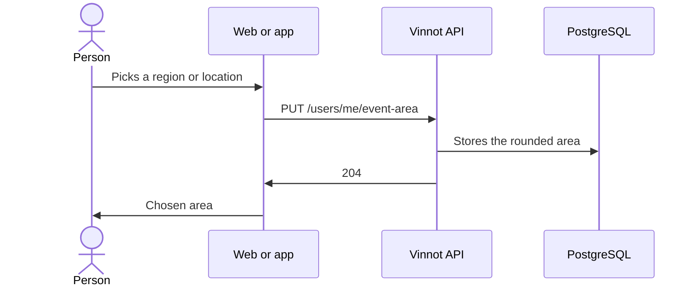

# UC-EVT-07 · Choose the event notice area

| Field | Value |
|---|---|
| ID | `UC-EVT-07` |
| Module | [Events and tickets](../README.md) |
| Platforms | Web, APK |
| Actors | Signed-in user |
| Lucidchart IDs | [WEB UC-NOTIF-02](https://lucid.app/lucidchart/9f11a16b-bb5a-42fc-a9e8-0852b17bd241/edit), [APK UC-NOTIF-06](https://lucid.app/lucidchart/e095dd25-e8ac-41ba-bf5b-396e1055f217/edit) |
| Requirements | [`RF-WEB-EVT-16`](../requirements.md), [`RF-APK-EVT-15`](../requirements.md) |
| Test cases | [`CP-EVT-33`](../testing.md), [`CP-EVT-34`](../testing.md), [`CP-EVT-35`](../testing.md), [`CP-EVT-36`](../testing.md), [`CP-EVT-37`](../testing.md) |

## Preconditions

- The person is signed in and opens their notification preferences.

## Postconditions

- New nearby event notices use the chosen area.

## Main flow

1. In the nearby events category, the person picks a region or uses their current location.
2. The client sends `PUT /users/me/event-area` with the region or the coordinates.
3. The API stores the area; coordinates are rounded to 0.1°.
4. The client shows the chosen area, read with `GET /users/me/event-area`.

## Alternative flows

- 1a. The person removes the area: the client sends `DELETE /users/me/event-area`.
- 2a. The latitude or the longitude is missing: the API answers 400.
- 3a. The region does not exist: the API answers 404.
- 4a. There is no stored area: the API answers 204 and the client offers to choose one.

## Business rules

- With coordinates, notices cover 50 km around the stored point.
- The exact location is not stored.
- Each category's preferences are in [Notifications](../../notifications/README.md).

## Diagram

[View the full “UC-EVT-07 · Choose the event notice area” diagram](https://images.vinnot.com/docs/diagrams/v1/en/modules-events-use-cases-uc-evt-07-event-area-3d441b4ad8a9.svg)

Component diagram in Lucidchart: [WEB UC-NOTIF-02](https://lucid.app/lucidchart/9f11a16b-bb5a-42fc-a9e8-0852b17bd241/edit), [APK UC-NOTIF-06](https://lucid.app/lucidchart/e095dd25-e8ac-41ba-bf5b-396e1055f217/edit).

## Code

| Layer | Location |
|---|---|
| Endpoints | `GET /users/me/event-area`, `PUT /users/me/event-area`, `DELETE /users/me/event-area` |
| Backend | [`EventAreaController.java`](../../../../../backend/src/main/java/com/vinnot/event/infrastructure/web/controller/EventAreaController.java), [`EventAreaService.java`](../../../../../backend/src/main/java/com/vinnot/event/application/service/EventAreaService.java), [`EventArea.java`](../../../../../backend/src/main/java/com/vinnot/event/domain/valueobject/EventArea.java), [`JdbcEventAreaRepository.java`](../../../../../backend/src/main/java/com/vinnot/event/infrastructure/persistence/adapter/JdbcEventAreaRepository.java) |
| Web | [`EventAreaPicker.tsx`](../../../../../frontend-react/src/presentation/pages/user/EventAreaPicker.tsx), [`useEventAreaViewModel.ts`](../../../../../frontend-react/src/presentation/pages/user/useEventAreaViewModel.ts), [`useEventArea.ts`](../../../../../frontend-react/src/presentation/hooks/queries/notification/useEventArea.ts), [`eventArea.ts`](../../../../../frontend-react/src/domain/notification/eventArea.ts) |
| App | [`EventAreaSection.tsx`](../../../../../frontend-mobile/src/presentation/features/user/EventAreaSection.tsx), [`useEventArea.ts`](../../../../../frontend-mobile/src/presentation/features/user/useEventArea.ts), [`eventArea.ts`](../../../../../frontend-mobile/src/domain/notification/eventArea.ts) |

## Automated tests

- Backend: [`EventAreaControllerTest.java`](../../../../../backend/src/test/java/com/vinnot/event/infrastructure/web/controller/EventAreaControllerTest.java), [`EventAreaServiceTest.java`](../../../../../backend/src/test/java/com/vinnot/event/application/service/EventAreaServiceTest.java), [`EventAreaTest.java`](../../../../../backend/src/test/java/com/vinnot/event/domain/valueobject/EventAreaTest.java), [`EventAreaPostgresIntegrationTest.java`](../../../../../backend/src/test/java/com/vinnot/event/infrastructure/EventAreaPostgresIntegrationTest.java)
- Web: [`EventAreaPicker.test.tsx`](../../../../../frontend-react/src/presentation/pages/user/EventAreaPicker.test.tsx), [`useEventAreaViewModel.test.tsx`](../../../../../frontend-react/src/presentation/pages/user/useEventAreaViewModel.test.tsx), [`useEventArea.test.tsx`](../../../../../frontend-react/src/presentation/hooks/queries/notification/useEventArea.test.tsx), [`eventArea.test.ts`](../../../../../frontend-react/src/domain/notification/eventArea.test.ts)
- App: [`EventAreaSection.test.tsx`](../../../../../frontend-mobile/src/presentation/features/user/EventAreaSection.test.tsx), [`useEventArea.test.ts`](../../../../../frontend-mobile/src/presentation/features/user/useEventArea.test.ts), [`eventArea.test.ts`](../../../../../frontend-mobile/src/domain/notification/eventArea.test.ts)
