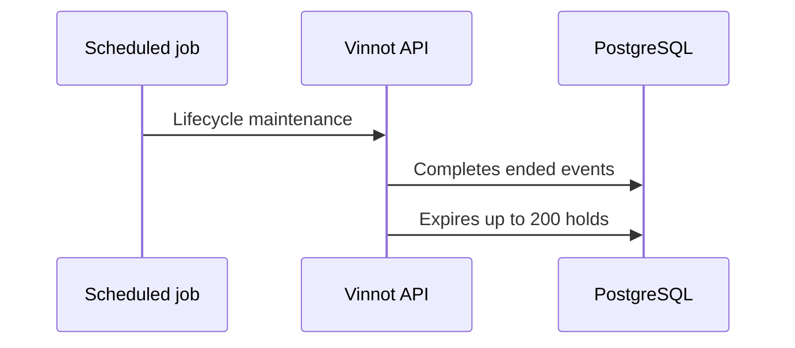

# UC-EVT-08 · Complete ended events and expire holds

| Field | Value |
|---|---|
| ID | `UC-EVT-08` |
| Module | [Events and tickets](../README.md) |
| Platforms | Backend only |
| Actors | System (scheduled job) |
| Lucidchart IDs | None |
| Requirements | None |
| Test cases | [`CP-EVT-38`](../testing.md), [`CP-EVT-39`](../testing.md), [`CP-EVT-40`](../testing.md) |

## Preconditions

- The scheduled job runs one minute after start-up and then every five minutes.

## Postconditions

- Ended events are `COMPLETED` and expired holds release their place.

## Main flow

1. The job marks as `COMPLETED` the published or sold-out events whose end has passed.
2. It looks for up to 200 registrations with an expired hold.
3. For each one, it releases the hold on the event and marks the registration as `EXPIRED`.

## Alternative flows

- 2a. More than 200 are due: the rest are processed in the following runs.
- 3a. A sold-out event regains places: it goes back to `PUBLISHED`.

## Business rules

- A waitlisted registration does not move up on its own when a place is freed.
- A cancelled event does not become `COMPLETED`.

## Diagram

[View the full “UC-EVT-08 · Complete ended events and expire holds” diagram](https://images.vinnot.com/docs/diagrams/v1/en/modules-events-use-cases-uc-evt-08-event-lifecycle-036c8ceb318c.svg)

## Code

| Layer | Location |
|---|---|
| Backend | [`EventLifecycleScheduler.java`](../../../../../backend/src/main/java/com/vinnot/event/infrastructure/scheduling/EventLifecycleScheduler.java), [`MaintainEventLifecycleCommandHandler.java`](../../../../../backend/src/main/java/com/vinnot/event/application/command/handler/MaintainEventLifecycleCommandHandler.java), [`EventHoldExpirationService.java`](../../../../../backend/src/main/java/com/vinnot/event/application/service/EventHoldExpirationService.java) |

## Automated tests

- Backend: [`MaintainEventLifecycleCommandHandlerTest.java`](../../../../../backend/src/test/java/com/vinnot/event/application/command/handler/MaintainEventLifecycleCommandHandlerTest.java), [`EventHoldExpirationServiceTest.java`](../../../../../backend/src/test/java/com/vinnot/event/application/service/EventHoldExpirationServiceTest.java), [`EventStatusTransitionTest.java`](../../../../../backend/src/test/java/com/vinnot/event/domain/model/EventStatusTransitionTest.java)
- Web: None
- App: None
