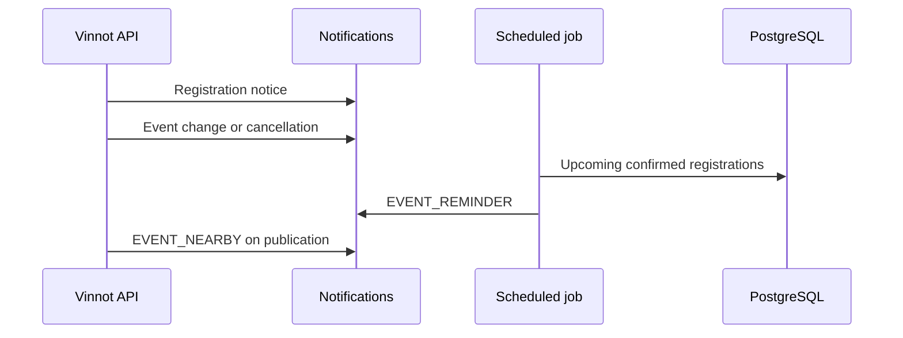

# UC-EVT-09 · Notify attendees

| Field | Value |
|---|---|
| ID | `UC-EVT-09` |
| Module | [Events and tickets](../README.md) |
| Platforms | Backend only |
| Actors | System (scheduled job), Organizer, Email and push service |
| Lucidchart IDs | None |
| Requirements | None |
| Test cases | [`CP-EVT-41`](../testing.md), [`CP-EVT-42`](../testing.md), [`CP-EVT-43`](../testing.md), [`CP-EVT-44`](../testing.md), [`CP-EVT-45`](../testing.md) |

## Preconditions

- There are new registrations, events that change or are cancelled, upcoming events or newly published events.

## Postconditions

- Attendees and people nearby get the notices that apply to them.

## Main flow

1. On registration, the person gets `EVENT_REGISTRATION_ATTENDEE` and the organizer `EVENT_REGISTRATION_ORGANIZER`, by email and push.
2. If the organizer changes the date or the venue of a published event, attendees get `EVENT_CHANGED_ATTENDEE` and reminders are rescheduled.
3. If the event is cancelled, every active registration is cancelled and each attendee gets `EVENT_CANCELLED_ATTENDEE` with the reason and what happens to their money.
4. Every five minutes, the reminder job sends `EVENT_REMINDER` by email and push to confirmed attendees between 24 and 1 hour before the start, and another push between 2 hours and 15 minutes before.
5. The first time an event is published with open registration, people whose notice area matches get an `EVENT_NEARBY` push.

## Alternative flows

- 3a. Whoever cancelled is not the organizer: the organizer gets an `EVENT_CANCELLED_ORGANIZER_SUMMARY` summary.
- 3b. The registration was paid online: the notice says an automatic refund to the same payment method was requested through Mercado Pago ([Payments](../../payments/README.md)); if it was paid to the organizer, that they arrange it.
- 4a. The event starts in less than 2 hours: the day-before push is not sent; the second one covers it.
- 5a. The person blocked the organizer, is the organizer or turned the category off: they get no notice.

## Business rules

- Nearby event notices are push only and arrive at most once a day.
- Areas by region or city match by name; with coordinates, within 50 km.
- Each notice has its own key, so retrying does not duplicate it.
- Channels, quiet hours and push limits are in [Notifications](../../notifications/README.md).

## Diagram

[View the full “UC-EVT-09 · Notify attendees” diagram](https://images.vinnot.com/docs/diagrams/v1/en/modules-events-use-cases-uc-evt-09-attendee-notices-114571e65d5b.svg)

## Code

| Layer | Location |
|---|---|
| Backend | [`NotifyEventRegistrationService.java`](../../../../../backend/src/main/java/com/vinnot/event/application/service/NotifyEventRegistrationService.java), [`EventScheduleChangeService.java`](../../../../../backend/src/main/java/com/vinnot/event/application/service/EventScheduleChangeService.java), [`EventCancellationService.java`](../../../../../backend/src/main/java/com/vinnot/event/application/service/EventCancellationService.java), [`EventReminderScheduler.java`](../../../../../backend/src/main/java/com/vinnot/event/infrastructure/scheduling/EventReminderScheduler.java), [`SendEventRemindersService.java`](../../../../../backend/src/main/java/com/vinnot/event/application/service/SendEventRemindersService.java), [`AnnounceNewEventNearbyService.java`](../../../../../backend/src/main/java/com/vinnot/event/application/service/AnnounceNewEventNearbyService.java) |

## Automated tests

- Backend: [`NotifyEventRegistrationServiceTest.java`](../../../../../backend/src/test/java/com/vinnot/event/application/service/NotifyEventRegistrationServiceTest.java), [`EventScheduleChangeServiceTest.java`](../../../../../backend/src/test/java/com/vinnot/event/application/service/EventScheduleChangeServiceTest.java), [`EventCancellationServiceTest.java`](../../../../../backend/src/test/java/com/vinnot/event/application/service/EventCancellationServiceTest.java), [`SendEventRemindersServiceTest.java`](../../../../../backend/src/test/java/com/vinnot/event/application/service/SendEventRemindersServiceTest.java), [`EventReminderPostgresIntegrationTest.java`](../../../../../backend/src/test/java/com/vinnot/event/infrastructure/EventReminderPostgresIntegrationTest.java), [`AnnounceNewEventNearbyServiceTest.java`](../../../../../backend/src/test/java/com/vinnot/event/application/service/AnnounceNewEventNearbyServiceTest.java), [`EventReminderSchedulerTest.java`](../../../../../backend/src/test/java/com/vinnot/event/infrastructure/scheduling/EventReminderSchedulerTest.java), [`EventReminderTemplateTest.java`](../../../../../backend/src/test/java/com/vinnot/notification/infrastructure/template/EventReminderTemplateTest.java)
- Web: None
- App: None
