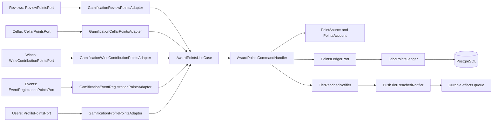

# Architecture

How the module is built in each layer. The backend follows the hexagonal flow
`controller → input port → handler → domain → output port → adapter`; the web and the app
follow `screen → hook → service → API client → HTTP transport`. Point, tier and
edge-case rules are in the [module README](README.md).

## Flow of an award

The modules where activity happens do not know the points rules: each one declares its own
output port and an infrastructure adapter translates it to the gamification input port.



[View the full “Flow of an award” diagram](https://images.vinnot.com/docs/diagrams/v1/en/modules-gamification-architecture-c83a6eee4252.svg)

## Backend

### Layers

| Responsibility | Implementation |
|---|---|
| HTTP | [`PointsController`](../../../../backend/src/main/java/com/vinnot/gamification/infrastructure/web/controller/PointsController.java) under `/users/me/points`; [`CelebratePointsRequest`](../../../../backend/src/main/java/com/vinnot/gamification/infrastructure/web/request/CelebratePointsRequest.java) requires `tier` or `welcome: true` |
| Writes | [`AwardPointsCommandHandler`](../../../../backend/src/main/java/com/vinnot/gamification/application/command/handler/AwardPointsCommandHandler.java) (award and revoke) and [`CelebratePointsCommandHandler`](../../../../backend/src/main/java/com/vinnot/gamification/application/command/handler/CelebratePointsCommandHandler.java) |
| Reads | [`GetMyPointsQueryHandler`](../../../../backend/src/main/java/com/vinnot/gamification/application/query/handler/GetMyPointsQueryHandler.java) and [`GetPointStandingsQueryHandler`](../../../../backend/src/main/java/com/vinnot/gamification/application/query/handler/GetPointStandingsQueryHandler.java) (tiers of several authors in one query) |
| Domain | [`PointSource`](../../../../backend/src/main/java/com/vinnot/gamification/domain/model/PointSource.java) (points and limits), [`PointRules`](../../../../backend/src/main/java/com/vinnot/gamification/domain/model/PointRules.java) (cap of 40, 80-character note, keys), [`PointsAccount`](../../../../backend/src/main/java/com/vinnot/gamification/domain/model/PointsAccount.java) (tier, celebration, welcome card and the day in the person's zone) and [`Tier`](../../../../backend/src/main/java/com/vinnot/gamification/domain/model/Tier.java) |
| Output ports | [`PointsLedgerPort`](../../../../backend/src/main/java/com/vinnot/gamification/application/port/out/PointsLedgerPort.java) and [`TierReachedNotifier`](../../../../backend/src/main/java/com/vinnot/gamification/application/port/out/TierReachedNotifier.java) |
| Adapters | [`JdbcPointsLedger`](../../../../backend/src/main/java/com/vinnot/gamification/infrastructure/persistence/JdbcPointsLedger.java) and [`PushTierReachedNotifier`](../../../../backend/src/main/java/com/vinnot/gamification/infrastructure/notification/PushTierReachedNotifier.java) |
| Readers in other modules | [`GamificationReviewerBadgeAdapter`](../../../../backend/src/main/java/com/vinnot/review/infrastructure/gamification/GamificationReviewerBadgeAdapter.java) (seal of review and comment authors) and [`GamificationUserPointsAdapter`](../../../../backend/src/main/java/com/vinnot/admin/infrastructure/gamification/GamificationUserPointsAdapter.java) (points and seal in the administration user list) |

### Concurrency and idempotency

- `JdbcPointsLedger.lockAccount` creates the `user_points` row when missing and locks it
  with `SELECT … FOR UPDATE`, so two simultaneous awards for one person are serialised and
  never exceed the caps.
- Each award is unique per (`user_id`, `source`, `source_key`). A revoked award becomes
  inactive and can be granted again without counting twice.
- Prefix revocations take back every like of a review at once.
- The `TIER_REACHED` push is queued in the same transaction, keyed
  `tier-reached:<person>:<tier>`; the Community preference is checked on delivery.

### Data

[`V70__points_and_wax_seal_emblems.sql`](../../../../backend/src/main/resources/db/migration/V70__points_and_wax_seal_emblems.sql)
creates `user_points`, `user_point_awards`, `user_point_movements` and `wine_label_scans`,
and computes historical points without sending pushes. The details are in the “Data and
backfill (V70)” section of the [README](README.md).

### Expected errors

`POST /users/me/points/celebrations` without `tier` or `welcome: true`, or with an unknown
tier key, answers `400`. A missing account when celebrating answers `404`
(`EntityNotFoundException`). Awarding or revoking for an account that no longer exists
does nothing.

## Web

```text
PointsPage / ProfilePointsHeader / PointsCelebrationHost → useMyPoints / usePointsAcknowledgement → pointsService → usersClient → http
```

| Piece | What it does |
|---|---|
| [`PointsPage.tsx`](../../../../frontend-react/src/presentation/pages/user/PointsPage.tsx) | “Your points” at `/profile/points`: seal, progress, how to earn, movements and ladder |
| [`ProfilePointsHeader.tsx`](../../../../frontend-react/src/presentation/components/features/points/ProfilePointsHeader.tsx) | Seal, points and progress in the profile; the seal opens “Your points” |
| [`PointsCelebrationHost.tsx`](../../../../frontend-react/src/presentation/components/features/points/PointsCelebrationHost.tsx) | Mounted in `AppShell`: tier reveal and welcome card |
| [`UserBadge.tsx`](../../../../frontend-react/src/presentation/components/features/points/UserBadge.tsx) | CSS-animated seal; honours reduced motion |
| [`useMyPoints.ts`](../../../../frontend-react/src/presentation/hooks/queries/user/useMyPoints.ts) and [`usePointsAcknowledgement.ts`](../../../../frontend-react/src/presentation/hooks/queries/user/usePointsAcknowledgement.ts) | Read and celebration acknowledgement with TanStack Query |
| [`points.service.ts`](../../../../frontend-react/src/application/services/points.service.ts) and [`domain/points`](../../../../frontend-react/src/domain/points/) | DTO-to-model mapping and the tier ladder |
| [`users.client.ts`](../../../../frontend-react/src/infrastructure/api/clients/users.client.ts) | `GET /users/me/points` and `POST /users/me/points/celebrations` |

## App

| Piece | What it does |
|---|---|
| [`PointsScreen.tsx`](../../../../frontend-mobile/src/presentation/features/points/PointsScreen.tsx) | “Your points” at `/points`, with pull to refresh |
| [`ProfilePoints.tsx`](../../../../frontend-mobile/src/presentation/features/points/ProfilePoints.tsx) | Seal, points and progress in the profile |
| [`PointsHost.tsx`](../../../../frontend-mobile/src/presentation/features/points/PointsHost.tsx) and [`usePointsCelebration.ts`](../../../../frontend-mobile/src/presentation/features/points/usePointsCelebration.ts) | Mounted in the `(app)` layout: reveal with a haptic and the welcome card |
| [`UserBadge.tsx`](../../../../frontend-mobile/src/presentation/features/points/UserBadge.tsx) and [`SealCanvas.tsx`](../../../../frontend-mobile/src/presentation/features/points/SealCanvas.tsx) | Seal animated with Skia and Reanimated clocks |
| [`hooks/queries/user`](../../../../frontend-mobile/src/presentation/hooks/queries/user/index.ts) | `usePointsSummary` and its refreshes |
| [`points.service.ts`](../../../../frontend-mobile/src/application/services/points.service.ts) and [`domain/points`](../../../../frontend-mobile/src/domain/points/) | DTO-to-model mapping and the tier ladder |
| [`points.client.ts`](../../../../frontend-mobile/src/infrastructure/api/clients/points.client.ts) | `GET /users/me/points` and `POST /users/me/points/celebrations` |

## References

- [Module README](README.md) and the [Points and seals manual](../../manuals/points-and-seals.mdx).
- [Notifications](../notifications/README.md), for the `TIER_REACHED` push.
- [Reviews](../reviews/README.md) and [Cellar](../cellar/README.md), which report the activity.
