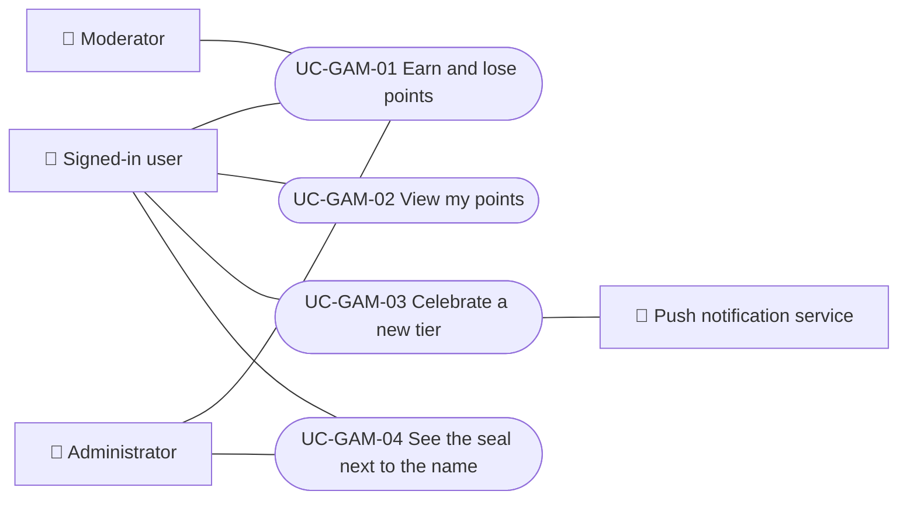

# Use cases

Use cases of the points and seals module: earn and lose points, read them, celebrate a new tier and see the seal next to the name. The user-facing guide is [Points and seals](../../../manuals/points-and-seals.mdx). Each case applies to the platforms shown.

| ID | Use case | Platforms | Actors |
|---|---|---|---|
| `UC-GAM-01` | [Earn and lose points](uc-gam-01-earn-and-lose-points.md) | Web, APK | Signed-in user, Moderator, Administrator |
| `UC-GAM-02` | [View my points](uc-gam-02-view-my-points.md) | Web, APK | Signed-in user |
| `UC-GAM-03` | [Celebrate a new tier](uc-gam-03-celebrate-tier.md) | Web, APK | Signed-in user, Push notification service |
| `UC-GAM-04` | [See the seal next to the name](uc-gam-04-seal-next-to-name.md) | Web, APK | Signed-in user, Administrator |

## Actors and use cases

[View the full “Actors and use cases” diagram](https://images.vinnot.com/docs/diagrams/v1/en/modules-gamification-use-cases-readme-261bcedb9e96.svg)

## Lucidchart mapping

| ID | Lucidchart IDs |
|---|---|
| `UC-GAM-01` | None |
| `UC-GAM-02` | None |
| `UC-GAM-03` | None |
| `UC-GAM-04` | None |
