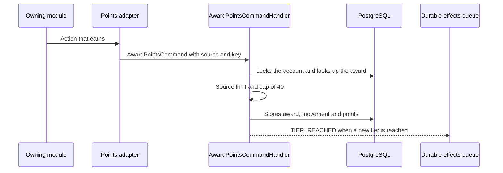

# UC-GAM-01 · Earn and lose points

| Field | Value |
|---|---|
| ID | `UC-GAM-01` |
| Module | [Points and seals](../README.md) |
| Platforms | Web, APK |
| Actors | Signed-in user, Moderator, Administrator |
| Lucidchart IDs | None |
| Requirements | [`RF-WEB-GAM-01`](../requirements.md), [`RF-WEB-GAM-02`](../requirements.md), [`RF-WEB-GAM-03`](../requirements.md), [`RF-APK-GAM-01`](../requirements.md), [`RF-APK-GAM-02`](../requirements.md), [`RF-APK-GAM-03`](../requirements.md) |
| Test cases | [`CP-GAM-01`](../testing.md), [`CP-GAM-02`](../testing.md), [`CP-GAM-03`](../testing.md), [`CP-GAM-04`](../testing.md), [`CP-GAM-05`](../testing.md), [`CP-GAM-06`](../testing.md), [`CP-GAM-07`](../testing.md), [`CP-GAM-08`](../testing.md) |

## Preconditions

- The person has an active account.

## Postconditions

- The movement is in the history and the person's points and tier are updated.

## Main flow

1. The person does something that earns points, such as publishing an approved review.
2. The owning module's use case (reviews, cellar, wines, events or users) calls its points port; its `Gamification*PointsAdapter` turns it into an `AwardPointsCommand` with the source and source key.
3. `AwardPointsCommandHandler` locks the person's points account.
4. If an active award with the same person, source and key already exists, it ends without changes.
5. `PointSource.grant` computes the points: first the source's daily limit, then the global cap of 40, with the day in the person's time zone.
6. It stores the award and the movement and updates points and tier.
7. If the person reached a higher tier for the first time, it queues the `TIER_REACHED` notice ([`UC-GAM-03`](uc-gam-03-celebrate-tier.md)).

## Alternative flows

- 4a. The same action arrives again with the same key: nothing is added.
- 5a. The source's daily limit was reached (5 likes, 3 comments, 3 scans or 3 cellar entries): it grants 0 and leaves no trace, so the action can earn another day.
- 5b. The global cap of 40 was reached: the last award is clamped to what is left; an approved wine still earns because it is outside the cap.
- 1a. The content is deleted or removed by moderation: `revoke` takes back exactly what was granted; deleting a review also revokes its received likes; creating it again awards again.
- 1b. A review goes back to `PENDING`: the review, its note and its likes are revoked; approval awards them again under the same keys, within that day's caps.
- 3a. The account no longer exists: nothing is added or taken.
- 3b. Two awards arrive at the same time: the per-person lock prevents passing the cap or counting a key twice.

## Business rules

- Giving likes earns nothing; self-likes count as received.
- A comment only earns on someone else's review.
- A cellar entry created by a review earns 0 points.
- The full table of sources, limits and edge cases is in the “Points per action” and “Revocation and edge cases” sections of the [module README](../README.md).

## Sequence of an award

[View the full “Sequence of an award” diagram](https://images.vinnot.com/docs/diagrams/v1/en/modules-gamification-use-cases-uc-gam-01-earn-and-lose-points-581c09e735a2.svg)

## Code

| Layer | Location |
|---|---|
| Backend | [`AwardPointsCommandHandler.java`](../../../../../backend/src/main/java/com/vinnot/gamification/application/command/handler/AwardPointsCommandHandler.java), [`PointSource.java`](../../../../../backend/src/main/java/com/vinnot/gamification/domain/model/PointSource.java), [`PointsAccount.java`](../../../../../backend/src/main/java/com/vinnot/gamification/domain/model/PointsAccount.java), [`JdbcPointsLedger.java`](../../../../../backend/src/main/java/com/vinnot/gamification/infrastructure/persistence/JdbcPointsLedger.java) |
| Other modules' adapters | [`GamificationReviewPointsAdapter.java`](../../../../../backend/src/main/java/com/vinnot/review/infrastructure/gamification/GamificationReviewPointsAdapter.java), [`GamificationCellarPointsAdapter.java`](../../../../../backend/src/main/java/com/vinnot/cellar/infrastructure/gamification/GamificationCellarPointsAdapter.java), [`GamificationWineContributionPointsAdapter.java`](../../../../../backend/src/main/java/com/vinnot/wine/infrastructure/gamification/GamificationWineContributionPointsAdapter.java), [`GamificationEventRegistrationPointsAdapter.java`](../../../../../backend/src/main/java/com/vinnot/event/infrastructure/gamification/GamificationEventRegistrationPointsAdapter.java), [`GamificationProfilePointsAdapter.java`](../../../../../backend/src/main/java/com/vinnot/user/infrastructure/gamification/GamificationProfilePointsAdapter.java) |
| Data | [`V70__points_and_wax_seal_emblems.sql`](../../../../../backend/src/main/resources/db/migration/V70__points_and_wax_seal_emblems.sql) |

## Automated tests

- Backend:
  - [`AwardPointsCommandHandlerTest.java`](../../../../../backend/src/test/java/com/vinnot/gamification/application/command/handler/AwardPointsCommandHandlerTest.java): `anAwardIsIdempotentPerMemberSourceAndKey`, `aRevocationTakesBackExactlyWhatWasAwardedOnceAndAllowsAwardingAgain`, `aPrefixRevocationTakesBackEveryLikeOfAReview`, `likesStopAtFivePerDayAndTheLimitResetsAtTheMembersMidnight`, `commentsScansAndCellarAddsStopAtThreePerDay`, `theGlobalCapIsFortyPerDayAndApprovedWinesAreOutsideIt`, `aMemberThatNoLongerExistsEarnsAndLosesNothing`, `aCappedAwardLeavesNoTraceSoItCanBeEarnedAnotherDay`
  - [`PointSourceTest.java`](../../../../../backend/src/test/java/com/vinnot/gamification/domain/model/PointSourceTest.java): `everySourceGrantsItsApprovedPoints`, `perSourceDailyLimitsStopAtFiveLikesAndThreeCommentsScansAndCellarAdds`, `theGlobalCapClampsTheLastAwardAndExcludesApprovedWines`
  - [`PointRulesTest.java`](../../../../../backend/src/test/java/com/vinnot/gamification/domain/model/PointRulesTest.java): `aNoteEarnsFromEightyCharactersWithoutSurroundingSpaces`, `aCompleteProfileHasAPhotoBothNamesAndAPhone`, `likeKeysShareTheReviewPrefix`, `awardsAndMovementsKeepTheirMemberSourceAndKey`
  - [`PointsAccountTest.java`](../../../../../backend/src/test/java/com/vinnot/gamification/domain/model/PointsAccountTest.java): `theWelcomeCardIsDismissedOnceAndPointsNeverGoNegative`, `theDayStartsAtMidnightInTheMembersOwnZone`
  - [`PointsHttpPostgresIntegrationTest.java`](../../../../../backend/src/test/java/com/vinnot/gamification/infrastructure/PointsHttpPostgresIntegrationTest.java): `reviewsLikesAndCommentsEarnAndDeletingTheReviewTakesItsPointsBack`, `aReviewOutOfModerationHoldsNoLikePointsAndApprovalAwardsEverythingAgainOnce`, `aCellarEntryAddedByHandEarnsOnceAndOneAReviewCreatedEarnsNothing`, `concurrentAwardsNeverPassTheDailyCapOrCountOneKeyTwice`, `scansAreRecordedAndAnExactMatchEarnsOncePerWine`, `aCompleteProfileNeedsThePhoneAndEarnsOnce`
  - [`PointsBackfillMigrationPostgresIntegrationTest.java`](../../../../../backend/src/test/java/com/vinnot/gamification/infrastructure/PointsBackfillMigrationPostgresIntegrationTest.java): `existingContentEarnsWithTheLiveRulesAndCapsWithoutAnyPush`
  - [`GamificationReviewPointsAdapterTest.java`](../../../../../backend/src/test/java/com/vinnot/review/infrastructure/gamification/GamificationReviewPointsAdapterTest.java): `aReviewEarnsPerWineAndItsNoteOnlyFromEightyCharacters`, `unpublishingRevokesTheReviewAndNoteAndDeletingAlsoItsLikes`, `unpublishingAlsoRevokesTheLikesTheReviewReceived`, `approvalAwardsTheReviewItsNoteAndOnePointPerCurrentLikeWithTheSameKeys`, `likesAreKeyedByReviewAndLiker`, `onlyACommentOnSomeoneElsesReviewEarns`
  - [`GamificationProfilePointsAdapterTest.java`](../../../../../backend/src/test/java/com/vinnot/user/infrastructure/gamification/GamificationProfilePointsAdapterTest.java): `aPhotoAndBothNamesWithoutAPhoneEarnNothing`, `addingThePhoneCompletesTheProfileUnderItsSingleKey`
- Web:
  - [`pointsInvalidation.test.tsx`](../../../../../frontend-react/src/presentation/hooks/queries/user/pointsInvalidation.test.tsx): `refreshes the points after a profile update and an avatar upload, still syncing the session user`
