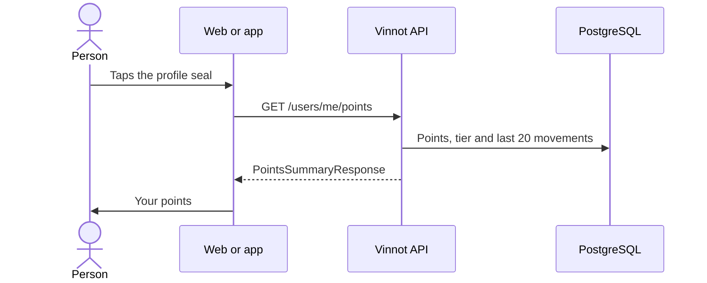

# UC-GAM-02 · View my points

| Field | Value |
|---|---|
| ID | `UC-GAM-02` |
| Module | [Points and seals](../README.md) |
| Platforms | Web, APK |
| Actors | Signed-in user |
| Lucidchart IDs | None |
| Requirements | [`RF-WEB-GAM-04`](../requirements.md), [`RF-APK-GAM-04`](../requirements.md) |
| Test cases | [`CP-GAM-09`](../testing.md), [`CP-GAM-10`](../testing.md), [`CP-GAM-11`](../testing.md), [`CP-GAM-12`](../testing.md), [`CP-GAM-13`](../testing.md) |

## Preconditions

- The person is signed in.

## Postconditions

- The person sees their points, seal, progress and latest movements.

## Main flow

1. The person opens their profile: the header shows the seal, the points, the tier name and the progress bar to the next tier.
2. They tap the seal and “Your points” opens (`/profile/points` on the web, `/points` in the app).
3. The client requests `GET /users/me/points`.
4. `GetMyPointsQueryHandler` projects the points, the tier, the next tier and its threshold, today's points and the cap, pending celebrations and the last 20 movements with their label.
5. The screen shows how to earn with each limit and the daily cap, the latest signed movements and the whole ladder with the current tier marked.

## Alternative flows

- 4a. The person never had points: it shows Bud with 0 points.
- 5a. There are no movements: it says there is no activity yet.
- 3a. Loading fails: a retry is offered.
- 5b. In the app, the person pulls to refresh or comes back to the screen: fresh points are requested, without a spinner for background refreshes.

## Business rules

- The tier comes from the current points: it drops if points are revoked.
- Revocations show as negative movements.
- A movement shows the related wine or event name when there is one.

## Sequence of the read

[View the full “Sequence of the read” diagram](https://images.vinnot.com/docs/diagrams/v1/en/modules-gamification-use-cases-uc-gam-02-view-my-points-c01ec87e014f.svg)

## Code

| Layer | Location |
|---|---|
| Endpoints | `GET /users/me/points` |
| Backend | [`PointsController.java`](../../../../../backend/src/main/java/com/vinnot/gamification/infrastructure/web/controller/PointsController.java), [`GetMyPointsQueryHandler.java`](../../../../../backend/src/main/java/com/vinnot/gamification/application/query/handler/GetMyPointsQueryHandler.java), [`PointsSummaryResponse.java`](../../../../../backend/src/main/java/com/vinnot/gamification/application/query/response/PointsSummaryResponse.java), [`Tier.java`](../../../../../backend/src/main/java/com/vinnot/gamification/domain/model/Tier.java) |
| Web | [`PointsPage.tsx`](../../../../../frontend-react/src/presentation/pages/user/PointsPage.tsx), [`ProfilePointsHeader.tsx`](../../../../../frontend-react/src/presentation/components/features/points/ProfilePointsHeader.tsx), [`useMyPoints.ts`](../../../../../frontend-react/src/presentation/hooks/queries/user/useMyPoints.ts), [`points.service.ts`](../../../../../frontend-react/src/application/services/points.service.ts), [`users.client.ts`](../../../../../frontend-react/src/infrastructure/api/clients/users.client.ts) |
| App | [`PointsScreen.tsx`](../../../../../frontend-mobile/src/presentation/features/points/PointsScreen.tsx), [`ProfilePoints.tsx`](../../../../../frontend-mobile/src/presentation/features/points/ProfilePoints.tsx), [`index.ts`](../../../../../frontend-mobile/src/presentation/hooks/queries/user/index.ts), [`points.service.ts`](../../../../../frontend-mobile/src/application/services/points.service.ts), [`points.client.ts`](../../../../../frontend-mobile/src/infrastructure/api/clients/points.client.ts) |

## Automated tests

- Backend:
  - [`PointsQueryHandlersTest.java`](../../../../../backend/src/test/java/com/vinnot/gamification/application/query/handler/PointsQueryHandlersTest.java): `aMemberWithoutPointsIsAFreshBrote`, `theSummaryShowsProgressTodayAndTheLastMovementsLabelled`
  - [`TierTest.java`](../../../../../backend/src/test/java/com/vinnot/gamification/domain/model/TierTest.java): `theLadderHasTheApprovedKeysAndThresholds`, `pointsChooseTheHighestReachedTier`, `nextIsNullAtTheTopAndLowerPicksTheSmallerTier`
  - [`PointsHttpPostgresIntegrationTest.java`](../../../../../backend/src/test/java/com/vinnot/gamification/infrastructure/PointsHttpPostgresIntegrationTest.java): `reviewsLikesAndCommentsEarnAndDeletingTheReviewTakesItsPointsBack`, `aCompleteProfileNeedsThePhoneAndEarnsOnce`
- Web:
  - [`PointsPage.test.tsx`](../../../../../frontend-react/src/presentation/pages/user/PointsPage.test.tsx): `shows the seal and progress, how to earn points, recent movements and the full ladder`, `reads in Spanish and says when there are no movements yet`, `offers a retry when the points cannot be loaded`, `shows points and the seal in the profile header; the seal opens the points page`, `shows a placeholder while loading and nothing when the points are unavailable`
  - [`points.service.test.ts`](../../../../../frontend-react/src/application/services/points.service.test.ts): `maps the points summary into the domain model`
  - [`users.client.points.test.ts`](../../../../../frontend-react/src/infrastructure/api/clients/users.client.points.test.ts): `reads the current user points from the wrapped /users/me/points response`, `also accepts an unwrapped points body`
  - [`points.mappers.test.ts`](../../../../../frontend-react/src/domain/points/points.mappers.test.ts): `maps the points summary with known tiers, sources and dates`, `falls back safely on the top tier, unknown keys and missing fields`, `treats an absent list and flags as empty`
  - [`points.tiers.test.ts`](../../../../../frontend-react/src/domain/points/points.tiers.test.ts): `lists the eleven tiers in ladder order with their thresholds`, `finds the tier that current points reach`, `measures the way from the tier floor to the next tier`, `is full with nothing left at the top tier`
  - [`badgeTierCopy.test.ts`](../../../../../frontend-react/src/shared/i18n/badgeTierCopy.test.ts): `names every tier in Spanish and in English`
- App:
  - [`PointsScreen.test.tsx`](../../../../../frontend-mobile/src/presentation/features/points/PointsScreen.test.tsx): `lists how to earn points with each limit and the daily cap`, `shows recent movements with their sign, including revocations and unknown sources`, `shows the whole ladder: reached seals animated, the current one marked, the rest locked`, `says when there is no activity yet`, `pulls fresh points on pull-to-refresh, without a spinner for background refreshes`, `offers a retry when loading fails`
  - [`usePointsSummary.test.tsx`](../../../../../frontend-mobile/src/presentation/hooks/queries/user/usePointsSummary.test.tsx): `asks for fresh points when a screen opens, even if the seal host already holds them`, `refreshes the points when the person comes back to the screen`, `does not fetch for a signed-out profile`
  - [`points.service.test.ts`](../../../../../frontend-mobile/src/application/services/points.service.test.ts): `maps the current user`
  - [`points.client.test.ts`](../../../../../frontend-mobile/src/infrastructure/api/clients/points.client.test.ts): `reads the current user`, `also accepts an unwrapped body`
  - [`points.mappers.test.ts`](../../../../../frontend-mobile/src/domain/points/points.mappers.test.ts): `maps the summary, its tiers and the recent movements`, `falls back safely on missing or unknown fields`, `derives an unknown tier from the points instead of showing the first seal`
  - [`badgeTiers.test.ts`](../../../../../frontend-mobile/src/domain/points/badgeTiers.test.ts): `lists the eleven tiers in ascending order with their thresholds`, `measures the way from the tier floor to the next tier`, `is complete at the top tier`
