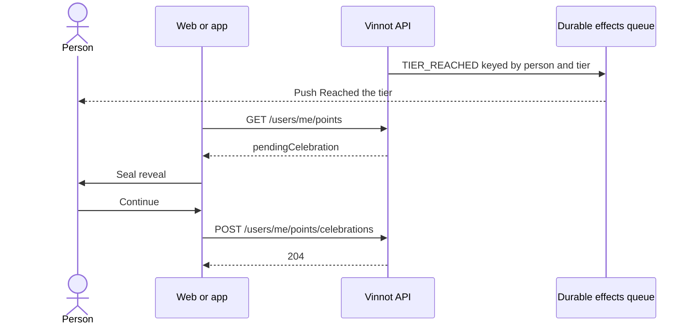

# UC-GAM-03 · Celebrate a new tier

| Field | Value |
|---|---|
| ID | `UC-GAM-03` |
| Module | [Points and seals](../README.md) |
| Platforms | Web, APK |
| Actors | Signed-in user, Push notification service |
| Lucidchart IDs | None |
| Requirements | [`RF-WEB-GAM-05`](../requirements.md), [`RF-WEB-GAM-06`](../requirements.md), [`RF-APK-GAM-05`](../requirements.md), [`RF-APK-GAM-06`](../requirements.md), [`RF-APK-GAM-09`](../requirements.md) |
| Test cases | [`CP-GAM-14`](../testing.md), [`CP-GAM-15`](../testing.md), [`CP-GAM-16`](../testing.md), [`CP-GAM-17`](../testing.md), [`CP-GAM-18`](../testing.md), [`CP-GAM-19`](../testing.md) |

## Preconditions

- The person reached a higher tier for the first time ([`UC-GAM-01`](uc-gam-01-earn-and-lose-points.md)).

## Postconditions

- That tier and the lower ones are celebrated and not shown again.

## Main flow

1. In the award's own transaction, `PushTierReachedNotifier` queues a `TIER_REACHED` push in the durable effects queue, keyed by person and tier.
2. On delivery, the push says “Reached <tier>” with the tier name in the person's language.
3. When the web or the app opens, `PointsCelebrationHost` (web) or `PointsHost` (app) reads `pendingCelebration` from `GET /users/me/points`.
4. It shows the full-screen seal reveal; in the app, with a success haptic.
5. On continue, the client sends `POST /users/me/points/celebrations` with `{ tier }`.
6. `CelebratePointsCommandHandler` marks that tier and the lower ones as celebrated and the API answers 204.

## Alternative flows

- 1a. The person dropped a tier after a revocation and climbs back: no other push is queued and the celebration is not repeated.
- 2a. The Community preference is off: the push is not delivered; the on-screen celebration still shows.
- 3a. The response carries `showWelcome` after the historical calculation: the welcome card shows once and is dismissed with `{ welcome: true }` for every device.
- 5a. A tier lower than the pending one is celebrated: the higher tier stays pending.
- 5b. The request has neither `tier` nor `welcome: true`, or an unknown key: the API answers 400.

## Business rules

- One push per person and tier: the effect key is `tier-reached:<person>:<tier>`.
- The V70 historical calculation never sends a push; it leaves the welcome card pending instead of a celebration.
- Celebrating a tier above the reached one counts as the reached one.

## Sequence of the celebration

[View the full “Sequence of the celebration” diagram](https://images.vinnot.com/docs/diagrams/v1/en/modules-gamification-use-cases-uc-gam-03-celebrate-tier-dfbcd7188d27.svg)

## Code

| Layer | Location |
|---|---|
| Endpoints | `POST /users/me/points/celebrations` |
| Backend | [`PointsController.java`](../../../../../backend/src/main/java/com/vinnot/gamification/infrastructure/web/controller/PointsController.java), [`CelebratePointsRequest.java`](../../../../../backend/src/main/java/com/vinnot/gamification/infrastructure/web/request/CelebratePointsRequest.java), [`CelebratePointsCommandHandler.java`](../../../../../backend/src/main/java/com/vinnot/gamification/application/command/handler/CelebratePointsCommandHandler.java), [`PushTierReachedNotifier.java`](../../../../../backend/src/main/java/com/vinnot/gamification/infrastructure/notification/PushTierReachedNotifier.java), [`TierReachedPushTemplate.java`](../../../../../backend/src/main/java/com/vinnot/notification/infrastructure/push/TierReachedPushTemplate.java) |
| Web | [`PointsCelebrationHost.tsx`](../../../../../frontend-react/src/presentation/components/features/points/PointsCelebrationHost.tsx), [`usePointsAcknowledgement.ts`](../../../../../frontend-react/src/presentation/hooks/queries/user/usePointsAcknowledgement.ts), [`points.service.ts`](../../../../../frontend-react/src/application/services/points.service.ts) |
| App | [`PointsHost.tsx`](../../../../../frontend-mobile/src/presentation/features/points/PointsHost.tsx), [`usePointsCelebration.ts`](../../../../../frontend-mobile/src/presentation/features/points/usePointsCelebration.ts), [`TierCelebration.tsx`](../../../../../frontend-mobile/src/presentation/features/points/TierCelebration.tsx), [`PointsWelcomeCard.tsx`](../../../../../frontend-mobile/src/presentation/features/points/PointsWelcomeCard.tsx) |

## Automated tests

- Backend:
  - [`CelebratePointsCommandHandlerTest.java`](../../../../../backend/src/test/java/com/vinnot/gamification/application/command/handler/CelebratePointsCommandHandlerTest.java): `celebratingTheReachedTierClearsThePendingCelebration`, `celebratingALowerTierLeavesTheHigherOnePending`, `aTierAboveTheReachedOneCountsAsTheReachedOne`, `dismissingTheWelcomeCardKeepsTheCelebrationPending`, `anUnknownMemberIsRejected`
  - [`PointsAccountTest.java`](../../../../../backend/src/test/java/com/vinnot/gamification/domain/model/PointsAccountTest.java): `reachingATierForTheFirstTimeIsReportedOnce`, `aJumpOverSeveralTiersReportsTheHighestOne`, `celebratingMarksThatTierAndLowerOnesButNeverAboveTheHighestReached`
  - [`PushTierReachedNotifierTest.java`](../../../../../backend/src/test/java/com/vinnot/gamification/infrastructure/PushTierReachedNotifierTest.java): `queuesOnePushKeyedByMemberAndTier`
  - [`AwardPointsCommandHandlerTest.java`](../../../../../backend/src/test/java/com/vinnot/gamification/application/command/handler/AwardPointsCommandHandlerTest.java): `reachingATierQueuesOnePushAndADropAndReturnDoNotQueueAnother`
  - [`PointsHttpPostgresIntegrationTest.java`](../../../../../backend/src/test/java/com/vinnot/gamification/infrastructure/PointsHttpPostgresIntegrationTest.java): `reachingATierQueuesOnePushAndTheCelebrationIsRecorded`
  - [`PointsQueryHandlersTest.java`](../../../../../backend/src/test/java/com/vinnot/gamification/application/query/handler/PointsQueryHandlersTest.java): `celebratingAndDismissingTheWelcomeAreStored`
- Web:
  - [`PointsCelebrationHost.test.tsx`](../../../../../frontend-react/src/presentation/components/features/points/PointsCelebrationHost.test.tsx): `reveals a newly reached tier once and records it as celebrated`, `shows the one-time welcome card and opens the points page from it`, `stays silent with nothing to celebrate and for visitors`
  - [`pointsInvalidation.test.tsx`](../../../../../frontend-react/src/presentation/hooks/queries/user/pointsInvalidation.test.tsx): `clears the pending celebration or the welcome card at once and records them`, `leaves an empty cache alone when acknowledging`
  - [`points.service.test.ts`](../../../../../frontend-react/src/application/services/points.service.test.ts): `marks a tier as celebrated and dismisses the welcome card`
  - [`users.client.points.test.ts`](../../../../../frontend-react/src/infrastructure/api/clients/users.client.points.test.ts): `marks a tier celebrated and dismisses the welcome card`
- App:
  - [`PointsHost.test.tsx`](../../../../../frontend-mobile/src/presentation/features/points/PointsHost.test.tsx): `renders nothing when there is nothing to celebrate`, `celebrates a new tier with a success haptic and closes it with continue`, `closes the celebration before opening the points screen`, `shows the one-time welcome card and dismisses it`
  - [`usePointsCelebration.test.ts`](../../../../../frontend-mobile/src/presentation/features/points/usePointsCelebration.test.ts): `celebrates a pending tier once and then marks it as celebrated`, `celebrates a later tier reached in the same session`, `shows the welcome card once and dismisses it on every device`, `shows nothing without a pending tier or a welcome`
  - [`points.service.test.ts`](../../../../../frontend-mobile/src/application/services/points.service.test.ts): `marks a tier as celebrated and dismisses the welcome card`
  - [`points.client.test.ts`](../../../../../frontend-mobile/src/infrastructure/api/clients/points.client.test.ts): `marks a tier as celebrated and dismisses the welcome card`
  - [`badgeTierCopy.test.ts`](../../../../../frontend-mobile/src/shared/i18n/badgeTierCopy.test.ts): `names every tier in Spanish and in English`, `reads naturally around the top tier in the celebration and the welcome card`
