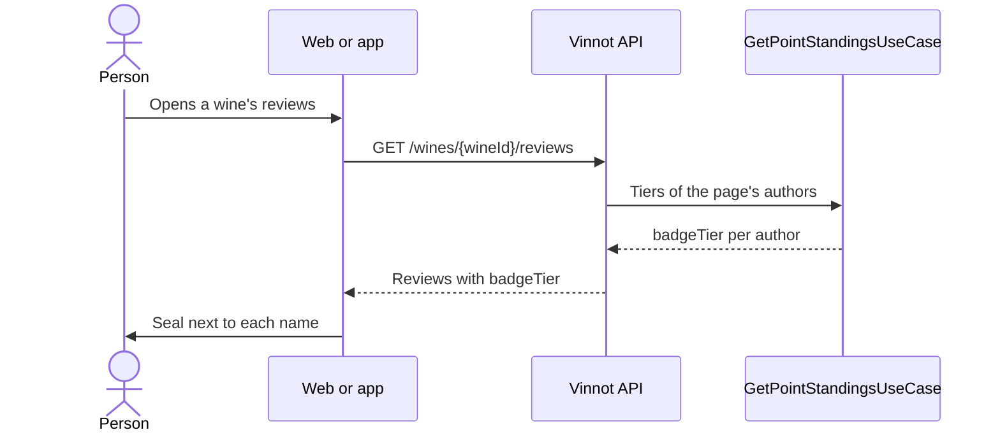

# UC-GAM-04 · See the seal next to the name

| Field | Value |
|---|---|
| ID | `UC-GAM-04` |
| Module | [Points and seals](../README.md) |
| Platforms | Web, APK |
| Actors | Signed-in user, Administrator |
| Lucidchart IDs | None |
| Requirements | [`RF-WEB-GAM-07`](../requirements.md), [`RF-WEB-GAM-08`](../requirements.md), [`RF-APK-GAM-07`](../requirements.md), [`RF-APK-GAM-08`](../requirements.md) |
| Test cases | [`CP-GAM-20`](../testing.md), [`CP-GAM-21`](../testing.md), [`CP-GAM-22`](../testing.md), [`CP-GAM-23`](../testing.md), [`CP-GAM-24`](../testing.md) |

## Preconditions

- The person is signed in.

## Postconditions

- Each visible author shows the seal of their tier, except locked or inactive accounts.

## Main flow

1. The person opens a wine's reviews, their own reviews, a review's comments or, as an administrator, the user list.
2. The API adds `badgeTier` to each author; reviews get it with a single query per page through `GetPointStandingsUseCase`, and the administration list also adds `points`.
3. `UserBadge` draws the tier art next to the name.
4. In lists the seal plays once on appear and again every 8 to 16 seconds; in the profile, continuously.

## Alternative flows

- 2a. The author's account is locked or inactive: `badgeTier` is `null` and no seal is shown.
- 3a. The tier key is unknown: no seal is shown and the name stays the same.
- 4a. The system asks for less motion: the seal stays still with a fixed highlight.
- 4b. The seal is smaller than 40 px: it is drawn without sparkles.

## Business rules

- The seal does not appear on organisers, blocks, reports or pushes.
- The animation grows with the tier; the per-tier detail is in the [module README](../README.md#interface).
- On the web, big seals follow the pointer with the foil; in the app, a resting seal stays flat.

## Sequence of a list with seals

[View the full “Sequence of a list with seals” diagram](https://images.vinnot.com/docs/diagrams/v1/en/modules-gamification-use-cases-uc-gam-04-seal-next-to-name-4134dcee62d3.svg)

## Code

| Layer | Location |
|---|---|
| Backend | [`GetPointStandingsQueryHandler.java`](../../../../../backend/src/main/java/com/vinnot/gamification/application/query/handler/GetPointStandingsQueryHandler.java), [`GamificationReviewerBadgeAdapter.java`](../../../../../backend/src/main/java/com/vinnot/review/infrastructure/gamification/GamificationReviewerBadgeAdapter.java), [`GamificationUserPointsAdapter.java`](../../../../../backend/src/main/java/com/vinnot/admin/infrastructure/gamification/GamificationUserPointsAdapter.java) |
| Web | [`UserBadge.tsx`](../../../../../frontend-react/src/presentation/components/features/points/UserBadge.tsx), [`sealMotion.ts`](../../../../../frontend-react/src/presentation/components/features/points/sealMotion.ts), [`ReviewCard.tsx`](../../../../../frontend-react/src/presentation/components/features/wine/ReviewCard.tsx) |
| App | [`UserBadge.tsx`](../../../../../frontend-mobile/src/presentation/features/points/UserBadge.tsx), [`NameBadge.tsx`](../../../../../frontend-mobile/src/presentation/features/points/NameBadge.tsx), [`SealCanvas.tsx`](../../../../../frontend-mobile/src/presentation/features/points/SealCanvas.tsx), [`sealMotion.ts`](../../../../../frontend-mobile/src/presentation/features/points/sealMotion.ts) |

## Automated tests

- Backend:
  - [`PointsQueryHandlersTest.java`](../../../../../backend/src/test/java/com/vinnot/gamification/application/query/handler/PointsQueryHandlersTest.java): `standingsHideTheSealOfLockedOrInactiveMembers`
  - [`PointsHttpPostgresIntegrationTest.java`](../../../../../backend/src/test/java/com/vinnot/gamification/infrastructure/PointsHttpPostgresIntegrationTest.java): `reviewerBadgesShowTheTierAndHideItForLockedMembers`
  - [`GamificationReviewPointsAdapterTest.java`](../../../../../backend/src/test/java/com/vinnot/review/infrastructure/gamification/GamificationReviewPointsAdapterTest.java): `badgesComeFromThePointsModule`
  - [`ReviewerInfoResolverTest.java`](../../../../../backend/src/test/java/com/vinnot/review/application/query/handler/ReviewerInfoResolverTest.java): `buildsFullNameAndFallsBackToUsernameForMissingNames`
  - [`GetReviewCommentsQueryHandlerTest.java`](../../../../../backend/src/test/java/com/vinnot/review/application/query/handler/GetReviewCommentsQueryHandlerTest.java): `batchResolvesReviewersAndKeepsUnknownUsersNullable`
  - [`GetReviewsByWineQueryHandlerTest.java`](../../../../../backend/src/test/java/com/vinnot/review/application/query/handler/GetReviewsByWineQueryHandlerTest.java): `resolvesSortEnrichmentCountsAndCurrentUsersLike`
  - [`AdminCatalogQueryHandlersTest.java`](../../../../../backend/src/test/java/com/vinnot/admin/application/query/handler/AdminCatalogQueryHandlersTest.java): `getsAnAdministrativeUserProjectionOrReportsItsAbsence`, `switchesAdministrativeUserSearchBetweenKeywordAndFullListing`
- Web:
  - [`UserBadge.test.tsx`](../../../../../frontend-react/src/presentation/components/features/points/UserBadge.test.tsx): `shows nothing when the tier is hidden or unknown`, `draws the tier art as one named image in both languages`, `plays once when it appears in a list, then replays every 8–16 s while visible`, `loops forever in the profile without waiting to appear`, `skips sparkles below 40 px and shows them on bigger seals`, `stays still with a fixed highlight when the system asks for less motion`, `follows the pointer with tilt and foil on big seals and resets on leave`
  - [`ReviewCard.test.tsx`](../../../../../frontend-react/src/presentation/components/features/wine/ReviewCard.test.tsx): `shows the reviewer seal right after the name`, `hides the seal when the reviewer has none, as before`
  - [`ReviewComments.test.tsx`](../../../../../frontend-react/src/presentation/components/features/wine/ReviewComments.test.tsx): `shows the commenter seal after the name and nothing when there is none`
  - [`AdminUsersPage.test.tsx`](../../../../../frontend-react/src/presentation/pages/admin/AdminUsersPage.test.tsx): `shows each user seal after the username and their points, without a seal when hidden`
- App:
  - [`UserBadge.test.tsx`](../../../../../frontend-mobile/src/presentation/features/points/UserBadge.test.tsx): `renders nothing when the user has no visible badge`, `draws the tier art and names the tier for screen readers`, `skips sparkles below 40 points and keeps them at profile size`, `keeps a resting seal flat, without the 3D tilt that leaves a box edge on iOS`, `still shows the seal with reduced motion`
  - [`useListReplay.test.ts`](../../../../../frontend-mobile/src/presentation/features/points/useListReplay.test.ts): `plays once on appear and again after 8 to 16 seconds while on screen`, `skips replays while the seal is off screen`
  - [`sealMotion.test.ts`](../../../../../frontend-mobile/src/presentation/features/points/sealMotion.test.ts): `loops forever in the profile and plays once per burst in lists`, `replays list seals every 8 to 16 seconds`
  - [`ReviewItem.test.tsx`](../../../../../frontend-mobile/src/presentation/features/wine/ReviewItem.test.tsx): `shows the reviewer's seal after the name and keeps the name when there is none`
  - [`ReviewComments.test.tsx`](../../../../../frontend-mobile/src/presentation/features/wine/ReviewComments.test.tsx): `shows the commenter's seal after the name only when they have one`
  - [`AdminUserRow.test.tsx`](../../../../../frontend-mobile/src/presentation/features/admin/AdminUserRow.test.tsx): `shows the user's seal after the name and their points`, `hides the seal of a user without a visible tier`
