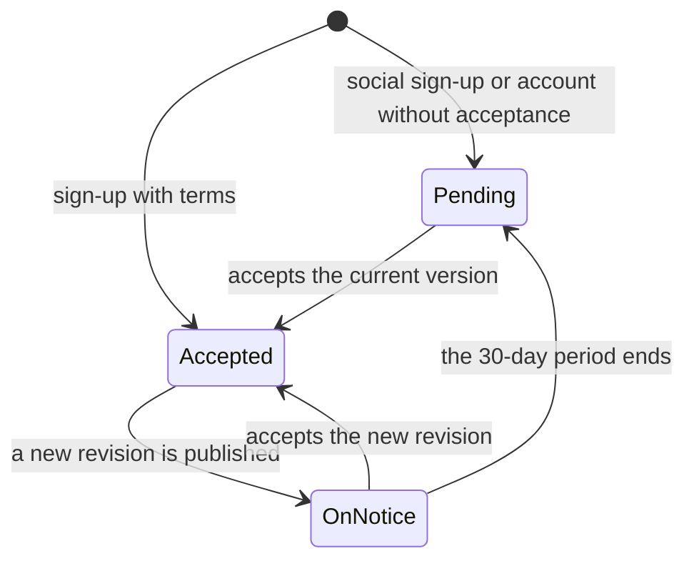
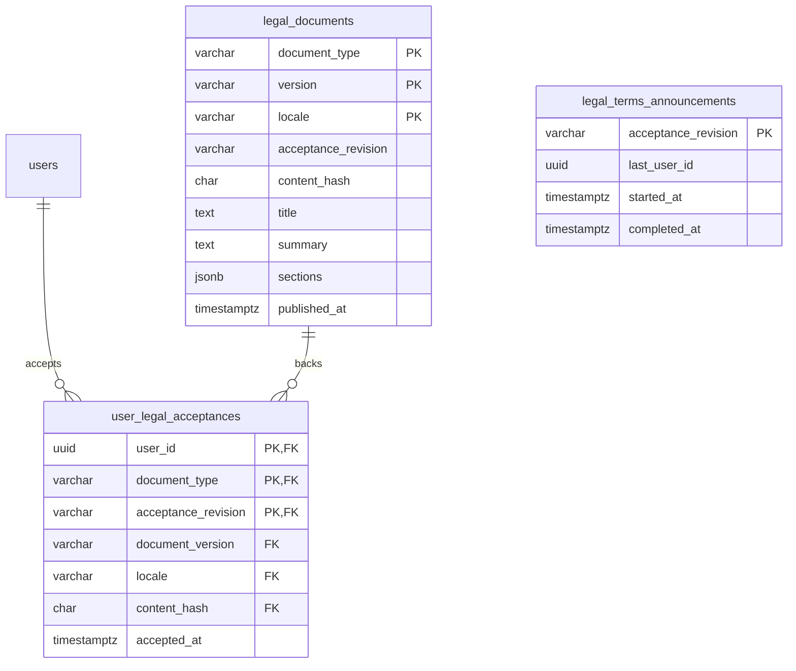

# Legal

The Vinnot terms of use and the proof that each account accepted them. The
module publishes the terms by version, asks for them at sign-up and on entry
when there is a new revision, stores every acceptance as evidence that cannot be
changed, and announces changes by email. The legal centre also offers privacy,
policies and cookies, but those documents are fixed content in the client: only
the terms are versioned and accepted.

- Module code: `LEG`.
- Backend: package [`legal`](../../../../backend/src/main/java/com/vinnot/legal/).
- [Use cases](use-cases/README.md) · [Requirements](requirements.md) ·
  [Architecture](architecture.md) · [Testing](testing.md)

## Actors

| Actor | What they do in this module |
|---|---|
| Visitor | Reads the legal centre and accepts the terms at sign-up |
| Signed-in user | Accepts the current version or signs out without accepting |
| Scheduled task | Notifies accounts when a new revision is published |
| Email service | Delivers the `TERMS_UPDATED` notice |
| Technical team | Publishes new versions with a migration and an environment variable |

## Business rules

| Rule | Detail | Where |
|---|---|---|
| Explicit acceptance | The box must be checked; signing in, reading or scrolling does not count | [`LegalAgreementService.java`](../../../../backend/src/main/java/com/vinnot/legal/application/service/LegalAgreementService.java) |
| Exact selection | Version, language (`es` or `en`) and SHA-256 hash must match the current version; otherwise 422 `TERMS_VERSION_CHANGED` | [`LegalAgreementService.java`](../../../../backend/src/main/java/com/vinnot/legal/application/service/LegalAgreementService.java) |
| Version and revision | `version` identifies a publication; `acceptanceRevision` the revision that requires acceptance. Translations share a revision | `V21__versioned_terms_acceptance.sql` |
| Notice period | Whoever accepted an earlier revision has 30 days from the new one's publication; the first revision and anyone who never accepted must accept at once | [`LegalAgreementService.java`](../../../../backend/src/main/java/com/vinnot/legal/application/service/LegalAgreementService.java) |
| Immutable evidence | Documents cannot be updated or deleted and acceptances cannot be updated (triggers); deleting the account removes its acceptances | `V21__versioned_terms_acceptance.sql` |
| No duplicates | One acceptance per account and revision; the first keeps its date and language | [`JdbcLegalRepository.java`](../../../../backend/src/main/java/com/vinnot/legal/infrastructure/JdbcLegalRepository.java) |
| API enforcement | With `LEGAL_ENFORCE_ACCEPTANCE` on, the API rejects anyone who must accept (422 `TERMS_ACCEPTANCE_REQUIRED`); it is off by default | [`LegalAccessConfiguration.java`](../../../../backend/src/main/java/com/vinnot/legal/infrastructure/web/LegalAccessConfiguration.java) |
| Scope | Accepting the terms does not enable optional cookies, messages or system permissions | [`TermsReview.tsx`](../../../../frontend-react/src/presentation/components/auth/TermsReview.tsx) |

## Acceptance status of an account

[View the full “Acceptance status of an account” diagram](https://images.vinnot.com/docs/diagrams/v1/en/modules-legal-readme-eff8a8962c5a.svg)

`Pending` is `required = true`: the web and the app show the acceptance request
before the application. `OnNotice` is `required = false` with `requiredFrom`:
the person keeps using the application and gets the notice email.

## Where it lives

| Part | Location |
|---|---|
| API | [`LegalController`](../../../../backend/src/main/java/com/vinnot/legal/infrastructure/web/LegalController.java), the interceptor [`LegalAccessConfiguration`](../../../../backend/src/main/java/com/vinnot/legal/infrastructure/web/LegalAccessConfiguration.java) and the task [`TermsAnnouncementScheduler`](../../../../backend/src/main/java/com/vinnot/legal/infrastructure/scheduling/TermsAnnouncementScheduler.java); sign-up calls the module from [`RegisterUserCommandHandler`](../../../../backend/src/main/java/com/vinnot/user/application/command/handler/RegisterUserCommandHandler.java) |
| Web | [`TermsGate`](../../../../frontend-react/src/presentation/components/auth/TermsGate.tsx), [`TermsReview`](../../../../frontend-react/src/presentation/components/auth/TermsReview.tsx) and the legal centre [`LegalCentrePage`](../../../../frontend-react/src/presentation/pages/public/LegalCentrePage.tsx) |
| App | [`TermsGate`](../../../../frontend-mobile/src/presentation/features/public/TermsGate.tsx), [`TermsReview`](../../../../frontend-mobile/src/presentation/features/public/TermsReview.tsx) and the legal centre [`LegalCentreScreen`](../../../../frontend-mobile/src/presentation/features/public/LegalCentreScreen.tsx) |
| Fixed content | `content/public-pages.json`, copied into each client by `scripts/sync-public-content.mjs` |

There is no admin screen for legal documents: a new version is published with a
migration and the `LEGAL_TERMS_VERSION` variable
([UC-LEG-08](use-cases/uc-leg-08-publish-terms-version.md)).

## Published versions

| Version | Revision | Migration | Reason |
|---|---|---|---|
| `2026-09-27.1` | `terms-1` | `V21__versioned_terms_acceptance.sql` | First version of the terms |
| `2026-10-29.1` | `terms-2` | `V75__terms_2026_10_29.sql` | The `transactions` section ("Events, tickets and payments") describes ticket sales through Mercado Pago and the Vinnot commission. The previous version said Vinnot did not process event payments, which was no longer true. It is a substantive change, so it uses a new revision |

The other seven sections of `2026-10-29.1` are identical to those of
`2026-09-27.1`. The copy bundled in the clients (the `terms` page of
`content/public-pages.json`) repeats the same text. The release steps are in
[UC-LEG-08](use-cases/uc-leg-08-publish-terms-version.md#release-revision-terms-2).

The rest of the legal centre has no version of its own: `content/public-pages.json`
carries a single `version` date (`2026-10-29` since this change). On that day the
privacy page added Mercado Pago, the payment records and the security log, and
the payments page stopped saying there were no payments or commission.

## Configuration

| Variable | Default | Purpose |
|---|---|---|
| `LEGAL_TERMS_VERSION` | `2026-10-29.1` | Picks the current version among the published ones |
| `LEGAL_ENFORCE_ACCEPTANCE` | `false` | Turns on the API block for anyone who must accept |
| `app.legal.notice-period` | `P30D` | Notice period for a new revision |
| `app.legal.announcements.enabled` | `true` | Turns on the email notice of a new revision |

## Data

Tables created in `V21__versioned_terms_acceptance.sql` and
`V56__legal_terms_announcements.sql`.

[View the full “Legal · Data” diagram](https://images.vinnot.com/docs/diagrams/v1/en/modules-legal-readme-bbfb951463e0.svg)

`legal_terms_announcements` stores how far the notice of each revision got, so
the next run picks it up from there.
