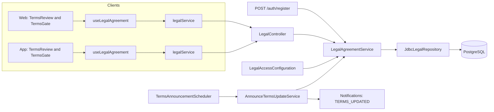
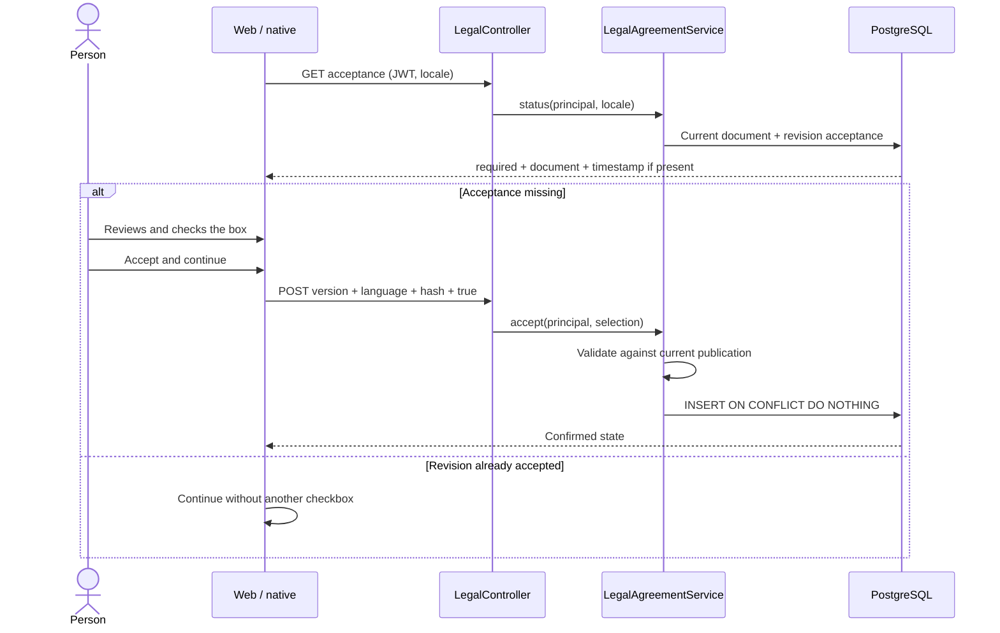
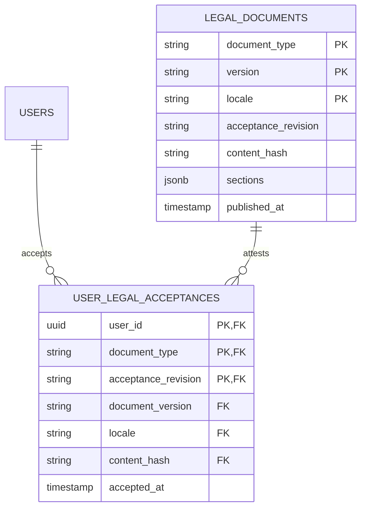

# Architecture

How the module is built in each layer. The backend follows the hexagonal flow
`controller → input port → service → domain → output port → adapter`;
the web and the app follow `screen → hook → service → API client → HTTP transport`.



[View the full “Architecture” diagram](https://images.vinnot.com/docs/diagrams/v1/en/modules-legal-architecture-4a05f1eef223.svg)

## Backend

### Scope and separate choices

The `legal` module records explicit acceptance of Vinnot's terms of use.
Password or social sign-in proves identity, not acceptance. Opening a policy,
scrolling to its end or changing a preference does not create contractual
evidence.

The Privacy Policy explains data processing. Maps/cookie preferences,
communications and operating-system permissions retain independent controls.
The terms checkbox never enables these optional choices.

### Layers and responsibilities

`LegalController → LegalAgreementUseCase → LegalAgreementService →
LegalDocumentPort / LegalAcceptancePort → JdbcLegalRepository → PostgreSQL`.

The domain contains `TermsDocument`, its sections, `TermsSelection` and
`TermsStatus`, without Spring or SQL. The service validates language,
affirmative acceptance, version and hash. The JDBC adapter archives and reads
documents, inserts evidence and implements idempotency. The controller takes
identity from the authenticated principal; a client-supplied `userId` never
defines the account accepting terms.

Registration depends on the legal input port: validation happens before account
creation; the selection is recorded in the same transaction that saves the user
and requests verification. Failure rolls back the operation. Existing and
OAuth-created accounts are never assigned fabricated acceptance.

### HTTP contracts

Paths relative to `/api`:

| Method and resource | Access | Result |
|---|---|---|
| GET /legal/terms/current?locale=es | Public | Current text, version, contractual revision, language and SHA-256 |
| GET /legal/terms/versions/{version}?locale=es | Public | Exact archived copy |
| GET /legal/acceptance?locale=es | Authenticated | required, acceptedAt, requiredFrom and current document |
| POST /legal/acceptance | Authenticated | Confirmed account state |

Supported locales: `es` and `en`. UI language is converted to a contract locale.
The POST and optional `termsAcceptance` field on `POST /auth/register` accept:

```json
{
  "version": "2026-10-29.1",
  "locale": "es",
  "contentHash": "<hexadecimal SHA-256 from the retrieved document>",
  "accepted": true
}
```

Missing/malformed fields or a false checkbox produce `400` at the HTTP adapter.
`TERMS_VERSION_CHANGED` and `TERMS_ACCEPTANCE_REQUIRED` are `422` business
rules, not authentication errors: they do not invalidate the JWT. The client
reloads the document and requires a new action, without automatically retrying
acceptance. A missing document returns `404`; a missing session returns `401`.

### Versions, evidence and integrity

Migration `V21__versioned_terms_acceptance.sql` creates:

- `legal_documents`: type/version/language key; title, summary, JSON sections,
  hash, contractual revision and publication timestamp.
- `user_legal_acceptances`: account, type, revision, exact version, language,
  hash and PostgreSQL-assigned timestamp.

The account/type/revision primary key prevents concurrent duplicates; the first
record retains its timestamp and language. A composite FK verifies that evidence
references a real document. The document index supports that FK; the primary key
resolves account state without scanning the table. Triggers prevent document
UPDATE/DELETE and acceptance UPDATE. Permanently deleting an account cascades
to its acceptance records; no IP, user-agent or device identifiers are collected.

The initial hash is calculated over compact UTF-8 JSON with properties ordered
as `title`, `summary`, `sections`; each section contains `id`, `title`,
`body`. It is not recalculated from PostgreSQL's JSONB serialization, which
may reorder keys. An editorial correction never rewrites archived text.

`version` identifies a publication; `acceptanceRevision` identifies the
contractual revision requiring assent. Equivalent translations share a
revision. A substantive change publishes new ES/EN rows with a new revision
and requires reacceptance; equivalent editorial corrections may preserve it.
Changing a FAQ or layout does not change the contractual revision.

The notice period counts from `published_at`, which PostgreSQL assigns when the
migration inserts the row, not from the `LEGAL_TERMS_VERSION` change. That is
why the migration and the variable ship in the same deployment.
`LegalPostgresIntegrationTest` recomputes the hash of `2026-09-27.1` and
`2026-10-29.1` with this algorithm and checks that only the `transactions`
section changed.

### Acceptance flow



[View the full “Acceptance flow” diagram](https://images.vinnot.com/docs/diagrams/v1/en/modules-legal-architecture-91f697e251a6.svg)

### Relational model



[View the full “Relational model” diagram](https://images.vinnot.com/docs/diagrams/v1/en/modules-legal-architecture-690780c0c6f8.svg)

### Gradual rollout and operation

`LEGAL_TERMS_VERSION` selects an existing publication (initial:
`2026-09-27.1`; current: `2026-10-29.1`, published by
`V75__terms_2026_10_29.sql` with revision `terms-2`; see
[published versions](README.md#published-versions)). `LEGAL_ENFORCE_ACCEPTANCE` defaults to `false`.
During this phase the backend accepts legacy registrations without a selection
but never marks them as accepted; new UI versions do request explicit selection.

With enforcement enabled, `LegalAccessConfiguration` checks the revision
before authenticated business operations. Authentication, refresh/logout,
documents/acceptance, support, own-account deletion, HTTP infrastructure/docs,
the minimum app version (`/app-versions/**`) and public static resources
remain available. Anonymous browsing retains its
public access; this policy does not grant roles or permissions.

A new acceptance revision gives accounts that accepted an earlier one a notice
period (`app.legal.notice-period`, 30 days by default) counted from the first
publication of that revision: `required` stays false until then, the app works
as before (`acceptedAt` reports their earlier acceptance and `requiredFrom` the
date, so clients released before the notice period still let them in), and
`TermsAnnouncementScheduler` emails each active, unsuspended one the date
(`TERMS_UPDATED`, V56 `legal_terms_announcements` cursor). The first revision and
accounts that never accepted any revision are required at once, so the period
never relaxes the existing guard.

Order: deploy backend and V21, publish compatible clients, verify recovery and
only then enable enforcement. Temporarily disabling enforcement neither deletes
evidence nor rewrites documents. A binary rollback must retain V21 and use a
version compatible with that Flyway history; applied migrations are not deleted.

The development web deployment checks both public documents through
`scripts/wait-github-public-terms.mjs` before uploading files to S3. It validates
structure, locale and matching ES/EN version/revision, with bounded retries while
the backend starts. If they remain unavailable, web publication stops without
replacing its files. This check neither enables global enforcement nor records
acceptance.

### Tests and references

Regressions cover validation, language, substantive revision, rollout, altered
documents, authenticated principal, rejection, concurrency, transactional
rollback, immutability, FK/indexes and account erasure. PostgreSQL is tested with
Testcontainers, not replaced with H2.

See [authentication](../../backend/architecture/authentication-and-identity.md),
[API](../../backend/architecture/api.md) and [public support](../support/architecture.md).

Agreement text starts collapsed during registration and first sign-in, with a disclosure control. The checkbox remains unchecked and acceptance requires explicit selection and server confirmation. Public privacy attribution identifies Vinnot and preserves the contact channel.

## Web

```text
TermsReview / TermsGate → useLegalAgreement → legalService → legalClient → http
```

| Layer | Piece | What it does |
|---|---|---|
| Domain | [`agreement.ts`](../../../../frontend-react/src/domain/legal/agreement.ts) | Types for the document, the selection and the status; `selectTerms()` builds the selection to send |
| Infrastructure | [`legal.client.ts`](../../../../frontend-react/src/infrastructure/api/clients/legal.client.ts) and [`legal.dto.ts`](../../../../frontend-react/src/infrastructure/api/dto/legal.dto.ts) | Calls `GET /legal/terms/current`, `GET /legal/acceptance` and `POST /legal/acceptance`; it does not use `/legal/terms/versions` |
| Application | [`legal.service.ts`](../../../../frontend-react/src/application/services/legal.service.ts) | Checks every answer: an incomplete document fails with `INVALID_TERMS_DOCUMENT` and an inconsistent status with `INVALID_TERMS_STATUS` |
| Presentation | [`useLegalAgreement.ts`](../../../../frontend-react/src/presentation/hooks/useLegalAgreement.ts) | `registration` mode (asks for the current document) or `account` mode (asks for the status). The tick holds for the person, the language and the hash; if accepting fails, it is cleared and not retried |
| Presentation | [`TermsReview.tsx`](../../../../frontend-react/src/presentation/components/auth/TermsReview.tsx) | Folded text, unchecked box, error with "Reload terms" and a privacy link |
| Presentation | [`TermsGate.tsx`](../../../../frontend-react/src/presentation/components/auth/TermsGate.tsx) | Full-screen "Before we continue" with accept and "Not now · sign out" |
| Presentation | [`usePublicDocument.ts`](../../../../frontend-react/src/presentation/hooks/usePublicDocument.ts) | Reads the terms from the API and the other documents from the bundled content; without the API it shows the bundled copy |

### Where it is checked

[`App.tsx`](../../../../frontend-react/src/app/App.tsx) wraps the application shell and
the complete-profile route with `TermsGate`. `/legal`, `/legal/:slug`,
`/contact` and the public pages are exempt, so they can be read without
accepting.

### Sign-up

[`useRegisterViewModel.ts`](../../../../frontend-react/src/presentation/pages/public/useRegisterViewModel.ts)
does not send the form without a selection and reloads the terms on
`TERMS_VERSION_CHANGED`. [`authErrorMessage.ts`](../../../../frontend-react/src/presentation/feedback/authErrorMessage.ts)
turns that code into its own message. The Google and Apple buttons on sign-up
send no terms: `TermsGate` asks for them after sign-in.

## App

The app repeats the web layers, with matching files in `frontend-mobile/src`:
[`agreement.ts`](../../../../frontend-mobile/src/domain/legal/agreement.ts),
[`legal.client.ts`](../../../../frontend-mobile/src/infrastructure/api/clients/legal.client.ts),
[`legal.service.ts`](../../../../frontend-mobile/src/application/services/legal.service.ts),
[`useLegalAgreement.ts`](../../../../frontend-mobile/src/presentation/hooks/useLegalAgreement.ts),
[`TermsReview.tsx`](../../../../frontend-mobile/src/presentation/features/public/TermsReview.tsx)
and [`TermsGate.tsx`](../../../../frontend-mobile/src/presentation/features/public/TermsGate.tsx).
The service is identical to the web one.

### Where it is checked

`frontend-mobile/app/(app)/_layout.tsx` places `TermsGate` inside `AuthGuard`,
around every private screen and the redirect to complete the profile. The public
routes (`app/legal`, `app/terms.tsx`, `app/privacy.tsx` and `app/contact.tsx`)
sit outside the `(app)` group, so they skip the check.

### Sign-up

`frontend-mobile/app/(auth)/register.tsx` does not send the form without a
selection and reloads the terms on `TERMS_VERSION_CHANGED`. [`auth.service.ts`](../../../../frontend-mobile/src/application/services/auth.service.ts)
turns that code into its own message, “The terms have been updated. Review the new
version before continuing.”, instead of the server text.
