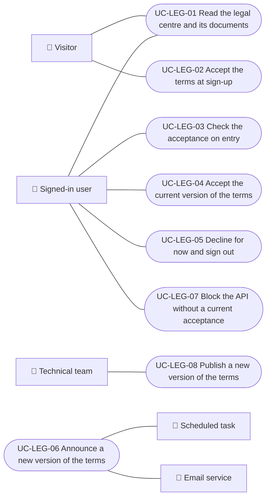

# Use cases

Use cases of the legal module: reading the documents, accepting the current terms and operating their versions. Each case applies to the platforms listed; "Backend only" marks processes without a screen.

| ID | Use case | Platforms | Actors |
|---|---|---|---|
| `UC-LEG-01` | [Read the legal centre and its documents](uc-leg-01-legal-centre.md) | Web, APK | Visitor, Signed-in user |
| `UC-LEG-02` | [Accept the terms at sign-up](uc-leg-02-accept-at-sign-up.md) | Web, APK | Visitor |
| `UC-LEG-03` | [Check the acceptance on entry](uc-leg-03-check-acceptance.md) | Web, APK | Signed-in user |
| `UC-LEG-04` | [Accept the current version of the terms](uc-leg-04-accept-current-version.md) | Web, APK | Signed-in user |
| `UC-LEG-05` | [Decline for now and sign out](uc-leg-05-decline-and-sign-out.md) | Web, APK | Signed-in user |
| `UC-LEG-06` | [Announce a new version of the terms](uc-leg-06-announce-terms-update.md) | Backend only | Scheduled task, Email service |
| `UC-LEG-07` | [Block the API without a current acceptance](uc-leg-07-enforce-acceptance.md) | Backend only | Signed-in user |
| `UC-LEG-08` | [Publish a new version of the terms](uc-leg-08-publish-terms-version.md) | Backend only | Technical team |

## Use case diagram

[View the full “Use cases · Use case diagram” diagram](https://images.vinnot.com/docs/diagrams/v1/en/modules-legal-use-cases-readme-fd2a1ecfd12f.svg)

## Lucidchart mapping

| ID | Lucidchart IDs |
|---|---|
| `UC-LEG-01` | [WEB UC-PUB-03](https://lucid.app/lucidchart/9f11a16b-bb5a-42fc-a9e8-0852b17bd241/edit), [APK UC-PUB-02](https://lucid.app/lucidchart/e095dd25-e8ac-41ba-bf5b-396e1055f217/edit) |
| `UC-LEG-02` | [WEB UC-LEGAL-01](https://lucid.app/lucidchart/9f11a16b-bb5a-42fc-a9e8-0852b17bd241/edit), [APK UC-AUTH-02](https://lucid.app/lucidchart/e095dd25-e8ac-41ba-bf5b-396e1055f217/edit) |
| `UC-LEG-03` | [WEB UC-LEGAL-02](https://lucid.app/lucidchart/9f11a16b-bb5a-42fc-a9e8-0852b17bd241/edit), [APK UC-LEGAL-01](https://lucid.app/lucidchart/e095dd25-e8ac-41ba-bf5b-396e1055f217/edit) |
| `UC-LEG-04` | [WEB UC-LEGAL-02](https://lucid.app/lucidchart/9f11a16b-bb5a-42fc-a9e8-0852b17bd241/edit), [APK UC-LEGAL-01](https://lucid.app/lucidchart/e095dd25-e8ac-41ba-bf5b-396e1055f217/edit) |
| `UC-LEG-05` | [WEB UC-LEGAL-02](https://lucid.app/lucidchart/9f11a16b-bb5a-42fc-a9e8-0852b17bd241/edit), [APK UC-LEGAL-01](https://lucid.app/lucidchart/e095dd25-e8ac-41ba-bf5b-396e1055f217/edit) |
| `UC-LEG-06` | None |
| `UC-LEG-07` | None |
| `UC-LEG-08` | None |
