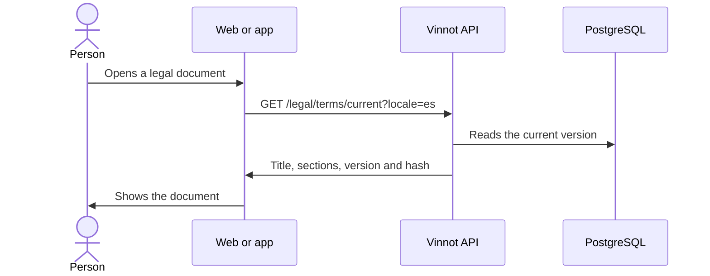

# UC-LEG-01 · Read the legal centre and its documents

| Field | Value |
|---|---|
| ID | `UC-LEG-01` |
| Module | [Legal](../README.md) |
| Platforms | Web, APK |
| Actors | Visitor, Signed-in user |
| Lucidchart IDs | [WEB UC-PUB-03](https://lucid.app/lucidchart/9f11a16b-bb5a-42fc-a9e8-0852b17bd241/edit), [APK UC-PUB-02](https://lucid.app/lucidchart/e095dd25-e8ac-41ba-bf5b-396e1055f217/edit) |
| Requirements | [`RF-WEB-LEG-01`](../requirements.md), [`RF-APK-LEG-01`](../requirements.md) |
| Test cases | [`CP-LEG-01`](../testing.md), [`CP-LEG-02`](../testing.md) |

## Preconditions

- None: the legal centre needs no session.

## Postconditions

- The person read the document; reading records no acceptance.

## Main flow

1. The person opens the legal centre (`/legal`, on the web and in the app).
2. The client lists the documents: terms, privacy, content policy, moderation, trust and safety, ranking, payments and cancellations, and cookies.
3. The person picks one.
4. For the terms, the client asks the API for the current version in the interface language; the other documents ship with the client.
5. The client shows the document with its version.

## Alternative flows

- 4a. The API does not answer for the terms: the copy bundled with the client is shown, marked as unconfirmed, with an option to reload.

## Business rules

- Only the terms are versioned in the API (`document_type = 'terms'`); the other documents come from `content/public-pages.json`, which `scripts/sync-public-content.mjs` copies into each client.
- `GET /legal/terms/current` and `GET /legal/terms/versions/{version}` are public; the language is `es` or `en`, any other value answers 422 `LEGAL_LOCALE_INVALID`.
- A version that does not exist answers 404.

## Diagram

[View the full “UC-LEG-01 · Read the legal centre and its documents” diagram](https://images.vinnot.com/docs/diagrams/v1/en/modules-legal-use-cases-uc-leg-01-legal-centre-dbb5aff4fd7d.svg)

Component diagram in Lucidchart: [WEB UC-PUB-03](https://lucid.app/lucidchart/9f11a16b-bb5a-42fc-a9e8-0852b17bd241/edit), [APK UC-PUB-02](https://lucid.app/lucidchart/e095dd25-e8ac-41ba-bf5b-396e1055f217/edit).

## Code

| Layer | Location |
|---|---|
| Endpoints | `GET /legal/terms/current`, `GET /legal/terms/versions/{version}` |
| Backend | [`LegalController.java`](../../../../../backend/src/main/java/com/vinnot/legal/infrastructure/web/LegalController.java), [`LegalAgreementService.java`](../../../../../backend/src/main/java/com/vinnot/legal/application/service/LegalAgreementService.java) |
| Web | [`LegalCentrePage.tsx`](../../../../../frontend-react/src/presentation/pages/public/LegalCentrePage.tsx), [`PublicDocumentPage.tsx`](../../../../../frontend-react/src/presentation/pages/public/PublicDocumentPage.tsx), [`usePublicDocument.ts`](../../../../../frontend-react/src/presentation/hooks/usePublicDocument.ts), [`useLegalAgreement.ts`](../../../../../frontend-react/src/presentation/hooks/useLegalAgreement.ts) |
| App | [`index.tsx`](../../../../../frontend-mobile/app/legal/index.tsx), [`terms.tsx`](../../../../../frontend-mobile/app/terms.tsx), [`LegalCentreScreen.tsx`](../../../../../frontend-mobile/src/presentation/features/public/LegalCentreScreen.tsx), [`usePublicDocument.ts`](../../../../../frontend-mobile/src/presentation/hooks/usePublicDocument.ts) |

## Automated tests

- Backend: [`LegalControllerTest.java`](../../../../../backend/src/test/java/com/vinnot/legal/infrastructure/web/LegalControllerTest.java), [`SecurityConfigAccessTest.java`](../../../../../backend/src/test/java/com/vinnot/shared/infrastructure/config/SecurityConfigAccessTest.java)
- Web: [`usePublicDocument.test.ts`](../../../../../frontend-react/src/presentation/hooks/usePublicDocument.test.ts)
- App: [`usePublicDocument.test.ts`](../../../../../frontend-mobile/src/presentation/hooks/usePublicDocument.test.ts)
