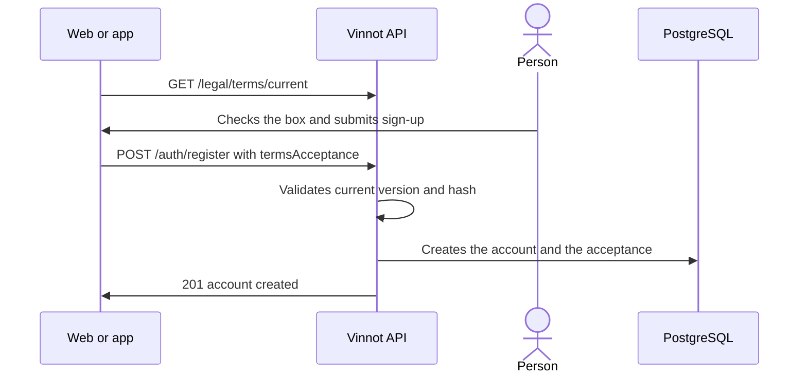

# UC-LEG-02 · Accept the terms at sign-up

| Field | Value |
|---|---|
| ID | `UC-LEG-02` |
| Module | [Legal](../README.md) |
| Platforms | Web, APK |
| Actors | Visitor |
| Lucidchart IDs | [WEB UC-LEGAL-01](https://lucid.app/lucidchart/9f11a16b-bb5a-42fc-a9e8-0852b17bd241/edit), [APK UC-AUTH-02](https://lucid.app/lucidchart/e095dd25-e8ac-41ba-bf5b-396e1055f217/edit) |
| Requirements | [`RF-WEB-LEG-02`](../requirements.md), [`RF-APK-LEG-02`](../requirements.md) |
| Test cases | [`CP-LEG-03`](../testing.md), [`CP-LEG-04`](../testing.md), [`CP-LEG-05`](../testing.md), [`CP-LEG-06`](../testing.md), [`CP-LEG-07`](../testing.md) |

## Preconditions

- The person is on the email and password sign-up.
- A current version of the terms is published in `es` and `en`.

## Postconditions

- The acceptance is stored with version, language and hash, in the same transaction that creates the account.
- Accepting the terms does not enable optional cookies or promotional messages.

## Main flow

1. The person opens sign-up and the client loads the current terms.
2. The client shows the terms folded, the box unchecked and the link to the privacy policy.
3. The person can expand the text and checks the box.
4. When submitting sign-up, the client adds `termsAcceptance` with version, language, hash and `accepted: true`.
5. The API compares the selection with the current version before creating the account.
6. The API creates the account and stores the acceptance in the same transaction ([UC-USR-01](../../users/use-cases/uc-usr-01-sign-up.md)).

## Alternative flows

- 1a. The terms do not load: a "Reload terms" notice is shown and sign-up cannot be sent.
- 3a. The box is not checked: the form is not sent.
- 5a. The version or hash is no longer current: the API answers 422 `TERMS_VERSION_CHANGED`, does not create the account, and the client shows a translated message, reloads the terms and clears the box.
- 1b. The person signs up with Google or Apple from that screen: no terms are sent and they are asked for after sign-in ([UC-LEG-04](uc-leg-04-accept-current-version.md)).

## Business rules

- The box starts unchecked and the tick holds for that person, that language and that hash: changing the language or receiving another version clears it.
- With `LEGAL_ENFORCE_ACCEPTANCE` off (the default) the API accepts sign-ups without `termsAcceptance` for old clients, but records no acceptance; when on, it answers 422 `TERMS_ACCEPTANCE_REQUIRED`.
- A malformed body or `accepted: false` answers 400.

## Diagram

[View the full “UC-LEG-02 · Accept the terms at sign-up” diagram](https://images.vinnot.com/docs/diagrams/v1/en/modules-legal-use-cases-uc-leg-02-accept-at-sign-up-67496b9a4053.svg)

Component diagram in Lucidchart: [WEB UC-LEGAL-01](https://lucid.app/lucidchart/9f11a16b-bb5a-42fc-a9e8-0852b17bd241/edit), [APK UC-AUTH-02](https://lucid.app/lucidchart/e095dd25-e8ac-41ba-bf5b-396e1055f217/edit).

## Code

| Layer | Location |
|---|---|
| Endpoints | `GET /legal/terms/current`, `POST /auth/register` |
| Backend | [`AuthController.java`](../../../../../backend/src/main/java/com/vinnot/user/infrastructure/web/controller/AuthController.java), [`RegisterUserCommandHandler.java`](../../../../../backend/src/main/java/com/vinnot/user/application/command/handler/RegisterUserCommandHandler.java), [`LegalAgreementService.java`](../../../../../backend/src/main/java/com/vinnot/legal/application/service/LegalAgreementService.java) |
| Web | [`RegisterPage.tsx`](../../../../../frontend-react/src/presentation/pages/public/RegisterPage.tsx), [`useRegisterViewModel.ts`](../../../../../frontend-react/src/presentation/pages/public/useRegisterViewModel.ts), [`TermsReview.tsx`](../../../../../frontend-react/src/presentation/components/auth/TermsReview.tsx), [`useLegalAgreement.ts`](../../../../../frontend-react/src/presentation/hooks/useLegalAgreement.ts), [`legal.service.ts`](../../../../../frontend-react/src/application/services/legal.service.ts) |
| App | `frontend-mobile/app/(auth)/register.tsx`, [`TermsReview.tsx`](../../../../../frontend-mobile/src/presentation/features/public/TermsReview.tsx), [`useLegalAgreement.ts`](../../../../../frontend-mobile/src/presentation/hooks/useLegalAgreement.ts), [`legal.service.ts`](../../../../../frontend-mobile/src/application/services/legal.service.ts) |

## Automated tests

- Backend: [`LegalAgreementServiceTest.java`](../../../../../backend/src/test/java/com/vinnot/legal/application/service/LegalAgreementServiceTest.java), [`AccountActionCommandHandlersTest.java`](../../../../../backend/src/test/java/com/vinnot/user/application/command/handler/AccountActionCommandHandlersTest.java), [`LegalPostgresIntegrationTest.java`](../../../../../backend/src/test/java/com/vinnot/legal/infrastructure/LegalPostgresIntegrationTest.java)
- Web: [`useLegalAgreement.test.ts`](../../../../../frontend-react/src/presentation/hooks/useLegalAgreement.test.ts), [`authErrorMessage.test.ts`](../../../../../frontend-react/src/presentation/feedback/authErrorMessage.test.ts), [`authErrorViewModels.test.tsx`](../../../../../frontend-react/src/presentation/pages/public/authErrorViewModels.test.tsx)
- App: [`registerRoute.test.tsx`](../../../../../frontend-mobile/src/presentation/features/auth/__tests__/registerRoute.test.tsx), [`useLegalAgreement.test.ts`](../../../../../frontend-mobile/src/presentation/hooks/useLegalAgreement.test.ts), [`auth.service.test.ts`](../../../../../frontend-mobile/src/application/services/auth.service.test.ts)
