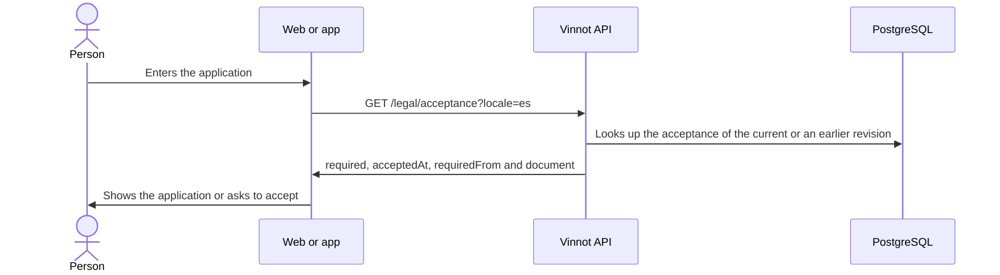

# UC-LEG-03 · Check the acceptance on entry

| Field | Value |
|---|---|
| ID | `UC-LEG-03` |
| Module | [Legal](../README.md) |
| Platforms | Web, APK |
| Actors | Signed-in user |
| Lucidchart IDs | [WEB UC-LEGAL-02](https://lucid.app/lucidchart/9f11a16b-bb5a-42fc-a9e8-0852b17bd241/edit), [APK UC-LEGAL-01](https://lucid.app/lucidchart/e095dd25-e8ac-41ba-bf5b-396e1055f217/edit) |
| Requirements | [`RF-WEB-LEG-03`](../requirements.md), [`RF-APK-LEG-03`](../requirements.md) |
| Test cases | [`CP-LEG-08`](../testing.md), [`CP-LEG-09`](../testing.md), [`CP-LEG-10`](../testing.md), [`CP-LEG-11`](../testing.md) |

## Preconditions

- The person is signed in.

## Postconditions

- The client knows whether the terms must be accepted; the application is shown only when they need not be.

## Main flow

1. The person enters a private part of the application or the complete-profile step.
2. The terms gate asks the API for the acceptance status.
3. While waiting it shows "Checking your account…".
4. The API works out the status: if the account accepted the current revision, nothing is needed; if it accepted an earlier revision and the notice period has not ended, nothing is needed either, and the deadline (`requiredFrom`) is reported; otherwise acceptance is required.
5. If no acceptance is needed, the client shows the application.

## Alternative flows

- 4a. Acceptance is required: continue with [UC-LEG-04](uc-leg-04-accept-current-version.md).
- 2a. The check fails with no connection or a timeout: the app shows the illustrated "No connection" state with "Try again"; access stays closed too.
- 2b. The check fails for another reason: "We couldn't verify your agreement" is shown with an option to reload; the application is not shown and missing terms are not assumed.
- 1a. The person opens the legal centre or contact: acceptance is not checked (the web exempts those routes; in the app they sit outside the private `(app)` group).

## Business rules

- The notice period is 30 days (`app.legal.notice-period`) from the first publication of the new revision.
- The first revision, accounts that never accepted and Google or Apple sign-ups must accept at once.
- The API decides the status; the client never keeps the acceptance as its own proof.
- During the notice period the person keeps using the application and gets the email of [UC-LEG-06](uc-leg-06-announce-terms-update.md).

## Diagram

[View the full “UC-LEG-03 · Check the acceptance on entry” diagram](https://images.vinnot.com/docs/diagrams/v1/en/modules-legal-use-cases-uc-leg-03-check-acceptance-1670b9587def.svg)

Component diagram in Lucidchart: [WEB UC-LEGAL-02](https://lucid.app/lucidchart/9f11a16b-bb5a-42fc-a9e8-0852b17bd241/edit), [APK UC-LEGAL-01](https://lucid.app/lucidchart/e095dd25-e8ac-41ba-bf5b-396e1055f217/edit).

## Code

| Layer | Location |
|---|---|
| Endpoints | `GET /legal/acceptance` |
| Backend | [`LegalController.java`](../../../../../backend/src/main/java/com/vinnot/legal/infrastructure/web/LegalController.java), [`LegalAgreementService.java`](../../../../../backend/src/main/java/com/vinnot/legal/application/service/LegalAgreementService.java), [`JdbcLegalRepository.java`](../../../../../backend/src/main/java/com/vinnot/legal/infrastructure/JdbcLegalRepository.java) |
| Web | [`App.tsx`](../../../../../frontend-react/src/app/App.tsx), [`TermsGate.tsx`](../../../../../frontend-react/src/presentation/components/auth/TermsGate.tsx), [`useLegalAgreement.ts`](../../../../../frontend-react/src/presentation/hooks/useLegalAgreement.ts), [`legal.service.ts`](../../../../../frontend-react/src/application/services/legal.service.ts), [`legal.client.ts`](../../../../../frontend-react/src/infrastructure/api/clients/legal.client.ts) |
| App | `frontend-mobile/app/(app)/_layout.tsx`, [`TermsGate.tsx`](../../../../../frontend-mobile/src/presentation/features/public/TermsGate.tsx), [`useLegalAgreement.ts`](../../../../../frontend-mobile/src/presentation/hooks/useLegalAgreement.ts), [`legal.service.ts`](../../../../../frontend-mobile/src/application/services/legal.service.ts), [`legal.client.ts`](../../../../../frontend-mobile/src/infrastructure/api/clients/legal.client.ts) |

## Automated tests

- Backend: [`LegalAgreementServiceTest.java`](../../../../../backend/src/test/java/com/vinnot/legal/application/service/LegalAgreementServiceTest.java), [`LegalAcceptanceHttpPostgresIntegrationTest.java`](../../../../../backend/src/test/java/com/vinnot/legal/infrastructure/web/LegalAcceptanceHttpPostgresIntegrationTest.java)
- Web: [`TermsGate.test.tsx`](../../../../../frontend-react/src/presentation/components/auth/TermsGate.test.tsx), [`useLegalAgreement.test.ts`](../../../../../frontend-react/src/presentation/hooks/useLegalAgreement.test.ts), [`legal.service.test.ts`](../../../../../frontend-react/src/application/services/legal.service.test.ts)
- App: [`TermsGate.test.tsx`](../../../../../frontend-mobile/src/presentation/features/public/TermsGate.test.tsx), [`useLegalAgreement.test.ts`](../../../../../frontend-mobile/src/presentation/hooks/useLegalAgreement.test.ts), [`legal.service.test.ts`](../../../../../frontend-mobile/src/application/services/legal.service.test.ts)
