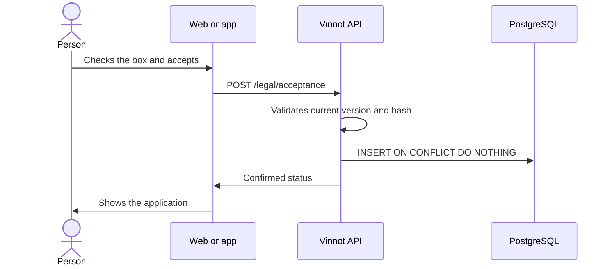

# UC-LEG-04 · Accept the current version of the terms

| Field | Value |
|---|---|
| ID | `UC-LEG-04` |
| Module | [Legal](../README.md) |
| Platforms | Web, APK |
| Actors | Signed-in user |
| Lucidchart IDs | [WEB UC-LEGAL-02](https://lucid.app/lucidchart/9f11a16b-bb5a-42fc-a9e8-0852b17bd241/edit), [APK UC-LEGAL-01](https://lucid.app/lucidchart/e095dd25-e8ac-41ba-bf5b-396e1055f217/edit) |
| Requirements | [`RF-WEB-LEG-04`](../requirements.md), [`RF-WEB-LEG-05`](../requirements.md), [`RF-WEB-LEG-06`](../requirements.md), [`RF-APK-LEG-04`](../requirements.md), [`RF-APK-LEG-05`](../requirements.md), [`RF-APK-LEG-06`](../requirements.md) |
| Test cases | [`CP-LEG-12`](../testing.md), [`CP-LEG-13`](../testing.md), [`CP-LEG-14`](../testing.md), [`CP-LEG-15`](../testing.md) |

## Preconditions

- The check in [UC-LEG-03](uc-leg-03-check-acceptance.md) said acceptance is required.

## Postconditions

- The acceptance is stored with account, revision, version, language, hash and a date set by PostgreSQL.
- Access opens only after the API confirms, and it holds on every platform.

## Main flow

1. The client shows "Before we continue" with the terms folded and the box unchecked.
2. The person checks the box.
3. They press "Accept and continue".
4. The client sends version, language, hash and `accepted: true`.
5. The API compares the selection with the current version and stores the acceptance.
6. The API returns the confirmed status and the client shows the application.

## Alternative flows

- 5a. The version changed meanwhile: the API answers 422 `TERMS_VERSION_CHANGED`, the client clears the box and asks to reload; it never retries the acceptance on its own.
- 4a. The network fails: the error is shown with "Reload terms" and access stays closed.
- 5b. The revision was already accepted (another device or a double submit): the API duplicates nothing, keeps the first date and language and returns the status.

## Business rules

- The owner comes from the session; the API takes no `userId` from the client.
- A malformed body or `accepted: false` answers 400; a language other than `es` or `en`, 422 `LEGAL_LOCALE_INVALID`.
- The evidence cannot be modified (V21 triggers); deleting the account removes it by cascade. No IP or device data is stored.
- Equivalent translations share a revision: accepting in `es` also covers the revision in `en`.

## Diagram

[View the full “UC-LEG-04 · Accept the current version of the terms” diagram](https://images.vinnot.com/docs/diagrams/v1/en/modules-legal-use-cases-uc-leg-04-accept-current-version-3a2daa367a83.svg)

Component diagram in Lucidchart: [WEB UC-LEGAL-02](https://lucid.app/lucidchart/9f11a16b-bb5a-42fc-a9e8-0852b17bd241/edit), [APK UC-LEGAL-01](https://lucid.app/lucidchart/e095dd25-e8ac-41ba-bf5b-396e1055f217/edit).

## Code

| Layer | Location |
|---|---|
| Endpoints | `POST /legal/acceptance` |
| Backend | [`LegalController.java`](../../../../../backend/src/main/java/com/vinnot/legal/infrastructure/web/LegalController.java), [`AcceptanceRequest.java`](../../../../../backend/src/main/java/com/vinnot/legal/infrastructure/web/AcceptanceRequest.java), [`LegalAgreementService.java`](../../../../../backend/src/main/java/com/vinnot/legal/application/service/LegalAgreementService.java), [`JdbcLegalRepository.java`](../../../../../backend/src/main/java/com/vinnot/legal/infrastructure/JdbcLegalRepository.java) |
| Web | [`TermsGate.tsx`](../../../../../frontend-react/src/presentation/components/auth/TermsGate.tsx), [`TermsReview.tsx`](../../../../../frontend-react/src/presentation/components/auth/TermsReview.tsx), [`useLegalAgreement.ts`](../../../../../frontend-react/src/presentation/hooks/useLegalAgreement.ts), [`legal.service.ts`](../../../../../frontend-react/src/application/services/legal.service.ts), [`legal.client.ts`](../../../../../frontend-react/src/infrastructure/api/clients/legal.client.ts) |
| App | [`TermsGate.tsx`](../../../../../frontend-mobile/src/presentation/features/public/TermsGate.tsx), [`TermsReview.tsx`](../../../../../frontend-mobile/src/presentation/features/public/TermsReview.tsx), [`useLegalAgreement.ts`](../../../../../frontend-mobile/src/presentation/hooks/useLegalAgreement.ts), [`legal.service.ts`](../../../../../frontend-mobile/src/application/services/legal.service.ts), [`legal.client.ts`](../../../../../frontend-mobile/src/infrastructure/api/clients/legal.client.ts) |

## Automated tests

- Backend: [`LegalAgreementServiceTest.java`](../../../../../backend/src/test/java/com/vinnot/legal/application/service/LegalAgreementServiceTest.java), [`LegalControllerTest.java`](../../../../../backend/src/test/java/com/vinnot/legal/infrastructure/web/LegalControllerTest.java), [`LegalAcceptanceHttpPostgresIntegrationTest.java`](../../../../../backend/src/test/java/com/vinnot/legal/infrastructure/web/LegalAcceptanceHttpPostgresIntegrationTest.java), [`LegalPostgresIntegrationTest.java`](../../../../../backend/src/test/java/com/vinnot/legal/infrastructure/LegalPostgresIntegrationTest.java)
- Web: [`TermsGate.test.tsx`](../../../../../frontend-react/src/presentation/components/auth/TermsGate.test.tsx), [`useLegalAgreement.test.ts`](../../../../../frontend-react/src/presentation/hooks/useLegalAgreement.test.ts), [`legal.service.test.ts`](../../../../../frontend-react/src/application/services/legal.service.test.ts)
- App: [`TermsGate.test.tsx`](../../../../../frontend-mobile/src/presentation/features/public/TermsGate.test.tsx), [`useLegalAgreement.test.ts`](../../../../../frontend-mobile/src/presentation/hooks/useLegalAgreement.test.ts), [`legal.service.test.ts`](../../../../../frontend-mobile/src/application/services/legal.service.test.ts)
