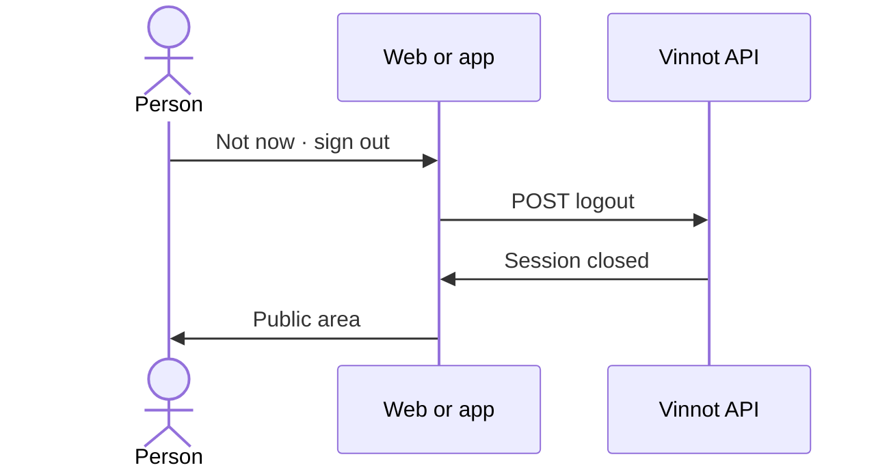

# UC-LEG-05 · Decline for now and sign out

| Field | Value |
|---|---|
| ID | `UC-LEG-05` |
| Module | [Legal](../README.md) |
| Platforms | Web, APK |
| Actors | Signed-in user |
| Lucidchart IDs | [WEB UC-LEGAL-02](https://lucid.app/lucidchart/9f11a16b-bb5a-42fc-a9e8-0852b17bd241/edit), [APK UC-LEGAL-01](https://lucid.app/lucidchart/e095dd25-e8ac-41ba-bf5b-396e1055f217/edit) |
| Requirements | [`RF-WEB-LEG-07`](../requirements.md), [`RF-APK-LEG-07`](../requirements.md) |
| Test cases | [`CP-LEG-16`](../testing.md), [`CP-LEG-17`](../testing.md) |

## Preconditions

- The client shows the acceptance request of [UC-LEG-04](uc-leg-04-accept-current-version.md).

## Postconditions

- The session is closed and no acceptance is recorded.
- The legal centre and contact stay available.

## Main flow

1. The person presses "Not now · sign out".
2. The client signs out ([UC-USR-08](../../users/use-cases/uc-usr-08-sign-out.md)).
3. The person goes back to the public area.

## Alternative flows

- 2a. Signing out fails: "Please try signing out again." is shown.

## Business rules

- Declining counts neither as consent nor as a stored refusal: the question comes back next time.
- Without accepting the terms the person can still deactivate or delete the account (`DELETE /users/me` and `DELETE /users/me/permanent` stay allowed even with enforcement on).

## Diagram

[View the full “UC-LEG-05 · Decline for now and sign out” diagram](https://images.vinnot.com/docs/diagrams/v1/en/modules-legal-use-cases-uc-leg-05-decline-and-sign-out-e4356ea19bb7.svg)

Component diagram in Lucidchart: [WEB UC-LEGAL-02](https://lucid.app/lucidchart/9f11a16b-bb5a-42fc-a9e8-0852b17bd241/edit), [APK UC-LEGAL-01](https://lucid.app/lucidchart/e095dd25-e8ac-41ba-bf5b-396e1055f217/edit).

## Code

| Layer | Location |
|---|---|
| Endpoints | `POST /auth/web/logout (web)`, `POST /auth/logout (app)` |
| Web | [`TermsGate.tsx`](../../../../../frontend-react/src/presentation/components/auth/TermsGate.tsx) |
| App | [`TermsGate.tsx`](../../../../../frontend-mobile/src/presentation/features/public/TermsGate.tsx) |

## Automated tests

- Backend: None
- Web: [`TermsGate.test.tsx`](../../../../../frontend-react/src/presentation/components/auth/TermsGate.test.tsx)
- App: [`TermsGate.test.tsx`](../../../../../frontend-mobile/src/presentation/features/public/TermsGate.test.tsx)
