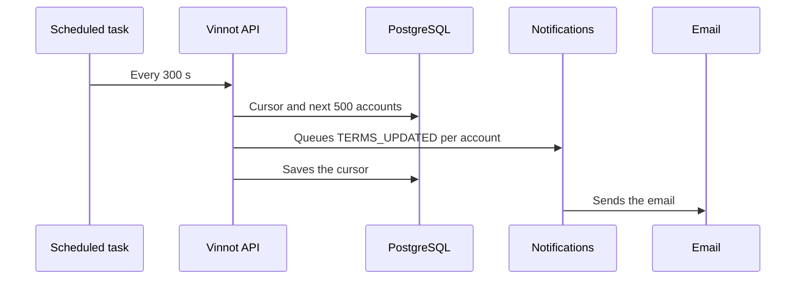

# UC-LEG-06 · Announce a new version of the terms

| Field | Value |
|---|---|
| ID | `UC-LEG-06` |
| Module | [Legal](../README.md) |
| Platforms | Backend only |
| Actors | Scheduled task, Email service |
| Lucidchart IDs | None |
| Requirements | None |
| Test cases | [`CP-LEG-18`](../testing.md), [`CP-LEG-19`](../testing.md), [`CP-LEG-20`](../testing.md) |

## Preconditions

- The current revision replaces an earlier one and its notice deadline (`requiredFrom`) has not passed yet.
- `app.legal.announcements.enabled` is on (the default).

## Postconditions

- Every active, unlocked account that accepted an earlier revision, and not the current one, gets a single `TERMS_UPDATED` notice with the version and the deadline.
- Progress is saved in `legal_terms_announcements`.

## Main flow

1. The scheduled task runs 60 seconds after start-up and then every 300 seconds.
2. It reads the current version and works out its deadline.
3. It locks the revision cursor and fetches the next 500 accounts to notify, ordered by id.
4. It queues one `TERMS_UPDATED` notice per account with the idempotency key `terms-updated:<revision>:<account>`.
5. It saves the last notified account as the new cursor.
6. The [notifications](../../notifications/README.md) module sends the email with the `terms_updated` template.

## Alternative flows

- 2a. There is no deadline or it has passed: the task does nothing.
- 3a. Fewer than 500 accounts remain: the revision is marked complete and later runs stop looking.

## Business rules

- The date is given in the `America/Argentina/Buenos_Aires` zone.
- The idempotency key prevents notifying the same account twice for the same revision.
- Accounts that never accepted get no notice: they must accept on entry.

## Diagram

[View the full “UC-LEG-06 · Announce a new version of the terms” diagram](https://images.vinnot.com/docs/diagrams/v1/en/modules-legal-use-cases-uc-leg-06-announce-terms-update-abb5801abad1.svg)

## Code

| Layer | Location |
|---|---|
| Backend | [`TermsAnnouncementScheduler.java`](../../../../../backend/src/main/java/com/vinnot/legal/infrastructure/scheduling/TermsAnnouncementScheduler.java), [`AnnounceTermsUpdateService.java`](../../../../../backend/src/main/java/com/vinnot/legal/application/service/AnnounceTermsUpdateService.java), [`JdbcTermsAnnouncementAdapter.java`](../../../../../backend/src/main/java/com/vinnot/legal/infrastructure/JdbcTermsAnnouncementAdapter.java), [`TermsUpdatedTemplate.java`](../../../../../backend/src/main/java/com/vinnot/notification/infrastructure/template/TermsUpdatedTemplate.java) |

## Automated tests

- Backend: [`AnnounceTermsUpdateServiceTest.java`](../../../../../backend/src/test/java/com/vinnot/legal/application/service/AnnounceTermsUpdateServiceTest.java), [`TermsAnnouncementSchedulerTest.java`](../../../../../backend/src/test/java/com/vinnot/legal/infrastructure/scheduling/TermsAnnouncementSchedulerTest.java), [`TermsUpdatedTemplateTest.java`](../../../../../backend/src/test/java/com/vinnot/notification/infrastructure/template/TermsUpdatedTemplateTest.java)
- Web: None
- App: None
