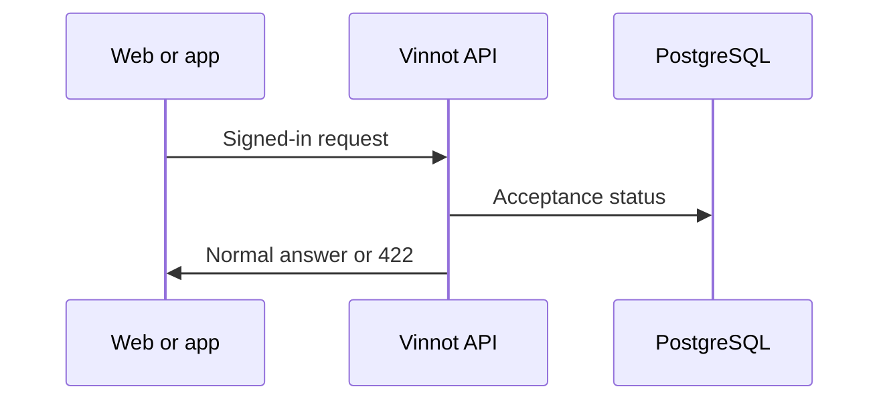

# UC-LEG-07 · Block the API without a current acceptance

| Field | Value |
|---|---|
| ID | `UC-LEG-07` |
| Module | [Legal](../README.md) |
| Platforms | Backend only |
| Actors | Signed-in user |
| Lucidchart IDs | None |
| Requirements | None |
| Test cases | [`CP-LEG-21`](../testing.md), [`CP-LEG-22`](../testing.md), [`CP-LEG-23`](../testing.md), [`CP-LEG-24`](../testing.md) |

## Preconditions

- `LEGAL_ENFORCE_ACCEPTANCE` is on (it is off by default).
- The person is signed in.

## Postconditions

- Accounts that must accept cannot use the signed-in API until they do.

## Main flow

1. The client calls a signed-in endpoint.
2. The interceptor checks the account's acceptance status.
3. If no acceptance is needed, the request goes on normally.

## Alternative flows

- 3a. Acceptance is required: the API answers 422 `TERMS_ACCEPTANCE_REQUIRED` ("Review and accept the current terms to continue").
- 1a. The route is exempt (`/auth/**`, `/legal/**`, `/support/**`, `/notifications/unsubscribe`, health, API docs and `/uploads/**`), the request is anonymous or it is `OPTIONS`: it passes without a check.
- 1b. It is `DELETE /users/me` or `DELETE /users/me/permanent`: it passes without a check.

## Business rules

- It is switched on only after deploying the backend and compatible clients; switching it off deletes no evidence.
- The web and the app ask for the same status on entry ([UC-LEG-03](uc-leg-03-check-acceptance.md)) and show the acceptance request before the application.
- This rule grants no roles or permissions.

## Diagram

[View the full “UC-LEG-07 · Block the API without a current acceptance” diagram](https://images.vinnot.com/docs/diagrams/v1/en/modules-legal-use-cases-uc-leg-07-enforce-acceptance-d136b187f553.svg)

## Code

| Layer | Location |
|---|---|
| Backend | [`LegalAccessConfiguration.java`](../../../../../backend/src/main/java/com/vinnot/legal/infrastructure/web/LegalAccessConfiguration.java), [`LegalAgreementService.java`](../../../../../backend/src/main/java/com/vinnot/legal/application/service/LegalAgreementService.java) |

## Automated tests

- Backend: [`LegalAccessConfigurationTest.java`](../../../../../backend/src/test/java/com/vinnot/legal/infrastructure/web/LegalAccessConfigurationTest.java), [`LegalAcceptanceHttpPostgresIntegrationTest.java`](../../../../../backend/src/test/java/com/vinnot/legal/infrastructure/web/LegalAcceptanceHttpPostgresIntegrationTest.java)
- Web: None
- App: None
