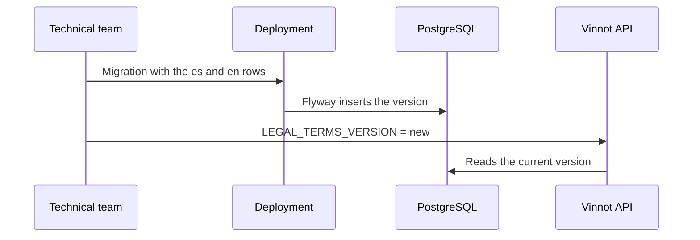

# UC-LEG-08 · Publish a new version of the terms

| Field | Value |
|---|---|
| ID | `UC-LEG-08` |
| Module | [Legal](../README.md) |
| Platforms | Backend only |
| Actors | Technical team |
| Lucidchart IDs | None |
| Requirements | None |
| Test cases | [`CP-LEG-25`](../testing.md), [`CP-LEG-26`](../testing.md), [`CP-LEG-27`](../testing.md) |

## Preconditions

- The new text is approved in `es` and `en`.

## Postconditions

- The new version is archived and becomes current.
- If the contractual revision changed, accounts must accept again as in [UC-LEG-03](uc-leg-03-check-acceptance.md).

## Main flow

1. The team writes a Flyway migration that inserts the `es` and `en` rows into `legal_documents` with the same version and revision, and the SHA-256 of each text.
2. They deploy the backend and the migration runs.
3. They set `LEGAL_TERMS_VERSION` to the new version.
4. The clients receive the new version when they ask for the terms.

## Alternative flows

- 1a. It is an equivalent editorial fix: a new version is published with the same revision and nobody has to accept again.
- 1b. It is a substantive change: a new revision is used; accounts that accepted the earlier one get the notice period and receive [UC-LEG-06](uc-leg-06-announce-terms-update.md).

## Business rules

- There is no admin screen: a published document cannot be updated or deleted (V21 triggers), so every change is a new version.
- The hash is computed over compact UTF-8 JSON with `title`, `summary` and `sections` in that order; each section has `id`, `title` and `body`.
- The development web deploy checks with `scripts/wait-github-public-terms.mjs` that both languages are published before uploading files.
- The notice period runs from when the migration inserts the rows (`published_at`), not from the `LEGAL_TERMS_VERSION` change: ship both in the same deployment.
- The `terms` page of `content/public-pages.json` repeats the current text, because it is the copy the clients show without the API. After editing it, run `node scripts/sync-public-content.mjs --write`.

## Release revision terms-2

`2026-10-29.1` / `terms-2` (`V75__terms_2026_10_29.sql`) replaces `2026-09-27.1` / `terms-1`; the reason is in [published versions](../README.md#published-versions).

1. Ship `V75__terms_2026_10_29.sql`, `content/public-pages.json`, both `generated-content.json` files and the `2026-10-29.1` default of `app.legal.terms-version` in the same change.
2. On each host, if the runtime secret defines `LEGAL_TERMS_VERSION`, set it to `2026-10-29.1` before the deployment. If it does not, the `application.yml` default applies.
3. Deploy the backend. Flyway inserts the `es` and `en` rows, and the 30-day notice period (`app.legal.notice-period`) starts at that moment.
4. Check that `GET /api/legal/terms/current?locale=es` and `?locale=en` return `2026-10-29.1` and `terms-2`. The web deployment waits for this with `scripts/wait-github-public-terms.mjs`.
5. Email notice: while the period lasts, `TermsAnnouncementScheduler` sends `TERMS_UPDATED` with the version and the deadline to every active, non-suspended account that accepted `terms-1`, in batches of 500 ([UC-LEG-06](uc-leg-06-announce-terms-update.md)). It needs `app.legal.announcements.enabled=true`, which is the default.
6. During the 30 days, whoever accepted `terms-1` keeps getting in: `GET /api/legal/acceptance` returns `required=false` and the deadline in `requiredFrom`. When the period ends, the web and the app ask them to accept `terms-2` ([UC-LEG-03](uc-leg-03-check-acceptance.md)). New accounts accept `terms-2` when they sign up.

## Diagram

[View the full “UC-LEG-08 · Publish a new version of the terms” diagram](https://images.vinnot.com/docs/diagrams/v1/en/modules-legal-use-cases-uc-leg-08-publish-terms-version-f500f15eca51.svg)

## Code

| Layer | Location |
|---|---|
| Backend | [`JdbcLegalRepository.java`](../../../../../backend/src/main/java/com/vinnot/legal/infrastructure/JdbcLegalRepository.java), [`LegalAgreementService.java`](../../../../../backend/src/main/java/com/vinnot/legal/application/service/LegalAgreementService.java) |

## Automated tests

- Backend: [`LegalPostgresIntegrationTest.java`](../../../../../backend/src/test/java/com/vinnot/legal/infrastructure/LegalPostgresIntegrationTest.java), [`LegalAgreementServiceTest.java`](../../../../../backend/src/test/java/com/vinnot/legal/application/service/LegalAgreementServiceTest.java)
- Web: None
- App: None
