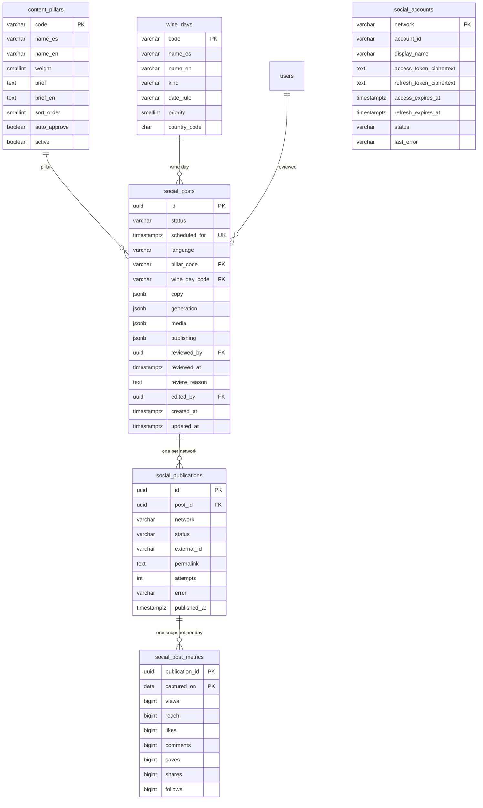

# Social media marketing

Social media agent. Phase 1 (#489): a wine-day calendar with date rules, content pillars, a
weekly planner that lines up two or three posts a week, copy written with the existing AI port
and an approval queue for the product owner. Phase 2 (#492): every post gets a watercolor
illustration (AI or pillar vignette) and its slides drawn as images for Instagram and TikTok,
reviewed and downloaded on the same page. Phases 3 and 4 (#510): approved posts publish themselves at their slot on
Instagram, Facebook and Threads (TikTok stays a draft until its audit), metrics come back, the planner learns which
pillars perform and each pillar can approve itself. Strategic schedule (#513): rotating posts at midday on Tuesday,
Wednesday and Thursday, wine days in the morning of their own day, one post per date, TikTok in the evening, and the
administrator can move a post to another date and time or publish it now. Everything is off by configuration until switched on
([social networks setup guide](../../infra/guides/social-networks-setup.md)).

- Module code: `MKT`.
- Backend: package [`marketing`](../../../../backend/src/main/java/com/vinnot/marketing/).
- [Use cases](use-cases/README.md) · [Requirements](requirements.md) ·
  [Architecture](architecture.md) · [Testing](testing.md)

## Actors

| Actor | What they do in this module |
|---|---|
| Administrator | Approves, rejects, edits or regenerates each post, requests a new illustration, downloads the slides, can plan now, changes a post's date and time, publishes an approved post now, retries a failed network, switches pillars and their auto-approval on or off and connects Threads and TikTok |
| System | Plans on Mondays at 09:00, writes the copy, retries drafts without copy, draws the slides in the background, publishes at the post's time (each network at its own time), reads the metrics daily, approves by pillar and refreshes the tokens |
| OpenAI | Writes the copy, checks its facts and paints the illustration |
| Instagram, Facebook, Threads and TikTok | Receive the carousel, return the id, the link and the metrics; Threads and TikTok authorize the account with OAuth |

## Business rules

| Rule | Detail | Where |
|---|---|---|
| Wine days by rule | Each day is `fixed`, `nth-weekday`, `last-weekday` or `offset-from`; it resolves per year | [`DateRule.java`](../../../../backend/src/main/java/com/vinnot/marketing/domain/model/DateRule.java) |
| Rotating slots | Tuesday, Wednesday and Thursday at 12:30 Argentina time, the days and hour with the most engagement | [`WeeklyPlanner.java`](../../../../backend/src/main/java/com/vinnot/marketing/domain/service/WeeklyPlanner.java) |
| Wine days in the morning | Posted on the day itself at 09:30; a wine day on a slot day takes that day's slot (no rotating post that day) | [`WeeklyPlanner.java`](../../../../backend/src/main/java/com/vinnot/marketing/domain/service/WeeklyPlanner.java) |
| One post per date | At most one post per Argentina date: of two wine days on one date the lower priority number wins and the other is dropped; existing posts count by date, whatever their time | [`WeeklyPlanner.java`](../../../../backend/src/main/java/com/vinnot/marketing/domain/service/WeeklyPlanner.java) |
| Weekly maximum | A wine day off the slot days is an extra post: priority 1 always goes out, priority 2 and 3 only while the week (Monday to Sunday, existing and planned) has fewer than 4 posts | [`WeeklyPlanner.java`](../../../../backend/src/main/java/com/vinnot/marketing/domain/service/WeeklyPlanner.java) |
| Moved posts | A rotating post moved off the slot days uses up one free slot of its week and a wine day already posted is not planned again, so moving posts never adds posts | [`WeeklyPlanner.java`](../../../../backend/src/main/java/com/vinnot/marketing/domain/service/WeeklyPlanner.java) |
| Pillar rotation | Each slot takes the active pillar with the fewest uses divided by (weight × performance factor), never repeating the previous pillar; `APP_FEATURE` one in every four | [`WeeklyPlanner.java`](../../../../backend/src/main/java/com/vinnot/marketing/domain/service/WeeklyPlanner.java) |
| Idempotence | Planning the same window twice creates nothing | [`WeeklyPlanner.java`](../../../../backend/src/main/java/com/vinnot/marketing/domain/service/WeeklyPlanner.java) |
| Per-network time | A network may have a not-before local time (TikTok 19:30 by default): on the post's day it publishes no earlier than that; the post stays `SCHEDULED` until every network is done | [`PublishingSettings.java`](../../../../backend/src/main/java/com/vinnot/marketing/application/model/PublishingSettings.java) |
| Change date and time | A post not yet publishing (`DRAFT`, `PENDING_APPROVAL`, `APPROVED`, `REJECTED`) moves to a future time and keeps its status; no other post may go out that date; written only over the status and time read | [`SocialPostScheduleService.java`](../../../../backend/src/main/java/com/vinnot/marketing/application/service/SocialPostScheduleService.java) |
| Publish now | An `APPROVED` post with ready Spanish slides moves to now and starts on every enabled network at once, ignoring their not-before times | [`SocialPostScheduleService.java`](../../../../backend/src/main/java/com/vinnot/marketing/application/service/SocialPostScheduleService.java) |
| Copy limits | Hook ≤ 60, 3 to 7 slides (title ≤ 40, body ≤ 160), caption ≤ 600, 5 to 10 hashtags including `#vinnot`, alt ≤ 200 | [`PostCopy.java`](../../../../backend/src/main/java/com/vinnot/marketing/domain/model/PostCopy.java) |
| Two languages | Every post is written in neutral Spanish ("tú", no voseo or regional slang) and in English, in one AI call; it waits for approval only when both copies are valid; the admin edits one language at a time | [`PostCopies.java`](../../../../backend/src/main/java/com/vinnot/marketing/domain/model/PostCopies.java) |
| Voice and pairings | A sommelier's refined, technical voice for a global audience, with concrete facts; pairings only by food category explained by structure, never street or fast food | [`SocialCopyPromptBuilder.java`](../../../../backend/src/main/java/com/vinnot/marketing/application/service/SocialCopyPromptBuilder.java) |
| Legal line | The domain always appends the line of each language, never the model: "Beber con moderación. Prohibida su venta a menores de 18 años." and "Drink responsibly. Not for sale to anyone under 18." | [`PostCopy.java`](../../../../backend/src/main/java/com/vinnot/marketing/domain/model/PostCopy.java) |
| Fact check | A second call verifies the facts; when it fails the copy is regenerated once and flagged `FLAGGED` | [`SocialCopyService.java`](../../../../backend/src/main/java/com/vinnot/marketing/application/service/SocialCopyService.java) |
| Transitions | Approve only from pending; reject from pending or approved; edit goes back to pending; regenerate from pending, rejected or approved (an approved post loses its approval and goes back to pending); anything else answers 409 | [`SocialPost.java`](../../../../backend/src/main/java/com/vinnot/marketing/domain/model/SocialPost.java) |
| Batch notice | Every administrator gets a `SOCIAL_BATCH_READY` email and push when a run leaves pending posts | [`SocialBatchNoticeService.java`](../../../../backend/src/main/java/com/vinnot/marketing/application/service/SocialBatchNoticeService.java) |
| Cost | Calls go through the shared provider's AI admission and budget | [`OpenAiClient.java`](../../../../backend/src/main/java/com/vinnot/shared/infrastructure/ai/OpenAiClient.java) |
| Watercolor illustration | One per post, from OpenAI (`/v1/images/edits`) with four app illustrations as references and the recipe "detailed hand-painted watercolor, fine sepia ink linework, warm sepia, cream, aged oak, olive and soft wine red palette, paper grain, warm light, elegant premium editorial feel"; checked transparent background, no text, logos, faces or people | [`IllustrationPromptBuilder.java`](../../../../backend/src/main/java/com/vinnot/marketing/application/service/IllustrationPromptBuilder.java) |
| Fallback vignette | When AI is off, mocked, over budget, fails or returns an opaque image, the cover uses the pillar vignette; slides never go missing because of the illustration | [`RenderSocialMediaService.java`](../../../../backend/src/main/java/com/vinnot/marketing/application/service/RenderSocialMediaService.java) |
| Slides | One set per language, JPEG of 1080x1350 (Instagram) and 1080x1920 (TikTok): cover, one per copy slide and closing with CTA and the language's legal line; the hero is shared; the text shrinks until it fits and is never cut | [`Java2dSlideRenderer.java`](../../../../backend/src/main/java/com/vinnot/marketing/infrastructure/render/Java2dSlideRenderer.java) |
| Current slides | Each language's slides are versioned by a hash of its hook, slides, CTA and subject; editing one language renders only that one; slides of older copy are never shown | [`SocialPostMedia.java`](../../../../backend/src/main/java/com/vinnot/marketing/domain/model/SocialPostMedia.java) |
| Self-publishing | An `APPROVED` post with ready Spanish slides is published at its time on every enabled network, as a carousel of the Spanish slides with the Spanish copy; it becomes `PUBLISHED` when every network succeeded or `FAILED` with the first error; it is never published more than 2 × `media-grace` late | [`PublishSocialPostService.java`](../../../../backend/src/main/java/com/vinnot/marketing/application/service/PublishSocialPostService.java) |
| Frozen post | From `SCHEDULED` on it is not edited, regenerated or rejected and gets no new illustration; a `FAILED` post may render again and be retried | [`SocialPost.java`](../../../../backend/src/main/java/com/vinnot/marketing/domain/model/SocialPost.java) |
| Copy per network | Instagram and Facebook ≤ 2,200 characters and 30 hashtags; Threads ≤ 500 with one topic; TikTok title ≤ 90 and description ≤ 4,000; the legal line is never cut | [`NetworkCaptionFormatter.java`](../../../../backend/src/main/java/com/vinnot/marketing/domain/service/NetworkCaptionFormatter.java) |
| TikTok as a draft | `MEDIA_UPLOAD` leaves the carousel in the TikTok inbox (`DRAFT_SENT`, counts as success); once the creator posts it from the TikTok app, the draft sweep (every 15 minutes, drafts of the last 14 days) marks it `PUBLISHED`, with the link when TikTok gives the public post id (#516); `DIRECT_POST` after the audit | [`TikTokPublisher.java`](../../../../backend/src/main/java/com/vinnot/marketing/infrastructure/social/TikTokPublisher.java), [`SyncSocialDraftsService.java`](../../../../backend/src/main/java/com/vinnot/marketing/application/service/SyncSocialDraftsService.java) |
| Retries | Up to 5 attempts per network on `RATE_LIMITED`, `UNAVAILABLE` or `PROCESSING_TIMEOUT`; the administrator retries a `FAILED` network and the attempts start over | [`SocialPublication.java`](../../../../backend/src/main/java/com/vinnot/marketing/domain/model/SocialPublication.java) |
| Weighting | Pillar factor = interactions per view over the last 90 days against the overall ones, between 0.5 and 2.0, neutral until 3 measured posts | [`PillarWeighting.java`](../../../../backend/src/main/java/com/vinnot/marketing/domain/service/PillarWeighting.java) |
| Auto-approval | A pillar with the switch on approves its pending posts with ready slides and a `PASSED` fact check 24 h before the slot, without a reviewer and with reason `AUTO_APPROVED` | [`AutoApproveSocialPostsService.java`](../../../../backend/src/main/java/com/vinnot/marketing/application/service/AutoApproveSocialPostsService.java) |
| Accounts | Meta (Instagram and the Facebook Page) uses a system-user token that does not expire, stored as a secret; Threads and TikTok are connected with OAuth, their tokens stored encrypted (AES-256-GCM) and refreshed automatically | [`SocialAccountAdminService.java`](../../../../backend/src/main/java/com/vinnot/marketing/application/service/SocialAccountAdminService.java) |
| Image cost | Every image reserves a flat cost (`ai.images.max-cost-usd`) against the same monthly AI cap | [`OpenAiImageClient.java`](../../../../backend/src/main/java/com/vinnot/shared/infrastructure/ai/OpenAiImageClient.java) |

## Where it lives

| Part | Location |
|---|---|
| API | [`SocialPostAdminController`](../../../../backend/src/main/java/com/vinnot/marketing/infrastructure/web/controller/SocialPostAdminController.java) under `/admin/social-posts`, [`SocialPillarAdminController`](../../../../backend/src/main/java/com/vinnot/marketing/infrastructure/web/controller/SocialPillarAdminController.java) under `/admin/social-posts/pillars` and [`SocialAccountAdminController`](../../../../backend/src/main/java/com/vinnot/marketing/infrastructure/web/controller/SocialAccountAdminController.java) under `/admin/social-accounts` |
| Public API | [`SocialMediaController`](../../../../backend/src/main/java/com/vinnot/shared/infrastructure/web/controller/SocialMediaController.java) serves `GET /api/uploads/social/{key}` with local or S3 storage; with R2 the `images.vinnot.com` Worker serves them; [`SocialAccountCallbackController`](../../../../backend/src/main/java/com/vinnot/marketing/infrastructure/web/controller/SocialAccountCallbackController.java) receives the OAuth redirect at `GET /api/public/social-accounts/{network}/callback` |
| Jobs | [`SocialPlannerScheduler`](../../../../backend/src/main/java/com/vinnot/marketing/infrastructure/scheduling/SocialPlannerScheduler.java) (Mondays 09:00) and [`SocialCopyGenerationScheduler`](../../../../backend/src/main/java/com/vinnot/marketing/infrastructure/scheduling/SocialCopyGenerationScheduler.java) (every 30 minutes); [`SocialMediaRenderScheduler`](../../../../backend/src/main/java/com/vinnot/marketing/infrastructure/scheduling/SocialMediaRenderScheduler.java) (sweep every 30 minutes) and the `social-media-render` durable effect ([`SocialMediaRenderEffectHandler`](../../../../backend/src/main/java/com/vinnot/marketing/infrastructure/effects/SocialMediaRenderEffectHandler.java)); [`SocialPublishingScheduler`](../../../../backend/src/main/java/com/vinnot/marketing/infrastructure/scheduling/SocialPublishingScheduler.java) (every 5 minutes) and the `social-publish` durable effect ([`SocialPublishEffectHandler`](../../../../backend/src/main/java/com/vinnot/marketing/infrastructure/effects/SocialPublishEffectHandler.java)); [`SocialMetricsScheduler`](../../../../backend/src/main/java/com/vinnot/marketing/infrastructure/scheduling/SocialMetricsScheduler.java) (06:00), [`SocialAutoApproveScheduler`](../../../../backend/src/main/java/com/vinnot/marketing/infrastructure/scheduling/SocialAutoApproveScheduler.java) (every 15 minutes) and [`SocialAccountRefreshScheduler`](../../../../backend/src/main/java/com/vinnot/marketing/infrastructure/accounts/SocialAccountRefreshScheduler.java) (hourly) |
| Art | `backend/src/main/resources/marketing/`: `references/` (style for the AI), `render/vignettes/` (several vignettes per pillar, `<PILLAR>-<n>.png`), `render/ornaments/`, `render/paper.png` and `render/fonts/` (OFL) |
| Push | [`SocialBatchReadyPushTemplate`](../../../../backend/src/main/java/com/vinnot/notification/infrastructure/push/SocialBatchReadyPushTemplate.java) and [`SocialPublishingPushTemplates`](../../../../backend/src/main/java/com/vinnot/notification/infrastructure/push/SocialPublishingPushTemplates.java) with copy in `push/marketing_{es,en}.properties` |
| Email | [`SocialBatchReadyTemplate`](../../../../backend/src/main/java/com/vinnot/notification/infrastructure/template/SocialBatchReadyTemplate.java) with copy in `email/social_batch_ready_{es,en}.properties` and [`SocialPublishingNoticeTemplate`](../../../../backend/src/main/java/com/vinnot/notification/infrastructure/template/SocialPublishingNoticeTemplate.java) with copy in `email/social_publishing_{es,en}.properties` |
| Web | `/admin/social-posts` page (`AdminSocialPostsPage`), administrators only: queue, "Change date and time" and "Publish now", per-network times, publications per network with retry and metrics, pillars panel and network connections panel |
| App | `/admin/social-posts` screen (`AdminSocialPostsScreen`), administrators only: queue, slides per language and format, review actions, per-language copy edit, plan now, "Change date and time" and "Publish now", per-network times, wine days, publications per network with retry, pillar switches and read-only connections ([mobile requirements](../../frontend-mobile/use-cases/functional-requirements.md)) |

## Data

[View the full “Social media marketing · Data” diagram](https://images.vinnot.com/docs/diagrams/v1/en/modules-marketing-readme-f9674e4759ea.svg)

Migration `V78__social_media_agent.sql` creates the three tables and seeds 76 wine days and
9 pillars. `copy` and `generation` are JSON documents with the same shape the API returns.
Migration `V80__social_post_media.sql` adds `media`: the render state, the illustration and the
slides per format (see [Architecture](architecture.md#illustration-and-slides)). Older posts
keep a null `media` until their first render. Migration `V81__social_bilingual_content.sql`
rewrites the pillar briefs in the new voice, adds `brief_en`, and moves every stored `copy` and
`media` under `es` (`copy` becomes `{"es": …, "en": …}`; the media keeps one copy hash and one
slide set per language). The `language` column is no longer used.
Migration `V82__social_publishing.sql` (#510) adds `social_publications` (one per post and network, unique on `post_id`
and `network`), `social_post_metrics` (one snapshot per publication and day), `social_accounts` (the Threads and TikTok
accounts with their encrypted tokens), `content_pillars.auto_approve` and `social_posts.publishing` (`{startedAt,
finishedAt, error}`, null until it starts). `V83__content_pillar_active.sql` adds `content_pillars.active` (all active) and
`V84__refined_social_content.sql` adds six pillars (`TERROIR`, `WINEMAKING`, `HISTORY`, `REGION`, `TASTING`, `SERVICE`),
rewrites the `QUIZ` and `CURIOUS_FACT` briefs and leaves `HUMOR` inactive. All three are additive.

## Configuration

| Key | Variable | Default | What it does |
|---|---|---|---|
| `app.marketing.enabled` | `MARKETING_ENABLED` | `true` | Turns the module's jobs on; the page stays available |
| `app.marketing.planner.cron` | `MARKETING_PLANNER_CRON` | `0 0 9 * * MON` | When the planner runs |
| `app.marketing.planner.zone` | `MARKETING_PLANNER_ZONE` | `America/Argentina/Buenos_Aires` | Zone of the cron, the posting times and the per-network times |
| `app.marketing.planner.slot-days` | `MARKETING_PLANNER_SLOT_DAYS` | `TUESDAY,WEDNESDAY,THURSDAY` | Days of the rotating posts |
| `app.marketing.planner.slot-time` | `MARKETING_PLANNER_SLOT_TIME` | `12:30` | Local time of the rotating posts |
| `app.marketing.planner.wine-day-time` | `MARKETING_PLANNER_WINE_DAY_TIME` | `09:30` | Local time of the wine-day posts |
| `app.marketing.planner.max-posts-per-week` | `MARKETING_PLANNER_MAX_POSTS_PER_WEEK` | `4` | Posts a week up to which priority 2 and 3 wine days are added |
| `app.marketing.planner.window-days` | `MARKETING_PLANNER_WINDOW_DAYS` | `14` | Days each run covers |
| `app.marketing.generation.delay-ms` | `MARKETING_GENERATION_DELAY_MS` | `1800000` | Retry of drafts without copy and sweep of pending slides |
| `ai.images.enabled` | `AI_IMAGES_ENABLED` | `false` | Paints the illustration with OpenAI; off uses the pillar vignette |
| `ai.images.model` | `AI_IMAGES_MODEL` | `gpt-image-1` | Image model |
| `ai.images.quality` | `AI_IMAGES_QUALITY` | `medium` | Requested quality |
| `ai.images.size` | `AI_IMAGES_SIZE` | `1024x1536` | Illustration size |
| `ai.images.max-cost-usd` | `AI_IMAGES_MAX_COST_USD` | `0.25` | Flat cost every image reserves and settles against the AI cap |
| `ai.images.timeout` | `AI_IMAGES_TIMEOUT` | `110s` | Whole call with retries; at most 115 s, inside the 2-minute admission lease |
| `ai.images.max-attempts` | `AI_IMAGES_MAX_ATTEMPTS` | `2` | Attempts; only 429 and 5xx are retried |
| `ai.images.initial-backoff-ms` | `AI_IMAGES_INITIAL_BACKOFF_MS` | `500` | Wait before the first retry |
| `services.openai.images-url` | `OPENAI_IMAGES_URL` | `https://api.openai.com/v1/images/edits` | Images endpoint |
| `app.marketing.publishing.enabled` | `MARKETING_PUBLISHING_ENABLED` | `false` | Turns on the sweep that publishes |
| `app.marketing.publishing.delay-ms` | `MARKETING_PUBLISHING_DELAY_MS` | `300000` | Sweep cadence (`MARKETING_PUBLISHING_INITIAL_DELAY_MS`, `60000`, the first time) |
| `app.marketing.publishing.media-grace` | `MARKETING_PUBLISHING_MEDIA_GRACE` | `PT6H` | Wait for the slides after the slot before `MEDIA_NOT_READY`; the publishing window is twice that |
| `app.marketing.publishing.networks.<network>.enabled` | `MARKETING_PUBLISHING_{INSTAGRAM,FACEBOOK,THREADS,TIKTOK}_ENABLED` | `false` | Publishes on that network |
| `app.marketing.publishing.networks.<network>.not-before` | `MARKETING_PUBLISHING_{INSTAGRAM,FACEBOOK,THREADS,TIKTOK}_NOT_BEFORE` | `19:30` for TikTok, empty for the rest | Local time (planner zone) before which that network does not publish on the post's day; empty publishes at the post time |
| `app.marketing.publishing.tiktok.mode` | `MARKETING_PUBLISHING_TIKTOK_MODE` | `MEDIA_UPLOAD` | `MEDIA_UPLOAD` (inbox draft) or `DIRECT_POST` |
| `app.marketing.publishing.draft-sync.delay-ms` | `MARKETING_PUBLISHING_DRAFT_SYNC_DELAY_MS` | `900000` | Cadence of the sweep that marks posted TikTok drafts `PUBLISHED` (`MARKETING_PUBLISHING_DRAFT_SYNC_INITIAL_DELAY_MS`, `120000`, the first time); runs with `publishing.enabled` |
| `app.marketing.publishing.draft-sync.window-days` | `MARKETING_PUBLISHING_DRAFT_SYNC_WINDOW_DAYS` | `14` | Days after sending that a draft is still checked; older drafts stay `DRAFT_SENT` |
| `app.marketing.publishing.draft-sync.max-per-sweep` | `MARKETING_PUBLISHING_DRAFT_SYNC_MAX_PER_SWEEP` | `20` | Drafts checked per run, oldest first (TikTok allows 30 status checks per minute) |
| `app.marketing.metrics.enabled` | `MARKETING_METRICS_ENABLED` | `false` | Turns on the daily metrics reading |
| `app.marketing.metrics.cron` | `MARKETING_METRICS_CRON` | `0 0 6 * * *` | When it runs, in the planner zone |
| `app.marketing.metrics.window-days` | `MARKETING_METRICS_WINDOW_DAYS` | `30` | Days back that are measured |
| `app.marketing.weighting.window-days` | `MARKETING_WEIGHTING_WINDOW_DAYS` | `90` | Days of metrics the planner weighs |
| `app.marketing.auto-approve.enabled` | `MARKETING_AUTO_APPROVE_ENABLED` | `false` | Turns on auto-approval |
| `app.marketing.auto-approve.lead` | `MARKETING_AUTO_APPROVE_LEAD` | `24h` | How long before the post's time posts are approved |
| `app.marketing.auto-approve.delay-ms` | `MARKETING_AUTO_APPROVE_DELAY_MS` | `900000` | Job cadence |
| `app.marketing.networks.*` | `MARKETING_NETWORKS_*`, `MARKETING_META_*`, `MARKETING_THREADS_*`, `MARKETING_TIKTOK_*`, `MARKETING_INSTAGRAM_*` | see [Environments and secrets](../../infra/architecture/environments-and-secrets.md#social-media-agent) | Hosts, API versions, timeouts and processing wait |
| `app.marketing.accounts.*` | `MARKETING_ACCOUNTS_*`, `MARKETING_META_*`, `MARKETING_THREADS_*`, `MARKETING_TIKTOK_*` | empty | Encryption key, Meta token, Threads and TikTok apps (secrets) |
| `app.storage.r2.social-max-monthly-bytes` | `APP_STORAGE_R2_SOCIAL_MAX_MONTHLY_BYTES` | `1073741824` (1 GiB) | Monthly R2 byte allowance for slides and illustrations, at most 4 GiB |

Assumptions: approval runs on the web and in the app, copy is generated in Spanish and English (`es`, `en`), and the slots are
configurable but stay at the values above. The `AI_IMAGES_*` and `MARKETING_*` variables are in
`infra/aws-low-cost/runtime.env.example`; AI images, publishing, metrics and auto-approval stay off until enabled.
