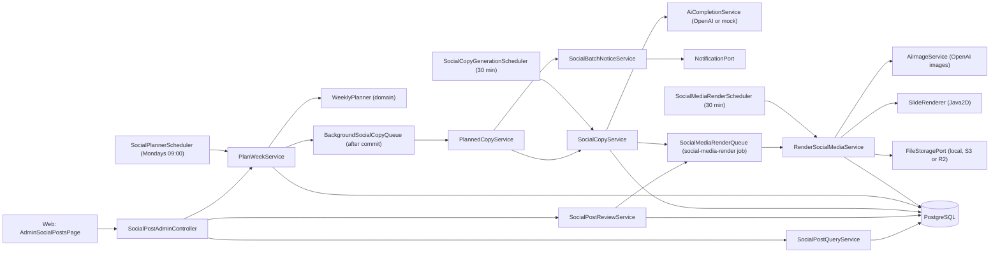
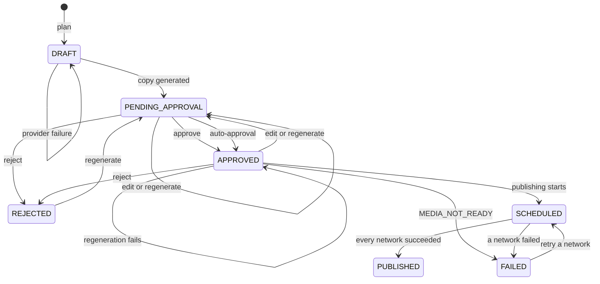
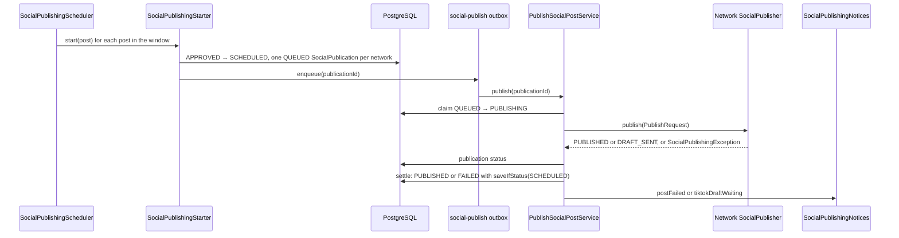
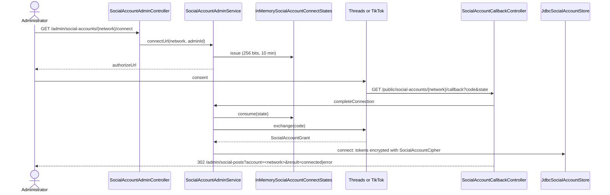

# Architecture

The module follows the hexagonal flow `controller → use case → domain → output port →
adapter`. The domain decides slots and transitions without knowing Spring, JDBC or OpenAI; the
application orchestrates planning, writing, notifying, reviewing, rendering, publishing,
measuring, approving by pillar and managing the accounts; the infrastructure brings the tables,
the jobs, the controllers, the email, the Java2D renderer, the OpenAI images client, storage, each
network's adapters and the OAuth with the encrypted tokens.

[View the full “Architecture” diagram](https://images.vinnot.com/docs/diagrams/v1/en/modules-marketing-architecture-31cbfd908da7.svg)

## Backend

### Layers

| Layer | What it holds |
|---|---|
| `domain/model` | `DateRule`, `WineDay`, `ContentPillar` (with `autoApprove` and `active`), `SocialPost` (transitions, `PostPublishing`), `SocialPublication` (one per network), `PublicationStatus`, `SocialNetwork`, `PublicationMetrics`, `PillarPerformance`, `SocialAccount`, `PostCopy` (limits and legal line), `GenerationInfo`, `PostReview`, `SocialPostMedia` (illustration, slides and render state), `ContentHash`, status and fact-check enums |
| `domain/service` | `WeeklyPlanner` (slots, wine days, weighted rotation and idempotence), `NetworkCaptionFormatter` (copy per network) and `PillarWeighting` (performance factor), dependency-free |
| `application/port/in` | `PlanWeekUseCase`, `GeneratePlannedCopyUseCase`, `GenerateSocialCopyUseCase`, `ReviewSocialPostUseCase`, `ScheduleSocialPostUseCase`, `BrowseSocialPostsUseCase`, `RenderSocialMediaUseCase`, `StartSocialPublishingUseCase`, `PublishSocialPostUseCase`, `RetrySocialPublicationUseCase`, `CollectSocialMetricsUseCase`, `SyncSocialDraftsUseCase`, `AutoApproveSocialPostsUseCase`, `ManageContentPillarsUseCase`, `ManageSocialAccountsUseCase`, `RefreshSocialAccountsUseCase` |
| `application/port/out` | `SocialPostRepository`, `SocialCopyQueue`, `WineDayCatalog`, `ContentPillarCatalog`, `AdminRecipients`, `ReviewerEmails`, `SocialMediaRenderQueue`, `SlideRenderer`, `StyleReferenceCatalog`, `SocialPublicationRepository`, `SocialMetricsRepository`, `SocialPublisher` and `SocialMetricsReader` (one per network), `SocialDraftTracker` (one per network that sends drafts), `SocialAccountTokens`, `SocialPublishQueue`, `SocialPublishingNotices`, `SocialAccountStore`, `SocialAccountOAuthProvider`, `SocialAccountConnectStates` |
| `application/service` | `PlanWeekService`, `PlannedCopyService`, `SocialCopyService` (+ `SocialCopyPromptBuilder`, `SocialCopyParser`, `MockSocialCopy`), `SocialPostReviewService`, `SocialPostScheduleService`, `SocialPostQueryService`, `SocialPostPresenter`, `SocialBatchNoticeService`, `RenderSocialMediaService` (+ `IllustrationPromptBuilder`), `SocialPublishingSweepService`, `SocialPublishingStarter`, `PublishSocialPostService`, `SocialPublicationRetryService`, `SocialPublishingNoticeService`, `SyncSocialDraftsService`, `CollectSocialMetricsService`, `PillarPerformanceService`, `AutoApproveSocialPostsService`, `ContentPillarAdminService`, `SocialAccountAdminService`, `SocialAccountRefreshService` |
| `infrastructure` | `JdbcSocialPostRepository`, `JdbcWineDayCatalog`, `JdbcContentPillarCatalog`, `JdbcMarketingStaff`, `JdbcSocialMediaReferences`, `BackgroundSocialCopyQueue`, the three schedulers, `OutboxSocialMediaRenderQueue`, `SocialMediaRenderEffectHandler`, `render/` (`Java2dSlideRenderer`, `ClasspathStyleReferenceCatalog`), `MarketingConfiguration` and `SocialPostAdminController`; since #510 `JdbcSocialPublicationRepository`, `JdbcSocialMetricsRepository`, `OutboxSocialPublishQueue`, `SocialPublishEffectHandler`, `SocialPublishingScheduler`, `SocialMetricsScheduler`, `SocialAutoApproveScheduler`, `MarketingPublishingConfiguration`, `social/` (Instagram, Facebook, Threads and TikTok publishers and readers, `GraphApi`, `TikTokApi`, `StatusPoller`), `accounts/` (`ThreadsOAuthProvider`, `TikTokOAuthProvider`, `JdbcSocialAccountStore`, `SocialAccountCipher`, `ConfiguredSocialAccountTokens`, `MetaPageTokenClient`, `InMemorySocialAccountConnectStates`, `SocialAccountRefreshScheduler`), `SocialPillarAdminController`, `SocialAccountAdminController` and `SocialAccountCallbackController`; since #516 `SocialDraftSyncScheduler` and `social/TikTokDraftTracker` |

`SocialPostAdminController` answers with bare bodies (no `{ data }` envelope). The `review` block carries
`reviewedBy` and `editedBy` (account ids) plus `reviewedByEmail` and `editedByEmail`, which `SocialPostPresenter`
resolves through `ReviewerEmails` (implemented by `JdbcMarketingStaff`) so the admin sees who acted.

### Planning

`PlanWeekService` takes today's date in the configured zone, reads the wine days, the pillars
and the existing posts (those inside the window and those of the 14 days before it, to carry
the rotation on) and delegates to `WeeklyPlanner`:

1. Each ISO week (Monday to Sunday) has its slot days (Tuesday, Wednesday and Thursday, rotating
   posts at 12:30). Existing posts count by local date, whatever their time: a date with a post gets
   no other. A rotating post moved off the slot days uses up one free slot of its week, and a wine
   day that already has a post (wherever it was moved) is not planned again.
2. Wine days post on their own day at 09:30. Of two wine days on one date the lower priority
   number wins and the other is dropped. A wine day on a free slot day takes that day's slot (no
   rotating post that day). A wine day on another day is an extra post: priority 1 always goes out,
   priority 2 and 3, by priority, only while the week has fewer than `max-posts-per-week` (4)
   posts, counting existing posts, planned posts and the slot days of the week still beyond the
   window (a later run plans them).
3. The remaining slots go to the active pillars: each takes the pillar with the fewest uses
   (existing posts plus the ones planned so far) divided by its weight times its performance
   factor (`PillarPerformanceService`, see [Metrics and weighting](#metrics-and-weighting)), never
   repeating the previous one, with the lower `sort_order` breaking ties; every fourth rotating
   post is `APP_FEATURE`. An inactive pillar is not planned and switching `WINE_DAY` off stops
   planning wine days. The sequence includes the existing posts, which is why a second run
   creates nothing.

Every new post is saved as `DRAFT` in one transaction and "Planificar ahora" answers at once.
Writing takes one to three AI calls per post, longer than Cloudflare lets a request wait
(100 s). Once the transaction commits, `BackgroundSocialCopyQueue` runs the batch on its own
thread, one batch at a time: `PlannedCopyService` writes the copy of each post still in
`DRAFT` and sends the batch notice. A post that cannot be written is logged and skipped. The
batch stays out of the shared outbox on purpose, because the outbox drain waits for every
claimed job and minutes of AI calls would hold back the emails and pushes queued after them.
The drafts are the durable state: a provider failure, or a restart mid-batch, leaves drafts that
the 30-minute job writes later (a restart skips the batch notice). Meanwhile the web page
refreshes the queue every 10 seconds for up to 5 minutes.

### Copy

Every post is written in two languages (#497): neutral Spanish, addressing the reader as
"tú" with no voseo or regional slang, and natural English. `SocialCopyService` makes **one**
completion that returns both (`{"es": copy, "en": copy, "illustration": subject}`), so both
languages state the same facts and share one hero subject. `SocialCopyPromptBuilder` writes the
instructions in English:

- Voice: a knowledgeable sommelier writing for curious wine lovers around the world, refined and
  precise; technical terms (malolactic fermentation, lees ageing, tannin structure, terroir,
  clones) are explained in a few words. The app is not described as Argentine, posts are not
  framed around one country unless the topic comes from there (Malbec World Day, Torrontés), and
  no publishing time or local time zone is stated.
- Substance: concrete, verifiable facts and curiosities (origin and history, main regions, body,
  acidity, tannin and aromatics, winemaking choices, ageing potential); a wine-day post explains
  why the day exists and adds at least two concrete facts; no filler and no jokes at the expense
  of wine culture.
- Pairings: only by food category, explained by structure (fat, acidity, tannin, salt), such as
  "quesos de pasta dura y madurados (parmesano, pecorino)" or "carnes rojas"; never street food,
  fast food or a single home dish.
- The pillar's English brief (`content_pillars.brief_en`, V81), the wine day and the date.

`SocialCopyParser` validates both copies; one invalid or missing language makes the whole answer
invalid. The prompt states the limits as hard character limits, and an invalid answer is written
once more with the exact reason (for example `es: slide body must hold at most 160 characters`).
When the rewrite is invalid too, the draft keeps waiting with `INVALID_POST_COPY`.
The call to action is required in both languages. Each rejected answer is logged with its shape:
the fields of each language and their lengths, never the text. A second call checks the facts of
both languages at once (and flags a fact one language contradicts); if it fails, both are
regenerated once and flagged `FLAGGED` with the issues. `PostCopy.of` validates the limits and
appends the legal line of its language: "Beber con moderación. Prohibida su venta a menores de
18 años." in Spanish, "Drink responsibly. Not for sale to anyone under 18." in English. Each
language has its own hashtags, always with `#vinnot`. With `AI_PROVIDER=mock` both copies are
written by `MockSocialCopy`, with `mock = true` and `SKIPPED`.

Calls use `AiCompletionService.chatCompletion`; `OpenAiClient` already goes through
`AiProviderAdmissionService` (capacity and budget), so the module reserves nothing itself. When
admission refuses, the error (`AI_BUDGET_EXHAUSTED`, `AI_CAPACITY_EXCEEDED`) is kept in
`generation.error`.

### Transitions

[View the full “Transitions” diagram](https://images.vinnot.com/docs/diagrams/v1/en/modules-marketing-architecture-b32e3fa819c5.svg)

A post reaches `PENDING_APPROVAL` from a generation only with copy in both languages. Regenerating
an approved post (#497) drops its approval (approver and time) and leaves it pending with its new
copy; when the provider fails it stays approved with its previous copy and the error.
Since #510 an approved post with ready Spanish slides moves to `SCHEDULED` when publishing starts
and to `PUBLISHED` or `FAILED` when it is settled; a `FAILED` post goes back to `SCHEDULED` when the
administrator retries a network (see [Publishing to the networks](#publishing-to-the-networks)).
`SCHEDULED` and `PUBLISHED` freeze the media: no illustration is requested and nothing is rendered again. An invalid action throws `InvalidPostTransitionException`, which reuses the
`INVALID_POST_TRANSITION` code so the shared handler answers 409.

### Illustration and slides

Rendering runs as a durable effect, outside the transaction that stores the copy:

1. `SocialPost` computes `PostCopy.mediaHash()` (hook, slides, CTA and illustration subject) for
   each language. When one changed, the media becomes `PENDING`; otherwise nothing changes.
   Generating, regenerating and editing call `SocialMediaRenderQueue.requestFor`, which queues
   `social-media-render` under the key `social-render:<post>:<target hash>:<version>` (the
   target hash covers every language's copy hash) only when the media is pending.
2. `SocialMediaRenderEffectHandler` (not transactional) calls
   `RenderSocialMediaService.render`. Every media write is a compare-and-set against what that
   run last wrote: when the copy or the version changed, the run stops and the newer one
   renders.
3. The illustration: when the version and subject did not change, the stored one is reused.
   Otherwise `IllustrationPromptBuilder` builds the prompt with the product owner's watercolor
   recipe and `AiImageService.edit` requests it with the four references in
   `marketing/references/`. Every `AiImageGenerationException`, and a failure to store the paid
   image (`HERO_STORE_FAILED`), leave a `FALLBACK` illustration with its reason.
4. `Java2dSlideRenderer` draws both formats of every stale language (`SocialPostMedia.staleLanguages()`:
   the languages whose slides do not show their copy with the current illustration version) in
   the headless JVM, one post at a time (the host has a 512 MB heap). Editing one language
   re-renders only that one; a new illustration re-renders both. When the illustration cannot be
   drawn (`INVALID_ILLUSTRATION`) every language is drawn with the pillar vignette. The hero is
   shared by both languages.
5. Each slide is stored with `FileStoragePort.storeSocialMedia`, the media becomes `READY` and
   the keys it no longer uses go to `deleteSocialMedia`.

| Format | Canvas | Text area |
|---|---|---|
| `INSTAGRAM` | 1080x1350 (4:5) | 110 px margins on the sides and bottom, 120 px on top |
| `TIKTOK` | 1080x1920 (9:16) | Central band: 140 px on the sides, 260 px on top and 420 px at the bottom, clear of the TikTok interface |

| Slide | Content |
|---|---|
| Cover | Illustration (or pillar vignette), hook and Vinnot mark |
| Content | "n / total" marker, title, divider ornament, body, corner ornaments and a small Vinnot mark |
| Closing | CTA, mark and the legal line of the deck's language (`PostLanguage.legalLine()`) |

The background is a paper texture, the ornaments are watercolor vine sprigs and the fonts are
Cormorant Garamond (titles) and Poppins (body), bundled with their OFL license. Text wraps by
words and shrinks down to a floor; what still does not fit fails with `TEXT_DOES_NOT_FIT`.
JPEGs use quality 0.9.

#### Errors and fallback

| Code | Where it is kept | What happens |
|---|---|---|
| `AI_IMAGE_UNAVAILABLE` | `illustrationReason` | AI off, mock mode, admission refused (budget or capacity) or no references: pillar vignette |
| `AI_IMAGE_REJECTED` | `illustrationReason` | The image is not a valid PNG or has no transparent background: vignette, no retry |
| `AI_IMAGE_FAILED` | `illustrationReason` | The request failed after its retries (only 429 and 5xx are retried): vignette |
| `HERO_STORE_FAILED` | `illustrationReason` | The paid image could not be stored: vignette for that version, never paid again |
| `INVALID_ILLUSTRATION` | `illustrationReason` | The drawing could not use the illustration: drawn with the vignette |
| `TEXT_DOES_NOT_FIT` | `media.error`, `FAILED` | The text does not fit even at the smallest size |
| `ENCODING_FAILED` | `media.error`, `FAILED` | The JPEG could not be encoded |
| `BUSY`, `INTERRUPTED` or another exception | `media.error`, stays `PENDING` | The worker retries with backoff |
| `RENDER_ATTEMPTS_EXHAUSTED` | `media.error`, `FAILED` | The five attempts ran out |

A `FAILED` render is retried by requesting a new illustration, which bumps the version and
resets the attempts. `SocialMediaRenderScheduler` (every `app.marketing.generation.delay-ms`)
queues up to 50 upcoming posts with copy whose media is null or `PENDING`: posts older than V80
and lost requests.

#### Storage

Keys are `posts/<post>/hero-<hash16>.png` and `posts/<post>/{es|en}/{instagram|tiktok}-NN-<hash16>.jpg`,
with the SHA-256 of the content (slides rendered before #497 keep their keys without the language
segment). The adapters check the key (lowercase, up to 160 characters,
`.jpg` or `.png`), the type, the magic bytes and up to 5 MB, and write once. R2 reserves its own
monthly byte allowance (`app.storage.r2.social-max-monthly-bytes`) plus one write of the shared
allowance. Deleting queues `social-media-cleanup`, which only deletes when
`JdbcSocialMediaReferences` confirms that no post and no pending job of that post uses the key.

#### Media in the database

`social_posts.media` (V80, per language since V81) holds a JSONB document: `status`,
`copyHashes` (`{"es": hash, "en": hash}`), `illustrationVersion`, `attempts`, `error`,
`illustration` (`version`, `subject`, `source`, `image {key, url}`, `reason`) and `slides`
(`{"es": set, "en": set}`, each set with `copyHash`, `illustrationVersion`, `instagram[]`,
`tiktok[]`, `renderedAt`). The media is `READY` when every language with copy shows its copy
hash with the current illustration version. While a render is pending the previous illustration
and slides stay, but the API only returns each language's slides of its current copy. A post save
merges per language: each stored slide set stays when it is of the same or a newer version than
the snapshot's.

### Publishing to the networks

Publishing (#510) runs outside any transaction, because networks are slow, as durable effects of
the shared outbox:

1. `SocialPublishingScheduler` (every `app.marketing.publishing.delay-ms`, only with
   `app.marketing.publishing.enabled`) calls `SocialPublishingSweepService`, which reads up to 50
   `APPROVED` posts whose slot passed within the last 2 × `media-grace` and calls
   `SocialPublishingStarter` for each in its own transaction. Without enabled networks it reads
   nothing. A post older than that window is ignored and never published late.
2. `SocialPublishingStarter`: with the Spanish slides ready (`SocialPost.readyToPublish()`: media
   `READY` with Instagram and TikTok slides for the current Spanish copy) it moves the post to
   `SCHEDULED` with `saveIfStatus(APPROVED)`, creates one `QUEUED` `SocialPublication` per enabled
   network and calls `SocialPublishQueue.enqueue`, which stores a `social-publish` effect keyed
   `social-publish:<publication>:<nonce>`. Each effect is due after that network's delay (#513):
   `PublishingSettings.delay` is the time left until the network's not-before time of the post's
   local day (`app.marketing.publishing.networks.<network>.not-before`, TikTok 19:30 by default),
   or zero when the network has none or it already passed. The post stays `SCHEDULED` until every
   publication is done. Without slides it waits until `media-grace` after the
   slot; then it leaves the post `FAILED` with `MEDIA_NOT_READY` and notifies.
3. `SocialPublishEffectHandler` calls `PublishSocialPostService.publish`, which first claims the
   publication with a conditional update (`QUEUED` → `PUBLISHING`, attempt + 1). When the claim
   fails (duplicate effect, another worker) it does nothing: a network never gets the post twice.
4. It builds the `PublishRequest` with the Spanish copy formatted by `NetworkCaptionFormatter` and
   the Spanish slide URLs (TikTok for TikTok, Instagram for the rest), which must be absolute https
   (`MEDIA_NOT_PUBLIC`), and calls the network's `SocialPublisher`.
5. A retryable `SocialPublishingException` (`RATE_LIMITED`, `UNAVAILABLE`, `PROCESSING_TIMEOUT`)
   with fewer than 5 attempts sends the publication back to `QUEUED` and is rethrown so the outbox
   retries; any other, or the fifth attempt, leaves it `FAILED`. With publishing or the network off,
   a queued or retried publication becomes `FAILED` with `PUBLISHING_OFF`.
6. Once every publication of the post is terminal, it settles the post with
   `saveIfStatus(SCHEDULED)`: `PUBLISHED` when all succeeded (`DRAFT_SENT` counts), `FAILED` with the
   first error otherwise. Only the settle that changes the post notifies the administrators.
7. A `DRAFT_SENT` publication is terminal for publishing but not final (#516).
   `SocialDraftSyncScheduler` (every `app.marketing.publishing.draft-sync.delay-ms`, 15 minutes,
   with the same switches as the publishing sweep) calls `SyncSocialDraftsService`, which reads
   the drafts sent in the last `draft-sync.window-days` (14) that have a network id, oldest first
   and at most `draft-sync.max-per-sweep` (20), through
   `SocialPublicationRepository.findDraftsSentSince` (`published_at` keeps the moment the draft
   was sent). The network's `SocialDraftTracker` checks each one; on `POSTED`,
   `SocialPublication.draftPosted` moves it to `PUBLISHED` (same network id, the link when known,
   `publishedAt` = now) and `saveIfStatus(DRAFT_SENT)` writes it once. A pending draft is left as
   it is. A failing draft is logged and the sweep goes on; `NOT_CONNECTED`, `TOKEN_INVALID` or
   `RATE_LIMITED` stop that network until the next run. The post was already settled when the
   draft was sent, so it does not change.

[View the full “Publishing to the networks” diagram](https://images.vinnot.com/docs/diagrams/v1/en/modules-marketing-architecture-f708191fe557.svg)

| Network | Adapter | What it does |
|---|---|---|
| Instagram | `InstagramPublisher` | Checks the daily quota (`content_publishing_limit`), creates one container per image with its alt text and the `CAROUSEL` container with the caption, waits until Meta processed it, publishes (`media_publish`) and reads the link; 2 to 20 images |
| Facebook | `FacebookPublisher` | Uploads every photo unpublished and creates one Page post with `attached_media` and the caption; reads the link; 1 to 50 images; uses the Page token |
| Threads | `ThreadsPublisher` | Creates one container per image, the carousel with the text and the topic, waits for processing, publishes (`threads_publish`) and reads the link; 2 to 20 images |
| TikTok | `TikTokPublisher` | Queries the creator, starts a photo post (`/v2/post/publish/content/init/`) that TikTok pulls from the public URLs and checks its status; `MEDIA_UPLOAD` ends in `DRAFT_SENT`, `DIRECT_POST` publishes with the creator's most open privacy; 1 to 35 images. `TikTokDraftTracker` checks a draft with one `status/fetch`: `PUBLISH_COMPLETE` is posted, linked to `https://www.tiktok.com/@<creator_username>/photo/<id>` only when `publicaly_available_post_id` already holds the id (then it reads `creator_info`); any other status is pending; `FAILED` and API errors map to the same codes |

`StatusPoller` checks every `MARKETING_NETWORKS_POLL_INTERVAL` up to
`MARKETING_NETWORKS_POLL_TIMEOUT` and fails with `PROCESSING_TIMEOUT`. A link that cannot be read
after publishing stays null without failing the publication (retrying would publish twice).

| Code | Retried | Meaning |
|---|---|---|
| `NOT_CONNECTED` | No | The network has no configured or connected account |
| `TOKEN_INVALID` | No | The token expired or was revoked |
| `MEDIA_REJECTED` | No | The network refused the images |
| `MEDIA_NOT_PUBLIC` | No | A slide URL is not absolute https |
| `REJECTED` | No | The network refused the request (also an image count out of range) |
| `RATE_LIMITED` | Yes | Network limit or Instagram's daily quota |
| `UNAVAILABLE` | Yes | The network did not answer, or an unexpected error |
| `PROCESSING_TIMEOUT` | Yes | The network took too long to process the images |
| `MEDIA_NOT_READY` | — | The slides were not ready `media-grace` after the slot (post) |
| `POST_NOT_SCHEDULED` | — | The post changed while it was being published |
| `PUBLISHING_OFF` | — | Publishing or the network was switched off |

The administrator retries a `FAILED` network with `SocialPublicationRetryService`, in one
transaction: it moves the publication from `FAILED` to `QUEUED` conditionally (of two concurrent
retries one wins; the other gets 409 `INVALID_PUBLICATION_TRANSITION`), resets the attempts to
zero, moves the post from `FAILED` to `SCHEDULED` (which needs ready slides) and queues a new
effect. With publishing or the network off it answers 409 `SOCIAL_PUBLISHING_OFF`.

`SocialPublishingNoticeService` queues per administrator `SOCIAL_POST_FAILED` (key
`social-failed:<post>:<network|ALL>:<run finish>`), `SOCIAL_TIKTOK_DRAFT_WAITING`
(`social-tiktok-draft:<post>`) and `SOCIAL_ACCOUNT_RECONNECT` (`social-reconnect:<network>:<UTC day>`),
each key ending with the administrator; email `SocialPublishingNoticeTemplate` (category
`MODERATION`) and push `SocialPublishingPushTemplate`.

### Reschedule and publish now

`SocialPostScheduleService` (#513) implements `ScheduleSocialPostUseCase` behind
`PUT /admin/social-posts/{id}/schedule` (body `{"scheduledFor": "<ISO-8601 instant>"}`, 200) and
`POST /admin/social-posts/{id}/publish-now` (202); both answer `SocialPostAdminResponse`.

- Reschedule: `SocialPost.reschedule` allows `DRAFT`, `PENDING_APPROVAL`, `APPROVED` and `REJECTED`
  (otherwise 409 `INVALID_POST_TRANSITION`), keeps the status, copy and media, keeps the time to the
  second and needs it after now (400 `SOCIAL_POST_SCHEDULE_NOT_FUTURE`). The service then reads the
  posts of that local date (planner zone) and answers 409 `SOCIAL_POST_DATE_TAKEN` when another one
  is there; moving a post within its own date is allowed.
- Publish now: publishing switched off or no network enabled answers 409 `SOCIAL_PUBLISHING_OFF`;
  `SocialPost.publishNow` needs `APPROVED` (409 `INVALID_POST_TRANSITION`) and ready Spanish slides
  (409 `SOCIAL_POST_MEDIA_NOT_READY`) and moves the time to now. In one transaction the service writes
  the time and calls `SocialPublishingStarter.startNow`, the sweep's start with every network queued
  at once (no not-before delay).
- Both write the time with `SocialPostRepository.saveScheduleIfUnchanged`, only over the status and
  time they read. `saveIfStatus` also checks the time read, so the publishing sweep and an admin
  action never overwrite each other: whoever writes second gets nothing written (the admin action
  answers 409 `INVALID_POST_TRANSITION`). The ordinary upsert never writes `scheduled_for`, so a save
  from a copy read before a reschedule never moves the post back; a copy job that read the old time
  discards its copy and the draft is written again.

The response carries `canReschedule`, `canPublishNow` (also false while publishing is off or no
network is enabled) and `networkSchedule` (`[{network, publishAt}]` for each network that publishes:
the post time, or that day's not-before time of the network when later; empty once publishing
started, since its publications show the real state), so the clients do not derive the rules.

### Metrics and weighting

`SocialMetricsScheduler` (`app.marketing.metrics.cron`, in the planner zone, only with
`app.marketing.metrics.enabled`) calls `CollectSocialMetricsService`: for every `PUBLISHED` or
`DRAFT_SENT` publication with a network id from the last `metrics.window-days`, its network's
`SocialMetricsReader` returns `PublicationMetrics` and `JdbcSocialMetricsRepository` stores the
day's snapshot (upsert per publication and day). A network without a reader is skipped and a
failure is logged without stopping the others.

| Network | Reader | Metrics |
|---|---|---|
| Instagram | `InstagramMetricsReader` | `views`, `reach`, `likes`, `comments`, `saved`, `shares` (list configurable in `MARKETING_INSTAGRAM_METRICS`; `follows` when added) |
| Facebook | `FacebookMetricsReader` | `post_media_view` (views), `post_total_media_view_unique` (reach), `post_reactions_by_type_total` (likes), the post's comments and shares |
| Threads | `ThreadsMetricsReader` | `views`, `likes`, `replies` (comments) and `reposts` + `quotes` + `shares` (shares) |
| TikTok | `TikTokMetricsReader` | None: the `publish_id` is not a queryable video id |

`PillarPerformanceService` adds up each publication's latest snapshot per pillar over the last
`weighting.window-days` (`PillarPerformance`: measured posts, views, interactions) and
`PillarWeighting` computes the factor: the pillar's interactions per view against the overall
ones, between 0.5 and 2.0, neutral (1.0) with fewer than 3 measured posts, no views or no
interactions overall. `PlanWeekService` passes the factors to `WeeklyPlanner` and the pillars panel
shows them.

### Auto-approval

`SocialAutoApproveScheduler` (every `auto-approve.delay-ms`, only with
`app.marketing.auto-approve.enabled`) calls `AutoApproveSocialPostsService`: when some pillar has
`auto_approve`, it reads up to 200 `PENDING_APPROVAL` posts and approves those of such pillars with a
future slot within `auto-approve.lead`, ready slides and a `PASSED` fact check with
`SocialPost.autoApprove` (`PostReview.automatic`: no reviewer, reason `AUTO_APPROVED`). It saves with
`saveApprovalIfUnchanged` against the `updatedAt` and media it read, so it never overwrites an
administrator's action. `ContentPillarAdminService` changes `auto_approve` and `active`; switching
off the last active rotating pillar throws `LastRotatingPillarException` (409 `LAST_ROTATING_PILLAR`).

### Accounts and OAuth

Meta (Instagram and the Facebook Page) uses a business portfolio system-user token, which does not
expire, and the account and Page ids, all from configuration (`app.marketing.accounts.meta.*`).
`ConfiguredSocialAccountTokens` hands that token to Instagram and, for Facebook, the Page token
(`page-access-token` or, when empty, read from the Graph API with `MetaPageTokenClient` and kept in
memory for an hour). Threads and TikTok are connected from the panel with OAuth and stored in
`social_accounts`; their token is handed out only while the account is `CONNECTED` and not expired.

[View the full “Accounts and OAuth” diagram](https://images.vinnot.com/docs/diagrams/v1/en/modules-marketing-architecture-91fc428b0401.svg)

- `SocialAccountCipher`: versioned AES-256-GCM envelope with the key
  `app.marketing.accounts.encryption-key` (base64 of 32 bytes), authenticated against the network
  and the field. Without a key the application starts but nothing can be connected (422
  `SOCIAL_ACCOUNT_ENCRYPTION_KEY_MISSING`); a malformed key stops startup.
- `InMemorySocialAccountConnectStates`: 256-bit states, 10 minutes, removed on first use, in the
  instance's memory; it works with a single backend instance and a restart between "Connect" and the
  redirect means starting again.
- `ThreadsOAuthProvider`: scopes `threads_basic`, `threads_content_publish`,
  `threads_manage_insights`; code exchange, swap for a 60-day token (`th_exchange_token`) and refresh
  with `th_refresh_token` in the last 10 days, once the token is at least 24 h old.
- `TikTokOAuthProvider`: scopes `user.info.basic`, `video.upload`, `video.publish`, `video.list`;
  exchange and refresh at `/v2/oauth/token/` in the access token's last half hour; every refresh
  brings a new refresh token.
- `SocialAccountRefreshService` (hourly, `SocialAccountRefreshScheduler`) takes a lease per account
  (`refresh_claimed_until`); a refusal, an expired credential or an unreadable token
  (`TOKEN_UNREADABLE`) mark `REFRESH_FAILED` and notify once; a transient error releases the lease
  and is retried.
- The redirect (`/public/social-accounts/*/callback`) is public in `SecurityConfig`: the `state`
  proves who started it. It always answers 302 to the web without the code, the `state` or a token.

### Persistence

`social_posts` stores `copy` as one JSONB document per language (`{"es": copy, "en": copy}`, the
`copies` of the API) and `generation` as JSONB; `scheduled_for` is unique. The `language` column
(V78) is no longer written. V81 rewrote every pillar brief in the new voice, added `brief_en`,
and moved every stored copy and media document under `es` (the English side stays missing until
the post is regenerated; regenerating an approved post is allowed so old posts can be filled). Wine days and pillars are read from their tables on every
run (85 rows). `JdbcMarketingStaff` finds the active, not locked administrators with
`ROLE_ADMIN`. V82 adds `social_publications`, `social_post_metrics`, `social_accounts`,
`content_pillars.auto_approve` and `social_posts.publishing` (JSONB `{startedAt, finishedAt,
error}`); V83 adds `content_pillars.active` and V84 the six refined pillars (see the
[relational model](../../backend/diagrams/relational-model.md#social-publishing-v82v84)).

### Batch notice

`SocialBatchNoticeService` enqueues one `SOCIAL_BATCH_READY` per administrator with `count`,
`from` and `to`. The outbox deduplicates on one global key, so the key is
`social-batch:<from>:<admin>`. The push is `SocialBatchReadyPushTemplate` (copy in `push/marketing_{es,en}.properties`, opens the app). The email is `SocialBatchReadyTemplate`, category `MODERATION`
(transactional, always delivered) with a button to `/admin/social-posts`.

### Tests

| Test | What it covers |
|---|---|
| `DateRuleTest` | Fixed, nth weekday, last weekday and offset rules, for 2026 and 2027 |
| `WeeklyPlannerTest` | Slot days and times, wine days in the morning, one post per date, weekly maximum, moved posts, idempotence and rotation |
| `SocialPostTest`, `PostCopyTest`, `PostCopiesTest`, `PostLanguageTest` | Transitions (both languages to reach pending, regenerate from approved), limits, legal line per language, per-language edit |
| `PlanWeekServiceTest`, `SocialCopyServiceTest`, `SocialBatchNoticeServiceTest` | Orchestration with mocked ports |
| `SocialCopyParserTest`, `SocialCopyPromptBuilderTest`, `MockSocialCopyTest` | Prompt, parsing and mock copy |
| `SocialPostReviewServiceTest`, `SocialPostQueryServiceTest`, `SocialPostPresenterTest` | Actions, queries and projection (with `canReschedule`, `canPublishNow` and `networkSchedule`) |
| `SocialPostScheduleTest`, `SocialPostScheduleServiceTest` | Reschedule and publish now: allowed statuses, future time, taken date, ready slides, publishing off and compare-and-set |
| `SocialBilingualMigrationPostgresIntegrationTest` | V81 on rows stored before it: briefs, copy and media under `es`, nothing lost, idempotent (Testcontainers) |
| `JdbcSocialPostRepositoryPostgresIntegrationTest` | V78 seeds, JSONB, uniqueness, paging and administrators (Testcontainers) |
| `SocialPostAdminControllerTest` | `ADMIN` guard, page wrapping, 409 and 400 |
| `SocialBatchReadyTemplateTest` | Email in both languages |
| `SocialBatchReadyPushTemplateTest` | Push in both languages, singular and plural |
| `SocialPostMediaTest`, `IllustrationPromptBuilderTest` | Hash versioning, new illustration, reuse and watercolor prompt |
| `RenderSocialMediaServiceTest` | AI illustration, fallback vignette, `HERO_STORE_FAILED`, retries, attempt cap, races and sweep |
| `SlideDeckTest`, `Java2dSlideRendererTest`, `TextFitterTest`, `RenderAssetsTest`, `SlidePaletteTest`, `ClasspathStyleReferenceCatalogTest` | Sizes, layouts, text fitting, art and references |
| `OutboxSocialMediaRenderQueueTest`, `SocialMediaRenderEffectHandlerTest` | Job key and non-transactional run |
| `JdbcSocialPostMediaPostgresIntegrationTest` | JSONB `media`, compare-and-set, sweep and cleanup references (Testcontainers) |
| `OpenAiImageClientTest`, `OpenAiImageClientWiringTest`, `ImageTransparencyTest`, `ImageEditRequestTest` | Multipart request, flat-cost admission, retries and transparency |
| `SocialPublicationTest`, `SocialPostPublishingTest`, `PublicationMetricsTest`, `ContentPillarTest`, `SocialAccountTest` | Per-network publication transitions, frozen post, auto-approval, metrics and accounts |
| `NetworkCaptionFormatterTest`, `PillarWeightingTest`, `WeeklyPlannerTest` | Copy per network, performance factor and weighted rotation |
| `SocialPublishingSweepServiceTest`, `SocialPublishingStarterTest`, `PublishSocialPostServiceTest`, `SocialPublicationRetryServiceTest`, `SocialPublishingNoticeServiceTest` | Window, start, per-network delay, claim, retries, settle, manual retry and notices |
| `SyncSocialDraftsServiceTest`, `TikTokDraftTrackerTest`, `SocialDraftSyncSchedulerTest` | Posted TikTok drafts become published: window, cap, conditional save, failures per draft and per network, `status/fetch` mapping and switches |
| `MarketingPublishingConfigurationTest`, `OutboxSocialPublishQueueTest` | Networks, not-before times and delayed effects |
| `CollectSocialMetricsServiceTest`, `PillarPerformanceServiceTest`, `AutoApproveSocialPostsServiceTest`, `ContentPillarAdminServiceTest` | Metrics, performance, auto-approval and pillar switches |
| `SocialAccountAdminServiceTest`, `SocialAccountRefreshServiceTest`, `ThreadsOAuthProviderTest`, `TikTokOAuthProviderTest`, `SocialAccountCipherTest`, `InMemorySocialAccountConnectStatesTest`, `ConfiguredSocialAccountTokensTest`, `MetaPageTokenClientTest` | Connection, refresh, encryption, states and tokens |
| `InstagramPublisherTest`, `FacebookPublisherTest`, `ThreadsPublisherTest`, `TikTokPublisherTest`, `SocialMetricsReadersTest`, `GraphApiTest`, `StatusPollerTest`, `SocialNetworksConfigurationTest` | Adapters against a fake HTTP server |
| `JdbcSocialPublicationRepositoryPostgresIntegrationTest`, `JdbcSocialMetricsRepositoryPostgresIntegrationTest`, `JdbcSocialPostPublishingPostgresIntegrationTest`, `JdbcSocialAccountStorePostgresIntegrationTest`, `SocialPillarSwitchesPostgresIntegrationTest`, `SocialPublishingMigrationPostgresIntegrationTest`, `SocialContentRefinementMigrationPostgresIntegrationTest` | V82–V84, atomic claim, metrics upsert, leases and compare-and-set, including the reschedule and publish-now races with the sweep (Testcontainers) |
| `SocialPostAdminControllerTest`, `SocialPillarAdminControllerTest`, `SocialAccountAdminControllerTest`, `SocialAccountCallbackControllerTest`, `GlobalExceptionHandlerTransitionConflictTest` | New endpoints, `ADMIN` guard, public redirect and 409 codes |
| `SocialPublishingNoticeTemplateTest`, `SocialPublishingPushTemplatesTest` | Email and push of the three notices in both languages |
| `SocialMediaObjectsTest`, storage `*SocialMediaTest`, `SocialMediaControllerTest`, `PublicUploadServiceTest` | Keys, limits, write-once, R2 allowance, cleanup and public route |

## Web

The `/admin/social-posts` page lives in `frontend-react` under `AdminOnlyLayout`, with the flow
`page → view model → query hooks → application service → API client`. Its layout and tests are
in the [administration manual](../../manuals/admin.md) and in [Requirements](requirements.md).
