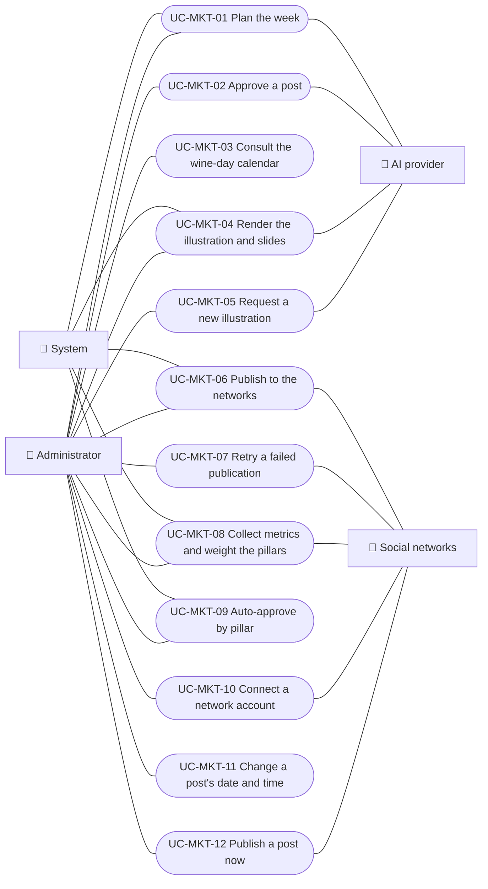

# Use cases

Social media marketing use cases: plan the week, approve a post, consult the wine-day calendar, render a post's illustration and slides, request a new illustration, publish to the networks, retry a failed publication, collect metrics and weight the pillars, auto-approve by pillar, connect a network account, change a post's date and time and publish a post now.

| ID | Use case | Platforms | Actors |
|---|---|---|---|
| `UC-MKT-01` | [Plan the week](uc-mkt-01-plan-week.md) | Web, Backend only | System, Administrator, AI provider |
| `UC-MKT-02` | [Approve a post](uc-mkt-02-approve-post.md) | Web | Administrator, AI provider |
| `UC-MKT-03` | [Consult the wine-day calendar](uc-mkt-03-wine-day-calendar.md) | Web | Administrator |
| `UC-MKT-04` | [Render a post's illustration and slides](uc-mkt-04-render-post-media.md) | Web, Backend only | System, Administrator, AI provider |
| `UC-MKT-05` | [Request a new illustration](uc-mkt-05-new-illustration.md) | Web | Administrator, AI provider |
| `UC-MKT-06` | [Publish a post to the networks](uc-mkt-06-publish-post.md) | Web, App, Backend only | System, Instagram, Facebook, Threads, TikTok, Administrator |
| `UC-MKT-07` | [Retry a failed publication](uc-mkt-07-retry-publication.md) | Web, App | Administrator, System |
| `UC-MKT-08` | [Collect metrics and weight the pillars](uc-mkt-08-collect-metrics-weight-pillars.md) | Web, App, Backend only | System, Instagram, Facebook, Threads, Administrator |
| `UC-MKT-09` | [Auto-approve by pillar](uc-mkt-09-auto-approve-by-pillar.md) | Web, App, Backend only | Administrator, System |
| `UC-MKT-10` | [Connect a network account](uc-mkt-10-connect-network-account.md) | Web, App | Administrator, Threads, TikTok, System |
| `UC-MKT-11` | [Change a post's date and time](uc-mkt-11-reschedule-post.md) | Web, App | Administrator, System |
| `UC-MKT-12` | [Publish a post now](uc-mkt-12-publish-post-now.md) | Web, App | Administrator, System, Instagram, Facebook, Threads, TikTok |

## Use case diagram

[View the full “Use cases · Use case diagram” diagram](https://images.vinnot.com/docs/diagrams/v1/en/modules-marketing-use-cases-readme-1bd9b69979e3.svg)

## Lucidchart equivalence

| ID | Lucidchart IDs |
|---|---|
| `UC-MKT-01` | None |
| `UC-MKT-02` | None |
| `UC-MKT-03` | None |
| `UC-MKT-04` | None |
| `UC-MKT-05` | None |
| `UC-MKT-06` | None |
| `UC-MKT-07` | None |
| `UC-MKT-08` | None |
| `UC-MKT-09` | None |
| `UC-MKT-10` | None |
| `UC-MKT-11` | None |
| `UC-MKT-12` | None |
