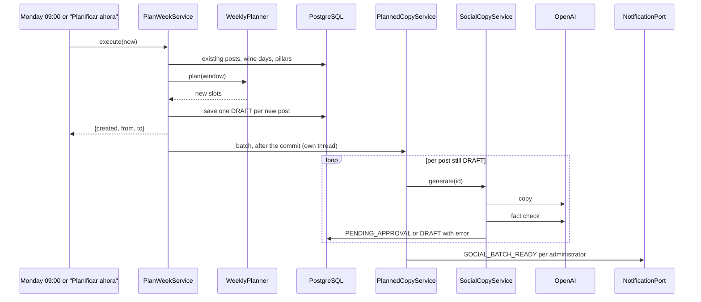

# UC-MKT-01 · Plan the week

| Field | Value |
|---|---|
| ID | `UC-MKT-01` |
| Module | [Social media marketing](../README.md) |
| Platforms | Web, Backend only |
| Actors | System, Administrator, AI provider |
| Lucidchart IDs | None |
| Requirements | [`RF-WEB-MKT-01`](../requirements.md), [`RF-WEB-MKT-02`](../requirements.md), [`RF-WEB-MKT-03`](../requirements.md), [`RF-WEB-MKT-04`](../requirements.md), [`RF-WEB-MKT-32`](../requirements.md) |
| Test cases | [`CP-MKT-01`](../testing.md), [`CP-MKT-02`](../testing.md), [`CP-MKT-03`](../testing.md), [`CP-MKT-04`](../testing.md), [`CP-MKT-05`](../testing.md), [`CP-MKT-06`](../testing.md), [`CP-MKT-07`](../testing.md), [`CP-MKT-67`](../testing.md), [`CP-MKT-68`](../testing.md) |

## Preconditions

- `app.marketing.enabled` is `true` (for the automatic run) or the person is an administrator and presses "Planificar ahora".
- The wine days and pillars are seeded (migration `V78`).

## Postconditions

- There is at most one post per Argentina date of the next 14 days (rotating posts on the free slot days and the wine days that fit), with copy in Spanish and English and the legal line of each, waiting for approval.
- The administrators received the batch notice.

## Main flow

1. Monday 09:00 Argentina time arrives or the person presses "Planificar ahora" (`POST /admin/social-posts/plan`).
2. The system computes the Tuesday, Wednesday and Thursday 12:30 slots of the next 14 days, leaving out the dates that already have a post, whatever its time.
3. It saves one draft per slot, queues the batch for its copy and answers `{created, from, to}` at once; the page says the AI is writing and refreshes the queue.
4. In the background it writes each post in neutral Spanish and English (one call writes both languages, another checks the facts of both) and notifies the administrators by email and push.

## Alternative flows

- 2a. A wine day falls inside the window: the post goes out that day at 09:30; on a slot day it takes that day's slot and no rotating post goes out that day.
- 2b. Two wine days fall on the same date: the lower priority number wins; the other is dropped.
- 2c. The same window is planned again: `created` is 0 and no notice is sent.
- 2d. A wine day falls off the slot days: it is an extra post; priority 1 always goes out, priority 2 and 3 only while its week (Monday to Sunday, existing and planned posts) has fewer than `max-posts-per-week` (4) posts.
- 2e. A post was moved to another date ([`UC-MKT-11`](uc-mkt-11-reschedule-post.md)) or was planned with other times: existing posts count by date, a rotating post moved off the slot days uses up one free slot of its week and a wine day already posted is not planned again, so planning again adds nothing to that date or week.
- 2f. Planning runs after one of today's slots has passed (for example "Plan now" at 15:00): that slot is skipped, because a post in the past could never be approved in time.
- 3a. The AI provider fails or is unavailable: the post stays `DRAFT` with `generation.error` and is retried every 30 minutes.
- 3b. The fact check fails: the copy is regenerated once and the post is flagged `FLAGGED`.
- 3c. The provider is in mock mode: the copy is deterministic in both languages, `mock` is `true` and the check is `SKIPPED`.
- 3d. The answer lacks a language or one language breaks a limit: the copy is requested once more with the exact reason; if the rewrite is invalid too, the post stays `DRAFT` with `INVALID_POST_COPY` and is retried.

## Business rules

- One post per Argentina date; `scheduled_for` is unique.
- Pillars rotate without repeating the previous one and `APP_FEATURE` is one in every four.
- The legal line of each language is always appended by the domain, never by the model.
- The voice is a refined, technical sommelier's for a global audience (Spanish with "tú", no voseo or regional slang; no Argentina framing unless the topic is Argentine; no local time); pairings only by food category, never street or fast food.
- Only the `APP_FEATURE` pillar names the app and the `vinnot.com/share` link.

## Diagram

[View the full “UC-MKT-01 · Plan the week” diagram](https://images.vinnot.com/docs/diagrams/v1/en/modules-marketing-use-cases-uc-mkt-01-plan-week-b90c850d3e9e.svg)

## Code

| Layer | Location |
|---|---|
| Backend | [`WeeklyPlanner.java`](../../../../../backend/src/main/java/com/vinnot/marketing/domain/service/WeeklyPlanner.java), [`PlanWeekService.java`](../../../../../backend/src/main/java/com/vinnot/marketing/application/service/PlanWeekService.java), [`PlannedCopyService.java`](../../../../../backend/src/main/java/com/vinnot/marketing/application/service/PlannedCopyService.java), [`BackgroundSocialCopyQueue.java`](../../../../../backend/src/main/java/com/vinnot/marketing/infrastructure/async/BackgroundSocialCopyQueue.java), [`SocialCopyService.java`](../../../../../backend/src/main/java/com/vinnot/marketing/application/service/SocialCopyService.java), [`SocialBatchNoticeService.java`](../../../../../backend/src/main/java/com/vinnot/marketing/application/service/SocialBatchNoticeService.java), [`SocialPlannerScheduler.java`](../../../../../backend/src/main/java/com/vinnot/marketing/infrastructure/scheduling/SocialPlannerScheduler.java) |
| Web | `AdminSocialPostsPage` ("Planificar ahora") |

## Automated tests

- Backend: [`WeeklyPlannerTest.java`](../../../../../backend/src/test/java/com/vinnot/marketing/domain/service/WeeklyPlannerTest.java), [`PostCopyTest.java`](../../../../../backend/src/test/java/com/vinnot/marketing/domain/model/PostCopyTest.java), [`PlanWeekServiceTest.java`](../../../../../backend/src/test/java/com/vinnot/marketing/application/service/PlanWeekServiceTest.java), [`PlannedCopyServiceTest.java`](../../../../../backend/src/test/java/com/vinnot/marketing/application/service/PlannedCopyServiceTest.java), [`BackgroundSocialCopyQueueTest.java`](../../../../../backend/src/test/java/com/vinnot/marketing/infrastructure/async/BackgroundSocialCopyQueueTest.java), [`SocialCopyServiceTest.java`](../../../../../backend/src/test/java/com/vinnot/marketing/application/service/SocialCopyServiceTest.java), [`SocialCopyParserTest.java`](../../../../../backend/src/test/java/com/vinnot/marketing/application/service/SocialCopyParserTest.java), [`SocialCopyPromptBuilderTest.java`](../../../../../backend/src/test/java/com/vinnot/marketing/application/service/SocialCopyPromptBuilderTest.java), [`MockSocialCopyTest.java`](../../../../../backend/src/test/java/com/vinnot/marketing/application/service/MockSocialCopyTest.java), [`SocialBatchNoticeServiceTest.java`](../../../../../backend/src/test/java/com/vinnot/marketing/application/service/SocialBatchNoticeServiceTest.java), [`SocialBatchReadyTemplateTest.java`](../../../../../backend/src/test/java/com/vinnot/notification/infrastructure/template/SocialBatchReadyTemplateTest.java), [`JdbcSocialPostRepositoryPostgresIntegrationTest.java`](../../../../../backend/src/test/java/com/vinnot/marketing/infrastructure/persistence/JdbcSocialPostRepositoryPostgresIntegrationTest.java), [`SocialPostAdminControllerTest.java`](../../../../../backend/src/test/java/com/vinnot/marketing/infrastructure/web/controller/SocialPostAdminControllerTest.java)
- Web: `AdminSocialPostsPage` and view model tests (see the [administration manual](../../../manuals/admin.md))
- App: Not applicable
